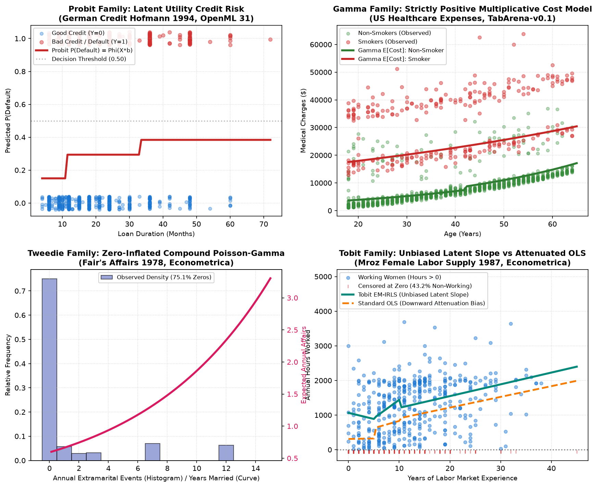
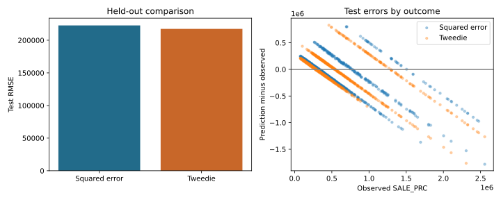

# Beyond mean squared error: choose a tree split for the outcome you have

A tree split chooses what patterns the model pays attention to. Squared error gives large absolute misses more weight. This can be a sensible choice when absolute errors matter. A different criterion can prioritize structure at different scales or account for how the target was observed.

We will fit two shallow trees on real Miami home sales and compare their held-out errors. This isolates the split criterion with the same tree size controls, feature list and mean-leaf setting.

## Get the data and fit both trees

Save the [OpenML Miami housing Parquet](https://www.openml.org/d/46942) to `datasets/miami_housing.parquet`. It has 13,776 sales and a positive sale-price target, `SALE_PRC`. The example selects five features directly related to the property. It samples 6,000 training and 2,000 test records after shuffling. For a market forecast, hold out later transactions, and consider holding out geographic areas as well.

Clone the repo, run `uv sync`, then run the code from the root.

```python
from statistics import mean

from examples.real_tree_studies import load, rows
from mltreelib import Metrics, ModelTree

df = load("miami_housing", 46942).sample(frac=1, random_state=2026)
features = ["LND_SQFOOT", "TOT_LVG_AREA", "age", "OCEAN_DIST", "structure_quality"]
train, test = df.iloc[:6000], df.iloc[6000:8000]
x_train, x_test = rows(train, features), rows(test, features)
y_train, y_test = train.SALE_PRC.tolist(), test.SALE_PRC.tolist()
metrics = Metrics()

print("mean baseline", metrics.regression(y_test, [mean(y_train)] * len(test))["rmse"])
for gain in ("sse", "tweedie"):
    tree = ModelTree(gain=gain, tweedie_p=1.5, leaf="mean",
                     max_depth=2, min_rows=40, prune="none")
    tree.fit(x_train, y_train, col_names=features)
    pred = tree.predict(x_test)
    print(gain, metrics.regression(y_test, pred)["rmse"], tree.splits()[0])
```

The Tweedie variance function increases with the mean as `mean ** p`. Here the value of `p` stays fixed at 1.5 to make the comparison reproducible. We compare both models on the same sale-price units using RMSE. If the decision calls for relative or deviance-based loss, choose that metric before fitting and compare both models again.

## What changed in the real example?

| Split or baseline | Test RMSE |
|---|---:|
| Training mean | 316,190 |
| Squared error | 222,710 |
| Tweedie deviance | 217,425 |

Tweedie splits reduced test RMSE by about 2.4% relative to squared-error splits in this run. Use a fresh split or paired resampling to assess how much this difference varies. Sale prices here are positive, so the comparison does not test the zero-mass use case.





Both models use mean leaves, so their scores are point estimates. A specialized split criterion does not change a point estimate into a probability distribution. The residual panel shows errors by observed sale price. Check large misses and their locations before choosing a model for pricing.

## When do you need a different objective?

| What the target records | Start with | Check on holdout |
|---|---|---|
| Numeric amount with absolute error costs | Squared error | RMSE, MAE and residuals by price range |
| Nonnegative amount with many genuine zeros and a positive tail | Tweedie deviance | Zero fraction, aggregate bias and calibration of the conditional mean |
| A measured value capped or floored by the collection process | Tobit under a defensible latent model | Boundary frequency and fit for uncensored outcomes |
| Time until event or end of follow-up | A survival tree | Censoring-aware scores at supported horizons |
| Similar means but changing spread across regimes | Heteroscedastic splitting | Test error and spread within each regime |

A zero claim, a reading floored by a sensor and an event censored by study end represent different observations. Clarify the observation process before choosing a loss. A Tobit claim depends on its latent distribution assumptions. A survival claim depends on follow-up and censoring assumptions.

```bash
uv run python examples/real_tree_studies.py housing
```

See the [split criteria example](../examples/distributional-split-criteria.md) for controlled cases and the [FLCHAIN survival pathway](../guides/survival.md) for censored follow-up. For a primary reference on Tweedie modeling, see [Dunn and Smyth (2005)](https://doi.org/10.1007/s11222-005-4070-y).
