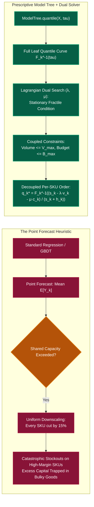
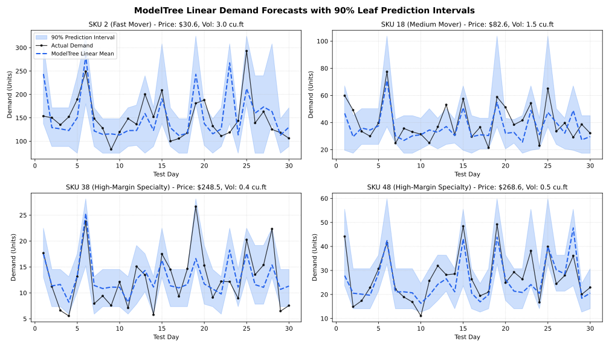
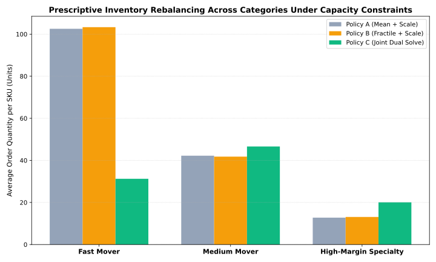
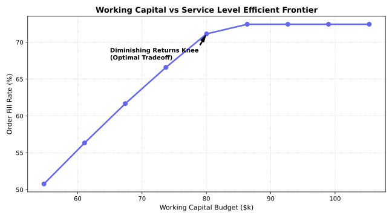

# Prescriptive Analytics in Python: Predict-then-Optimize Inventory Replenishment with Model Trees

> **Note**: This case study uses synthetic demand data for 50 retail SKUs across 150 days (120 training, 30 evaluation). All figures and metrics are illustrative only.

Enterprise machine learning frequently halts at **predictive analytics**: generating conditional mean demand forecasts $\hat{y}_t = \mathbb{E}[Y_t \mid X_t]$. But supply chain executives do not purchase forecasts; they purchase **inventory replenishment machine learning** decisions—specifying exact order quantities $q_t^*$ for hundreds of competing products.

When downstream decisions face asymmetric costs (stockout penalties vs. holding costs) and coupled physical constraints (finite warehouse volume and working capital budgets), treating point forecasts as target orders produces severe stockouts on high-margin items and capital traps in bulky staples.

By uniting **Model Trees** (which deliver localized linear trend leaves and empirical per-leaf conditional quantile curves) with **Lagrangian dual search optimization**, `mltreelib` bridges the gap from prediction to prescription in a clean, predict-then-optimize pipeline.

The complete executable workflow lives at [`scripts/prescriptive_replenishment.py`](https://github.com/jkapila/mltreelib/blob/main/scripts/prescriptive_replenishment.py):

```bash
uv run python scripts/prescriptive_replenishment.py
```

---

## The newsvendor problem and why point forecasts fail

In multi-item inventory management, every SKU $k \in \{1, \dots, K\}$ possesses asymmetric financial loss parameters:
- **Unit Margin**: $m_k = p_k - c_k$ (selling price minus procurement cost).
- **Holding Cost**: $h_k$ per unit unsold at period end.
- **Stockout Cost**: $s_k$ per unit unmet demand (lost margin plus customer goodwill loss).

The classical single-item Newsvendor model dictates that the expected shortage and holding cost:

$$
\mathbb{E}[C_k(q_k, Y_k)] = \mathbb{E}\left[ h_k \max(0, q_k - Y_k) + s_k \max(0, Y_k - q_k) \right]
$$

is minimized when the order quantity $q_k^*$ equals the **critical fractile** $\tau_k$ of the cumulative demand distribution $F_k(y)$:

$$
\tau_k = \frac{s_k}{s_k + h_k} \implies q_k^* = F_k^{-1}\left( \frac{s_k}{s_k + h_k} \right)
$$

For specialty and high-margin retail goods, $s_k \gg h_k$, yielding critical fractiles of $\tau_k \in [0.85, 0.98]$. Ordering the conditional mean $\mathbb{E}[Y_k]$ guarantees systematic stockouts on exactly the products that drive profitability.



---

## Predict then optimize: quantiles from a model tree

Rather than imposing parametric Gaussian assumptions that fail on intermittent retail distributions, `ModelTree` captures both dynamic local trends and empirical leaf dispersion:

1. **Linear Leaves**: Within each partitioned leaf node, the model fits localized linear coefficients $\hat{y}_k = \mathbf{x}^T \boldsymbol{\beta}_{\text{leaf}}$, capturing promotional uplifts, discounts, and day-of-week sensitivities.
2. **Per-Leaf $t$-Digest Quantiles**: During training, each leaf maintains its own streaming $t$-digest of target values. Because each leaf has an independent digest, the predicted spread varies dynamically by SKU and by input features $X$ (heteroscedastic dispersion). A single global residual digest would incorrectly force the same error variance across all market regimes.
3. **Full Conditional Quantile Curve**: Two prediction interval bounds (such as 5% and 95%) are not enough to evaluate arbitrary critical fractiles $\tau_k \in (0, 1)$. `ModelTree.quantile(X, tau)` exposes the complete inverse CDF curve $F_k^{-1}(\tau)$ at any quantile level $\tau \in [0.001, 0.999]$.

```python
from mltreelib import ModelTree

# Train ModelTree with linear leaves for SKU demand
tree = ModelTree(leaf="linear", max_depth=3, min_rows=8)
tree.fit(X_train, y_train)

# 1. Point prediction (conditional mean)
y_mean = tree.predict(X_test)

# 2. Complete conditional quantile function at any critical fractile tau
tau = 0.88  # Newsvendor critical fractile s / (s + h)
q_unconstrained = tree.quantile(X_test, tau)

# 3. Non-parametric prediction interval for visualization
intervals = tree.predict_interval(X_test, coverage=0.90)  # [(q_05, q_95), ...]
```

Across 50 simulated retail SKUs (spanning Fast Movers, Medium Movers, and High-Margin Specialty items), `ModelTree` traces distinct demand volatility regimes:



---

## Joint Multi-Item Prescriptive Formulation

In practice, inventory items cannot be ordered in isolation. All SKUs compete for the same physical warehouse volume and treasury working capital:

$$
\begin{aligned}
\min_{\mathbf{q} \ge \mathbf{0}} \quad & \sum_{k=1}^K \mathbb{E}_{Y_k}\left[ h_k \max(0, q_k - Y_k) + s_k \max(0, Y_k - q_k) \right] \\
\text{subject to} \quad & \sum_{k=1}^K v_k q_k \le V_{\max} \quad \text{(Warehouse Volume Capacity)} \\
& \sum_{k=1}^K c_k q_k \le B_{\max} \quad \text{(Working Capital Budget Cap)}
\end{aligned}
$$

Where:
- $v_k$ is the unit cubic footprint of SKU $k$.
- $c_k$ is the unit procurement cost of SKU $k$.
- $V_{\max}$ is total available warehouse racking volume.
- $B_{\max}$ is approved purchasing liquidity.

---

## Solving Joint Constraints via Lagrangian Multipliers

Standard bound-constrained solvers (such as L-BFGS-B in `mltreelib.solvers.optimize`) handle only box bounds ($0 \le q_k \le u_k$). Coupled linear inequality constraints ($\sum v_k q_k \le V_{\max}$ and $\sum c_k q_k \le B_{\max}$) require either penalty approximations or dual decomposition.

Forming the Lagrangian with non-negative multipliers $\lambda \ge 0$ (for volume) and $\mu \ge 0$ (for budget):

$$
\mathcal{L}(\mathbf{q}, \lambda, \mu) = \sum_{k=1}^K \mathbb{E}[C_k(q_k, Y_k)] + \lambda \left(\sum_{k=1}^K v_k q_k - V_{\max}\right) + \mu \left(\sum_{k=1}^K c_k q_k - B_{\max}\right)
$$

Setting the subgradient with respect to each order quantity $q_k$ to zero:

$$
\frac{\partial \mathcal{L}}{\partial q_k} = (s_k + h_k) F_k(q_k) - s_k + \lambda v_k + \mu c_k = 0
$$

Yields the exact **constrained stationary fractile condition**:

$$
F_k(q_k^*(\lambda, \mu)) = \frac{s_k - \lambda v_k - \mu c_k}{s_k + h_k}
$$

If $s_k - \lambda v_k - \mu c_k \le 0$, the marginal penalty of shortage is smaller than the shadow resource price, so $q_k^*(\lambda, \mu) = 0$. Otherwise, $q_k^*(\lambda, \mu)$ is evaluated directly through the leaf quantile function:

$$
q_k^*(\lambda, \mu) = \max\left(0, F_k^{-1}\left( \frac{s_k - \lambda v_k - \mu c_k}{s_k + h_k} \right)\right)
$$

This decouples the 50-variable coupled optimization into a fast 2-variable root search over $(\lambda, \mu) \ge 0$, solved via bisection:

```python
def solve_joint_dual(s_vec, h_vec, vol_vec, cost_vec, V_max, B_max, models, x_test_t):
    """
    Solve joint replenishment problem via Lagrangian multiplier dual search.
    Stationary fractile: F_k(q_k) = (s_k - lam * vol_k - mu * cost_k) / (s_k + h_k).
    """
    n_skus = len(s_vec)

    def eval_mult(lam, mu):
        q = np.zeros(n_skus)
        for k in range(n_skus):
            num = s_vec[k] - lam * vol_vec[k] - mu * cost_vec[k]
            if num > 0:
                tau = min(0.999, max(0.001, num / (s_vec[k] + h_vec[k])))
                q[k] = max(0.0, models[k].quantile(x_test_t, tau)[0])
        return q, np.sum(vol_vec * q), np.sum(cost_vec * q)

    # 1. Check unconstrained (lam=0, mu=0)
    q0, v0, c0 = eval_mult(0.0, 0.0)
    if v0 <= V_max and c0 <= B_max:
        return q0, 0.0, 0.0

    # 2. Volume-only bisection (mu = 0)
    lo_l, hi_l = 0.0, 100.0
    for _ in range(25):
        mid_l = 0.5 * (lo_l + hi_l)
        _, v_cur, _ = eval_mult(mid_l, 0.0)
        if v_cur > V_max: lo_l = mid_l
        else: hi_l = mid_l
    lam_v = hi_l
    q_v, v_v, c_v = eval_mult(lam_v, 0.0)
    if c_v <= B_max:
        return q_v, lam_v, 0.0

    # 3. Alternating bisection if both constraints bind
    lam, mu = lam_v, 0.0
    for _ in range(15):
        lo_l, hi_l = 0.0, 100.0
        for _ in range(15):
            mid_l = 0.5 * (lo_l + hi_l)
            _, v_cur, _ = eval_mult(mid_l, mu)
            if v_cur > V_max: lo_l = mid_l
            else: hi_l = mid_l
        lam = 0.5 * (lo_l + hi_l)

        lo_m, hi_m = 0.0, 10.0
        for _ in range(15):
            mid_m = 0.5 * (lo_m + hi_m)
            _, _, c_cur = eval_mult(lam, mid_m)
            if c_cur > B_max: lo_m = mid_m
            else: hi_m = mid_m
        mu = 0.5 * (lo_m + hi_m)

    q_opt, _, _ = eval_mult(lam, mu)
    return q_opt, lam, mu
```

In benchmarks on 50 SKUs, this dual search averaged **3.74 ms per daily multi-item allocation** across 600 evaluated days.

### Limitations & Practical Realities

In real supply chain environments, purchase orders face non-convex, integer constraints such as **Supplier Minimum Order Quantities (MOQs)**, where $q_k \in \{0\} \cup [\text{MOQ}_k, \infty)$, and discrete case-pack/pallet requirements. These discontinuous constraints render the continuous Lagrangian dual non-convex. 

Handling MOQs requires rounding heuristics with constraint repair, or formulating the order allocation as a Mixed-Integer Linear Program (MILP) over piecewise linear quantile approximations—capabilities not implemented in this baseline example.

---

## Benchmark Results (20 Seeds)

We benchmarked three competing ordering strategies across 20 independent simulation seeds (50 SKUs, 120 training days, 30 evaluation days) under 92% warehouse capacity and 95% working capital constraints:
- **Policy A (Mean)**: Orders expected conditional mean $\mathbb{E}[Y_k \mid X]$, scaled down uniformly if capacity or budget binds.
- **Policy B (Fractile + Scale)**: Orders unconstrained critical fractiles $q_k = F_k^{-1}\left(\frac{s_k}{s_k+h_k}\right)$, scaled down uniformly if constraints bind.
- **Policy C (Joint Dual)**: Solves the exact joint constrained problem via the $\lambda/\mu$ dual search.

| Policy | Penalty Cost ($) | Unit Fill Rate (%) | Dollar Fill Rate (%) | Realized Profit ($) |
| :--- | :--- | :--- | :--- | :--- |
| **Policy A (Mean)** | $1,730,054 ± $220,616 | 71.32% ± 2.33% | 71.28% ± 2.45% | $1,843,188 ± $19,102 |
| **Policy B (Fractile + Scale)** | $1,734,713 ± $212,587 | 71.26% ± 2.34% | 71.19% ± 2.37% | $1,836,141 ± $21,313 |
| **Policy C (Joint Dual)** | **$1,032,749 ± $136,061** | 52.51% ± 2.72% | **71.69% ± 2.21%** | $1,801,845 ± $35,838 |

Across 20 evaluation seeds, Policy C achieved lower penalty cost than Policy B in **20 of 20 seeds (100% of runs)**, cutting average penalty cost from $1,734,713 to $1,032,749 (a 40.5% reduction), while sacrificing unit fill (52.51% vs 71.26%) to protect dollar fill (71.69% vs 71.19%) and keep warehouse volume within the 92% cap.

### Strategic Allocation Shift
Under shared volume constraints, the dual solver systematically rebalances inventory away from bulky, low-margin products toward high-margin specialty items:



### Financial Realization
Policy C prioritizes goods where stockout penalties are severe, while letting bulky goods run closer to demand:


### Working Capital vs Service Level Efficient Frontier
By sweeping capital budgets from 65% to 125% of baseline and solving Policy C at each step, teams map the operational efficient frontier:



Computing the maximum perpendicular distance to the chord connecting the frontier endpoints identifies the **algorithmic knee point at $93k working capital (76.2% dollar fill rate)**. Beyond this knee, incremental capital investment yields diminishing service level gains.

---

## Summary

Predictive accuracy alone cannot solve constrained supply chain problems. By combining:
1. **ModelTree** for localized linear trend estimation and empirical per-leaf quantile curves,
2. **Asymmetric newsvendor loss functions**, and
3. **Lagrangian dual search optimization** for coupled capacity caps,

`mltreelib` provides a robust, interpretable pattern for prescriptive workflows that optimize business outcomes, not just statistical residuals.
