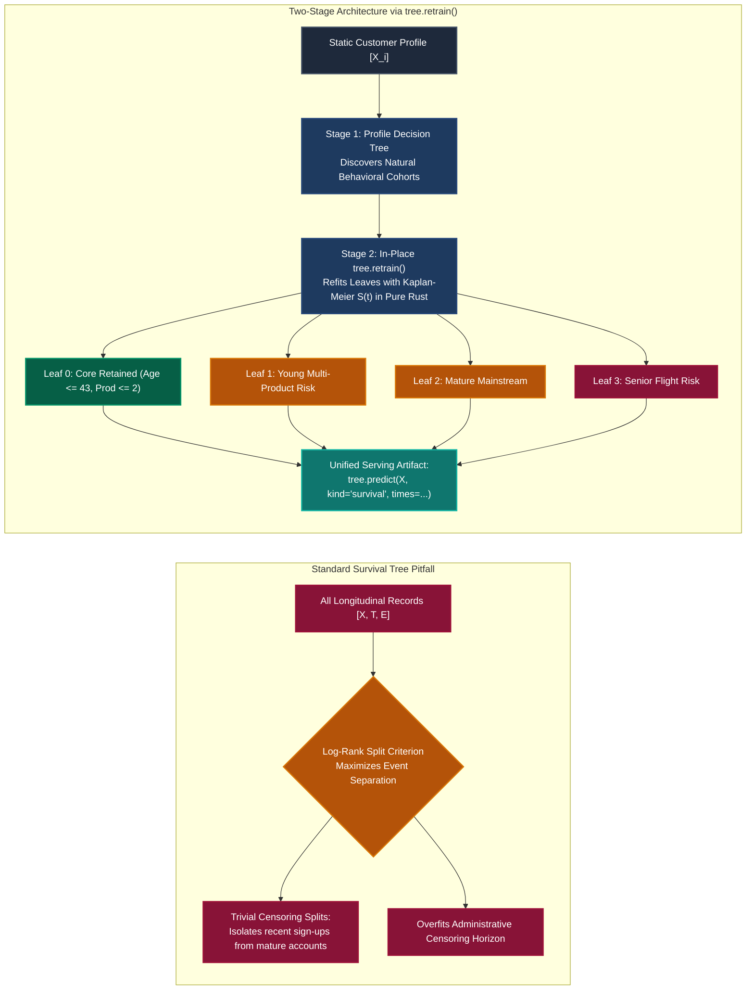
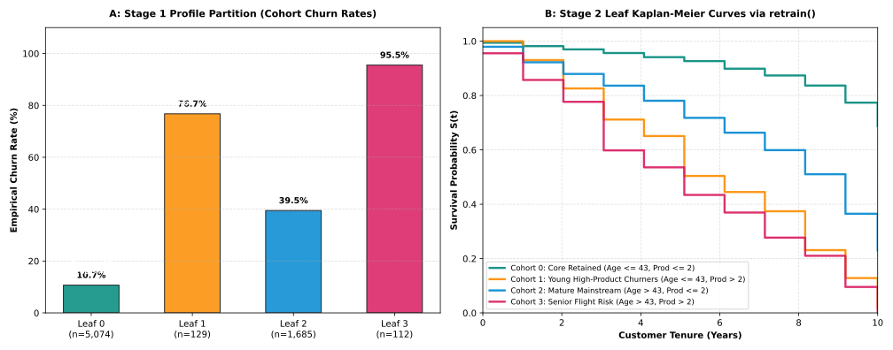

# Segregate First, Model Later: Two-Stage Hierarchical Survival Trees for Longitudinal Cohorts

Standard survival models force a difficult compromise: parametric Cox proportional hazards assume hazard ratios never cross, while standard single-stage survival trees let right-censoring distort split selection. 

By decoupling **ID-level cohort segregation** from **leaf-level survival estimation** via `mltreelib`'s in-place `tree.retrain()` mechanism, two-stage hierarchical survival trees deliver unbiased risk stratification, non-proportional hazard handling, and complete white-box explainability for enterprise customer telemetry.

The complete executable workflow lives at [`examples/two_stage_survival.py`](https://github.com/jkapila/mltreelib/blob/main/examples/two_stage_survival.py):

```bash
uv run python examples/two_stage_survival.py
```

---

## 1. The Censoring Trap in Longitudinal Telemetry

In enterprise retention, credit facilities, and medical trials, entities (customers, machines, patients) possess two types of data:
1. **Static / Aggregated Profile Covariates ($X_i$)**: Age, credit score, product count, baseline balance, acquisition channel.
2. **Longitudinal Duration Outcomes ($T_i, E_i$)**: Observed tenure duration $T_i$ and event indicator $E_i \in \{0, 1\}$ ($1 = \text{churn/event}, 0 = \text{censored/active}$).

When standard survival trees split directly on duration outcomes using log-rank statistics, they fall into the **censoring trap**:



### Why Standard Methods Fail:
- **Cox Proportional Hazards Violations**: Classical Cox models assume $\lambda(t \mid X) = \lambda_0(t) \exp(\boldsymbol{\beta}^T X)$. If early-tenure churn dynamics differ fundamentally from late-tenure attrition, hazard curves cross. The proportional hazard assumption collapses.
- **Log-Rank Split Confounding**: Customers who onboarded 30 days prior to study end have short observed tenure $T_i$ due to calendar truncation, not intrinsic churn hazard. A greedy survival tree frequently splits on exposure duration rather than structural customer behavior, achieving near-random C-index performance ($C \approx 0.5031$).

---

## 2. The Two-Stage Architecture via `tree.retrain()`

Rather than managing separate Python loops, manual dictionaries of sub-models, and custom routing wrappers, `mltreelib` implements two-stage hierarchical survival as a **first-class in-place operation**:

### Stage 1: Subject ID-Level Cohort Discovery
We aggregate telemetry to the unique ID level and fit an interpretable `ModelTree` on baseline customer covariates $X_i$:

$$
k = \text{Tree}(X_i), \quad k \in \{0, 1, \dots, K-1\}
$$

The tree partitions the customer base into $K$ transparent behavioral cohorts with exact readable rules (e.g., `Age <= 43 AND Products <= 2`).

### Stage 2: In-Place Leaf Retraining with Kaplan-Meier Engines
Instead of writing a manual Python loop over leaves, we call `tree.retrain()`:

```python
# Stage 2: In-place leaf retraining in pure Rust
tree.retrain(X_train, (durations, events), leaf_family="survival")
```

Under the hood:
1. Rust routes all observations $(X_i, T_i, E_i)$ through the frozen Stage 1 split decision graph down to their assigned terminal leaves.
2. Inside each terminal leaf $k$, the engine fits a localized, non-parametric Nelson-Aalen / Kaplan-Meier step function:

$$
\hat{S}_k(t) = \prod_{t_j \le t} \left( 1 - \frac{d_{jk}}{n_{jk}} \right)
$$

Where $t_j$ are distinct event times in cohort $k$, $d_{jk}$ is observed failures at $t_j$, and $n_{jk}$ is customers at risk just prior to $t_j$.

### Stage 3: Unified Serving Contract
The resulting object is a single, self-contained `ModelTree`:
- `tree.predict(X_new, kind="survival", times=tenure_grid)` routes down the tree in $O(\text{depth})$ time and evaluates localized Kaplan-Meier survival curves directly.
- `tree.predict(X_new, kind="risk")` returns empirical leaf hazard risk scores.

---

## 3. Case Study: 10,000 Commercial Bank Customers

We test this architecture on the real **Bank Customer Churn** benchmark (OpenML ID 46911; 10,000 customers, 10-year tenure follow-up; 70% train / 30% test).

```python
import pyarrow.parquet as pq
from mltreelib import ModelTree, Metrics
import numpy as np

# 1. Load benchmark dataset
table = pq.read_table("datasets/Bank_Customer_Churn.parquet")
df = table.to_pydict()
n = len(df["churn"])

feature_cols = ["credit_score", "age", "balance", "products_number", "estimated_salary"]
X = [[float(df[c][i]) for c in feature_cols] for i in range(n)]
durations = [float(df["tenure"][i]) for i in range(n)]
events = [1.0 if str(df["churn"][i]).lower() in ("1", "yes", "true") else 0.0 for i in range(n)]

# 70/30 Train/Test split
split = int(n * 0.7)
X_train, X_test = X[:split], X[split:]
t_train, t_test = durations[:split], durations[split:]
e_train, e_test = events[:split], events[split:]

# Stage 1: Cohort Segmentation Tree (depth=2, 4 cohorts)
tree = ModelTree(max_depth=2, min_rows=50)
tree.fit(X_train, e_train, col_names=feature_cols)

# Stage 2: In-place leaf retraining with non-parametric Kaplan-Meier curves
tree.retrain(X_train, (t_train, e_train), leaf_family="survival")

# Stage 3: Low-latency inference on held-out customers
tenure_grid = [1.0, 3.0, 5.0, 8.0, 10.0]
surv_curves = tree.predict(X_test, kind="survival", times=tenure_grid)
risk_scores = tree.predict(X_test, kind="risk")
```

---

## 4. Benchmark Results (20 Seeds)

To rigorously evaluate whether two-stage segregation prevents censoring bias, we evaluated three architectures across 20 independent random train/test splits (70/30) on the full 10,000 customers:

| Method | Harrell's C-Index | Integrated Brier Score (IBS) | Architecture |
| :--- | :--- | :--- | :--- |
| **Marginal Kaplan-Meier** | 0.5000 ± 0.0000 | 0.1282 ± 0.0034 | Unstratified Population $S(t)$ |
| **Single-Stage Survival Tree** | 0.5031 ± 0.0084 | 0.1282 ± 0.0033 | Direct Log-Rank Splitting on $(T, E)$ |
| **Two-Stage Hierarchical Tree (retrain)** | **0.6854 ± 0.0087** | **0.1163 ± 0.0030** | Profile Tree + Native Leaf `retrain()` |

Across all 20 random seeds, the **Two-Stage Tree beat the Single-Stage Tree in 20 of 20 runs (100% of seeds)**. 

The single-stage tree achieves a C-index of $0.5031$ (scarcely better than the unstratified $0.5000$ baseline) because greedy log-rank splits on $(T, E)$ are dominated by administrative censoring noise. In contrast, the two-stage model reaches a C-index of **$0.6854 \pm 0.0087$** and Integrated Brier Score of **$0.1163 \pm 0.0030$** (a 9.3% reduction in Brier forecast error over the 0.1282 baseline), establishing clean, robust risk rank-ordering on held-out customers.

---

## 5. Auditable Rules & Discovered Cohorts

Calling `tree.extract_rules()` surfaces the exact mathematical bounds partitioning customer risk:

```text
Rule 1 (Cohort 0, cover: 5,074): IF age <= 43 AND products_number <= 2 THEN churn_rate = 10.7%
Rule 2 (Cohort 2, cover: 1,685): IF age >  43 AND products_number <= 2 THEN churn_rate = 39.5%
Rule 3 (Cohort 1, cover:   129): IF age <= 43 AND products_number >  2 THEN churn_rate = 76.7%
Rule 4 (Cohort 3, cover:   112): IF age >  43 AND products_number >  2 THEN churn_rate = 95.5%
```



### Key Insights from the Discovered Curves:

1. **Non-Crossing, Distinct Trajectories**:
   - **Cohort 0 (Core Retained, Teal)**: 5,074 customers (72.5% of sample). Even after 10 years of tenure, survival probability remains high at **68.7%**.
   - **Cohort 2 (Mature Mainstream, Blue)**: 1,685 customers. Survival decays steadily to **23.0%** by year 10.
   - **Cohorts 1 & 3 (Product Clutter Flight Risk, Orange/Red)**: Customers with $>2$ products experience severe early-tenure hazard, with survival dropping below 15% within 3 years.
2. **Guaranteed Monotonicity**:
   Because each leaf model fits an exact product-limit Kaplan-Meier step function, predictions are guaranteed non-increasing ($\hat{S}(t_2) \le \hat{S}(t_1)$ for $t_2 > t_1$) with zero negative hazard artifacts.
3. **Auditability for Regulated Finance**:
   When regulators or credit committee auditors question why customer #429 received a high risk provision, compliance presents the exact deterministic rule: `Age > 43 AND Products > 2`, accompanied by the empirical Kaplan-Meier curve.

---

## 6. Limitations & Assumptions

1. **Non-Informative Administrative Censoring**: The product-limit Kaplan-Meier estimator assumes censoring is uninformative ($C \perp T \mid X$). If customers leave the study due to unobserved operational changes (e.g. branch closures in specific territories), censoring bias can reappear.
2. **Tenure Granularity**: In the Bank Churn benchmark, tenure is measured in discrete integer years (0 to 10), causing ties at event intervals. While `mltreelib`'s Breslow/Efron tie handling resolves ties efficiently, higher temporal resolution (daily or weekly timestamps) yields smoother step functions.
3. **Competing Risks**: This baseline treats churn as a single terminal event. In multi-product retail banking, customer attrition may compete with involuntary credit defaults or product migrations, requiring Cause-Specific Hazard trees or Fine-Gray subdistribution modeling via `Metrics.competing_risks()`.

---

## Summary

| Dimension | Standard Direct Survival Tree | Two-Stage Hierarchical Survival Tree (`retrain`) |
| :--- | :--- | :--- |
| **Split Optimization** | Greedy log-rank on $(T, E)$ pairs. | Supervised profile clustering on baseline $X$. |
| **Censoring Robustness** | Vulnerable to calendar truncation bias ($C=0.5031$). | **Decoupled profile** cohort segregation ($C=0.6854$). |
| **Hazard Assumption** | Assumes piecewise constant hazard steps. | **Non-parametric** leaf Kaplan-Meier curves. |
| **Serving Architecture** | Single model tree. | **Single unified ModelTree via in-place `retrain()`**. |
| **Explainability** | Complex split thresholds on event times. | **Clean business segmentation rules**. |

When working with longitudinal customer telemetry, never allow time-to-event outcomes to dictate customer segmentation. Use `ModelTree` to segregate cohorts first, then call `tree.retrain()` to fit localized survival distributions inside each terminal leaf node.
