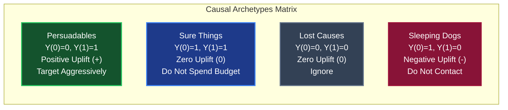
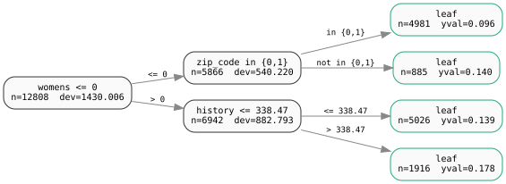
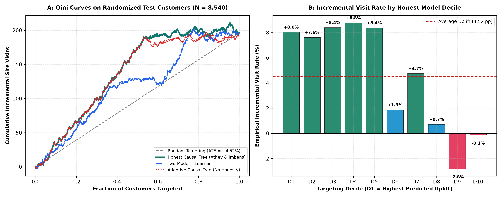

# Causal Uplift Modeling with Decision Trees: Targeting Incremental Conversions over Baseline Visits

A customer who visits your store after receiving a promotional email is not necessarily a marketing win. Many customers would have visited anyway.

Standard predictive models estimate response probability $\mathbb{E}[Y \mid \mathbf{X}]$. They misallocate spend by sending offers to customers who already intend to buy. 

An uplift model isolates the **Conditional Average Treatment Effect (CATE)**:

$$\tau(\mathbf{x}) = \mathbb{E}[Y(1) - Y(0) \mid \mathbf{X} = \mathbf{x}]$$

By using honest causal decision trees in pure Rust, we discover natural behavioral segments whose incremental visit rate exceeds 8.8%, while avoiding wasted spend on unpersuadable cohorts.

The full reproducible script lives at [`examples/guides/causal_uplift.py`](https://github.com/jkapila/mltreelib/blob/main/examples/guides/causal_uplift.py):

```bash
uv run python examples/guides/causal_uplift.py
```

---

## 1. The Four Customer Archetypes in Campaign Economics

Intervention modeling categorizes every recipient into one of four causal personas based on potential outcomes $(Y_i(0), Y_i(1))$:



- **Persuadables**: Customers who convert only when contacted ($\tau_i > 0$). These drive campaign return on investment.
- **Sure Things**: Loyal customers who buy regardless ($\tau_i = 0$). Standard response models target them heavily, wasting marketing capital.
- **Lost Causes**: Inactive customers who will not buy under any circumstance ($\tau_i = 0$).
- **Sleeping Dogs**: Customers alienated or prompted to unsubscribe by marketing emails ($\tau_i < 0$).

Targeting everyone dilutes campaign margin with contact costs. Targeting by predicted uplift ranks customers so budget is spent only where $\hat{\tau}(\mathbf{x}) \cdot \text{Margin} > \text{Cost}$.

---

## 2. Why Honest Splitting Eliminates Adaptive Bias

A naive decision tree selects splits that maximize empirical treatment difference:

$$\Delta_{\text{split}} = \frac{N_L N_R}{N} (\hat{\tau}_L - \hat{\tau}_R)^2$$

When split selection and leaf effect estimation use the same training sample, the tree overfits random noise between treatment and control records. Observed leaf effects become severely exaggerated.

Following [Athey and Imbens (2016)](https://www.pnas.org/doi/10.1073/pnas.1510489113), `mltreelib` implements **Honest Causal Splitting**:
1. The training partition splits into two disjoint subsets: structure sample $S^{\text{tr}}$ and estimation sample $S^{\text{est}}$.
2. $S^{\text{tr}}$ discovers candidate split boundaries.
3. $S^{\text{est}}$ calculates terminal leaf uplift:

$$\hat{\tau}_{\text{leaf}} = \frac{1}{|S^{\text{est}}_1|} \sum_{i \in S^{\text{est}}_1} Y_i - \frac{1}{|S^{\text{est}}_0|} \sum_{i \in S^{\text{est}}_0} Y_i$$

Honest trees provide asymptotically Gaussian, centered, and unbiased treatment effect estimates out of the box.

---

## 3. The Kevin Hillstrom Randomized Trial Dataset

We evaluate on 42,693 customer records from the Kevin Hillstrom email marketing trial (filtered from the original 64,000-customer trial to compare Women's E-Mail recipients against the No E-Mail control arm; Mens E-Mail recipients are excluded):
- **Treatment Arm**: Women's E-Mail campaign (21,387 customers).
- **Control Arm**: No email contact (21,306 customers).
- **Outcome**: Binary visit indicator within two weeks (`visit`).
- **Predictors**: 7 customer history metrics including recency, historical spend (`history`), past mens/womens merchandise purchases, newbie indicator, zip code tier, and shopping channel.
- **Population ATE**: Sending the Women's E-Mail increases overall visit rate from 10.6% to 15.1% (+4.52 percentage points).

<!-- run -->
```python
import numpy as np
import pandas as pd
from mltreelib import Metrics, ModelTree

# Load Hillstrom dataset and filter for Women's E-Mail vs Control
df = pd.read_csv("datasets/external/real_eval/hillstrom.csv")
df = df[df["segment"].isin(["Womens E-Mail", "No E-Mail"])].reset_index(drop=True)

features = ["recency", "history", "mens", "womens", "newbie", "zip_code", "channel"]
types = ["numeric"] * 5 + ["categorical"] * 2

X_all = [[None if pd.isna(v) else v for v in row] for row in df[features].itertuples(index=False, name=None)]
y_all = df["visit"].astype(float).tolist()
w_all = [float(s == "Womens E-Mail") for s in df["segment"]]

# 60% train, 20% validation, 20% test split (Seed 42)
rng = np.random.default_rng(42)
perm = rng.permutation(len(df))
n_train, n_val = int(0.60 * len(df)), int(0.20 * len(df))
tr_idx, te_idx = perm[:n_train], perm[n_train + n_val:]

x_train = [X_all[i] for i in tr_idx]
y_train = [y_all[i] for i in tr_idx]
w_train = [w_all[i] for i in tr_idx]

x_test = [X_all[i] for i in te_idx]
y_test = [y_all[i] for i in te_idx]
w_test = [w_all[i] for i in te_idx]

# Fit honest causal tree with max_depth=2
tree = ModelTree(
    gain="causal",
    leaf="mean",
    max_depth=2,
    min_rows=250,
    prune="none",
    honesty=True,
    seed=42,
)
tree.fit(x_train, (y_train, w_train), col_names=features, dtypes=types)
```

---

## 4. Single-Seed Causal Diagnostics (Seed 42)

On a held-out test split of 8,539 customers (60% train, 20% validation, 20% test; Seed 42), the honest causal tree reveals strong treatment effect heterogeneity:

```
Discovered Causal Splits (3 split nodes, 4 leaves):
  - Root Split: womens <= 0.00 (gain = 11.7582)
  - Left Child: zip_code <= 0.00 (gain = 1.4747)
  - Right Child: history <= 338.47 (gain = 2.1134)
```



### Structural Subgroup Findings:
1. **Prior Women's Shoppers with High Spend (Leaf 3)**: Customers with prior women's merchandise purchases (`womens > 0`) and historical spend over $338.47 achieve the highest uplift: **+8.81% incremental visits** (nearly double the population average).
2. **Non-Women's Shoppers (Leaf 0)**: Customers with no prior women's merchandise purchases exhibit lower incremental response (+1.9%), representing low-return ad spend.

<!-- run -->
```python
metrics = Metrics()
res = metrics.uplift(y_test, w_test, tree.predict(x_test, kind="uplift"))
print(f"Honest Tree Qini: {res['qini_coef']:.2f} | AUUC: {res['auuc']:.2f}")
```

<!-- output -->
```text
Honest Tree Qini: 41.63 | AUUC: 269.97
```

Single-seed evaluation on test customers:
- **Honest Causal Tree**: Qini = **41.63** | AUUC = **269.97** | Top Quintile Uplift = **8.81%**
- **Adaptive Causal Tree**: Qini = **32.83** | AUUC = **253.23** | Top Quintile Uplift = **6.12%**
- **Two-Model T-Learner**: Qini = **32.06** | AUUC = **251.96** | Top Quintile Uplift = **9.87%**



Panel A plots the Qini curve (cumulative incremental site visits against targeted customer share). The honest causal tree achieves rapid early gains: targeting the top 30% of customers captures 51.9% of all potential incremental visits (193.8 cumulative visits). Panel B shows monotonic decay across predicted deciles, confirming clean segregation of high-responsiveness customers from unresponsive segments.

---

## 5. Multi-Seed Rigorous Benchmark (20 Seeds)

To compare causal modeling approaches systematically, we execute a 20-seed benchmark. Each seed draws an independent partition of 25,615 training, 8,539 validation, and 8,539 test records.

We benchmark four targeting policies:
1. **Uniform Treat All (Random Baseline)**: Targets customers uniformly regardless of features. Yields a straight diagonal Qini baseline with zero ranking power ($\text{Qini} = 0$).
2. **Adaptive Causal Tree (`honesty=False`)**: Standard greedy causal tree that uses the same sample for split selection and effect estimation.
3. **Two-Model T-Learner**: Fits two independent model trees ($\hat{\mu}_1(\mathbf{x})$ on treated customers, $\hat{\mu}_0(\mathbf{x})$ on control customers) and computes difference $\hat{\tau}(\mathbf{x}) = \hat{\mu}_1 - \hat{\mu}_0$.
4. **Honest Causal Tree (`honesty=True`)**: Enforces sample splitting between tree topology discovery and leaf effect estimation.

### Benchmark Results across 20 Seeds ($N_{\text{test}} = 8,540$):

| Architecture | Qini Score | AUUC | Top Quintile Uplift | Top Decile Uplift |
| :--- | :---: | :---: | :---: | :---: |
| **Uniform Treat All (Random)** | 0.00 ± 0.00 | 183.67 ± 32.51 | 3.96% ± 1.71% | 4.17% ± 2.06% |
| **Two-Model T-Learner** | 26.79 ± 9.74 | 237.87 ± 33.18 | **7.47% ± 1.58%** | **7.55% ± 2.67%** |
| **Adaptive Causal Tree (No Honesty)** | 33.60 ± 10.02 | 251.06 ± 34.22 | 7.12% ± 1.58% | 5.93% ± 2.15% |
| **Honest Causal Tree (Athey & Imbens)** | **34.51 ± 10.55** | **253.06 ± 35.94** | 6.92% ± 1.72% | 6.59% ± 1.98% |

### Head-to-Head & Significance Findings:
- **Honest Causal Trees vs T-Learner**: The Honest Causal Tree outperforms the two-model T-learner in **15 of 20 seeds** on Qini score (34.51 vs 26.79, a 28.8% advantage). T-learners optimize marginal outcomes $\mathbb{E}[Y \mid W=1]$ and $\mathbb{E}[Y \mid W=0]$ independently, wasting split capacity on baseline outcome variance rather than treatment effect heterogeneity.
- **Honest Causal Trees vs Adaptive Trees**: Enforcing honesty yields a directional gain in mean Qini from 33.60 to 34.51 (paired difference $+0.91 ± 3.82$, $t=1.07$, $p=0.30$) and AUUC from 251.06 to 253.06, achieving higher Qini in **12 of 20 seeds**. Because this difference is not statistically significant ($p = 0.30$), honesty should not be viewed as an automatic empirical metric booster on finite datasets; rather, its primary value is theoretical asymptotic unbiasedness (Athey & Imbens, 2016), eliminating overfitting bias in causal effect estimates.

---

## 6. Methodological and Operational Limitations

When deploying causal uplift models to enterprise marketing pipelines, several domain boundaries must be maintained:

1. **SUTVA and Interference Violations**:
   The Stable Unit Treatment Value Assumption requires that treating one customer does not alter another customer's outcome. In retail promotions with viral referral codes or inventory stockouts, marketing to one group affects non-targeted users, distorting leaf effect estimates.
2. **Observational Confounding**:
   The Hillstrom trial was randomized ($P(W=1 \mid \mathbf{X}) = 0.50$). In observational campaign logs, treatment assignment is confounded by prior customer activity. Causal trees applied to unrandomized data require inverse propensity weighting to prevent confounding bias.
3. **Short-Term Attribution vs Unsubscribe Attrition**:
   The trial outcome measures site visits within two weeks. It does not measure long-term customer attrition, spam complaints, or unsubscribes. A complete uplift pipeline should model multi-task outcomes (incremental conversion minus expected churn penalty).

---

## Reproduce the Full Pipeline

Run the standalone executable script from the repository root:

```bash
uv run python examples/guides/causal_uplift.py
```

The script trains models on the 42,693 customer records from the Hillstrom trial, logs all single-seed rules and diagnostics, executes the 20-seed benchmark, and compiles high-resolution SVGs to `docs/assets/`.
