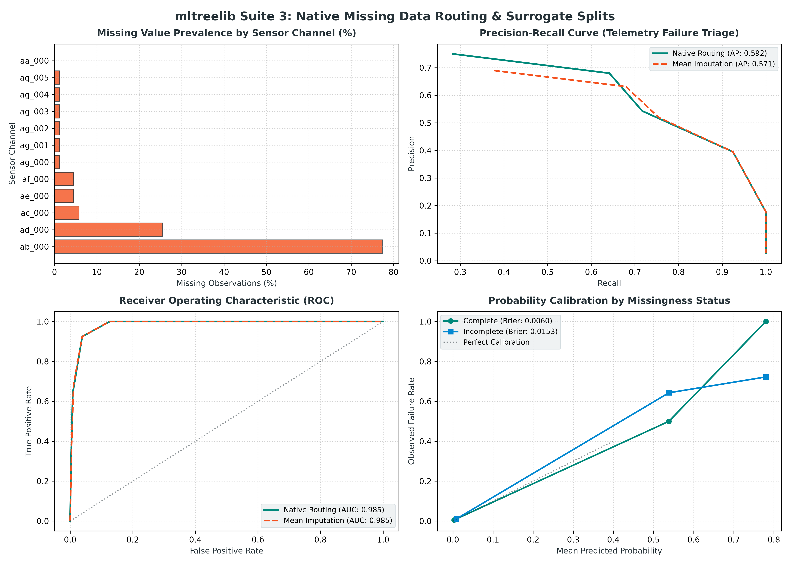
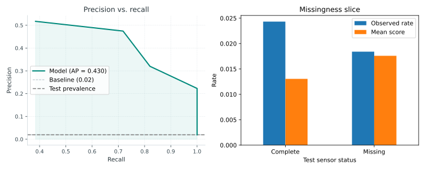

# How do decision trees handle missing sensor values? A real truck failure example

A missing sensor reading leaves two questions. Can the tree still score the record? Does the resulting score work for the same review decision? We can answer both with labeled, held-out sensor records.

This tutorial uses Scania's air pressure system (APS) failure data. It predicts whether a failure concerns the air pressure system using the available measurements. The label describes the relevant failure component. The table does not give the hours until failure, so this case evaluates diagnostic triage.

## Get the sensor data and audit missingness

Save the [OpenML APSFailure Parquet](https://www.openml.org/d/46908) to `datasets/APSFailure.parquet`. The [UCI source](https://archive.ics.uci.edu/dataset/421/aps+failure+at+scania+trucks) describes the sensor measurements and component labels. The TabArena version has 76,000 records. Use a fixed 12-feature subset and 12,000 sampled rows for this tutorial. The original task supplies a train/test split and a cost scheme. This example uses its own seeded split and illustrative costs.

Clone the repo and run `uv sync`. Run the following code from its root. The loader preserves missing values by converting pandas missing sentinels to Python `None`. The model receives the unfilled sensor readings.

## Fit a tree and audit its review queue

```python
from examples.real_tree_studies import load, rows
from mltreelib import Metrics, ModelTree

df = load("APSFailure", 46908).sample(frac=1, random_state=2026).iloc[:12000]
features = ["aa_000", "ab_000", "ac_000", "ad_000", "ae_000", "af_000",
            "ag_000", "ag_001", "ag_002", "ag_003", "ag_004", "ag_005"]
train, val, test = df.iloc[:8000], df.iloc[8000:10000], df.iloc[10000:]
target = "AirPressureSystemFailure"
print(train[features].isna().sum())

def labels(frame):
    return (frame[target] == "pos").astype(int).tolist()

tree = ModelTree(leaf="mean", leaf_family="binomial", gain="deviance",
                 max_depth=3, min_rows=100, prune="none")
tree.fit(rows(train, features), labels(train), col_names=features,
         dtypes=["numeric"] * len(features))
val_scores = tree.predict_proba(rows(val, features))

def cost(cutoff):
    return sum(5 if y and p < cutoff else 1 if not y and p >= cutoff else 0
               for y, p in zip(labels(val), val_scores))

cutoff = min([.02, .05, .10, .20, .40, 1.01], key=cost)
scores = tree.predict_proba(rows(test, features))
predicted = [int(score >= cutoff) for score in scores]
print(cutoff, Metrics().classification(labels(test), predicted)["confusion"])
print(tree.splits()[0])
```

When a split feature is absent, the tree can use its missing route. The named split includes `missing_left`. The feature names here are anonymized. Keep those names in the output and ask the data owner for a mapping before making a mechanical interpretation.

## What did the tree find on the holdout?

The `ab_000` channel was missing on 6,181 of 8,000 training rows. All 2,000 test records received scores. The validation-selected threshold was 0.10. The test queue contained 59 records, including 28 of the 39 positive cases. That is 47% precision and 72% recall. Average precision was 0.430, alongside 1.95% test prevalence.





The right panel separates records with all selected sensor values from records with at least one missing value. The groups contain 370 and 1,630 observations with 9 and 30 positives, respectively. The mean score was 1.31% for complete rows, compared with 2.43% observed. The missing group had a mean score of 1.76% and an observed rate of 1.84%. Small event counts make these slice averages noisy. Review score bins, false alerts and missed events on a larger recent sample before changing alert policy.

## How should you test this on a new fleet?

Record missingness by channel, truck and time window. Split by truck and date if those keys exist. If telemetry stops preferentially during particular operations, include those operating states in the evaluation. Compare the same tree against a training-only imputation baseline and an existing triage rule on identical records. The current comparison uses a constant probability baseline, which tests ranking and score quality but cannot isolate the effect of native missing routing.

```bash
uv run python examples/real_tree_studies.py aps
```

See the [missing-routing example](../examples/missing-routing.md) for a controlled check of individual routing paths.
