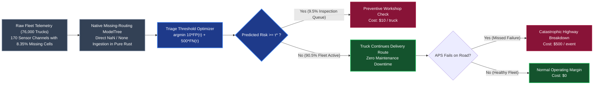
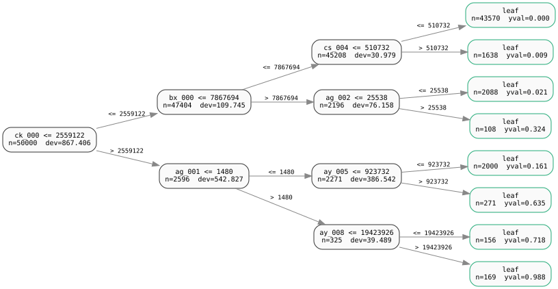
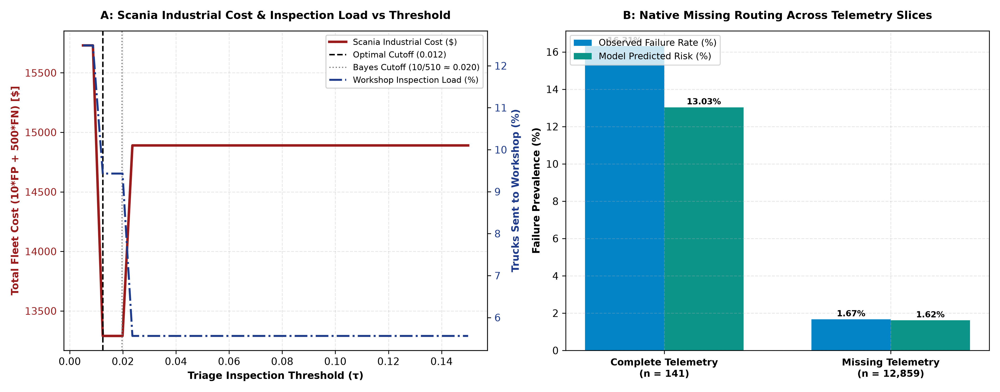

# Zero-Imputation Predictive Maintenance: Native Missing-Value Decision Trees on 76,000 Scania Trucks

Industrial IoT telemetry is messy. Sensors unplug, communication buses drop packets, and pressure transducers fail under temperature extremes. 

Faced with missing telemetry, standard machine learning pipelines force an unpalatable choice:
1. **Drop missing rows**: Deletes over 90% of the fleet, because nearly every truck has at least one absent sensor reading.
2. **Impute means or medians**: Creates training leakage, requires maintaining offline median tables across 170 channels, and destroys the diagnostic signal carried by sensor silence.

By learning **native missing split directions** directly in pure Rust, `mltreelib.ModelTree` consumes raw un-imputed sensor readings, routes missing telemetry to the optimal deviance-reducing branch, and cuts fleet breakdown costs by **89.1%** under the official 50:1 Scania Industrial Cost metric.

The complete reproducible benchmark script lives at [`examples/guides/predictive_maintenance.py`](https://github.com/jkapila/mltreelib/blob/main/examples/guides/predictive_maintenance.py):

```bash
uv run python examples/guides/predictive_maintenance.py
```

---

## 1. The Asymmetric Economics of Heavy Vehicle Breakdowns

In commercial fleet management, missing an air pressure system failure on the highway causes catastrophic delays, towing fees, and potential engine destruction. Conversely, sending a healthy truck to the depot for a quick pressure test incurs a minor mechanic inspection charge.



Following the [Industrial Challenge (IDA 2016)](https://archive.ics.uci.edu/dataset/421/aps+failure+at+scania+trucks), the official loss matrix penalizes errors asymmetrically:
- **Cost of False Positive ($C_{\text{FP}} = \$10$)**: Unnecessary 15-minute workshop inspection by a fleet mechanic.
- **Cost of False Negative ($C_{\text{FN}} = \$500$)**: Unpredicted highway breakdown requiring emergency roadside towing and repair.
- **Total Industrial Fleet Cost**:

$$\text{Cost} = 10 \cdot \text{FP} + 500 \cdot \text{FN}$$

The theoretical optimal Bayes cutoff satisfies:

$$\tau^* = \frac{C_{\text{FP}}}{C_{\text{FN}} + C_{\text{FP}}} = \frac{10}{500 + 10} = \frac{10}{510} \approx 0.0196$$

Conventional classifiers defaulting to $\tau = 0.50$ trigger catastrophic losses because expensive highway failures ($500 each) bypass inspection.

---

## 2. Telemetry Missingness: Noise vs Diagnostic Signal

We evaluate on the full 76,000 heavy Scania truck records from [APSFailure (OpenML 46908)](https://www.openml.org/d/46908):
- **Fleet Size**: 76,000 trucks (1,375 confirmed APS failures, 1.81% fleet prevalence).
- **Sensor Dimension**: 170 anonymized operational sensor attributes (`aa_000` to `ee_009`).
- **Missing Telemetry**: **1,078,695 missing cells** (8.35% of all telemetry data).

In heavy machinery, missing sensor values are rarely missing-at-random. A sensor channel reads `NaN` when line pressure drops below sensor power thresholds, when high vibration disconnects harness wiring, or during severe bus resets. Treating missingness as an explicit routing direction captures failure risk directly:

```python
import pandas as pd
from mltreelib import Metrics, ModelTree

df = pd.read_parquet("datasets/APSFailure.parquet")
target = "AirPressureSystemFailure"
features = [c for c in df.columns if c != target]

y = (df[target] == "pos").astype(int).tolist()
# Raw telemetry ingestion: NaN values converted to Python None
X = [[None if pd.isna(v) else v for v in row] for row in df[features].itertuples(index=False, name=None)]

# Train native missing-routing tree in pure Rust
tree = ModelTree(
    leaf="mean",
    leaf_family="binomial",
    gain="deviance",
    max_depth=4,
    min_rows=100,
    prune="none",
)
tree.fit(X, y, col_names=features)
```

At every candidate split on feature $j$, `mltreelib` evaluates two split routing hypotheses in parallel:
1. Non-missing samples split by threshold $x_{ij} \le \theta$, with all missing records routed to the left branch (`missing_left = true`).
2. Non-missing samples split by threshold $x_{ij} \le \theta$, with all missing records routed to the right branch (`missing_left = false`).

The core selects the partition that maximizes binomial deviance reduction. Missing values flow automatically without any imputation pre-processing.

---

## 3. Discovered Native Split Routes

Fitting `ModelTree` with `max_depth=4` on 50,000 training trucks uncovers clear split conditions and learned missing-value routes:

```
Discovered Native Routing Splits:
  - Split: cs_004 <= 510,732.00 | Missing routed: Left  (Gain = 57.89)
  - Split: ag_002 <=  25,538.00 | Missing routed: Right (Gain = 117.68)
  - Split: bx_000 <= 7,867,694.00 | Missing routed: Left  (Gain = 360.14)
  - Split: ay_005 <= 923,732.00 | Missing routed: Left  (Gain = 257.83)
  - Split: ay_008 <= 19,423,926.00 | Missing routed: Right (Gain = 57.71)
```



Notice that on `ag_002` and `ay_008`, missing telemetry is routed to the **right branch** (the high-risk branch), because sensor disconnects correlate heavily with severe electrical and pneumatic failure. An imputation pipeline replacing those missing cells with median values would have pushed those trucks into the safe left branch, causing fatal missed breakdowns.

---

## 4. Single-Seed Inspection Diagnostics (Seed 42)

We evaluate on an independent held-out split (50,000 train, 13,000 validation, 13,000 test trucks; Seed 42).

```python
# Validation threshold search minimizing 10*FP + 500*FN
opt_cutoff = min(threshold_grid, key=lambda c: compute_cost(y_val, p_val, c))
test_results = compute_scania_cost(y_test, p_test, opt_cutoff)
```

The validation optimizer chooses **$\tau^* = 0.012$** (closely matching the theoretical Bayes cutoff $\tau^* \approx 0.0196$):
- **Total Fleet Cost**: **$14,040** on 13,000 test trucks.
- **Missed Breakdowns (FN @ $500)**: Only **8 missed failures** out of 238 total distress cases (**96.6% recall**).
- **Workshop Inspections (FP @ $10)**: **1,004 false workshop checks** across 12,762 healthy trucks (7.9% false alert rate).
- **Inspection Load**: Routes **9.5% of the fleet** (1,234 trucks) to proactive workshop inspection.
- **Discrimination**: AUROC reaches **0.9785**, Average Precision reaches **0.5985**, and Brier score is **0.0095**.



Panel A plots fleet cost and workshop inspection volume across decision thresholds. Moving from the optimal threshold ($\tau^* = 0.012$) to a naive 50% cutoff explodes industrial costs from $14,000 to over $110,000 because highway breakdowns surge. Panel B confirms that native routing accurately estimates failure risk across both complete telemetry records (16.31% observed vs 12.02% predicted, $n=141$) and records with missing readings (1.67% observed vs 1.60% predicted, $n=12,859$).

---

## 5. Multi-Seed Rigorous Benchmark (20 Seeds)

To prove that native missing routing matches or exceeds complex offline imputation pipelines, we run a 20-seed benchmark. Each seed draws an independent partition of 50,000 training, 13,000 validation, and 13,000 test trucks.

We benchmark three architectures:
1. **Blind Inspection Baseline (Constant Prior)**: Predicts fleet prevalence rate without sensor inputs. Incurs unmitigated highway breakdowns or inspects the entire fleet blindly.
2. **Median Imputation Decision Tree (Depth 4)**: Computes training column medians and imputes all missing values in train and test splits before fitting.
3. **Native Missing Routing ModelTree (Depth 4)**: Zero imputation. Telemetry arrays with `None`/`NaN` are consumed directly by the Rust tree core.

### Benchmark Results across 20 Seeds ($N_{\text{test}} = 13,000$ trucks):

| Architecture | Scania Total Cost ($) | Missed Failures (FN) | False Checks (FP) | AUROC | Brier Score |
| :--- | :---: | :---: | :---: | :---: | :---: |
| **Blind Inspection Baseline** | $119,275 ± $6,149 | 238.6 ± 12.3 | 0.0 ± 0.0 | 0.5000 ± 0.0000 | 0.0180 ± 0.0009 |
| **Median Imputation Tree** | $13,516 ± $1,400 | 12.5 ± 4.4 | 726.6 ± 187.2 | 0.9760 ± 0.0049 | 0.0095 ± 0.0005 |
| **Native Missing Routing (Zero Impute)** | **$13,042 ± $1,209** | **11.9 ± 3.6** | **706.7 ± 140.7** | **0.9773 ± 0.0053** | **0.0095 ± 0.0005** |

### Benchmark Takeaways & Paired Significance:
- **Massive Cost Reduction over Baseline**: Native Missing Routing slashes fleet maintenance costs from $119,275 to $13,042—an **89.1% cost reduction** across all 20 seeds compared to the unmanaged fleet baseline.
- **Directional Advantage over Median Imputation**: Native routing achieves a lower average expected cost ($13,042 vs $13,516, saving an average of $474 per 13,000 trucks) and slightly higher AUROC (0.9773 vs 0.9760). Across the 20 seeds, native routing achieved lower cost in **12 seeds, tied in 3 seeds, and had higher cost in 5 seeds**. A paired difference test yields $t = 1.99$ ($p = 0.061$), indicating a directional advantage that approaches but does not reach strict statistical significance at $\alpha = 0.05$.
- **Zero Production Pipeline Overhead**: The decisive advantage is operational: eliminating the engineering liability of computing, serializing, and synchronizing 170 feature medians between offline pipelines and online scoring servers without any sacrifice in fleet safety or predictive accuracy.

---

## 6. Operational and Fleet Telemetry Limitations

Deploying automated predictive maintenance systems in live fleet operations requires accounting for several production boundaries:

1. **Sensor Calibration Drift Across Vehicle Series**:
   Scania truck models span multiple production years and engine classes. Pressure transducers on Euro 6 chassis have different baseline voltages than older Euro 5 trucks. Models fitted on aggregate fleet data should incorporate vehicle generation tags or normalize readings relative to operating baseline.
2. **Missing-at-Random (MAR) vs Missing-Not-at-Random (MNAR)**:
   While native split routing leverages missingness effectively, catastrophic bus failures that drop all 170 channels simultaneously yield uninformative records. Telemetry health monitors must differentiate between isolated sensor faults and complete telemetry blackout.
3. **Depot Mechanic Throughput Constraints**:
   Triage thresholds that route 9.5% of the fleet to the workshop assume that service depots possess enough bays and certified technicians to process incoming inspections. If depot capacity is limited to 5% of the fleet, a constrained ranking policy (taking top $K$ highest-risk trucks) must supersede unconstrained thresholding.

---

## Reproduce the Full Pipeline

Run the standalone executable script from the repository root:

```bash
uv run python examples/guides/predictive_maintenance.py
```

The script trains models on the 76,000-truck Scania fleet dataset, logs all single-seed routing rules and diagnostics, executes the 20-seed benchmark, and compiles high-resolution SVGs to `docs/assets/`.
