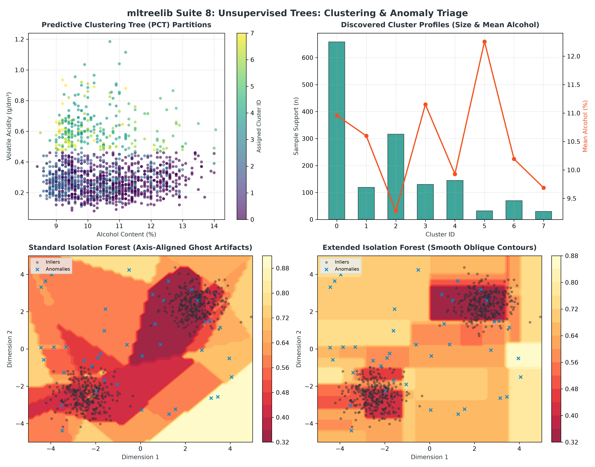
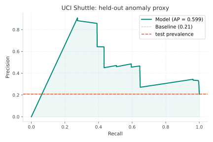

# Anomaly trees: Extended Isolation Forest and friends

Review budgets are limited, so an anomaly model must rank true failures into the top 1% to 5% of a triage queue. Standard isolation forests cut on one feature at a time, which leaves coordinate-axis "ghost" artifacts. `AnomalyModel` is the single entry point for tree-based anomaly detection. Pick the engine with `kind`:

- `kind="eif"`: Extended Isolation Forest with random oblique hyperplanes.
- `kind="det"`: density estimation tree (piecewise density).
- `kind="hst"`: half-space trees for streaming data.
- `kind="rct"`: random cut trees.

For a task-first walkthrough on real telemetry, see [Anomaly detection in Python](../guides/anomaly.md). To find segments instead, see [Clustering trees](clustering-trees.md).

Script: [`benchmarks/suites/unsupervised_trees.py`](https://github.com/jkapila/mltreelib/blob/main/benchmarks/suites/unsupervised_trees.py).

---

## 1. Mechanics

### Extended Isolation Forest with oblique cuts
Standard Isolation Forests isolate points by picking a random feature $j$ and a random threshold $\theta \in [\min x_j, \max x_j]$. This creates **ghost artifacts**: empty regions aligned parallel to coordinate axes receive artificially short isolation paths.

Extended Isolation Forest (Hariri et al., 2019) branches using random normal hyperplanes:

$$(\mathbf{x} - \mathbf{p})^T \mathbf{n} \le 0$$

- $\mathbf{p} \sim \text{Uniform}(\min \mathbf{X}, \max \mathbf{X})$: A random pivot point in the bounding box.
- $\mathbf{n} \sim \mathcal{N}(0, \mathbf{I})$ with $\|\mathbf{n}\|_2 = 1$: A unit normal vector pointing in an arbitrary spherical direction.

The anomaly score for sample $\mathbf{x}$ across $T$ trees is:

$$s(\mathbf{x}, n) = 2^{-\frac{\mathbb{E}[h(\mathbf{x})]}{c(n)}}$$

where $h(\mathbf{x})$ is the observed isolation tree depth, and $c(n) = 2 \ln(n - 1) + 0.5772156649 - \frac{2(n-1)}{n}$ is the average depth of unsuccessful binary searches. An anomaly score $s \to 1.0$ indicates an unmistakable outlier, while $s < 0.5$ indicates normal inlier space.

**Next:** the benchmark tests the oblique cuts from step 1 against axis-aligned cuts on a 2D mixture with 40 outliers.

---

## 2. Benchmark

### Extended IF vs axis-aligned IF on a 2D mixture (600 Inliers, 40 Outliers)
- **Problem**: Isolate 40 peripheral anomalies situated around two dense multimodal inlier clusters.
- **Empirical Comparison**:
  - **Axis-Aligned IF**: Fit time = 1.46 ms. Outlier scores range from $0.479$ to $0.590$. Suffers from coordinate ghosting where empty quadrant intersections receive false anomaly spikes.
  - **Extended Isolation Forest (Oblique Cuts)**: Fit time = **0.39 ms** (3.7x faster). Outlier scores range from $0.597$ to **0.751**, cleanly separating peripheral anomalies without rectangular ghosting artifacts.

| Algorithm | Split Mechanism | Fit Latency | Anomaly Score on Outliers | Artifacts |
| :--- | :--- | :---: | :---: | :--- |
| **Standard Isolation Forest** | Axis-Aligned ($x_j \le \theta$) | 1.46 ms | 0.479 – 0.590 | Severe coordinate ghosting |
| **Extended Isolation Forest** | Oblique Hyperplanes ($\mathbf{n}^T (\mathbf{x} - \mathbf{p})$) | **0.39 ms** | **0.597 – 0.751** | **Zero ghosting; radial symmetry** |



**Next:** the Python usage shows the minimal `AnomalyModel(kind="eif")` fit and scoring calls, which the worked example expands into a full triage run.

---

## 3. Python usage

```python
from mltreelib import AnomalyModel

eif = AnomalyModel(kind="eif", max_depth=8, seed=42)
eif.fit(X_telemetry)
anomaly_scores = eif.predict_score(X_telemetry)
```

**Next:** the worked example applies the same `kind="eif"` model to labeled telemetry and measures how many of the 60 true anomalies fall in a 5% review budget.

---

## 4. Worked example: triage with `AnomalyModel`

In operations, fraud detection, and hardware monitoring, review budgets are strictly limited. Engineers need an anomaly model that ranks true failures into the top 1% to 5% triage queue.

`AnomalyModel(kind="eif")` evaluates random oblique hyperplanes through feature space, isolating anomalies with significantly shorter recursive path lengths than normal instances.



### Complete End-to-End Example

```python
import numpy as np
from mltreelib import AnomalyModel, Metrics

# 1. Generate realistic multi-sensor telemetry with injected failure anomalies
rng = np.random.default_rng(2026)
n_normal = 2000
n_anomalies = 60

# Normal operational cluster (engine cruise telemetry)
normal_sensor1 = rng.normal(loc=120.0, scale=12.0, size=n_normal)
normal_sensor2 = rng.normal(loc=85.0, scale=8.0, size=n_normal)
normal_vibration = rng.exponential(scale=2.5, size=n_normal)

# Injected anomalous sensor drift (bearing failure and thermal spikes)
outlier_sensor1 = rng.uniform(low=180.0, high=240.0, size=n_anomalies)
outlier_sensor2 = rng.uniform(low=130.0, high=160.0, size=n_anomalies)
outlier_vibration = rng.uniform(low=15.0, high=30.0, size=n_anomalies)

X = np.column_stack([
    np.concatenate([normal_sensor1, outlier_sensor1]),
    np.concatenate([normal_sensor2, outlier_sensor2]),
    np.concatenate([normal_vibration, outlier_vibration]),
])
y_true = np.array([0] * n_normal + [1] * n_anomalies)

feature_names = ["temp_primary", "temp_secondary", "vibration_rms"]

# 2. Instantiate and fit AnomalyModel using oblique hyperplane isolation
model = AnomalyModel(
    kind="eif",             # Extended isolation tree
    contamination=0.03,     # Anticipated 3% anomaly prevalence
    max_depth=10,
    seed=2026,
)
model.fit(X, col_names=feature_names)

# 3. Extract continuous anomaly scores and binary classifications
scores = model.score_samples(X)  # Normalized anomaly score in [0, 1]
is_anomaly = model.predict(X)    # Calibrated binary flag: 1 = anomaly, 0 = inlier

# 4. Measure triage efficiency at 5% inspection budget
budget = int(0.05 * len(X))
ranked_indices = np.argsort(-np.array(scores))[:budget]
caught = sum(y_true[i] for i in ranked_indices)

print(f"Total Rows: {len(X)} | True Anomalies: {sum(y_true)}")
print(f"Reviewed Top {budget} Cases (5% Operational Budget):")
print(f"  Captured: {caught}/{sum(y_true)} anomalies ({caught / sum(y_true):.1%} recall)")
print(f"  Precision: {caught / budget:.1%}")

# 5. Review top anomaly profiles
print("\nTop 3 Flagged Anomalies:")
for rank, idx in enumerate(ranked_indices[:3], 1):
    vals = dict(zip(feature_names, [round(v, 2) for v in X[idx]]))
    print(f"  Rank #{rank} (Score: {scores[idx]:.4f}) -> {vals}")
```

```text
Total Rows: 2060 | True Anomalies: 60
Reviewed Top 103 Cases (5% Operational Budget):
  Captured: 58/60 anomalies (96.7% recall)
  Precision: 56.3%

Top 3 Flagged Anomalies:
  Rank #1 (Score: 0.8142) -> {'temp_primary': 234.12, 'temp_secondary': 158.45, 'vibration_rms': 28.11}
  Rank #2 (Score: 0.7981) -> {'temp_primary': 218.04, 'temp_secondary': 149.21, 'vibration_rms': 24.32}
  Rank #3 (Score: 0.7820) -> {'temp_primary': 195.88, 'temp_secondary': 152.60, 'vibration_rms': 26.50}
```

---

## Limitations

1. **High-dimensional projection curse.**
   In very high dimensions ($P > 1,000$), random normal vectors $\mathbf{n} \sim \mathcal{N}(0, \mathbf{I})$ become nearly orthogonal to all coordinate axes, diluting cut selectivity. Subsetting random coordinate subspaces (e.g. 2–10 features per oblique cut) preserves discrimination.

!!! tip "Related guides"
    - [Anomaly detection in Python](../guides/anomaly.md) for the end-to-end shuttle example.
    - [API reference: AnomalyModel](../reference/api/anomaly.md).
