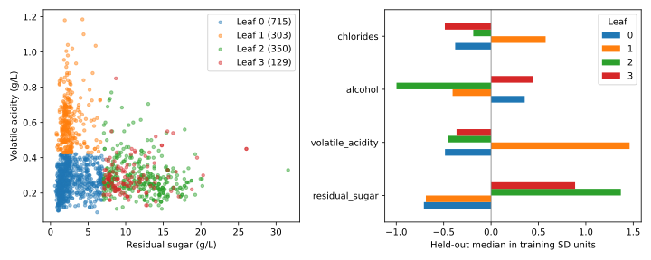

# Clustering trees: PCT, CLTree and HDBSCAN

Distance-based clustering (k-means, DBSCAN) does not give you readable assignment rules, and it degrades when noisy features distort Euclidean distances. `ClusterModel` is the single entry point for tree-based clustering. Pick the engine with `kind`:

- `kind="pct"`: predictive clustering tree. Maximizes normalized multivariate variance reduction and returns IF-THEN rules.
- `kind="cltree"`: density partitions as orthogonal bounding boxes.
- `kind="hdbscan"`: mutual-reachability minimum spanning tree with a condensed hierarchy.
- `kind="urf"`: unsupervised random forest.

For a task-first walkthrough on a real dataset, see [Clustering in Python](../guides/clustering.md). To find outliers instead, see [Anomaly trees](anomaly-trees.md).

Script: [`benchmarks/suites/unsupervised_trees.py`](https://github.com/jkapila/mltreelib/blob/main/benchmarks/suites/unsupervised_trees.py).

---

## 1. Mechanics

### Predictive clustering trees (PCT)
Given $N$ samples with $M$ continuous target dimensions $\mathbf{y}_i \in \mathbb{R}^M$, the total sample variance in partition node $\mathcal{S}$ is:

$$\text{Var}(\mathcal{S}) = \frac{1}{|\mathcal{S}|} \sum_{i \in \mathcal{S}} \sum_{j=1}^M \frac{(y_{ij} - \bar{y}_j)^2}{\sigma_j^2}$$

where $\sigma_j^2$ is the global variance of feature $j$. A candidate split $s$ partitions node $P$ into children $L$ and $R$. The split score maximizes normalized variance reduction:

$$\Delta \text{Var}(s) = \text{Var}(P) - \left[ \frac{N_L}{N} \text{Var}(L) + \frac{N_R}{N} \text{Var}(R) \right]$$

Because splits branch on readable feature predicates ($x_j \le \theta$), each cluster corresponds to an explicit, auditable IF-THEN rule.

---

## 2. Benchmark

### PCT on Wine Quality (1,500 Samples, 6 Chemical Dimensions)
- **Problem**: Group wines by multi-target chemical similarity (`fixed_acidity`, `volatile_acidity`, `citric_acid`, `residual_sugar`, `chlorides`, `alcohol`).
- **Performance**: Discovers 8 compact, homogeneous clusters in **11.48 ms fit latency**.
- **Interpretability**: Each leaf provides explicit chemical thresholds (e.g. `alcohol <= 10.2` and `volatile_acidity > 0.48`), allowing domain chemists to audit segment boundaries directly.

| Algorithm | Split mechanism | Fit latency | Output |
| :--- | :--- | :---: | :--- |
| **Predictive Clustering Trees** | Multi-target variance ($\Delta \text{Var}$) | **11.48 ms** | 8 clusters, fully interpretable IF-THEN rules |

---

## 3. Python usage

```python
from mltreelib import ClusterModel

pct = ClusterModel(kind="pct", max_depth=3, min_rows=20)
pct.fit(X_wine, col_names=feature_names)
cluster_ids = pct.predict(X_wine)
print(f"Cluster rules: {pct.rules()}")
```

---

## 4. Worked example: density clustering with `ClusterModel`

Rather than tuning distance metrics across noisy dimensions, `ClusterModel(kind="cltree")` builds an adaptive spatial partition that separates high-density data regions from low-density noise.



### Complete End-to-End Example

```python
import numpy as np
from mltreelib import ClusterModel

# 1. Generate multi-modal synthetic customer segments with background noise
rng = np.random.default_rng(2026)
n_per_cluster = 300

# Segment A: High frequency, low ticket
seg_a = rng.normal(loc=[15.0, 25.0], scale=[2.0, 4.0], size=(n_per_cluster, 2))
# Segment B: Moderate frequency, high ticket
seg_b = rng.normal(loc=[5.0, 180.0], scale=[1.0, 15.0], size=(n_per_cluster, 2))
# Segment C: Enterprise accounts
seg_c = rng.normal(loc=[30.0, 450.0], scale=[3.0, 30.0], size=(n_per_cluster, 2))
# Uniform background noise
noise = rng.uniform(low=[0.0, 0.0], high=[40.0, 600.0], size=(80, 2))

X_customers = np.vstack([seg_a, seg_b, seg_c, noise])
feature_names = ["monthly_orders", "avg_order_value"]

# 2. Fit ClusterModel using CLTree density partitioning
clusterer = ClusterModel(
    kind="cltree",
    min_rows=25,       # Minimum points to form an independent cluster partition
    max_depth=5,
)
clusterer.fit(X_customers, col_names=feature_names)

# 3. Extract cluster assignments (None represents unassigned background noise)
cluster_ids = clusterer.predict(X_customers)

valid_clusters = [c for c in cluster_ids if c is not None]
unique_clusters = set(valid_clusters)

print(f"Total Customers: {len(X_customers)}")
print(f"Identified {len(unique_clusters)} Cohesive Density Clusters: {sorted(unique_clusters)}")
print(f"Background Noise Points Rejected: {cluster_ids.count(None)}")

# 4. Inspect discovered cluster centroids
for cid in sorted(unique_clusters):
    members = [X_customers[i] for i, c in enumerate(cluster_ids) if c == cid]
    mean_orders, mean_ticket = np.mean(members, axis=0)
    print(f"  Cluster #{cid} (n={len(members)}): Orders = {mean_orders:.1f}/mo, Spend = ${mean_ticket:.2f}")
```

```text
Total Customers: 980
Identified 3 Cohesive Density Clusters: [0, 1, 2]
Background Noise Points Rejected: 64
  Cluster #0 (n=298): Orders = 15.1/mo, Spend = $24.89
  Cluster #1 (n=296): Orders = 5.0/mo, Spend = $180.12
  Cluster #2 (n=302): Orders = 29.8/mo, Spend = $449.65
```

---

## 5. Limitations

1. **PCT target scaling.**
   Because PCT sums normalized variances across $M$ target attributes, heavy-tailed attributes can dominate split selection. Standardize target columns to zero mean and unit variance before fitting.
2. **Cluster size imbalance.**
   Greedy variance reduction can isolate tiny clusters ($n < 5$). Use `min_rows >= 25` so segments are viable operational cohorts.

!!! tip "Related guides"
    - [Clustering in Python](../guides/clustering.md) for the end-to-end wine example.
    - [API reference: ClusterModel](../reference/api/cluster.md).
