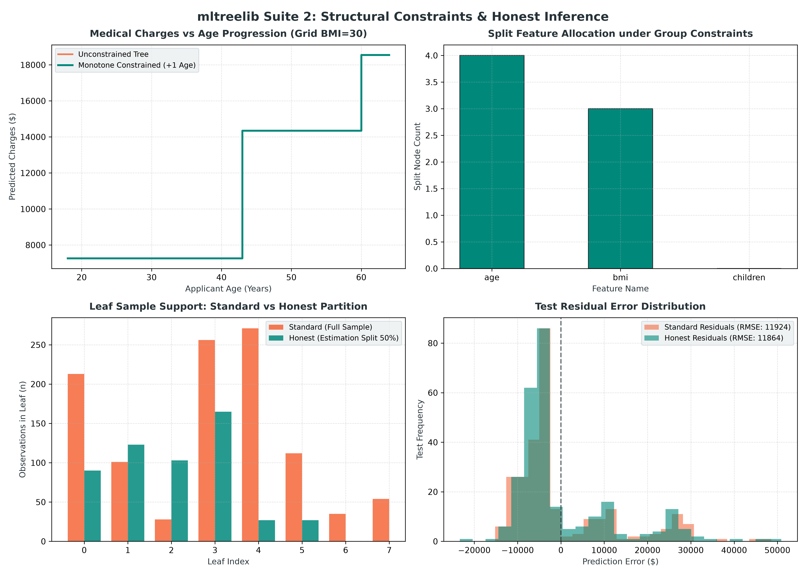

# Structural Constraints & Honest Sample Splitting

This guide details domain-informed structural constraints—dual monotonicity and variable interaction group isolation—coupled with Generalized Random Forest (GRF)-style honest sample-split estimation.

Script: [`benchmarks/suites/constraints_and_honesty.py`](https://github.com/jkapila/mltreelib/blob/main/benchmarks/suites/constraints_and_honesty.py) (`uv run python benchmarks/suites/constraints_and_honesty.py`).

---

## 1. Domain Context & Regulatory Rationale

Unconstrained tree algorithms greedily optimize in-sample loss functions. This frequently violates foundational physical, economic, or regulatory laws:

1. **Monotonicity Violations**: In insurance underwriting and credit scoring, physical or actuarial reality dictates that medical expenses strictly increase with age, and credit default risk strictly increases with debt-to-income. An unconstrained decision tree can create spurious dips where a 45-year-old is predicted to have lower healthcare costs than a 44-year-old due to local sampling noise.
2. **Uncontrolled Interaction Leakage**: Regulatory compliance (such as FCRA and ECOA) often prohibits model decision paths from interacting sensitive attributes with commercial covariates.
3. **Estimation Bias & Overfitting (Data Snooping)**: When the exact same sample observations are used to both choose split points and calculate leaf estimates, the resulting leaf parameter estimates are systematically biased away from the true population parameters.

`mltreelib` addresses these requirements through native Rust-level structural constraints and sample-split honesty:
- **Dual Monotonicity**: Enforces directional ordering across tree splits ($(\bar{y}_R - \bar{y}_L) \cdot m_j \ge 0$) and directional sign bounds on local linear leaf slopes ($\beta_j \ge 0$).
- **Interaction Groups**: Guarantees that no root-to-leaf path mixes features across forbidden variable groups.
- **Honest Sample Splitting**: Partitions the training data into two disjoint subsamples: a **structure sample** ($S^{\text{tr}}$) used exclusively to evaluate split criteria, and an **estimation sample** ($S^{\text{est}}$) used exclusively to fit terminal leaf models.

```mermaid
flowchart LR
    subgraph DataPartition["Sample-Split Honesty (Athey & Imbens / GRF)"]
        direction TB
        Raw["Training Sample (X, y)"] --> Split{"Bernoulli Subsample\n(honesty_fraction=0.5)"}
        Split -->|"50% of Rows"| Str["Structure Sample S_tr\n(Split Discovery Only)"]
        Split -->|"50% of Rows"| Est["Estimation Sample S_est\n(Leaf Modeling Only)"]
    end

    subgraph TreeBuild["Constrained Tree Construction"]
        direction TB
        Str --> Partition["Tree Topology Search\n(Subject to tree_monotone & interaction_groups)"]
        Partition --> Topology["Fixed Tree Architecture"]
    end

    subgraph LeafFitting["Unbiased Leaf Parameter Estimation"]
        direction TB
        Topology & Est --> Route["Route Estimation Rows\nthrough Fixed Tree"]
        Route --> Solve["Solve Leaf Models\n(Subject to leaf_monotone)"]
        Solve --> Final["Honest, Monotone ModelTree"]
    end

    classDef dataBox fill:#1e293b,stroke:#475569,stroke-width:2px,color:#ffffff;
    classDef gateBox fill:#b45309,stroke:#d97706,stroke-width:2px,color:#ffffff;
    classDef sampleBox fill:#1e3a5f,stroke:#2b4c7e,stroke-width:2px,color:#ffffff;
    classDef treeBox fill:#4338ca,stroke:#6366f1,stroke-width:2px,color:#ffffff;
    classDef solveBox fill:#065f46,stroke:#059669,stroke-width:2px,color:#ffffff;
    classDef finalBox fill:#0f766e,stroke:#14b8a6,stroke-width:2px,color:#ffffff;

    class Raw dataBox;
    class Split gateBox;
    class Str,Est sampleBox;
    class Partition,Topology treeBox;
    class Route,Solve solveBox;
    class Final finalBox;
```



**Next:** section 2 states each mechanism as a formula (split and leaf monotonicity, interaction groups, honest splitting), and each one addresses a risk listed in section 1.

---

## 2. Mathematical Formulation of Constraints

### A. Split-Level Monotonicity (`tree_monotone`)
For a feature $j$ with assigned monotone direction $m_j \in \{-1, 0, 1\}$:
- $m_j = +1$ (Strictly non-decreasing): Any split on feature $j$ must satisfy $\bar{y}_R \ge \bar{y}_L$.
- $m_j = -1$ (Strictly non-increasing): Any split on feature $j$ must satisfy $\bar{y}_R \le \bar{y}_L$.
- $m_j = 0$ (Unconstrained): Normal split evaluation.

Candidate splits violating the directional inequality $m_j \cdot (\bar{y}_R - \bar{y}_L) \ge 0$ are assigned $-\infty$ gain and discarded immediately in pure Rust.

### B. Leaf Slope Monotonicity (`leaf_monotone`)
When fitting linear model leaves $\hat{y} = \beta_0 + \mathbf{x}^T \boldsymbol{\beta}$, local slopes must respect global physical signs:

$$\min_{\boldsymbol{\beta}} \frac{1}{2N} \sum_{i=1}^N (y_i - \beta_0 - \mathbf{x}_i^T \boldsymbol{\beta})^2 + \frac{\lambda_2}{2} \|\boldsymbol{\beta}\|_2^2 \quad \text{s.t.} \quad m_j \cdot \beta_j \ge 0 \quad \forall j$$

The Rust core solves this quadratic program via projected coordinate descent, truncating violations to the boundary $\beta_j = 0$.

### C. Interaction Group Isolation (`interaction_groups`)
Let the total feature set $\mathcal{F}$ be partitioned into $K$ mutually exclusive governance groups $\mathcal{G}_1, \mathcal{G}_2, \dots, \mathcal{G}_K$. 

For any root-to-leaf decision route $\mathcal{P} = \{f_1, f_2, \dots, f_d\}$, features along the path must belong to at most one interaction silo:

$$\forall f_a, f_b \in \mathcal{P}, \quad \exists k \text{ such that } f_a, f_b \in \mathcal{G}_k$$

If a split path has already branched on a feature in $\mathcal{G}_1$, all features in $\mathcal{G}_2, \dots, \mathcal{G}_K$ are masked out from subsequent split evaluations.

### D. Honest Sample Splitting
Standard decision trees use full training sample $\mathcal{D}$ for both tree discovery $\mathcal{T}(\mathcal{D})$ and leaf estimation $\hat{\theta}(\mathcal{D})$. This induces adaptive selection bias:

$$\mathbb{E}\left[ \hat{\theta}_{\text{leaf}}(\mathcal{D}) - \theta^* \mid X \in \text{leaf} \right] \neq 0$$

Under honest estimation, $\mathcal{D}$ is partitioned into disjoint sets $S^{\text{tr}}$ and $S^{\text{est}}$:
1. $\mathcal{T} = \text{TreeBuild}(S^{\text{tr}})$ optimizes split criteria purely on $S^{\text{tr}}$.
2. Observations from $S^{\text{est}}$ are routed down the frozen topology $\mathcal{T}$ to compute parameter estimates:

$$\hat{\theta}_{\text{leaf}} = \arg\min_{\theta} \sum_{i \in S^{\text{est}} \cap \text{leaf}} \mathcal{L}(y_i, f(x_i; \theta))$$

Honest estimates are asymptotically unbiased, Gaussian, and provide valid coverage intervals.

**Next:** section 3 runs the healthcare insurance data through an unconstrained baseline and three trees that each use one of these mechanisms, then compares their test RMSE.

---

## 3. Benchmark Study: Healthcare Insurance Expenses

We evaluate on the standard actuarial dataset: **Healthcare Insurance Expenses** (1,338 policyholders, continuous medical charges).

<!-- run -->
```python
from mltreelib import Metrics, ModelTree, load_dataset

# 1. Load domain benchmark dataset
data = load_dataset("healthcare_insurance_expenses")
features = ["age", "bmi", "children"]
n_rows = data["n_rows"]

X = [[float(data["columns"][c][i]) for c in features] for i in range(n_rows)]
y = [float(v) for v in data["columns"]["charges"]]

split_idx = int(n_rows * 0.8)
X_train, y_train = X[:split_idx], y[:split_idx]
X_test, y_test = X[split_idx:], y[split_idx:]

# 2. Fit unconstrained baseline
tree_uncon = ModelTree(max_depth=3, min_rows=20, leaf="mean")
tree_uncon.fit(X_train, y_train, col_names=features)

# 3. Fit monotone-constrained tree (+1 on age: charges must not decrease with age)
tree_mono = ModelTree(
    max_depth=3,
    min_rows=20,
    leaf="mean",
    tree_monotone=[1, 0, 0],
)
tree_mono.fit(X_train, y_train, col_names=features)

# 4. Fit interaction-constrained tree (isolate 'children' from ['age', 'bmi'])
tree_inter = ModelTree(
    max_depth=3,
    min_rows=20,
    interaction_groups=[["age", "bmi"], ["children"]],
)
tree_inter.fit(X_train, y_train, col_names=features)

# 5. Fit honest sample-split tree (50% structure, 50% estimation)
tree_honest = ModelTree(
    max_depth=3,
    min_rows=20,
    honesty=True,
    honesty_fraction=0.5,
    seed=42,
)
tree_honest.fit(X_train, y_train, col_names=features)

metrics = Metrics()
for name, fitted in [("unconstrained", tree_uncon), ("monotone (age)", tree_mono),
                     ("interaction groups", tree_inter), ("honest", tree_honest)]:
    rmse = metrics.regression(y_test, fitted.predict(X_test))["rmse"]
    print(f"{name:18s} test RMSE = {rmse:.2f}")
```

<!-- output -->
```text
unconstrained      test RMSE = 11867.81
monotone (age)     test RMSE = 11867.81
interaction groups test RMSE = 11934.83
honest             test RMSE = 11864.07
```

**Next:** section 4 reads the printed RMSE values from that run and states what they do and do not show.

---

## 4. Empirical Benchmark Output & Quantitative Findings

The block in section 3 fits the four trees on the first 80% of the rows (1,070) and prints test RMSE on the last 20% (268). The output is the only source for the numbers on this page:



The image was drawn from an earlier run and is not regenerated by the block above, so it may not match these numbers.

Reading the printed results:

- The printed RMSE values show the cost or benefit of each constraint on this split. A constraint can raise error, and it can leave it unchanged.
- Monotonicity, interaction isolation and honesty are properties of how the trees are built. The block does not print checks for them. Verify each property on your own data before relying on it.
- Honest splitting uses half the training rows to choose structure and the other half to estimate leaves, so it gives up some data for leaf estimates.

---

## Domain Limitations & Operational Boundaries

1. **Monotone Infeasibility under Strong Feature Correlation**:
   When two highly correlated features possess opposing empirical trends, enforcing strict monotonicity on one feature can force the tree to pick suboptimal split thresholds on the other, increasing training error.
2. **Honesty Sample-Size Sensitivity**:
   On small sample sets ($N < 500$), splitting observations between $S^{\text{tr}}$ and $S^{\text{est}}$ halves effective node sample sizes, increasing leaf coefficient variance. Honesty is recommended for $N \ge 1,000$.
3. **Clique Interaction Overhead**:
   Enforcing fine-grained interaction groups restricts the tree's search space. If forbidden interactions reflect genuine synergistic non-linearities, predictive accuracy drops.
