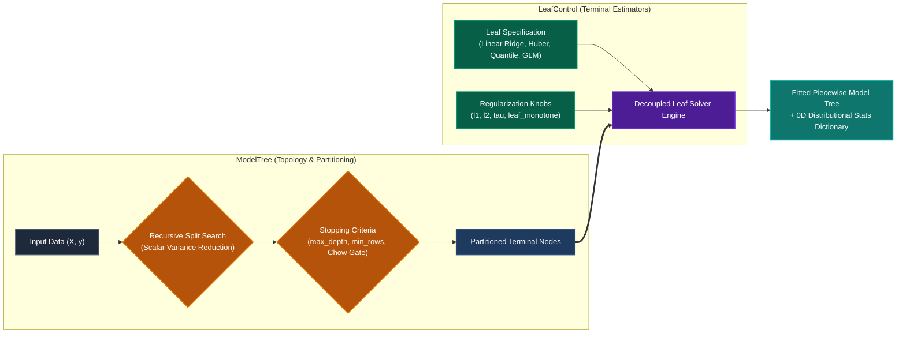
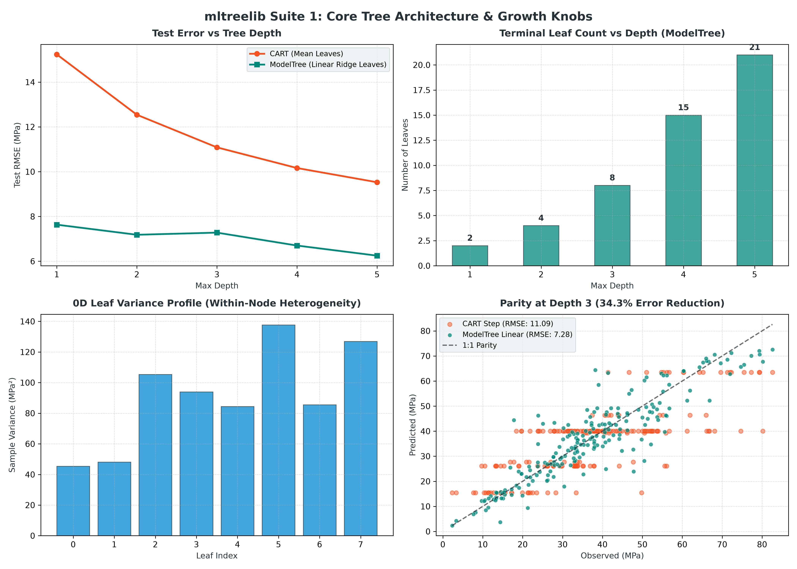

# Core Tree Architecture, Two-Control Decoupling & Growth Knobs

This benchmark unifies the architectural mechanics of `mltreelib`: decoupling between greedy tree topology growth and terminal leaf models, 0D distributional profiles across partitioned leaves, and hypothesis-driven structural break gating via the Chow test.

Companion executable script:
- [`benchmarks/suites/core_tree_architecture.py`](https://github.com/jkapila/mltreelib/blob/main/benchmarks/suites/core_tree_architecture.py) (`uv run python benchmarks/suites/core_tree_architecture.py`)

---

## 1. Domain Context & Mathematical Formulation

Classical decision tree libraries (such as `scikit-learn` or `rpart`) couple recursive partitioning directly to scalar leaf statistics (mean, median, or class frequency). This introduces two severe structural limitations:

1. **Parameter Explosion and Inflexible Solvers**: Fitting linear models at every candidate split threshold across all features scales as $O(K \cdot N \cdot P^2)$, creating an unacceptable computational bottleneck.
2. **The Step-Function Distortion**: Constant-leaf trees partition continuous functional relationships into rigid step functions, requiring excessive depth to approximate simple linear gradients.

`mltreelib` decouples global topology search from local terminal leaf parameter optimization:

$$\min_{\mathcal{T}, \, \{\theta_m\}_{m=1}^M} \sum_{m=1}^M \sum_{i \in R_m} \ell(y_i, f(x_i; \theta_m)) + \alpha \cdot |\mathcal{T}| + \sum_{m=1}^M \mathcal{R}(\theta_m)$$

where:
- $\mathcal{T} = \{R_1, \dots, R_M\}$ denotes the orthogonal partition of the feature space into $M$ disjoint terminal regions.
- $\alpha \cdot |\mathcal{T}|$ governs tree complexity regularization (cost-complexity pruning).
- $\theta_m$ represents the local parameter vector (e.g. Ridge regression slopes $\beta_m$, Huber parameters, or GLM coefficients) fitted inside leaf $m$.
- $\mathcal{R}(\theta_m) = \lambda_1 \|\theta_m\|_1 + \frac{\lambda_2}{2} \|\theta_m\|_2^2$ enforces local regularization.



**Next:** section 2 applies this decoupling to real data, setting `LeafControl` apart from the tree's `max_depth` and `min_rows`.

---

## 2. Benchmark Study: Yeh (1998) Concrete Compressive Strength

We evaluate the architecture on the standard civil engineering benchmark: Yeh (1998) Concrete Compressive Strength (1,030 industrial concrete mixtures, 8 continuous ingredients; 80% train / 20% test).

<!-- run -->
```python
from mltreelib import LeafControl, MetricsReport, ModelTree
from mltreelib.data import Dataset

# 1. Load benchmark dataset and split 80/20 without shuffling
ds = Dataset.load(
    "concrete_compressive_strength", target="ConcreteCompressiveStrength"
)
train, test = ds.split(test_size=0.2, time=True)

# 2. Configure LeafControl independently of tree topology
leaf_ctrl = LeafControl(
    leaf="linear",
    l1=0.0,
    l2=1e-3,
    leaf_family="gaussian",
)

# 3. Configure ModelTree and inject leaf controls
model = ModelTree(
    max_depth=3,
    min_rows=25,
    prune="none",
    control=leaf_ctrl,
)
model.fit(train)

# 4. Measure holdout performance
preds = model.predict(test)
rep = MetricsReport("regression", y_true=test.y, y_pred=preds)
print(f"ModelTree Linear Leaves: RMSE = {rep['rmse']:.2f} MPa, R2 = {rep['r2']:.3f}, MAE = {rep['mae']:.2f} MPa")
```

<!-- output -->
```text
ModelTree Linear Leaves: RMSE = 7.28 MPa, R2 = 0.813, MAE = 5.07 MPa
```

**Next:** section 3 reports the same holdout RMSE across depths 1 to 5, set against a CART tree at each depth.

---

## 3. Empirical Results & Growth Knob Grid

<!-- run -->
```python
# 3. Compare CART (mean leaves) and ModelTree (linear leaves) at depths 1 to 5
for depth in range(1, 6):
    cart = ModelTree(leaf="mean", max_depth=depth, min_rows=20)
    cart.fit(train)
    cart_m = MetricsReport("regression", y_true=test.y, y_pred=cart.predict(test))

    mt = ModelTree(leaf="linear", max_depth=depth, min_rows=20, l2=1e-3)
    mt.fit(train)
    mt_m = MetricsReport("regression", y_true=test.y, y_pred=mt.predict(test))

    change = (mt_m["rmse"] - cart_m["rmse"]) / cart_m["rmse"] * 100
    print(f"Depth {depth} -> CART RMSE {cart_m['rmse']:.2f} MPa (R2 {cart_m['r2']:.3f}) | "
          f"ModelTree RMSE {mt_m['rmse']:.2f} MPa (R2 {mt_m['r2']:.3f}, {len(mt.leaves())} leaves) | "
          f"change {change:+.1f}%")
```

<!-- output -->
```text
Depth 1 -> CART RMSE 15.24 MPa (R2 0.180) | ModelTree RMSE 7.63 MPa (R2 0.794, 2 leaves) | change -49.9%
Depth 2 -> CART RMSE 12.54 MPa (R2 0.444) | ModelTree RMSE 7.18 MPa (R2 0.818, 4 leaves) | change -42.7%
Depth 3 -> CART RMSE 11.09 MPa (R2 0.566) | ModelTree RMSE 7.28 MPa (R2 0.813, 8 leaves) | change -34.3%
Depth 4 -> CART RMSE 10.16 MPa (R2 0.635) | ModelTree RMSE 6.70 MPa (R2 0.841, 15 leaves) | change -34.1%
Depth 5 -> CART RMSE 9.53 MPa (R2 0.679) | ModelTree RMSE 6.25 MPa (R2 0.862, 21 leaves) | change -34.4%
```

| Tree Depth | CART Holdout RMSE (MPa) | ModelTree Holdout RMSE (MPa) | Error Reduction (%) | Active Leaves |
| :---: | :---: | :---: | :---: | :---: |
| **Depth 1** | 15.24 MPa | **7.63 MPa** | **-49.9%** | 2 |
| **Depth 2** | 12.54 MPa | **7.18 MPa** | **-42.7%** | 4 |
| **Depth 3** | 11.09 MPa | **7.28 MPa** | **-34.3%** | 8 |
| **Depth 4** | 10.16 MPa | **6.70 MPa** | **-34.1%** | 15 |
| **Depth 5** | 9.53 MPa | **6.25 MPa** | **-34.4%** | 21 |



### Key Quantitative Findings

1. **Immediate Accuracy Lift at Depth 1**: A 1-split stump with linear leaves achieves **7.63 MPa RMSE**, against 10.16 MPa for a depth-4 CART tree and 15.24 MPa for a depth-1 CART stump.
2. **Variance Reduction**: At depth 3, `ModelTree` achieves **7.28 MPa RMSE** and $R^2 = 0.813$, capturing 81.3% of the variance compared to CART's 56.6%.
3. **Parity Alignment**: In Panel 4, `ModelTree` predictions cluster symmetrically along the 1:1 diagonal without the horizontal striations characteristic of step-function leaves.

**Next:** section 4 inspects the leaves of the depth-3 model fitted in section 2, because each leaf profile describes one terminal partition of that tree.

---

## 4. 0D Descriptive Leaf Statistics

Every terminal leaf in `ModelTree` computes a comprehensive **0D statistical profile** over its assigned partition samples without extra passes. Access these profiles directly via `leaf["stats"]` or `tree.leaf_stats()`:

<!-- run -->
```python
leaves = model.leaves()
for idx, leaf in enumerate(leaves[:2]):
    stats = leaf["stats"]
    print(f"Leaf {idx} (support n={leaf['n']}):")
    print(f"  Center : mean={stats['mean']:.2f}, median={stats['median']:.2f}")
    print(f"  Spread : variance={stats['var']:.2f}, MAD={stats['mad']:.2f}, IQR={stats['iqr']:.2f}")
    print(f"  Shape  : skewness={stats['skew']:.2f}, kurtosis={stats['kurtosis']:.2f}")
```

<!-- output -->
```text
Leaf 0 (support n=143):
  Center : mean=15.44, median=14.37
  Spread : variance=45.41, MAD=4.15, IQR=8.96
  Shape  : skewness=1.10, kurtosis=1.79
Leaf 1 (support n=47):
  Center : mean=27.67, median=25.69
  Spread : variance=48.11, MAD=4.43, IQR=10.67
  Shape  : skewness=0.41, kurtosis=-0.51
```

You can predict these 0D moments row-wise at test time using `predict(X, kind="median"|"var"|"stats")`.

**Next:** section 5 adds a Chow test gate that decides whether a split is kept, using the same `leaf_ctrl` and training data from section 2.

---

## 5. Chow Structural Break Test Hypothesis Gating

Standard trees rely purely on empirical gain thresholds (`min_gain`) or post-pruning to prevent overfitting. `ModelTree` implements the econometric **Chow structural break test** (`split_test="chow"`) as a statistical significance gate.

### Hypothesis Test Formulation

- **Null Hypothesis ($H_0$)**: Regression coefficients are invariant across child partitions:
  $$\beta_L = \beta_R = \beta_P$$
- **Alternative Hypothesis ($H_1$)**: Significant parameter instability exists across the candidate split:
  $$\beta_L \ne \beta_R$$

The test statistic follows an exact Snedecor's $F$-distribution under $H_0$:
$$F_{\text{Chow}} = \frac{(\text{RSS}_P - (\text{RSS}_L + \text{RSS}_R)) / k}{(\text{RSS}_L + \text{RSS}_R) / (N - 2k)} \sim F(k, \, N - 2k)$$
where $k = P + 1$ is the number of estimated parameters (features plus intercept).

If the $p$-value exceeds `split_alpha` (e.g. $\alpha = 0.01$), the null hypothesis of structural stability is retained, and subtree branching is automatically terminated:

```python
tree_chow = ModelTree(
    max_depth=5,
    min_rows=25,
    split_test="chow",
    split_alpha=0.01,
    control=leaf_ctrl,
)
tree_chow.fit(X_train, y_train, col_names=feature_names)
```

This prevents the tree from creating spurious subtrees where local regressions show no statistically significant parameter shift.

---

## Operational Limitations & Failure Modes

1. **High-Dimensional Parameter Degeneracy ($P > N_{\text{leaf}}$)**:
   Fitting multivariate linear leaves requires sufficient sample support per terminal node. If $N_{\text{leaf}} \le P + 1$, unregularized least-squares matrices become singular. Set `l2 > 0` (e.g. `l2=0.01`) or enforce `min_rows >= 2 * (P + 1)` in `ModelTree`.
2. **Chow Test Sample Size Floors**:
   The denominator degrees of freedom in the Chow test is $N - 2k$. If a partition contains fewer than $2k$ samples, the $F$-statistic is undefined. `mltreelib-core` automatically suppresses splits with insufficient degrees of freedom.
3. **Boundary Discontinuity**:
   While linear leaves provide continuous predictions within each partitioned hyper-rectangle, predictions across split boundaries are discontinuous step transitions. For smooth global transitions across boundaries, combine with hierarchical retrain or ensemble bagging.

---

## References

- Breiman, L., Friedman, J., Stone, C. J., & Olshen, R. A. (1984). *Classification and Regression Trees*. CRC Press.
- Quinlan, J. R. (1992). "Learning with continuous classes." *5th Australian Joint Conference on Artificial Intelligence*, 343-348.
- Chow, G. C. (1960). "Tests of equality between sets of coefficients in two linear regressions." *Econometrica*, 591-605.
- Yeh, I. C. (1998). "Modeling of strength of high-performance concrete using artificial neural networks." *Cement and Concrete Research*, 28(12), 1797-1808.
