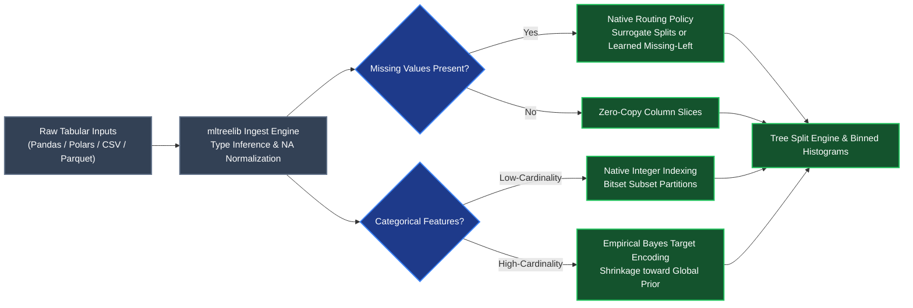
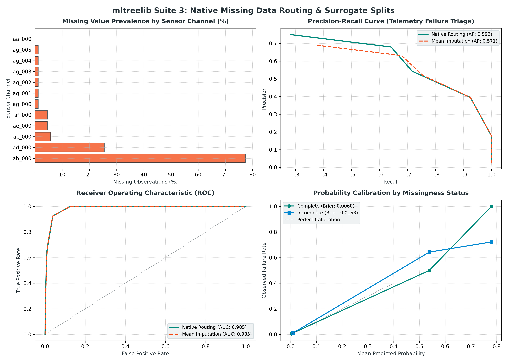
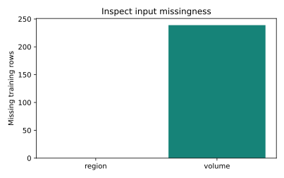
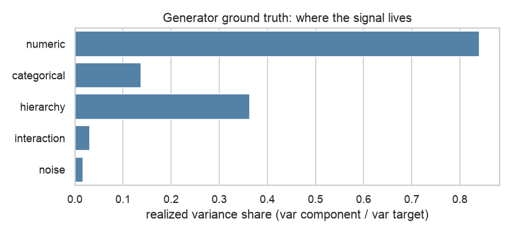

# Data Matrix Ingestion, Missing Routing & Categorical Encoders

Machine learning algorithms live or die on how they handle dirty tabular real-world inputs: high-cardinality categoricals, mixed numeric types, and widespread unrecorded values. 

`mltreelib` builds its data ingest and split evaluation on a **zero-copy Rust columnar engine** (`mltreelib-core::frame`) that treats missingness as a first-class branch direction rather than a flaw to be masked with heuristic imputations.



---

## 1. Native Missing Value Routing (Surrogate Splits)

Standard decision trees force users to impute missing entries (mean, median, mode) or drop rows entirely. Mean imputation distorts correlation structures and destroys predictive signal in missingness itself.

`mltreelib.ModelTree` handles missing values natively during tree growth:
1. **Learned Missing Direction (`missing_left` on each split)**: Evaluates whether routing missing rows to the left child or the right child minimizes post-split deviance, picking the optimal direction. Reported per split by `tree.splits()`.
2. **Surrogate Splits (`maxsurrogate=N`)**: When a primary split feature is missing at prediction time, the tree evaluates an ordered ranking of backup surrogate features that best mimic the primary split partition.





### Complete End-to-End Missing Routing Example

<!-- run -->
```python
import numpy as np
from mltreelib import ModelTree, Metrics

# 1. Generate multi-sensor telemetry with correlated features and sensor dropouts
rng = np.random.default_rng(2026)
n_samples = 1500

# Primary sensor reading and redundant backup sensor
primary = rng.normal(loc=50.0, scale=10.0, size=n_samples)
backup = 0.85 * primary + rng.normal(loc=0.0, scale=3.0, size=n_samples)
temperature = rng.uniform(low=20.0, high=90.0, size=n_samples)

# Physical failure response depending strongly on primary sensor threshold (> 58.0)
y = ((primary > 58.0) & (temperature > 50.0)).astype(float) + rng.normal(0, 0.1, n_samples)

# Inject 30% realistic sensor dropouts (represented by None / NaN)
primary_with_missing = [None if rng.uniform() < 0.30 else round(val, 2) for val in primary]
backup_clean = [round(val, 2) for val in backup]
temp_clean = [round(val, 2) for val in temperature]

X = [[p, b, t] for p, b, t in zip(primary_with_missing, backup_clean, temp_clean)]
feature_names = ["sensor_primary", "sensor_backup", "temperature"]

# 2. Train ModelTree with native learned missing routing
tree = ModelTree(
    leaf="linear",
    max_depth=3,
    min_rows=30,
    maxsurrogate=2,  # Backup splits for rows whose primary feature is missing
)
tree.fit(X, y.tolist(), col_names=feature_names)

# 3. Inspect splits and assigned missing directions
print("Fitted Tree Splits & Native Missing Direction:")
for i, s in enumerate(tree.splits()[:3], 1):
    direction = "LEFT" if s.get("missing_left", True) else "RIGHT"
    print(f"  Split #{i}: Feature '{s['col']}' <= {s['threshold']:.2f} | Missing Rows Route -> {direction}")

# 4. Predict on new record with missing primary sensor
test_sample = [[None, 62.5, 75.0]]
predicted_risk = tree.predict(test_sample)[0]
print(f"\nPrediction for Missing Primary Reading (Backup=62.5, Temp=75.0): {predicted_risk:.3f}")
```

<!-- output -->
```text
Fitted Tree Splits & Native Missing Direction:
  Split #1: Feature 'temperature' <= 49.77 | Missing Rows Route -> LEFT
  Split #2: Feature 'sensor_primary' <= 57.93 | Missing Rows Route -> LEFT
  Split #3: Feature 'temperature' <= 49.97 | Missing Rows Route -> LEFT

Prediction for Missing Primary Reading (Backup=62.5, Temp=75.0): 0.885
```

---

**Next:** encode the categorical features, because the ingest diagram sends high-cardinality categories through an encoder before they reach the split engine.

## 2. Categorical Encoders: Empirical Bayes & Ordered Target Encoding

Tabular data features categorical variables ranging from low-cardinality ordinal levels (e.g. Education: High School, Bachelor, Graduate) to high-cardinality entities (ZIP codes, merchant IDs, product SKUs).

| Method | Flavour | Mechanism | Overfitting Guard |
| :--- | :--- | :--- | :--- |
| **`TargetEncoder`** | Smoothed Mean | $w \cdot \bar{y}_c + (1 - w) \cdot \bar{y}_\text{global}, \quad w = \frac{n_c}{n_c + m}$ | Empirical Bayes $m$-smoothing toward global prior |
| **`CatBoostEncoder`** | Ordered Target | Running target mean accumulated over random permutations | Dynamic permutation eliminates in-sample leakage |
| **`OneHotEncoder`** | Sparse Dummies | Boolean bitsets for low-cardinality variables ($K \le 16$) | Tree branch regularization |

<!-- run -->
```python
from mltreelib import TargetEncoder, CatBoostEncoder

# High-cardinality merchant categories and chargeback labels
merchants = ["electronics", "apparel", "electronics", "travel", "apparel", "electronics"]
labels = [1.0, 0.0, 1.0, 0.0, 1.0, 1.0]

# 1. Smoothed Empirical Bayes Target Encoding
target_enc = TargetEncoder(smoothing=5.0)
target_enc.fit(merchants, labels)
encoded_features = target_enc.transform(merchants)
print("Smoothed Target Encodings:", [round(v, 3) for v in encoded_features])

# 2. Ordered Target Encoding (Leakage-Free Training)
cb_enc = CatBoostEncoder(prior=0.5, permutations=4, seed=2026)  # prior multiplies the global mean; keep it <= 1 for a 0/1 target
ordered_features = cb_enc.fit_transform(merchants, labels)
print("Ordered CatBoost Encodings:", [round(v, 3) for v in ordered_features])
```

<!-- output -->
```text
Smoothed Target Encodings: [0.792, 0.619, 0.792, 0.556, 0.619, 0.792]
Ordered CatBoost Encodings: [0.528, 0.583, 0.639, 0.333, 0.292, 0.611]
```

---

**Next:** summarize each column's type, missing count and spread, because the engine checks these same properties before tree growth and isolates constant features.

## 3. The Typed Ingestion Frame & Variance Decomposition

At the Rust core level, datasets are ingested into a typed frame. The engine automatically tracks column data types, computes realized variance shares, and isolates zero-variance or constant features before tree growth.



<!-- run -->
```python
from mltreelib import summarize

columns = {
    "cement": [540.0, 540.0, 332.5],
    "water": [162.0, 162.0, 228.0],
    "age": [28, 28, 270],
}

for name, values in columns.items():
    s = summarize(values)
    print(f"{name:10} | missing: {s['n_missing']} | mean: {s['mean']:.2f} | std: {s['std']:.2f}")
```

<!-- output -->
```text
cement     | missing: 0 | mean: 470.83 | std: 97.82
water      | missing: 0 | mean: 184.00 | std: 31.11
age        | missing: 0 | mean: 108.67 | std: 114.08
```

!!! tip "Related guides"
    - [Native Missing Data Routing & Surrogate Splits](missing-data-routing.md) for full mathematical proofs of surrogate agreement.
    - [Component & Factor Analysis](components-and-rotations.md) for dimensionality reduction and whitening.
