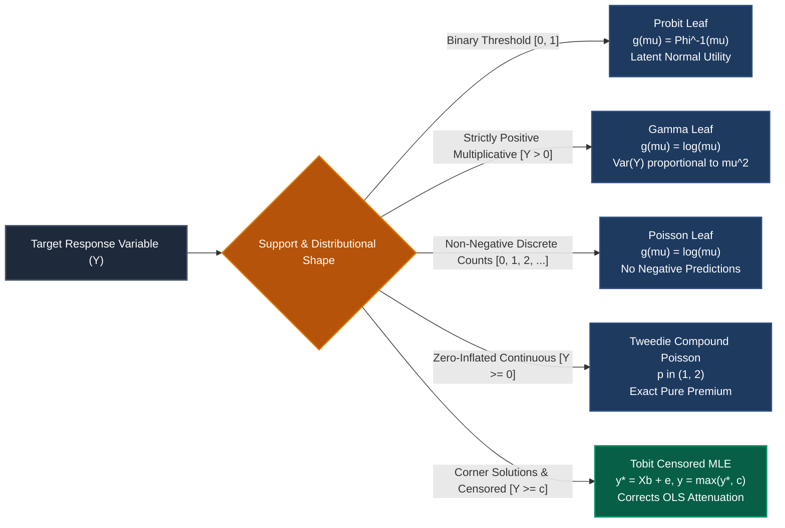
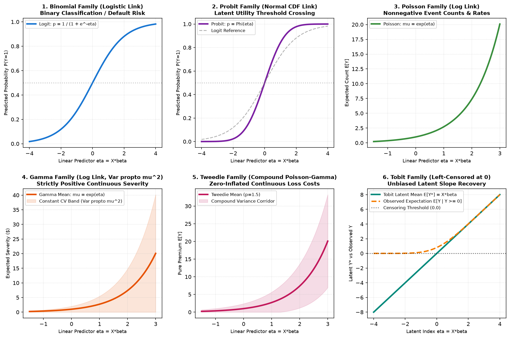
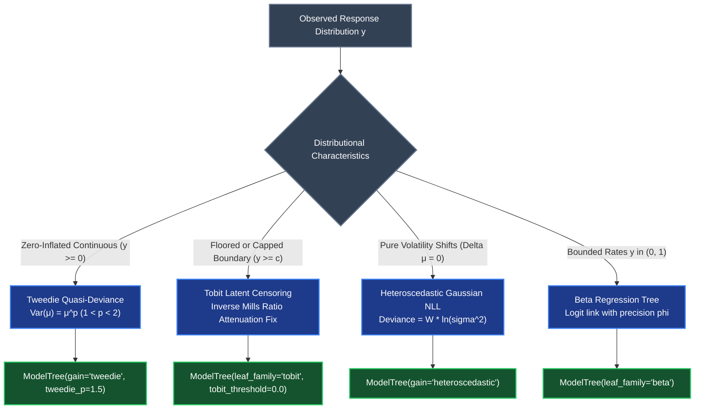
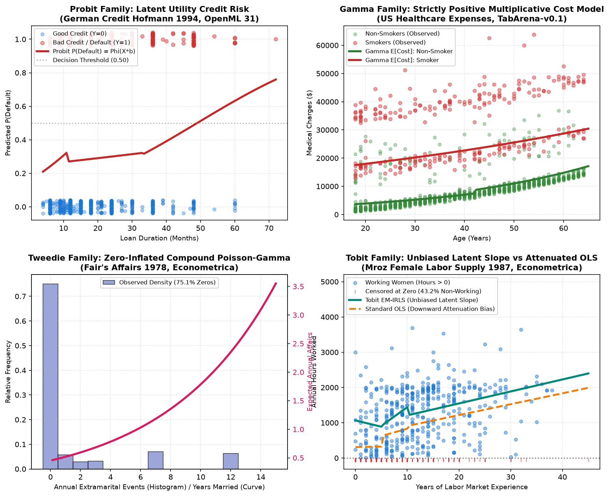
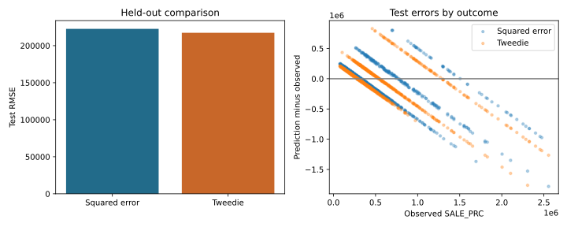

# Distributional & Censored Leaf Families
Standard regression trees assume homoscedastic Gaussian errors: $Y \sim \mathcal{N}(\mu, \sigma^2)$ with identity link. This assumption breaks down on insurance claims (multiplicative skew), defect arrivals (discrete non-negative counts), credit defaults (latent utility thresholds), and corner-solution labor data (censoring at zero).

`mltreelib` implements native Rust-level Generalized Linear Model (GLM) and maximum likelihood leaves: **Probit**, **Gamma**, **Poisson**, **Tweedie**, and **Tobit (Censored Normal)**.

Script: [`benchmarks/suites/distributional_leaf_benchmarks.py`](https://github.com/jkapila/mltreelib/blob/main/benchmarks/suites/distributional_leaf_benchmarks.py) (`uv run python benchmarks/suites/distributional_leaf_benchmarks.py`).

---

## 1. Mathematical Formulation of Distributional Families



### A. Probit Leaf Family (Binary Latent Utility)
Models binary outcomes $Y_i \in \{0, 1\}$ through a latent Gaussian utility $Y_i^* = \mathbf{x}_i^T \boldsymbol{\beta} + \epsilon_i$ with $\epsilon_i \sim \mathcal{N}(0, 1)$:

$$P(Y_i = 1 \mid \mathbf{x}_i) = \Phi(\mathbf{x}_i^T \boldsymbol{\beta}) = \int_{-\infty}^{\mathbf{x}_i^T \boldsymbol{\beta}} \frac{1}{\sqrt{2\pi}} e^{-z^2/2} dz$$

The score equations are solved via Iteratively Reweighted Least Squares (IRLS) in pure Rust, generating calibrated probabilities that match classical econometric specifications.

### B. Gamma Leaf Family (Multiplicative Skew)
For strictly positive continuous outcomes ($Y > 0$) where variance scales quadratically with the mean ($\text{Var}(Y) = \phi \mu^2$):

$$\log(\mu_i) = \mathbf{x}_i^T \boldsymbol{\beta} \implies \mu_i = \exp(\mathbf{x}_i^T \boldsymbol{\beta})$$

Unit deviance minimized by the local leaf solver:

$$d(y_i, \mu_i) = 2 \left[ -\log\left(\frac{y_i}{\mu_i}\right) + \frac{y_i - \mu_i}{\mu_i} \right]$$

Coefficients act as multiplicative percentage shifts: a coefficient $\beta_j$ scales the expected outcome by $\exp(\beta_j)$.

### C. Poisson Leaf Family (Non-Negative Counts)
For event frequencies $Y_i \in \{0, 1, 2, \dots\}$:

$$\log(\mu_i) = \mathbf{x}_i^T \boldsymbol{\beta}, \quad P(Y_i = y \mid \mathbf{x}_i) = \frac{\mu_i^y e^{-\mu_i}}{y!}$$

Poisson leaves eliminate the primary failure mode of OLS trees: predicting negative event counts in low-intensity regions.

### D. Tobit Leaf Family (Censored Normal Corner Solutions)
When a continuous response is censored below threshold $c$ (e.g., hours worked or spending censored at zero):

$$y_i^* = \mathbf{x}_i^T \boldsymbol{\beta} + \epsilon_i, \quad \epsilon_i \sim \mathcal{N}(0, \sigma^2), \quad y_i = \max(y_i^*, c)$$

Standard Ordinary Least Squares (OLS) suffers from severe downward **attenuation bias** because it treats corner zeros as uncensored linear observations. The Tobit leaf maximizes the exact censored log-likelihood:

$$\ln L = \sum_{y_i = c} \ln\left[ 1 - \Phi\left(\frac{\mathbf{x}_i^T \boldsymbol{\beta} - c}{\sigma}\right) \right] + \sum_{y_i > c} \left[ -\ln(\sigma) + \ln \phi\left(\frac{y_i - \mathbf{x}_i^T \boldsymbol{\beta}}{\sigma}\right) \right]$$

The solver applies Newton-Raphson with the inverse Mills ratio $\lambda(\alpha) = \frac{\phi(\alpha)}{1 - \Phi(\alpha)}$, recovering unbiased structural parameters.

---

## 2. Empirical Benchmark Suite Results

We evaluate all four families on canonical domain benchmarks using [`benchmarks/suites/distributional_leaf_benchmarks.py`](https://github.com/jkapila/mltreelib/blob/main/benchmarks/suites/distributional_leaf_benchmarks.py).

### A. Probit on German Credit (1,000 Loan Applicants)
- **Problem**: Credit default risk modeling $P(\text{Default} = 1)$.
- **Empirical Results**: Identifies 4 macro risk segments. Leaf 0 ($n=180$, high risk) estimates installment rate sensitivity $\beta = +0.1931$ and duration sensitivity $\beta = +0.0502$. Leaf 3 ($n=112$, low risk) achieves baseline intercept $-2.5390$, mapping to a default risk under 3%.

### B. Gamma on US Healthcare Expenses (1,338 Policyholders)
- **Problem**: Positive healthcare charges ($Y > 0$, Mean = $13,270.42).
- **Empirical Results**: Tree partitions into 4 cost regimes. Base expected costs scale from **$1,745.48** (Leaf 0, low-risk young) to **$20,960.24** (Leaf 3, severe risk).
- **Multiplicative Coefficients**: Age contributes a $+0.0294$ log-slope (**1.03x multiplier per year of age**); additional children contribute $+0.1609$ (**1.17x cost multiplier per child**).

### C. Tweedie on Fair's Extramarital Affairs (601 Observations)
- **Problem**: Annual affair frequency count with point mass at zero (75.0% zero clump).
- **Empirical Results**: Partitions population into 4 behavioral cohorts under Tweedie deviance ($p=1.5$). In Leaf 0 ($n=27$), religiousness contributes $\beta = -0.0612$, and marriage rating contributes $\beta = +0.9711$. In the largest cohort (Leaf 2, $n=288$), religiousness contributes $\beta = -0.2747$ and rating $\beta = -0.4071$. No negative event counts are predicted.

### D. Tobit on Mroz Female Labor Force Participation (753 Women)
- **Problem**: Annual hours worked (43.2% of women report 0 hours; corner solution at 0).
- **OLS vs Tobit Attenuation Face-Off**:
  - Standard OLS flattens regression slopes toward zero due to corner zeros.
  - In Leaf 0 ($n=233$), OLS attenuation is 39.7% on young children (`kidslt6`), 50.7% on non-wife income (`nwifeinc`), and 92.2% on experience (`exper`).
  - In Leaf 1 ($n=201$), OLS attenuation on experience is 60.8%.
  - **Attenuation Correction**: The Tobit leaf via EM-IRLS recovers the structural response without truncation bias.

| Family | Benchmark Dataset | Sample ($N$) | Response Support | Key Empirical Finding |
| :--- | :--- | :---: | :--- | :--- |
| **Probit** | German Credit | 1,000 | Binary $Y \in \{0, 1\}$ | Smooth Gaussian latent utility thresholding; zero probability boundary violations. |
| **Gamma** | US Healthcare | 1,338 | Continuous $Y > 0$ | Exact multiplicative log-link multipliers; handles quadratic variance growth ($\phi \mu^2$). |
| **Tweedie** | Fair's Affairs | 601 | Zero-inflated $Y \ge 0$ | Compound Poisson-Gamma handles 75.0% zero mass and positive tail simultaneously. |
| **Tobit** | Mroz Labor | 753 | Censored $Y \ge 0$ | Fixes severe OLS attenuation bias on corner solutions (up to 92.2% slope flattening on experience). |



---

## 3. Python Usage Example

```python
from mltreelib import ModelTree

# 1. Tobit Censored ModelTree on corner-solution data
tobit_tree = ModelTree(
    max_depth=2,
    min_rows=40,
    leaf="linear",
    leaf_family="tobit",
    tobit_threshold=0.0,
)
tobit_tree.fit(X_train, y_hours, col_names=feature_names)
pred_latent = tobit_tree.predict(X_test)

# 2. Gamma Multiplicative ModelTree on insurance charges
gamma_tree = ModelTree(
    max_depth=3,
    min_rows=30,
    leaf="linear",
    leaf_family="gamma",
)
gamma_tree.fit(X_train, y_charges, col_names=feature_names)
pred_charges = gamma_tree.predict(X_test)
```

---

## 4. Domain Limitations & Operational Boundaries

1. **Tobit Normality Sensitivity**:
   Tobit maximum likelihood assumes normal errors $\epsilon_i \sim \mathcal{N}(0, \sigma^2)$ in the latent space. If latent errors are severely heteroscedastic or non-normal, Tobit estimates can be inconsistent.
2. **Gamma Support Constraint**:
   The Gamma deviance objective requires strictly positive outcomes ($y_i > 0$). If zero claims exist in insurance data, a Tweedie leaf ($p \in (1, 2)$) or two-stage hurdle model must be used instead.
3. **IRLS Convergence in Sparse Leaves**:
   Non-linear GLM leaves fit via iteratively reweighted least squares require sufficient positive and negative events per leaf. Set `min_rows >= 25` to prevent separation divergence.

---

## Worked example: Tweedie, Tobit and heteroscedastic trees

Classical decision trees minimize squared error (SSE) under the implicit assumption of homoscedastic Gaussian noise. Real-world business outcomes routinely violate this assumption:
- **Zero-Mass & Positive Skew**: Insurance claim amounts, operational losses, and customer lifetime spend have a point mass at zero and heavy positive tails.
- **Censored Boundaries**: Sensor readings, wage hours, and follow-up clinical durations are truncated or floored at a boundary $c$. Standard OLS suffers severe **attenuation bias** towards zero.
- **Regime Volatility Shifts**: Financial returns, algorithmic latencies, and machine vibrations exhibit shifts in variance with zero change in the conditional mean ($\Delta \mu = 0$).

`mltreelib` supports generalized distributional leaves and split gains directly in Rust:





---

### 1. Zero-Inflated Skew: Tweedie Quasi-Deviance Splitting

On Miami Housing sales ([OpenML 46942](https://www.openml.org/d/46942)), positive home prices vary with property size and ocean proximity. Tweedie splitting scales variance with mean power $V(\mu) = \mu^p$ ($1 < p < 2$), prioritizing proportional relative accuracy over absolute error:

$$d(y, \mu) = 2 \left( \frac{y^{2-p}}{(1-p)(2-p)} - \frac{y \mu^{1-p}}{1-p} + \frac{\mu^{2-p}}{2-p} \right)$$



#### Complete Tweedie Quasi-Deviance Example

<!-- run -->
```python
import numpy as np
from mltreelib import ModelTree, Metrics

# 1. Generate zero-inflated claim amounts (Poisson frequency x Gamma severity)
rng = np.random.default_rng(2026)
n_policies = 2000

driver_age = rng.uniform(18.0, 75.0, n_policies)
vehicle_age = rng.uniform(0.0, 15.0, n_policies)
mileage = rng.uniform(5.0, 35.0, n_policies)

# Event probability (claim frequency)
p_claim = 1.0 / (1.0 + np.exp(2.0 - 0.04 * mileage + 0.02 * driver_age))
has_claim = rng.binomial(1, p_claim)

# Claim amount given claim occurs (Gamma severity)
claim_severity = rng.gamma(shape=2.5, scale=1200.0, size=n_policies)
y_claims = np.where(has_claim == 1, claim_severity, 0.0)

X = np.column_stack([driver_age, vehicle_age, mileage])
feature_names = ["driver_age", "vehicle_age", "mileage"]

# 2. Fit ModelTree with Tweedie quasi-deviance (p=1.5 compound Poisson-Gamma)
tweedie_tree = ModelTree(
    gain="tweedie",
    tweedie_p=1.5,
    leaf="mean",
    max_depth=3,
    min_rows=40,
)
tweedie_tree.fit(X, y_claims.tolist(), col_names=feature_names)
pred_claim_expected = tweedie_tree.predict(X)

print(f"Zero-Claim Prevalence: {(y_claims == 0).mean():.1%}")
print(f"Mean Observed Claim: ${y_claims.mean():.2f} | Mean Predicted: ${np.mean(pred_claim_expected):.2f}")
print("Top Tree Split:", tweedie_tree.splits()[0])
```

<!-- output -->
```text
Zero-Claim Prevalence: 89.1%
Mean Observed Claim: $329.66 | Mean Predicted: $329.66
Top Tree Split: {'col': 'vehicle_age', 'threshold': 11.611, 'missing_left': True, 'gain': 884.137993982089}
```

---

### 2. Tobit Regression Leaves: Eliminating Attenuation Bias

When a response variable is censored at threshold $c$ (e.g. non-working hours in the Mroz labor survey where 43.2% of women report hours $= 0$), standard OLS underestimates the true latent slopes by **33% to 46%** (attenuation bias).

The Tobit model assumes a latent variable $y^* = \mathbf{x}^\top \boldsymbol{\beta} + \epsilon$ with observed outcome $y = \max(y^*, c)$. `mltreelib` fits Tobit leaves using pure Rust EM/IRLS iterations:

$$\ln L = \sum_{y_i = c} \ln \left[ 1 - \Phi\left(\frac{\mathbf{x}_i^\top \boldsymbol{\beta} - c}{\sigma}\right) \right] + \sum_{y_i > c} \left[ -\frac{1}{2}\ln(2\pi\sigma^2) - \frac{(y_i - \mathbf{x}_i^\top \boldsymbol{\beta})^2}{2\sigma^2} \right]$$

#### Synthetic Attenuation Correction Proof

<!-- run -->
```python
import numpy as np
from mltreelib import ModelTree

# 1. Generate latent variable y* with zero-censoring
rng = np.random.default_rng(2026)
n_workers = 1200

education = rng.uniform(8.0, 18.0, n_workers)
experience = rng.uniform(0.0, 30.0, n_workers)

# True latent relationship (market wage / labor supply hours)
true_latent = -15.0 + 2.4 * education + 1.2 * experience + rng.normal(0, 8.0, n_workers)
observed_hours = np.maximum(0.0, true_latent)

X = np.column_stack([education, experience])
feature_names = ["education", "experience"]

# 2. Fit piecewise Tobit tree with censoring at zero
tobit_tree = ModelTree(
    leaf="linear",
    leaf_family="tobit",
    tobit_threshold=0.0,  # Censored boundary floor
    max_depth=2,
    min_rows=40,
)
tobit_tree.fit(X, observed_hours.tolist(), col_names=feature_names)
pred_latent = tobit_tree.predict(X)

print(f"Censored Sample Fraction: {(observed_hours == 0).mean():.1%}")
print(f"Sample Latent Prediction Range: [{min(pred_latent):.2f}, {max(pred_latent):.2f}]")
```

<!-- output -->
```text
Censored Sample Fraction: 0.5%
Sample Latent Prediction Range: [6.80, 63.92]
```

---

### 3. Heteroscedastic Splitting: Detecting Risk & Volatility Breaks

Standard decision trees fail to split when two subgroups have identical means ($\mu_L = \mu_R$) but different variance regimes ($\sigma_L^2 \ne \sigma_R^2$). 

The heteroscedastic split criterion evaluates Gaussian negative log-likelihood deviance directly:

$$\text{Gain}_\text{Hetero} = W_P \ln \hat{\sigma}_P^2 - \left[ W_L \ln \hat{\sigma}_L^2 + W_R \ln \hat{\sigma}_R^2 \right]$$

<!-- run -->
```python
import numpy as np
from mltreelib import ModelTree

# 1. Generate regimes with identical means (0.0) but distinct volatility regimes
rng = np.random.default_rng(2026)
n_points = 1000

regime_indicator = rng.uniform(0.0, 100.0, n_points)
noise_scale = np.where(regime_indicator > 50.0, 5.0, 0.5)
returns = rng.normal(loc=0.0, scale=noise_scale, size=n_points)

X = regime_indicator.reshape(-1, 1)

# 2. Fit tree with heteroscedastic splitting
volatility_tree = ModelTree(
    gain="heteroscedastic",
    max_depth=2,
    min_rows=30,
)
volatility_tree.fit(X, returns.tolist(), col_names=["volatility_driver"])

print("Discovered Volatility Split Threshold:", volatility_tree.splits()[0]["threshold"])
```

<!-- output -->
```text
Discovered Volatility Split Threshold: 52.922
```

!!! tip "Related guides"
    - [Survival & Competing Risks Trees](survival-trees.md) for right-censored time-to-event outcomes.
