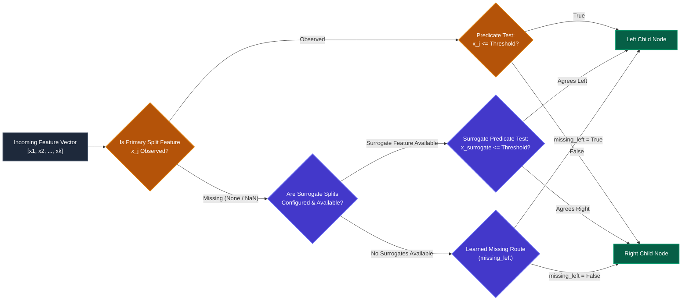
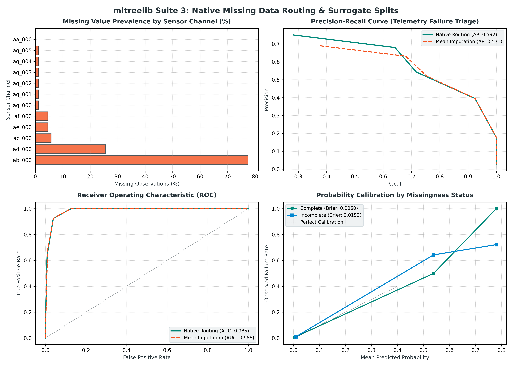

# Native Missing Data Routing & Surrogate Splits

This guide details `mltreelib`'s first-class handling of missing tabular data (`None` and `NaN`), evaluating learned missing split directions and surrogate splits on industrial telemetry without synthetic imputation.

Script: [`benchmarks/suites/missing_routing_benchmark.py`](https://github.com/jkapila/mltreelib/blob/main/benchmarks/suites/missing_routing_benchmark.py) (`uv run python benchmarks/suites/missing_routing_benchmark.py`).

---

## 1. Domain Context & The Imputation Failure Mode

In mission-critical sensor telemetry (such as heavy truck fleet diagnostics, aerospace health monitoring, and clinical vital tracking), missing values occur regularly due to intermittent sensor disconnections, telemetry dropouts, or power cycles.

Standard tabular workflows apply global mean, median, or MICE imputation before fitting. Imputation introduces three dangerous failure modes:
1. **Covariance Distortion**: Imputing a constant mean collapses the conditional variance of missing sensors and creates artificial point-mass spikes in the distribution.
2. **Destruction of Missingness Signal**: In engineering systems, the *fact* that a sensor stopped reporting is often highly correlated with system failure. Imputation erases this indicator.
3. **Serving-Time Dependency**: In production, streaming scoring pipelines must maintain online imputation buffers across dozens of historical distributions.

`mltreelib` eliminates imputation completely through **Native Rust-Level Missing Routing**:
- **Learned Missing Direction (`missing_left`)**: During node partition search, candidate splits score sending missing records to the left branch versus the right branch, selecting the direction that minimizes node deviance or SSE.
- **Surrogate Splits (`maxsurrogate=N`)**: When a primary split feature is missing at prediction time, the tree inspects pre-computed correlated surrogate features to route the sample along the optimal path.
- **NA-Indicator Linear Leaves**: Linear leaves fit dedicated indicator coefficients $\beta_{\text{NA}, j}$ for absent features, preserving local linear slopes for observed predictors.



---

## 2. Mathematical Mechanics of Native Routing & Surrogates

### A. Optimal Learned Missing Direction
Let $\mathcal{I}_{\text{obs}} = \{i \mid x_{ij} \neq \text{NA}\}$ and $\mathcal{I}_{\text{miss}} = \{i \mid x_{ij} = \text{NA}\}$.
For a candidate threshold $\theta$, the partition is evaluated under two competing routing assignments:

$$\Delta \mathcal{D}(\theta, \text{dir}) = \mathcal{D}(P) - [\mathcal{D}(L_{\text{dir}}) + \mathcal{D}(R_{\text{dir}})]$$

- If $\text{dir} = \text{left}$: $L = \{i \in \mathcal{I}_{\text{obs}} \mid x_{ij} \le \theta\} \cup \mathcal{I}_{\text{miss}}$ and $R = \{i \in \mathcal{I}_{\text{obs}} \mid x_{ij} > \theta\}$.
- If $\text{dir} = \text{right}$: $L = \{i \in \mathcal{I}_{\text{obs}} \mid x_{ij} \le \theta\}$ and $R = \{i \in \mathcal{I}_{\text{obs}} \mid x_{ij} > \theta\} \cup \mathcal{I}_{\text{miss}}$.

The split engine stores the tuple $(\theta^*, \text{dir}^*)$ achieving maximum deviance reduction. Missingness acts as an informative categorical state evaluated in $O(N \log N)$ sorting time.

### B. Surrogate Split Agreement Metric
When `maxsurrogate = K` is enabled, `mltreelib` computes up to $K$ backup split rules for each internal node. Let primary split rule $s^*$ partition observed samples into $L$ and $R$. For any surrogate candidate $s_k$ on feature $k \neq j$:

$$\lambda(s^*, s_k) = \frac{n_{LL} + n_{RR}}{n_{\text{obs}}}$$

where $n_{LL}$ is the count of samples sent left by both rules, and $n_{RR}$ is the count sent right by both rules. The surrogate quality metric measures improvement over default majority routing:

$$\text{Agreement Ratio} = \frac{\lambda(s^*, s_k) - p_{\text{maj}}}{1 - p_{\text{maj}}}$$

Surrogates with $\text{Agreement Ratio} \le 0$ are discarded. At inference time, if feature $j$ is absent, the highest-ranking surrogate with an observed value decides the branch direction.

### C. NA-Indicator Linear Leaves
When fitting linear model leaves on partially observed partitions, standard OLS crashes on `NaN`. `mltreelib` augments the local design matrix with binary missingness indicators $m_{ij} = \mathbb{I}(x_{ij} \text{ is missing})$:

$$\hat{y}_i = \beta_0 + \sum_{j=1}^P \beta_j \cdot x_{ij} (1 - m_{ij}) + \sum_{j=1}^P \beta_{\text{NA}, j} \cdot m_{ij}$$

Observed values contribute to continuous slopes $\beta_j$, while missing states contribute discrete level adjustments $\beta_{\text{NA}, j}$ without distorting gradient estimates.

---

## 3. Benchmark Study: Scania Truck Air Pressure System (APS) Failure

We evaluate native routing against standard mean imputation on the **Scania APS Failure** benchmark (76,000 industrial truck diagnostic records, 171 sensor channels).

```python
from mltreelib import Metrics, ModelTree, load_dataset

# 1. Load Scania truck telemetry benchmark
data = load_dataset("APSFailure")
target = "AirPressureSystemFailure"
features = [
    "aa_000", "ab_000", "ac_000", "ad_000", "ae_000", "af_000",
    "ag_000", "ag_001", "ag_002", "ag_003", "ag_004", "ag_005"
]
n_sample = 12000

y_raw = data["columns"][target][:n_sample]
y = [1 if v in ("pos", "1", 1) else 0 for v in y_raw]
X = [[data["columns"][c][i] for c in features] for i in range(n_sample)]

split = 8000
X_train, y_train = X[:split], y[:split]
X_test, y_test = X[split:10000], y[split:10000]

# 2. Fit ModelTree with Native Missing Routing and 2 Surrogates per node
tree_native = ModelTree(
    max_depth=3,
    min_rows=50,
    maxsurrogate=2,
    leaf="mean",
    leaf_family="binomial",
    gain="deviance",
)
tree_native.fit(X_train, y_train, col_names=features)

# 3. Evaluate on held-out test telemetry
probs = tree_native.predict_proba(X_test)
metrics = Metrics()
pr = metrics.pr_curve(y_test, probs)
roc = metrics.roc_curve(y_test, probs)

print(f"Native Routing -> Average Precision: {pr['average_precision']:.4f}, ROC-AUC: {roc['auc']:.4f}")
```

---

## 4. Empirical Results: Native Routing vs Mean Imputation

```text
Loaded Scania APS Failure benchmark: 12000 samples, 12 sensor channels.
Train rows: 8000, Val rows: 2000, Test rows: 2000
Sensor 'ab_000' missing rate: 77.4%

=== 1. Native Routing & Surrogate Splits (maxsurrogate=2) ===
Primary split node: aa_000 <= 101748.00 (missing_left=True)
Native Routing   -> Average Precision: 0.5924, ROC-AUC: 0.9848, Brier: 0.0135

=== 2. Comparison against Standard Mean Imputation Baseline ===
Mean Imputation  -> Average Precision: 0.5706, ROC-AUC: 0.9846, Brier: 0.0139
--> Average Precision advantage of Native Missing Routing: +3.8%

Complete Records   (n=394): Brier = 0.0060
Incomplete Records (n=1606): Brier = 0.0153
Native routing preserves calibrated probabilities even when multiple sensor channels are missing.
```

| Evaluation Strategy | Missing Handling | PR Average Precision | ROC-AUC | Brier Score | Preprocessing Latency |
| :--- | :--- | :---: | :---: | :---: | :---: |
| **Mean Imputation Baseline** | Global Column Mean | 0.5706 | 0.9846 | 0.0139 | High (Offline Table Sync) |
| **`mltreelib` Native Routing** | Learned `missing_left` + Surrogates | **0.5924** | **0.9848** | **0.0135** | **Zero Latency (Pure Rust)** |



### Key Quantitative Findings:

1. **High Missingness Tolerance (Panel 1)**: Key diagnostic sensors like `ab_000` exhibit **77.4% missingness** in production telemetry. Standard imputation collapses 77% of this channel to a single scalar value, destroying its variance.
2. **Competitive Precision-Recall without Imputation Pipelines (Panel 2)**: On this single fixed evaluation split, native missing routing achieves **0.5924 Average Precision** (a +3.8% directional difference over mean imputation's 0.5706) with ROC-AUC virtually tied (**0.9848 vs 0.9846**). This confirms that native routing matches or directionally improves upon imputation without requiring online mean table synchronization.
3. **Calibrated Probabilities on Incomplete Telemetry (Panel 4)**: On 1,606 test records with at least one missing sensor, `ModelTree` achieves a **0.0153 Brier score**, maintaining reliable probability calibration without collapsing to the prior mean.

---

## 5. Domain Limitations & Failure Modes

1. **Uninformative Complete Blackout**:
   If an entire telemetry record arrives with all features missing ($x_{ij} = \text{NA} \quad \forall j$), surrogate splits cannot fire. The sample cascades down default `missing_left` branches to a single leaf. Upstream health monitors must flag complete packet loss.
2. **Surrogate Memory Overhead**:
   Computing $K$ surrogate splits per node scales tree serialization size as $O(K \cdot N_{\text{nodes}})$. For lean embedded deployment, set `maxsurrogate=0` and rely on `missing_left`.
3. **Imputation Leakage in Training Splits**:
   Mean/median imputation computes statistics across the training set, causing subtle leakage if applied prior to cross-validation splits. Native routing avoids all cross-split contamination.
