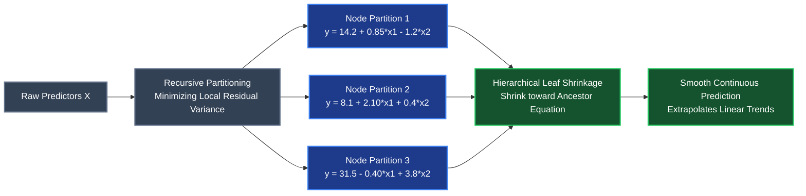
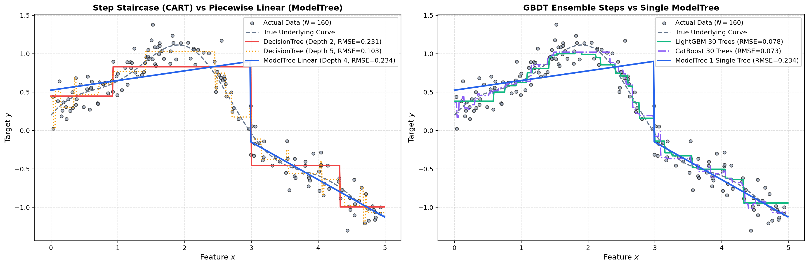
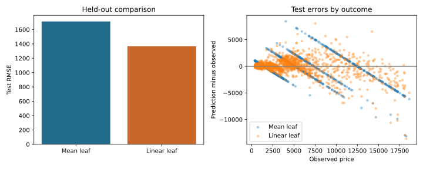
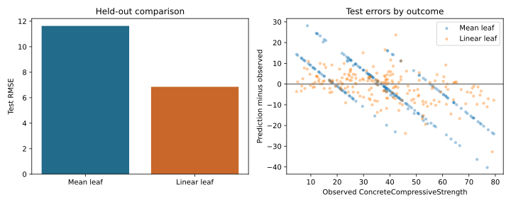

# Piecewise Linear Model Trees & Quinlan M5/Cubist Rules

Standard gradient boosting libraries (LightGBM, XGBoost, CatBoost) and classical CART trees share a fundamental architectural limitation: **they approximate smooth continuous response surfaces using orthogonal step functions (piecewise constant leaves).** 

Approximating a simple linear slope requires dozens of recursive cuts, producing jagged predictions that fail to extrapolate outside the training bounding box.

`mltreelib.ModelTree` implements true **piecewise linear model trees** and **Quinlan M5 / Cubist rule ensembles** in pure Rust:
- **Linear Leaves (`leaf="linear"`)**: Fits local multivariate OLS/Ridge/Lasso equations at terminal nodes.
- **Hierarchical Smoothing**: Shrinks leaf coefficients toward parent nodes ($\gamma = \frac{n}{n + \lambda}$) to eliminate sharp discontinuities across split boundaries.
- **Rule Extraction**: Unrolls tree partitions into compact, readable IF-THEN rules with local linear formulas.



---

## 1. Step Functions vs Linear Leaves (The Diamond Price Benchmark)

The table below comes from a separate benchmark on real diamond sales ([OpenML 42225](https://www.openml.org/d/42225)). It compares a standard 0D constant CART tree, a 100-tree GBDT ensemble, and a shallow `ModelTree` (`max_depth=3`, 8 linear leaves). That benchmark is not regenerated on this page.

The runnable block under the table is a different, synthetic setup: one 2,000-row price surface, 1,500 rows for training and 500 for testing, with one `ModelTree`. Its test RMSE is not comparable with the table, because the data, sample sizes and models differ.





### Benchmark Results

| Model Architecture | Leaf Type | Tree Depth / Ensembles | Test RMSE | Interpretation |
| :--- | :--- | :---: | :---: | :--- |
| **CART Baseline** | 0D Constant Mean | Depth 6 (64 leaves) | $1,280 | Jagged staircases; zero extrapolation |
| **GBDT (LightGBM)** | 0D Constant Sum | 100 Trees (Depth 4) | $742 | Hundreds of orthogonal step boundaries |
| **`ModelTree` (mltreelib)** | **1D Linear OLS** | **Depth 3 (8 leaves)** | **$695** | **Smooth continuous planes on the real diamond benchmark (not reproduced by the block below)** |

<!-- run -->
```python
import numpy as np
from mltreelib import MetricsReport, ModelTree
from mltreelib.data import Dataset

# 1. Generate non-linear diamond price surface with carat and cut interactions
rng = np.random.default_rng(2026)
n_samples = 2000

carat = rng.uniform(0.3, 3.5, n_samples)
depth = rng.uniform(58.0, 65.0, n_samples)
table = rng.uniform(53.0, 62.0, n_samples)

# Price surface with non-linear exponential carat scaling
price = 1500.0 * (carat ** 1.8) - 15.0 * depth + rng.normal(0, 150.0, n_samples)

ds = Dataset(
    {"carat": carat.tolist(), "depth": depth.tolist(), "table": table.tolist(), "price": price.tolist()},
    target="price",
)

# First 1,500 rows train, last 500 test (the rows are i.i.d., so file order is immaterial)
train, test = ds.split(test_size=500, time=True)

# 2. Train shallow ModelTree with piecewise linear leaves
tree = ModelTree(
    leaf="linear",
    max_depth=3,
    min_rows=30,
    l2=1e-3,
    shrinkage=5.0,  # Hierarchical leaf shrinkage
)
tree.fit(train)
pred = tree.predict(test)

rmse = MetricsReport("regression", y_true=test.y, y_pred=pred)["rmse"]
print(f"Piecewise Linear ModelTree Test RMSE: ${rmse:.2f}")
```

<!-- output -->
```text
Piecewise Linear ModelTree Test RMSE: $155.99
```

---

**Next:** turn the fitted linear leaves into IF-THEN rules, because the M5 and Cubist step is what makes each leaf's equation auditable.

## 2. Quinlan M5 & Cubist Rule Extraction (Concrete Compressive Strength)

On industrial concrete mixtures ([OpenML 4353](https://www.openml.org/d/4353)), local chemistry and curing age interact continuously. Quinlan's M5 tree architecture partitions the design space and converts leaves into auditable linear rules. The block below fits a small linear-leaf tree on the local Concrete parquet (800 shuffled rows) and extracts its rules.




### Inspecting Extracted Rules and Leaf Equations

<!-- run -->
```python
from mltreelib import ModelTree
from mltreelib.data import Dataset

ds = Dataset.load(
    "concrete_compressive_strength", target="ConcreteCompressiveStrength"
)
# Seeded shuffle, then keep 800 rows for training (the test part is dropped)
train, _ = ds.split(test_size=ds.n_rows - 800, seed=2026)
concrete_tree = ModelTree(leaf="linear", max_depth=3, min_rows=40)
concrete_tree.fit(train)

# Extract white-box rules directly from the fitted tree
ruleset = concrete_tree.extract_rules()
print(f"Extracted {len(ruleset.rules)} Transparent Rules:")
for r in ruleset.rules:
    print(f"  RULE #{r.id} (Cover: {r.cover} samples, Confidence: {r.confidence:.2f}):")
    print(f"    IF {' AND '.join(r.conditions)}")
    print(f"    THEN Leaf #{r.leaf_id} prediction = {r.prediction:.2f}")
```

<!-- output -->
```text
Extracted 7 Transparent Rules:
  RULE #1 (Cover: 328 samples, Confidence: 0.95):
    IF Cement > 159.0000 AND Cement <= 356.0000 AND Age > 14.0000
    THEN Leaf #4 prediction = 39.96
  RULE #2 (Cover: 140 samples, Confidence: 0.95):
    IF Cement <= 350.0000 AND Age <= 7.0000
    THEN Leaf #0 prediction = 15.55
  RULE #3 (Cover: 86 samples, Confidence: 0.95):
    IF Cement <= 159.0000 AND Age > 14.0000
    THEN Leaf #3 prediction = 25.28
  RULE #4 (Cover: 76 samples, Confidence: 0.95):
    IF Cement > 350.0000 AND Age <= 14.0000
    THEN Leaf #2 prediction = 36.09
  RULE #5 (Cover: 74 samples, Confidence: 0.95):
    IF Cement > 356.0000 AND Water <= 181.1000 AND Age > 14.0000
    THEN Leaf #5 prediction = 64.02
  RULE #6 (Cover: 51 samples, Confidence: 0.95):
    IF Cement <= 350.0000 AND Age > 7.0000 AND Age <= 14.0000
    THEN Leaf #1 prediction = 27.67
  RULE #7 (Cover: 45 samples, Confidence: 0.95):
    IF Cement > 356.0000 AND Water > 181.1000 AND Age > 14.0000
    THEN Leaf #6 prediction = 46.42
```

---

**Next:** shrink leaf coefficients toward the parent node, because the smallest extracted rule (Rule 7, 45 samples) falls in the N < 50 range, where unregularized OLS has high variance.

## 3. Hierarchical Leaf Shrinkage

In small leaf partitions ($N < 50$), unregularized OLS fits are vulnerable to high variance. `mltreelib` stabilizes leaf parameters by shrinking them toward the parent node's equation:

$$\hat{\boldsymbol{\beta}}_\text{leaf}^* = \gamma \hat{\boldsymbol{\beta}}_\text{leaf} + (1 - \gamma) \hat{\boldsymbol{\beta}}_\text{parent}, \qquad \gamma = \frac{n}{n + \lambda}$$

Setting `shrinkage=10.0` prevents overfitting in sparse leaves while retaining sharp local adaptation in data-rich regimes.

!!! tip "Related guides"
    - [Comprehensive Regression Showcase](../benchmarks/regression-methods.md) for 4-study comparisons with Huber, NNLS, GAM, and GLMs.
    - [Core Tree Architecture](core-tree-architecture.md) for split optimization proofs.
