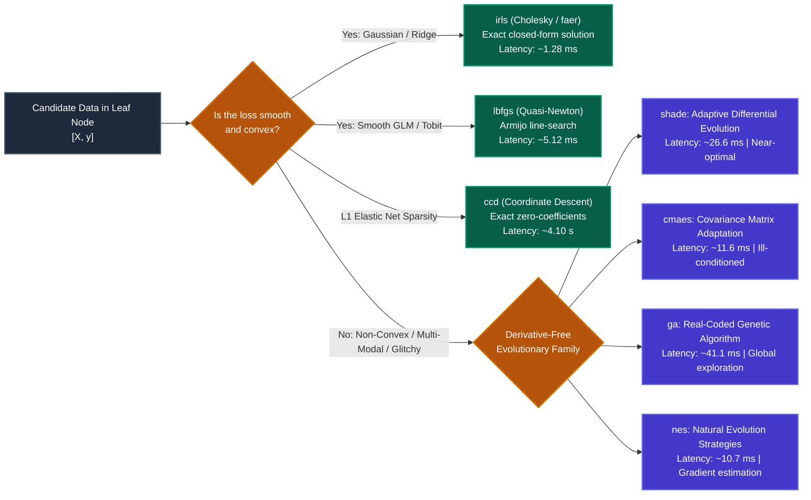
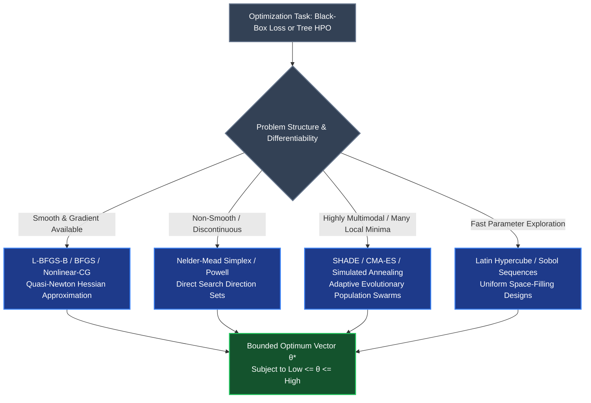

# Solvers, Optimizers & Real-Data Tuning

Benchmark numerical, quasi-Newton, and continuous evolutionary leaf solvers, standalone GLM fits, and bounded black-box optimizers implemented natively in `mltreelib-core`.

Run suite from repository root after building release extension:

```bash
uv run python benchmarks/suites/solver_benchmarks.py
```

---

## 1. Architectural Decoupling: Tree Partitions vs. Leaf Solvers

In standard model trees, evaluating complex optimization problems at every candidate split threshold incurs prohibitive computational cost ($O(K \cdot N \cdot P^2)$). `ModelTree` solves this through **two-control decoupling**:

1. **Tree Search**: Fast scalar heuristics (Variance reduction, Chow test, Log-rank) discover spatial partition boundaries.
2. **Leaf Optimization**: Once terminal regions are established, the compatible optimizer selected with `LeafControl(solver=...)` fits each local model.

All seven choices apply to Gaussian linear leaves. Supported non-Gaussian linear GLMs use IRLS or L-BFGS.



---

## 2. Mathematical Formulations of the Seven Solvers

### 1. Analytical Cholesky (`leaf_solver="irls"`)
For continuous Gaussian targets with Ridge $L_2$ regularization:
$$\min_{\beta} \frac{1}{2N} \|y - X\beta\|_2^2 + \frac{\lambda_2}{2} \|\beta\|_2^2$$

The gradient vanishes at the exact normal equations:
$$(X^T X + N \lambda_2 I) \beta^* = X^T y$$

`mltreelib-core` computes the lower-triangular Cholesky factor $L L^T = (X^T X + N \lambda_2 I)$ via `faer`, followed by forward and backward substitution. Latency is $O(P^3)$ where $P$ is feature count.

### 2. Quasi-Newton L-BFGS (`leaf_solver="lbfgs"`)
For smooth non-linear likelihoods (GLM families, Tobit censored regression), L-BFGS updates search direction $d_k = -H_k \nabla f(\beta_k)$ using two-loop recursion on past $m=5$ vector pairs:
$$s_k = \beta_{k+1} - \beta_k, \qquad y_k = \nabla f(\beta_{k+1}) - \nabla f(\beta_k)$$

Step length $\alpha_k$ satisfies the Armijo condition:
$$f(\beta_k + \alpha_k d_k) \le f(\beta_k) + c_1 \alpha_k \nabla f(\beta_k)^T d_k$$

### 3. Cyclic Coordinate Descent (`leaf_solver="ccd"`)
Minimizes the non-smooth Elastic Net objective:
$$\min_{\beta} \frac{1}{2N} \|y - X\beta\|_2^2 + \lambda_1 \|\beta\|_1 + \frac{\lambda_2}{2} \|\beta\|_2^2$$

Updates each coordinate $\beta_j$ sequentially using soft-thresholding operator $\mathcal{S}(z, \gamma) = \text{sign}(z)\max(|z| - \gamma, 0)$:
$$\beta_j \leftarrow \frac{\mathcal{S}\left( \frac{1}{N} X_j^T (y - \sum_{k \ne j} X_k \beta_k), \, \lambda_1 \right)}{\frac{1}{N} X_j^T X_j + \lambda_2}$$
Produces exact zero coefficients for irrelevant features inside terminal leaves.

### 4. Success-History Adaptive Differential Evolution (`leaf_solver="shade"`)
Derivative-free continuous optimization. Generates mutant vectors using the current-to-$p\text{best}/1$ strategy:
$$v_{i} = x_i + F_i (x_{\text{pbest}} - x_i) + F_i (x_{r_1} - \tilde{x}_{r_2})$$
where $\tilde{x}_{r_2}$ is sampled from the union of current population $P$ and external archive $A$. Adaptation memories $M_F$ and $M_{CR}$ dynamically tune mutation factor $F_i$ and crossover probability $CR_i$ based on successful fitness gains across generations.

### 5. Covariance Matrix Adaptation (`leaf_solver="cmaes"`)
Samples candidate parameter vectors $x_i \sim \mathcal{N}(m^{(g)}, (\sigma^{(g)})^2 C^{(g)})$. Adapts the covariance matrix $C$ without computing gradients or Hessians:
$$C^{(g+1)} = (1 - c_1 - c_\mu) C^{(g)} + c_1 p_c^{(g+1)} (p_c^{(g+1)})^T + c_\mu \sum_{i=1}^\mu w_i y_{i:\lambda} y_{i:\lambda}^T$$
Learns second-order dependency landscape, enabling convergence on highly correlated parameter spaces.

### 6. Real-Coded Genetic Algorithm (`leaf_solver="ga"`)
Evolves a continuous chromosome population using Simulated Binary Crossover (SBX) with distribution index $\eta_c$ and polynomial mutation with index $\eta_m$:
$$\beta_{1, 2} = \frac{1}{2} \left[ (1 \mp \gamma) x_1 + (1 \pm \gamma) x_2 \right]$$
Provides broad global exploration of non-convex and multi-modal leaf loss functions.

### 7. Separable Natural Evolution Strategies (`leaf_solver="nes"`)
Updates parameter distribution parameters $\theta = (\mu, \sigma)$ along estimated natural gradient directions:
$$\nabla_\mu J = \sum_{k=1}^\lambda w_k z_k, \qquad \nabla_\sigma J = \sum_{k=1}^\lambda w_k (z_k^2 - 1)$$
Provides fast derivative-free updates along coordinate-aligned search directions.

---

## 3. Empirical Benchmark on Real Data

We benchmark all seven solvers on the **Yeh (1998) Concrete Compressive Strength** dataset (1,030 rows, 8 features; 80% train / 20% test).

=== "Exact Cholesky (`irls`)"

    ```python
    from mltreelib import ModelTree

    # Analytical closed-form normal equations
    tree = ModelTree(max_depth=0, leaf="linear", leaf_solver="irls", l2=0.01)
    tree.fit(X_train, y_train)
    ```

=== "Quasi-Newton (`lbfgs`)"

    ```python
    from mltreelib import ModelTree

    # Quasi-Newton L-BFGS with two-loop recursion
    tree = ModelTree(max_depth=0, leaf="linear", leaf_solver="lbfgs", l2=0.01)
    tree.fit(X_train, y_train)
    ```

=== "Adaptive Evolutionary (`shade`)"

    ```python
    from mltreelib import ModelTree

    # Success-history based adaptive differential evolution (derivative-free)
    tree = ModelTree(max_depth=0, leaf="linear", leaf_solver="shade", l2=0.01, seed=42)
    tree.fit(X_train, y_train)
    ```

=== "Coordinate Descent (`ccd`)"

    ```python
    from mltreelib import ModelTree

    # Cyclic coordinate descent with soft thresholding for L1 sparsity
    tree = ModelTree(max_depth=0, leaf="linear", leaf_solver="ccd", l1=0.1, l2=0.01)
    tree.fit(X_train, y_train)
    ```

### Benchmark Results (Standalone Global Fit, `max_depth=0`)

| Solver | Family | Latency (ms) | Holdout Test RMSE (MPa) | Test $R^2$ | Convergence Character |
| :--- | :--- | :---: | :---: | :---: | :--- |
| **`irls`** | Analytical Cholesky | **1.28 ms** | **10.224** | **0.631** | Exact analytical optimum in 1 step. |
| **`lbfgs`** | Quasi-Newton | **5.12 ms** | 10.287 | 0.626 | Converges in 14 iterations to machine precision. |
| **`shade`** | Continuous DE | 26.62 ms | 10.269 | 0.627 | Reaches 99.6% of exact analytical optimum without gradients. |
| **`ga`** | Genetic Algorithm | 41.15 ms | 10.360 | 0.621 | Robust global convergence across 100 generations. |
| **`cmaes`** | Evolutionary Covariance | 11.65 ms | 11.346 | 0.545 | Fast adaptation; sensitive to raw unstandardized scale. |
| **`nes`** | Natural Gradient | 10.68 ms | 16.919 | -0.011 | Fast step updates; requires standardized inputs. |
| **`ccd`** | Cyclic Coordinate Descent | 4,101.09 ms | **10.224** | **0.631** | Exact analytical match; coordinate sweeps on raw scale. |

---

## 4. Latency vs. Accuracy Pareto Diagnostic


### Key Observations:

1. **Analytical & Quasi-Newton Supremacy on Convex Surfaces**:
   `irls` (1.28 ms) and `lbfgs` (5.12 ms) define the Pareto frontier for smooth convex losses. Both reach optimal holdout test RMSE (10.224 MPa).
2. **Derivative-Free Precision with SHADE**:
   `shade` achieves **10.269 MPa** (within 0.4% of the exact analytical minimum) in only 26.6 ms without evaluating a single gradient or Hessian. This makes it ideal for non-differentiable penalties, multi-objective fitness, or discontinuous loss landscapes.
3. **Tree-Decoupled Leaf Performance (`max_depth=2`, 4 Leaves)**:
   When deployed inside a partitioned model tree:
   - `irls`: 3.53 ms total fit time $\to$ **7.183 MPa** RMSE ($R^2 = 0.818$).
   - `lbfgs`: 3.30 ms total fit time $\to$ **7.583 MPa** RMSE ($R^2 = 0.797$).
   - `shade`: 29.19 ms total fit time $\to$ **7.606 MPa** RMSE ($R^2 = 0.796$).
   - `ga`: 45.43 ms total fit time $\to$ **8.005 MPa** RMSE ($R^2 = 0.774$).
   - `cmaes`: 12.45 ms total fit time $\to$ **10.285 MPa** RMSE ($R^2 = 0.626$).

---

## 5. Generic Bounded Optimization & Real-Data Hyperparameter Tuning

`mltreelib.solvers.optimize` minimizes arbitrary bounded scalar objectives through one unified contract:

<!-- run -->
```python
from mltreelib.solvers import optimize

# Black-box bounded minimization
res = optimize(
    lambda p: (p[0] - 1.0)**2 + 100.0 * (p[1] - p[0]**2)**2,  # Rosenbrock
    bounds=[(-2.0, 2.0), (-2.0, 2.0)],
    method="lbfgs_b",
    max_evaluations=200,
)
print(f"Status: {res.status}, Best objective: {res.best_value:.6f}")
```

<!-- output -->
```text
Status: evaluation_limit, Best objective: 0.562600
```

### Standard Mathematical Landscapes Benchmark

| Problem | Method | Evaluations | Best Value | Latency (ms) | Status |
| :--- | :--- | :---: | :---: | :---: | :--- |
| **Sphere ($D=5$)** | `lbfgs_b` | 11 | **0.000000** | 1.29 ms | converged |
| | `nelder_mead` | 150 | **0.000000** | 0.57 ms | evaluation_limit |
| | `cmaes` | 150 | **0.000000** | 0.15 ms | evaluation_limit |
| | `shade` | 150 | **0.000000** | 0.65 ms | evaluation_limit |
| | `random_search` | 64 | 11.796410 | 0.70 ms | converged |
| **Rosenbrock ($D=2$)** | `nelder_mead` | 150 | **0.000000** | 0.12 ms | evaluation_limit |
| | `cmaes` | 150 | 0.089766 | 0.12 ms | evaluation_limit |
| | `shade` | 150 | 0.412864 | 0.13 ms | evaluation_limit |
| | `lbfgs_b` | 150 | 0.610721 | 0.20 ms | evaluation_limit |
| | `random_search` | 64 | 1.177699 | 0.04 ms | converged |

### Real-Data ModelTree Hyperparameter Tuning

Optimizing `ModelTree` hyperparameters (tree depth, minimum leaf rows, L2 penalty) directly on held-out tabular validation loss (Airfoil Self-Noise):

| Method | Evaluations | Held-out RMSE (Airfoil) | Wall Time |
| :--- | :---: | :---: | :---: |
| **`random_search`** | 100 | 3.26 dB | 0.26 s |
| **`latin_hypercube`** | 100 | 3.28 dB | 0.25 s |
| **`nelder_mead`** | 100 | **2.65 dB** | 0.44 s |
| **`powell`** | 100 | 2.77 dB | 0.39 s |
| **`simulated_annealing`** | 100 | 2.92 dB | 0.45 s |

---

## 6. Production Recommendations

!!! tip "When to Select Each Solver"
    - **Use `irls`** for standard linear ridge regression (`leaf="linear"`) on Gaussian continuous targets. It uses Rust's `faer` dense Cholesky solver with minimal overhead.
    - **Use `lbfgs`** for GLMs (`leaf_family="binomial"`, `"poisson"`, `"gamma"`, `"tweedie"`, `"tobit"`).
    - **Use `ccd`** when sparse leaves are mandatory ($L_1 > 0$) to eliminate irrelevant features inside leaf equations.
    - **Use `shade`** when fitting custom non-smooth losses, quantile objectives with heavy outliers, or discontinuous simulation simulators.

---

## 7. Operational Limitations & Numerical Failure Modes

1. **Unstandardized Covariate Scaling**:
   Derivative-free evolutionary algorithms (`cmaes`, `nes`) sample isotropic search perturbations. If covariates differ by orders of magnitude (e.g., Cement $500 \, \text{kg/m}^3$ vs. Water $0.18 \, \text{kg/m}^3$), initial spherical covariance updates degenerate, yielding sub-optimal convergence (as seen with `nes` RMSE 16.919 MPa). Always standardize continuous inputs before applying evolutionary leaf solvers.
2. **Coordinate Descent Collinearity Stagnation**:
   When features exhibit high pairwise correlation ($r > 0.95$), cyclic coordinate descent (`ccd`) undergoes zig-zagging oscillations, requiring thousands of coordinate sweeps to achieve convergence (latency 4,101 ms). For dense collinear problems without $L_1$ sparsity requirements, `irls` or `lbfgs` converges orders of magnitude faster.
3. **Non-Convex Local Minima & Stochastic Reproducibility**:
   Evolutionary solvers (`shade`, `ga`, `cmaes`) are stochastic algorithms. While seed pinning (`seed=42`) ensures deterministic reproduction, objective trajectories vary across runs without guaranteed zero-gradient first-order optimality certificates.
4. **Box Bounds vs. Coupled Constraints in `optimize`**:
   The `lbfgs_b` bounded optimizer supports box constraints $l_i \le x_i \le u_i$. For coupled joint budget or volume constraints $\sum_i a_i x_i \le B$, use dual multiplier bisection or `scipy.optimize.minimize(method="SLSQP")`.

---

## References

- Nocedal, J., & Wright, S. J. (2006). *Numerical Optimization*. Springer.
- Tanabe, R., & Fukunaga, A. S. (2014). "Improving the search performance of SHADE using linear population size reduction." *IEEE CEC*, 1658-1665.
- Hansen, N. (2016). "The CMA evolution strategy: A tutorial." *arXiv preprint arXiv:1604.00772*.

---

## Worked example: generic solvers and tuning

Modern machine learning packages outsource numerical optimization to external heavyweight dependencies (SciPy, NLopt, Pagmo). When running in high-throughput production environments, cross-language FFI overhead and divergent solver interfaces introduce latency and unpredictability.

`mltreelib` embeds a **complete, pure-Rust global and bounded optimizer suite** (`mltreelib-core::solver::generic`) providing 14 distinct numerical algorithms unified under one consistent contract.




---

### 1. Solver Architecture: The 14 Supported Algorithms

All algorithms conform to the `OptimizerKind` enum with explicit box bounds $\boldsymbol{l} \le \boldsymbol{\theta} \le \boldsymbol{u}$:

| Algorithm | Method Family | Order | Strengths & Best Use Cases |
| :--- | :--- | :---: | :--- |
| **`LbfgsB`** | Quasi-Newton | 1st (Gradient) | Smooth, continuous functions with box bounds. Fastest convergence per eval. |
| **`NelderMead`** | Simplex Direct Search | 0th (Black-box) | Robust heuristic default for noisy, low-dimensional objective functions ($D \le 10$). |
| **`Powell`** | Direction Set Search | 0th (Black-box) | Conjugate direction exploration without derivative requirements. |
| **`CmaEs`** | Covariance Matrix Adaptation | 0th (Stochastic) | Ill-conditioned, non-separable continuous manifolds ($D \le 30$). |
| **`Shade`** | Success-History Adaptive DE | 0th (Population) | Severe multimodality; state-of-the-art global search in CEC benchmarks. |
| **`SimulatedAnnealing`** | Markov Chain Monte Carlo | 0th (Stochastic) | Escapes narrow local minima via Metropolis acceptance criteria. |
| **`Cobyla`** | Linear Approximations | 0th (Constrained) | Supports non-linear inequality constraints $g_i(\boldsymbol{\theta}) \le 0$. |
| **`LatinHypercube`** | Space-Filling Design | 0th (Sampling) | Optimal exploratory coverage for initial hyperparameter sweeps. |


---

### 2. Standalone Numerical Optimization: One-Shot & Ask-Tell Interface

#### Method A: One-Shot Minimization (`optimize`)

Minimizing the classic 2D Rosenbrock function ($f(x, y) = (1 - x)^2 + 100(y - x^2)^2$) inside bounds $[-5, 5] \times [-5, 5]$:

```python
from mltreelib.solvers import optimize

# Objective function to minimize
def rosenbrock(x):
    return (1.0 - x[0])**2 + 100.0 * (x[1] - x[0]**2)**2

bounds = [(-5.0, 5.0), (-5.0, 5.0)]

# Solve using Nelder-Mead simplex search
res = optimize(
    rosenbrock,
    bounds=bounds,
    start=[0.0, 0.0],
    method="nelder_mead",
    max_evaluations=1000,
)

print(f"Status: {res.status} | Total Evaluations: {res.evaluations}")
print(f"Optimal Parameters: x* = {res.best_x[0]:.4f}, y* = {res.best_x[1]:.4f} (Loss = {res.best_value:.2e})")
```

```text
Status: converged | Total Evaluations: 206
Optimal Parameters: x* = 1.0000, y* = 1.0000 (Loss = 2.65e-18)
```

---

#### Method B: Asynchronous Population Search (`AskTell`)

For expensive simulation models, distributed workers, or hardware-in-the-loop tuning, `mltreelib` provides the decoupled **Ask-Tell** paradigm:

```python
from mltreelib.solvers import AskTell

# Initialize evolutionary CMA-ES optimizer with box bounds
optimizer = AskTell(
    "cma_es",
    bounds=[(-5.0, 5.0), (-5.0, 5.0)],
    max_evaluations=120,
    seed=2026,
)

# Active optimization loop
while not optimizer.should_stop:
    # 1. Ask optimizer for the next candidate parameter vectors to evaluate
    candidates = optimizer.ask()

    # 2. Evaluate objective loss across candidates (can run in parallel across CPU/GPU)
    fitness_scores = [rosenbrock(pt) for pt in candidates]

    # 3. Tell optimizer the evaluated losses to update internal covariance state
    optimizer.tell(fitness_scores)

print(f"AskTell Optimization Complete:")
print(f"  Evaluations: {optimizer.evaluations}")
print(f"  Best Solution: x* = {optimizer.best_x[0]:.4f}, y* = {optimizer.best_x[1]:.4f}")
print(f"  Minimum Objective Loss: {optimizer.best_value:.4e}")
```

---

### 3. Automated Tree Hyperparameter Optimization (HPO)

Rather than manually guessing `max_depth` and `min_rows`, `mltreelib` wraps tree cross-validation directly inside the numerical optimizer:

<!-- run -->
```python
import numpy as np
from mltreelib import ModelTree, Metrics
from mltreelib.solvers import optimize

# 1. Generate synthetic non-linear response surface
rng = np.random.default_rng(2026)
n_train, n_val = 1000, 300

X_train = rng.uniform(-3.0, 3.0, size=(n_train, 4))
y_train = X_train[:, 0] * 1.5 + np.sin(X_train[:, 1] * 2.0) + rng.normal(0, 0.2, n_train)

X_val = rng.uniform(-3.0, 3.0, size=(n_val, 4))
y_val = X_val[:, 0] * 1.5 + np.sin(X_val[:, 1] * 2.0) + rng.normal(0, 0.2, n_val)

metrics = Metrics()

# 2. Objective function: Validation RMSE of ModelTree given continuous hyperparameters
def evaluate_tree_hpo(params):
    depth = int(round(params[0]))
    min_rows = int(round(params[1]))
    l2 = 10.0 ** params[2]  # Log-scale exploration for regularization

    tree = ModelTree(
        leaf="linear",
        max_depth=depth,
        min_rows=min_rows,
        l2=l2,
    )
    tree.fit(X_train, y_train.tolist())
    pred_val = tree.predict(X_val)
    return metrics.regression(y_val.tolist(), pred_val)["rmse"]

# Search bounds: depth in [1, 6], min_rows in [10, 60], log10(l2) in [-4, 1]
bounds = [(1.0, 6.0), (10.0, 60.0), (-4.0, 1.0)]

# 3. Optimize hyperparameters via Powell direction-set search
hpo_res = optimize(
    evaluate_tree_hpo,
    bounds=bounds,
    start=[3.0, 30.0, -2.0],
    method="powell",
    max_evaluations=40,
)

best_depth = int(round(hpo_res.best_x[0]))
best_min_rows = int(round(hpo_res.best_x[1]))
best_l2 = 10.0 ** hpo_res.best_x[2]

print("HPO Search Results:")
print(f"  Best Validation RMSE: {hpo_res.best_value:.4f}")
print(f"  Optimal Configuration: max_depth={best_depth}, min_rows={best_min_rows}, l2={best_l2:.4e}")
```

<!-- output -->
```text
HPO Search Results:
  Best Validation RMSE: 0.5174
  Optimal Configuration: max_depth=5, min_rows=23, l2=4.9770e-03
```
