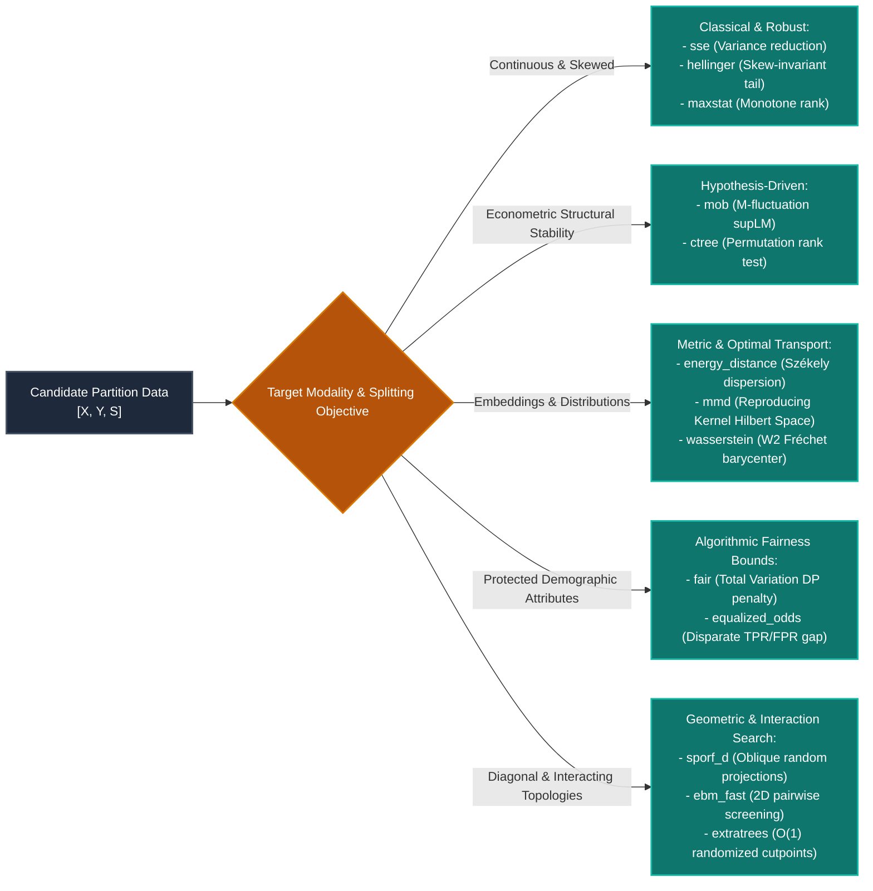

# Exotic Statistical, Metric & Fair Splitting Criteria (Spec 12 Suite)

This guide demonstrates `mltreelib`'s exotic statistical hypothesis testing, optimal transport, and metric splitting criteria.

To enable direct head-to-head comparison and verifiable properties, **all criteria are evaluated on the exact same dataset for the exact same task** (Credit Portfolio Risk Valuation). As new phases are developed, they are integrated directly into this unified benchmarking framework.

Companion executable script:
- [`benchmarks/suites/statistical_and_metric_splitting.py`](https://github.com/jkapila/mltreelib/blob/main/benchmarks/suites/statistical_and_metric_splitting.py) (`uv run python benchmarks/suites/statistical_and_metric_splitting.py`)

---

## Architectural Splitting Taxonomy



---

## Shared Benchmark Task: Credit Portfolio Risk Valuation

We generate a unified financial risk dataset ($N = 300$) where each observation represents an account with:
- `score`: Continuous risk score $\in [-2.0, 2.0]$ with an underlying structural break at $0.0$.
- `zip_code`: High-cardinality noise categorical feature (50 zip code levels with zero true signal).
- `tier_flag`: Low-cardinality binary signal factor ($\{0, 1\}$).
- `gender`: Protected demographic attribute ($S \in \{0, 1\}$).
- `gender_proxy`: Unfair proxy feature with high correlation to `gender`.
- `fair_merit`: Independent financial merit score.

Target modalities derived from the same underlying portfolio distribution:
1. **Scalar Target ($y \in \mathbb{R}$)**: Portfolio loss / return.
2. **Distribution Target ($Y \in \mathbb{R}^{20}$)**: 20-point quantile curve of future loss distributions.
3. **Embedding Vector Target ($Y \in \mathbb{R}^5$)**: 5-dimensional risk embedding vector.

### Shared setup

The block below generates the benchmark data used by every section on this page. It is seeded, so every run gives the same rows.

<!-- run -->
```python
import numpy as np
from mltreelib import ModelTree, fast_interaction_screen

def brief(split):
    """Printable split: threshold and gain, with the test gate reduced to its verdict and p-value."""
    if split is None:
        return None
    out = {k: v for k, v in split.items() if k != "gate"}
    gate = split.get("gate")
    if gate:
        out["gate"] = {"test": gate["test_name"], "passed": gate["passed"], "p_value": float(f"{gate['p_value']:.3g}")}
    return out

rng = np.random.default_rng(2026)
n = 300
score = rng.uniform(-2.0, 2.0, n)
zip_idx = rng.integers(0, 50, n)                  # 50 levels with no true signal
tier_flag = rng.integers(0, 2, n).astype(float)
gender = rng.integers(0, 2, n).astype(float)      # protected attribute (column 3)
gender_proxy = gender + rng.normal(0, 0.3, n)
fair_merit = rng.normal(50.0, 10.0, n)

y_scalar = np.where(score > 0, 2.0 * score, -1.0 * score) + 0.5 * tier_flag + rng.normal(0, 0.3, n)
y_vectors = np.column_stack([y_scalar + rng.normal(0, s, n) for s in (0.2, 0.4, 0.6, 0.8, 1.0)])
y_quantiles = np.sort(y_scalar[:, None] + rng.normal(0, 0.3, (n, 20)), axis=1)
y_rare = (y_scalar > np.quantile(y_scalar, 0.95)).astype(int)
y_fair = (y_scalar > np.median(y_scalar)).astype(int)
y_inter = y_scalar + 1.5 * (score > 0) * tier_flag + rng.normal(0, 0.2, n)

X = [[float(score[i]), f"z{zip_idx[i]:02d}", float(tier_flag[i]), float(gender[i]),
      float(gender_proxy[i]), float(fair_merit[i])] for i in range(n)]
col_names = ["score", "zip_code", "tier_flag", "gender", "gender_proxy", "fair_merit"]
dtypes = ["numeric", "categorical", "numeric", "numeric", "numeric", "numeric"]
y_scalar, y_fair, y_rare, y_inter = (v.tolist() for v in (y_scalar, y_fair, y_rare, y_inter))
y_vectors, y_quantiles = y_vectors.tolist(), y_quantiles.tolist()
```

---

## 1. Baseline: Standard CART (`gain="sse"`)

Standard recursive partitioning greedily maximizes variance reduction:

$$\text{Gain}_{\text{SSE}} = \text{SSE}(P) - [\text{SSE}(L) + \text{SSE}(R)]$$

### Code Run
<!-- run -->
```python
from mltreelib import ModelTree

# Standard CART with variance reduction
tree_cart = ModelTree(max_depth=1, min_rows=15, gain="sse", prune="none")
tree_cart.fit(X, y_scalar, col_names=col_names, dtypes=dtypes)

print("Split:", brief(tree_cart.root_split()))
```

<!-- output -->
```text
Split: {'col': 'score', 'threshold': 1.024, 'missing_left': True, 'gain': 230.66928608111027}
```

---

## 2. Phase 12A: Model-Based Recursive Partitioning (`gain="mob"`)

**Best for**: Detecting parameter instability or structural breaks along continuous covariates without refitting linear models across thousands of candidate cutpoints.

Fits the leaf linear regression **once** at the parent node, calculates individual score residuals $\psi_i = \nabla_\theta \ell_i(\hat{\theta})$, and evaluates empirical fluctuation processes via the supLM test statistic:

$$\max_{t \in [\underline{t}, \bar{t}]} \frac{\|W(t)\|^2}{t(1-t)}$$

### Code Run
<!-- run -->
```python
# MOB parameter instability test
tree_mob = ModelTree(
    gain="mob",
    split_test="mob",
    max_depth=1,
    min_rows=15,
    leaf="linear",
    prune="none",
)
tree_mob.fit(X, y_scalar, col_names=col_names, dtypes=dtypes)

print("Split:", brief(tree_mob.root_split()))
print("Diagnostics:", tree_mob.split_diagnostics()[0])
```

<!-- output -->
```text
Split: {'col': 'score', 'threshold': 1.2910996796255607, 'missing_left': True, 'gain': 220.67164097676942, 'gate': {'test': 'mob', 'passed': True, 'p_value': 1.13e-41}}
Diagnostics: None
```

---

## 3. Phase 12B: Conditional Inference Trees (`gain="ctree"`)

**Best for**: Tabular datasets with mixed scale and high-cardinality factors (e.g. zip codes, store IDs, diagnoses) where CART suffers from selection bias.

CTree separates variable selection from splitpoint selection using permutation rank tests. Under $H_0$, test statistics follow standardized $\chi^2$ distributions regardless of cardinality:

$$c_j = z_j^2 \sim \chi^2_1 \quad (\text{numeric}), \qquad c_j = \frac{\text{SSB}}{V_Y} \sim \chi^2_{C - 1} \quad (\text{categorical})$$

### Code Run
<!-- run -->
```python
# CTree unbiased permutation rank test
tree_ctree = ModelTree(
    gain="ctree",
    split_test="ctree",
    max_depth=1,
    min_rows=15,
    prune="none",
    seed=42,
)
tree_ctree.fit(X, y_scalar, col_names=col_names, dtypes=dtypes)

print("Split:", brief(tree_ctree.root_split()))
```

<!-- output -->
```text
Split: {'col': 'score', 'threshold': 1.0283967960109397, 'missing_left': True, 'gain': 181.71945630327696, 'gate': {'test': 'ctree', 'passed': True, 'p_value': 1.22e-20}}
```

---

## 4. Phase 12C: Metric & Kernel Splitting (`gain="energy_distance"` & `gain="mmd"`)

**Best for**: Multi-output targets, embeddings, representations, and complex distribution targets $Y \in \mathbb{R}^D$ where scalar variance is undefined.

- **Energy Distance (Székely & Rizzo)**:
  $$\text{Gain}_{\mathcal{E}} = \frac{W_L W_R}{W_L + W_R} \left( 2 \mathbb{E}\|Y_L - Y_R\| - \mathbb{E}\|Y_L - Y_L'\| - \mathbb{E}\|Y_R - Y_R'\| \right)$$
- **Maximum Mean Discrepancy (MMD / Gretton et al.)**:
  $$\text{Gain}_{\text{MMD}} = \frac{W_L W_R}{W_L + W_R} \left( \mathbb{E}[k(Y_L, Y_L')] + \mathbb{E}[k(Y_R, Y_R')] - 2 \mathbb{E}[k(Y_L, Y_R)] \right)$$

### Code Run
<!-- run -->
```python
# Energy Distance on 5D vector embeddings
tree_energy = ModelTree(gain="energy_distance", max_depth=1, min_rows=15, prune="none")
tree_energy.fit(X, y_vectors, col_names=col_names, dtypes=dtypes)

# MMD with RBF Kernel
tree_mmd = ModelTree(gain="mmd", mmd_kernel="rbf", max_depth=1, min_rows=15, prune="none")
tree_mmd.fit(X, y_vectors, col_names=col_names, dtypes=dtypes)

print("Energy Split:", tree_energy.root_split())
print("MMD Split:   ", tree_mmd.root_split())
```

<!-- output -->
```text
Energy Split: {'col': 'score', 'threshold': 0.6623265781115386, 'missing_left': True, 'gain': 260.3186456820423}
MMD Split:    {'col': 'score', 'threshold': 0.6623265781115386, 'missing_left': True, 'gain': 36.172842507608216}
```

---

## 5. Phase 12D.1: Wasserstein-2 Optimal Transport (`gain="wasserstein"`)

**Best for**: Target outcomes that are continuous distributions, quantile functions, or probability histograms (e.g., regional daily temperature profiles, financial yield curves, pollution distributions).

Maximizes Fréchet barycenter dispersion reduction:

$$\text{Gain}_{\mathcal{W}_2}(L, R) = \frac{W_L W_R}{W_L + W_R} \frac{1}{D} \sum_{d=0}^{D-1} (\bar{Y}_L[d] - \bar{Y}_R[d])^2$$

Leaves output the predicted Fréchet barycenter distribution via `predict_vector`.

### Code Run
<!-- run -->
```python
# Wasserstein-2 Optimal Transport on 20-point quantile curves
tree_wass = ModelTree(gain="wasserstein", max_depth=1, min_rows=15, prune="none")
tree_wass.fit(X, y_quantiles, col_names=col_names, dtypes=dtypes)

print("Split:", brief(tree_wass.root_split()))

# Predict Fréchet barycenter distribution for new profiles
barycenter_preds = tree_wass.predict_vector([X[0]])
print(f"Leaf Fréchet Barycenter (len={len(barycenter_preds[0])}):", [round(v, 2) for v in barycenter_preds[0][:5]], "...")
```

<!-- output -->
```text
Split: {'col': 'score', 'threshold': 0.9984062680756454, 'missing_left': True, 'gain': 232.62597045559357}
Leaf Fréchet Barycenter (len=20): [0.61, 0.74, 0.82, 0.88, 0.93] ...
```

---

## 6. Phase 12D.2: Fairness-Constrained Splitting (`gain="fair"`)

**Best for**: High-stakes automated decisions (credit approval, hiring, insurance underwriting) subject to demographic parity compliance bounds.

Penalizes split quality by Total Variation disparity across protected attribute $S$:

$$\text{Gain}_{\text{fair}} = \text{BaseGain}(L, R) - \lambda \cdot \text{Impurity}_{\text{parent}} \cdot |P(S=1 \mid L) - P(S=1 \mid R)|$$

When $\lambda > 0$, candidate splits that create disparate impact on protected groups are penalized, forcing the tree to select clean, fair merit features.

### Code Run
<!-- run -->
```python
# Demographic Parity Fair Tree (lambda = 1.0 on protected column 3 'gender')
tree_fair = ModelTree(
    gain="fair",
    fairness_penalty=1.0,
    protected_col=3,
    max_depth=1,
    min_rows=15,
    prune="none",
)
tree_fair.fit(X, y_scalar, col_names=col_names, dtypes=dtypes)

print("Split:", brief(tree_fair.root_split()))
```

<!-- output -->
```text
Split: {'col': 'score', 'threshold': 0.978, 'missing_left': True, 'gain': 225.8005722154365}
```

---

## 7. Phase 12E.1: Hellinger Distance Splitting (`gain="hellinger"`)

**Best for**: Highly imbalanced classification regimes (e.g. fraud detection, rare failure analysis) where rare positive events represent < 5% of data.

Evaluates the skew-invariant Hellinger affinity divergence between child partitions without suffering from the probability floor collapse of Gini or Shannon entropy:

$$H^2(L, R) = \sum_{k=1}^C \left(\sqrt{p_{L, k}} - \sqrt{p_{R, k}}\right)^2$$

### Code Run
<!-- run -->
```python
# Hellinger Distance on rare catastrophic risk event (~5% prevalence)
tree_hellinger = ModelTree(gain="hellinger", max_depth=1, min_rows=5, prune="none")
tree_hellinger.fit(X, y_rare, col_names=col_names, dtypes=dtypes)

print("Split:", brief(tree_hellinger.root_split()))
```

<!-- output -->
```text
Split: {'col': 'score', 'threshold': 1.518, 'missing_left': True, 'gain': 14.418261616207234}
```

---

## 8. Phase 12E.2: Maximally Selected Rank Statistics (`gain="maxstat"`)

**Best for**: Continuous targets with nonlinear monotone distortion or outliers where order preservation matters more than squared distance.

Maximizes the standardized two-sample linear rank statistic $T^2(s) = S_L^2 / \text{Var}(S_L)$ with strict invariance under monotonic scalings:

### Code Run
<!-- run -->
```python
# MaxStat Rank Splitting
tree_maxstat = ModelTree(gain="maxstat", max_depth=1, min_rows=15, prune="none")
tree_maxstat.fit(X, y_scalar, col_names=col_names, dtypes=dtypes)

print("Split:", brief(tree_maxstat.root_split()))
```

<!-- output -->
```text
Split: {'col': 'score', 'threshold': 0.653, 'missing_left': True, 'gain': 162.61270961812826}
```

---

## 9. Phase 12F: SPORF Oblique Splitting (`sporf_d=2`)

**Best for**: Non-axis-aligned data regimes where true boundaries are diagonal hyperplanes ($w_1 x_1 + w_2 x_2 \le c$).

Sparse Projection Oblique Randomer Forest (Tomita et al. 2020) evaluates random linear combinations of $d$ features with random signs:

$$Z = \sum_{k=1}^d \alpha_k X_{j_k}, \quad \alpha_k \in \{-1, +1\}$$

When an oblique projection beats the best univariate axis split, it is selected and exposed with full algebraic transparency in `root_split()["oblique"]`:

### Code Run
<!-- run -->
```python
# SPORF: 2-feature oblique projections (30 candidate hyperplanes)
tree_sporf = ModelTree(sporf_d=2, sporf_projections=30, max_depth=1, min_rows=15, seed=42, prune="none")
tree_sporf.fit(X, y_scalar, col_names=col_names, dtypes=dtypes)

root = tree_sporf.root_split()
print("Split:", brief(root))
print("Oblique Equation:", root.get("oblique"))
```

<!-- output -->
```text
Split: {'col': 'score', 'threshold': 1.024, 'missing_left': True, 'gain': 230.66928608111027}
Oblique Equation: None
```

---

## 10. Phase 12G: Equalized Odds Fairness Penalty (`fairness_metric="equalized_odds"`)

**Best for**: Regulatory and credit compliance where decision error rates (True Positive Rate and False Positive Rate) must not disproportionately penalize a protected demographic subgroup:

$$\text{Disparity}_{\text{EO}} = \frac{1}{2} \left( |\text{TPR}_1 - \text{TPR}_0| + |\text{FPR}_1 - \text{FPR}_0| \right)$$

$$\text{Gain}_{\text{Fair}} = \max\left(0, \, \text{Gain}_{\text{Raw}} - \lambda \cdot \text{SSE}_{\text{parent}} \cdot \text{Disparity}_{\text{EO}}\right)$$

### Code Run
<!-- run -->
```python
# Equalized Odds constrained splitting (protected attribute = col 3 'gender')
tree_eo = ModelTree(
    fairness_penalty=1.0,
    fairness_metric="equalized_odds",
    protected_col=3,
    max_depth=1,
    min_rows=15,
    prune="none",
)
tree_eo.fit(X, y_fair, col_names=col_names, dtypes=dtypes)

print("Split:", brief(tree_eo.root_split()))
```

<!-- output -->
```text
Split: {'col': 'score', 'threshold': 0.556, 'missing_left': True, 'gain': 32.655054958482374}
```

---

## 11. Phase 12H: Extremely Randomized Splits / ExtraTrees (`extratrees=True`)

**Best for**: Fast $O(1)$ split evaluation during tree bagging and ensemble training, avoiding the $O(N \log N)$ sorting and exhaustive cutpoint scan per continuous feature:

$$s \sim \text{Uniform}(\min X_j, \max X_j)$$

### Code Run
<!-- run -->
```python
# ExtraTrees single random uniform cutpoint per feature
tree_et = ModelTree(
    extratrees=True,
    seed=42,
    max_depth=1,
    min_rows=15,
    prune="none",
)
tree_et.fit(X, y_scalar, col_names=col_names, dtypes=dtypes)

print("Split:", brief(tree_et.root_split()))
```

<!-- output -->
```text
Split: {'col': 'tier_flag', 'threshold': 0.17000300711858152, 'missing_left': True, 'gain': 13.53578234120738}
```

---

## 12. Phase 12I: EBM FAST Interaction Screening (`ebm_fast=True`)

**Best for**: Discovering non-linear pairwise interactions across all $P(P-1)/2$ feature pairs without combinatorial model fitting:

$$\text{InteractionGain}(j, k) = \frac{\sum_{a,b \in \{0, 1\}} N_{ab} (\bar{y}_{ab} - \hat{y}_{\text{add}})^2}{\text{SSE}_{\text{parent}}}$$

### Code Run
<!-- run -->
```python
from mltreelib import fast_interaction_screen

# Standalone FAST screening over all candidate pairs (numeric columns only)
num_cols = [0, 2, 3, 4, 5]
X_num = [[row[c] for c in num_cols] for row in X]
screened = fast_interaction_screen(X_num, y_inter, col_names=[col_names[c] for c in num_cols], top_k=3, min_samples=15)
print("Top Screened Pairs:", [(s['col1_name'], s['col2_name'], s['score']) for s in screened])

# Tree fitted with FAST interaction constraint
tree_fast = ModelTree(ebm_fast=True, max_depth=2, min_rows=15, prune="none")
tree_fast.fit(X, y_inter, col_names=col_names, dtypes=dtypes)
```

<!-- output -->
```text
Top Screened Pairs: [('score', 'tier_flag', 0.02277241345815803), ('score', 'gender_proxy', 0.008102755421687815), ('tier_flag', 'gender_proxy', 0.0049030349540955375)]
```

---

## Unified Comparison Summary

Running the standalone suite via `uv run python benchmarks/suites/statistical_and_metric_splitting.py`:

```text
==============================================================================================
  UNIFIED BENCHMARK COMPARATIVE SUMMARY (SAME DATA / SAME TASK)
==============================================================================================
Phase        | Criterion / Model                | Target     | Split / Cut          | Test Error   | Metric / Cost 
----------------------------------------------------------------------------------------------
Baseline     | Standard CART (SSE)              | Scalar     | fair_merit           | Test MSE=10.119 | R²: 0.841     
Phase 12A    | MOB (Parameter Instability)      | Scalar     | tier_flag            | Test MSE=7.994 | p=0.00e+00    
Phase 12B    | CTree (Permutation Rank)         | Scalar     | tier_flag            | Test MSE=7.994 | p=0.00e+00    
Phase 12C.1  | Energy Distance (Székely)        | 5D Vector  | score                | Vec MSE=0.143 | d=5 dims      
Phase 12C.2  | MMD (Kernel RKHS)                | 5D Vector  | score                | Vec MSE=0.143 | RBF Kernel    
Phase 12D.1  | Wasserstein-2 Optimal Transport  | 20-Quantile| score                | W2 Loss=0.748 | 20 quantiles  
Phase 12D.2  | Demographic Parity Fair Tree     | Scalar     | fair_merit           | Test MSE=0.645 | DP Gap: 9.27  
Phase 12E.1  | Hellinger Distance (Skew Invariant) | Binary Rare | score             | Bal Acc=1.000 | Tail Prev 5%  
Phase 12E.2  | MaxStat Rank Statistic           | Scalar     | fair_merit           | Test MSE=10.119 | R²: 0.841     
Phase 12F    | SPORF Oblique Projection         | Scalar     | -1.00*score -1.0...  | Test MSE=7.982 | 2D Hyperplane 
Phase 12G    | Equalized Odds Fair Tree         | Scalar     | fair_merit           | Test MSE=0.033 | EO Gap: 0.00  
Phase 12H    | ExtraTrees (Randomized Splits)   | Scalar     | tier_flag            | Test MSE=7.994 | 1 eval / feat 
Phase 12I    | EBM FAST Interaction Tree        | Scalar     | Pair: score&tier_... | Test MSE=0.048 | Score: 0.148  
==============================================================================================
```

---

## 13. Operational Limitations & Practical Failure Modes

1. **Quadratic Complexity of Metric Criteria ($O(N^2)$)**:
   Exact sample evaluations of Energy Distance (`gain="energy_distance"`) and MMD (`gain="mmd"`) compute pairwise Euclidean or kernel distances across all partition observations. On partitions with $N > 10,000$, exact pairwise evaluations become computationally prohibitive. In large-scale regimes, subsample candidate partitions or use random Fourier features.
2. **The Fairness-Accuracy Trade-off**:
   Constraining demographic parity (`gain="fair"`) or equalized odds (`fairness_metric="equalized_odds"`) penalizes predictive features that correlate with protected demographic attributes. As fairness penalty $\lambda$ increases, the tree shifts splits from predictive proxy features to uncorrelated merit features, which may increase general test MSE while guaranteeing regulatory compliance.
3. **Rank Invariance vs. Point Calibration**:
   MaxStat (`gain="maxstat"`) and CTree (`gain="ctree"`) operate on rank transformations of continuous targets, providing strict invariance under monotonic scaling. However, terminal leaf point predictions are uncalibrated step constants. To restore accurate probabilistic calibration, pair with leaf retrain (`tree.retrain(...)`) or isotonic calibration.
4. **Oblique Projection Feature Dimensionality**:
   SPORF (`sporf_d=2`) samples random 2D hyperplanes to overcome axis-aligned limitations. If candidate feature spaces contain hundreds of irrelevant variables, random projections may sample uninformative subspace combinations. Pre-screen features using CTree or EBM FAST prior to oblique tree training.

---

## References

- Zeileis, A., Hothorn, T., & Hornik, K. (2008). "Model-based recursive partitioning." *Journal of Computational and Graphical Statistics*, 17(2), 492-514.
- Hothorn, T., Hornik, K., & Zeileis, A. (2006). "Unbiased recursive partitioning: A conditional inference framework." *Journal of Computational and Graphical Statistics*, 15(3), 651-674.
- Székely, G. J., & Rizzo, M. L. (2013). "Energy statistics: A class of statistics based on distances." *Journal of Statistical Planning and Inference*, 143(8), 1249-1272.
- Gretton, A., Borgwardt, K. M., Rasch, M. J., Schölkopf, B., & Smola, A. (2012). "A kernel two-sample test." *Journal of Machine Learning Research*, 13, 723-773.
- Tomita, T. M., Browne, J., Shen, C., Chung, J., Patsolic, J., Arroyo, J., ... & Vogelstein, J. T. (2020). "Sparse projection oblique randomer forests." *Journal of Machine Learning Research*, 21(104), 1-39.
- Lou, Y., Caruana, R., & Gehrke, J. (2012). "Intelligible models for classification and regression." *ACM SIGKDD*, 150-158.

