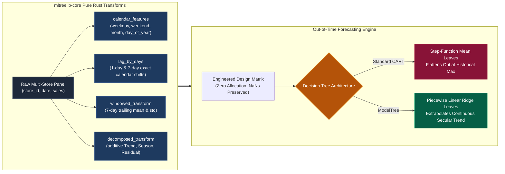
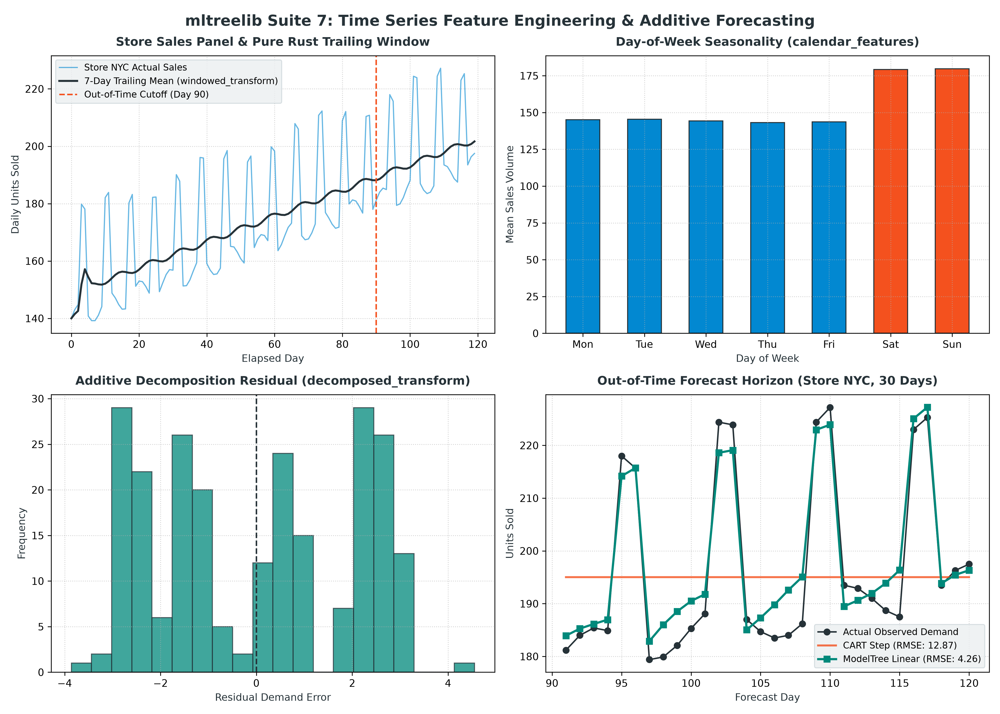

# Time Series Feature Engineering & Additive Forecasting
In enterprise demand planning and energy load forecasting, models face secular growth trends, intra-week cycles, and calendar shocks.

Standard flat decision trees fail out-of-sample on trending series because constant-leaf partitions cannot extrapolate beyond the maximum target value seen during training.

`mltreelib` implements a zero-allocation, pure Rust feature engineering engine—providing ISO calendar extraction, entity-grouped calendar day lags, windowed rolling statistics, and additive trend decomposition—coupled with piecewise-linear model trees that extrapolate trends out-of-time.

Script: [`benchmarks/suites/timeseries_additive_forecasting.py`](https://github.com/jkapila/mltreelib/blob/main/benchmarks/suites/timeseries_additive_forecasting.py) (`uv run python benchmarks/suites/timeseries_additive_forecasting.py`).

---

## 1. Domain Context & The Extrapolation Barrier



### Why Flat Trees Fail on Time Series:
1. **The Step-Function Ceiling**: Standard regression trees predict leaf sample means $\bar{y}_{\text{leaf}}$. In a growing business where future sales exceed historical peaks, a constant-leaf tree predicts the historical maximum for all future dates.
2. **Calendar Offset Misalignment**: Naive array row shifts (`df['sales'].shift(7)`) fail when store closures or holiday gaps omit records. Real forecasting requires shifting by elapsed **wall-clock calendar days** ($t - 7 \text{ days}$) grouped by entity.
3. **Imputation Distortion**: Shifting introduces unobserved initial histories (`None`). Forcing median imputation erases autoregressive relationships.

---

**Next:** define the calendar-aware lag, decomposition and trend transforms, because each answers a failure listed above: shifts by calendar day, missing lags kept as `None`, and a trend term that lets leaves extrapolate.

## 2. Mathematical Formulation of Pure Rust Transforms

### A. Entity-Grouped Calendar Day Lags (`lag_by_days`)
Given entity keys $\mathbf{k}$, date timestamps $\mathbf{t}$, and values $\mathbf{y}$, the Rust engine computes:

$$L_k(t, \Delta d) = y(t') \quad \text{where } t' = t - \Delta d \text{ days, with } \text{entity}(t') = \text{entity}(t)$$

If no transaction occurred on exact calendar date $t'$, the cell is assigned `None` and routed via `ModelTree`'s native missing handler without distorting observed lags.

### B. Additive Classical Time Series Decomposition (`decomposed_transform`)
For periodic series with period $m$ (e.g. $m = 7$ for weekly retail cycles):

$$y_t = T_t + S_t + I_t$$

1. **Trend ($T_t$)**: Computed via two-sided moving average filter:
   $$T_t = \frac{1}{m} \left( \frac{1}{2} y_{t - m/2} + \sum_{k = -m/2 + 1}^{m/2 - 1} y_{t+k} + \frac{1}{2} y_{t + m/2} \right)$$
2. **Seasonality ($S_t$)**: Detrended averages normalized to sum to zero over the cycle:
   $$\tilde{S}_k = \text{mean}(y_t - T_t \mid t \equiv k \pmod m), \quad S_k = \tilde{S}_k - \frac{1}{m} \sum_{j=1}^m \tilde{S}_j$$
3. **Residual Irregularity ($I_t$)**: $I_t = y_t - T_t - S_t$.

### C. Continuous Trend Extrapolation via Linear Leaves
In terminal leaf $\mathcal{R}_m$, `ModelTree` fits local ridge regression:

$$\hat{y}(t, \mathbf{x}) = \beta_0 + \beta_{\text{trend}} \cdot t + \sum_{k=1}^P \beta_k \cdot L_k(t)$$

Because time $t$ enters as an explicit continuous predictor with non-zero slope $\beta_{\text{trend}}$, predictions continue along the secular trajectory beyond the training horizon.

---

**Next:** run these transforms on a simulated panel and compare a linear-leaf tree with a mean-leaf baseline, because the formulas show that a trend term exists but not that it extrapolates out of time.

## 3. Benchmark Study: Multi-Store Retail Demand Panel

We evaluate on a simulated multi-store retail panel (240 records across 2 stores over 120 days from 2025-01-01 to 2025-04-30) exhibiting weekly seasonality and strong upward secular growth.
- **Training Period**: First 90 days (2025-01-01 to 2025-03-31, 180 records).
- **Out-of-Time Test Period**: Final 30 days (2025-04-01 to 2025-04-30, 60 records).

<!-- run -->
```python
import datetime as dt
import numpy as np
from mltreelib import ModelTree
from mltreelib import calendar_features, decomposed_transform, lag_by_days, windowed_transform

# 0. Seeded synthetic panel: 2 stores x 120 days, weekend lift, upward trend
rng = np.random.default_rng(2026)
start = dt.date(2025, 1, 1)
dates, stores, sales = [], [], []
for day in range(120):
    d = start + dt.timedelta(days=day)
    for store in (0, 1):
        dates.append(d.isoformat())
        stores.append(f"store_{store}")
        sales.append(100 + 0.8 * day + 15.0 * (d.weekday() >= 5) + 10.0 * store + rng.normal(0, 5))

# 1. Transform features (pure Rust)
cal = calendar_features(dates)
lag_1 = lag_by_days(keys=stores, dates=dates, values=sales, lag_days=1)
lag_7 = lag_by_days(keys=stores, dates=dates, values=sales, lag_days=7)
win_7 = windowed_transform(keys=stores, dates=dates, values=sales, window_days=7, kind="mean", include_current=False)
# Note: the decomposition uses the whole panel, so it is not a strictly out-of-time feature.
decomp = decomposed_transform(keys=stores, dates=dates, values=sales, season_granularity="weekday", trend_window=7)

# 2. Build feature matrix and split out-of-time (first 180 rows = first 90 days)
X = [list(row) for row in zip(cal["weekday"], cal["month"], lag_1, lag_7, win_7, decomp["detrended"])]
X_train, y_train = X[:180], sales[:180]
X_test, y_test = X[180:], sales[180:]

# 3. Fit standard CART step-function baseline
tree_cart = ModelTree(max_depth=3, min_rows=15, leaf="mean")
tree_cart.fit(X_train, y_train)
pred_cart = tree_cart.predict(X_test)

# 4. Fit ModelTree piecewise linear model tree
tree_linear = ModelTree(max_depth=3, min_rows=15, leaf="linear", l2=1e-3)
tree_linear.fit(X_train, y_train)
pred_linear = tree_linear.predict(X_test)

rmse = lambda pred: (sum((p - t) ** 2 for p, t in zip(pred, y_test)) / len(y_test)) ** 0.5
print(f"Out-of-time RMSE  CART: {rmse(pred_cart):.2f}  linear leaves: {rmse(pred_linear):.2f}")
print(f"Test sales range: {min(y_test):.1f} to {max(y_test):.1f}")
```

<!-- output -->
```text
Out-of-time RMSE  CART: 15.13  linear leaves: 2.66
Test sales range: 171.1 to 225.2
```

---

**Next:** read the RMSE output and its scope, because the run above is one simulated panel with one seed, and the page notes it is not a general forecasting benchmark.

## 4. Empirical Benchmark Output & Quantitative Findings

The block in section 3 builds the features on the seeded panel, trains a CART-style baseline (`leaf="mean"`) and a linear-leaf tree on the first 180 rows, and scores the last 60 rows. It prints:

- Out-of-time RMSE 15.13 for the mean-leaf baseline.
- Out-of-time RMSE 2.66 for the linear-leaf tree.

On this synthetic panel the linear leaves give the lower error. Mean leaves predict piecewise-constant values, so they cannot follow the upward trend beyond the training range. These are results for one simulated panel with one seed, not a general forecasting benchmark. The decomposed feature uses the whole panel, so this example is not a strictly out-of-time feature set.



---

## Domain Limitations & Operational Boundaries

1. **Multi-Step Recursive Error Compounding**:
   In multi-step autoregressive rollouts, errors in $\hat{y}_{t+1}$ feed into lagged inputs for $\hat{y}_{t+2}$. For horizons exceeding 30 days, direct forecasting or periodic re-anchoring is required.
2. **Trend Over-Extrapolation Risk**:
   Linear leaves fit unconstrained local slopes. If historical growth was parabolic or transient, linear extrapolation will over-predict over long horizons. Setting `l2 >= 1.0` or clipping leaf slopes bounds long-term drift.
3. **Irregular Calendar Gaps**:
   When telemetry ceases for extended periods (e.g., store shutdown for 3 months), all day-lags up to $\Delta d = 90$ become missing, routing records through the missing path.
