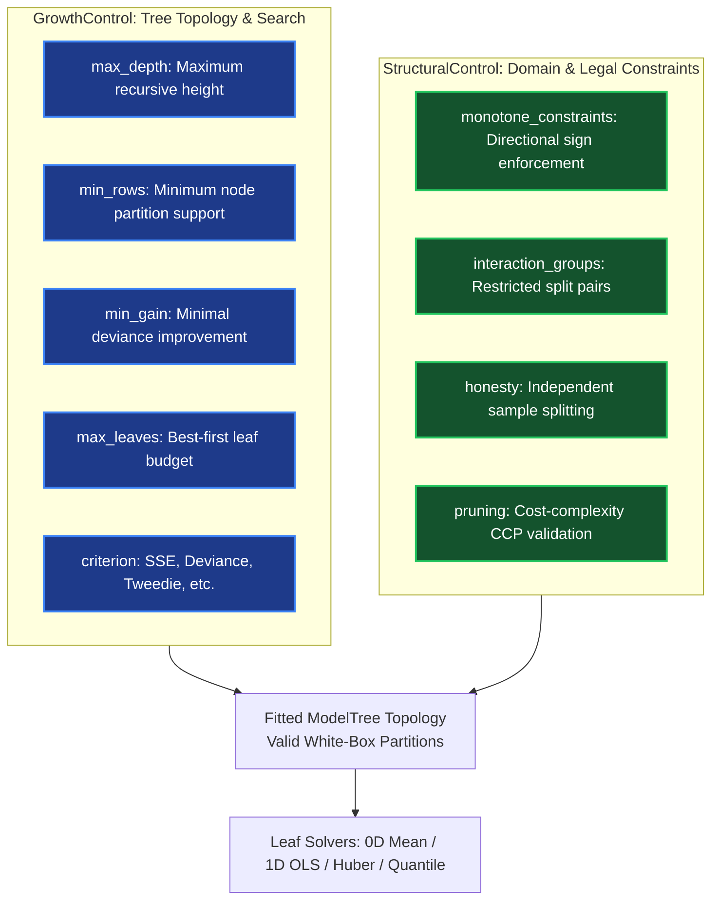
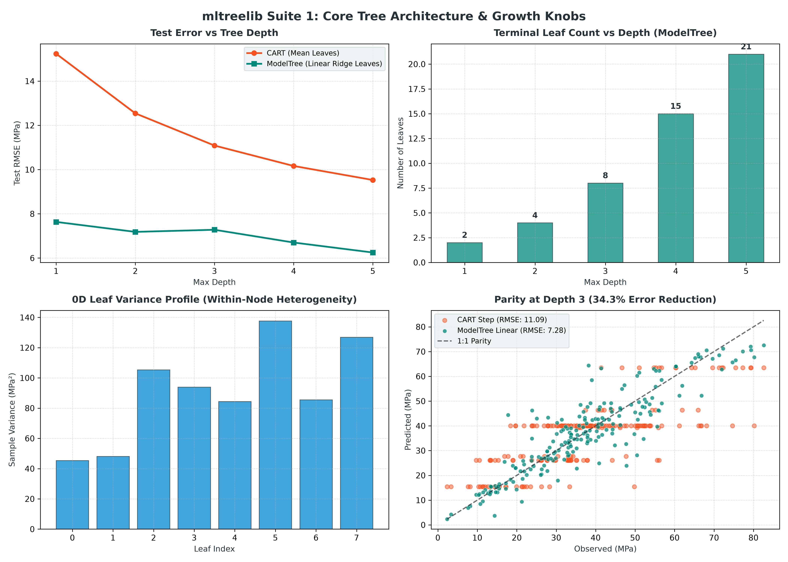
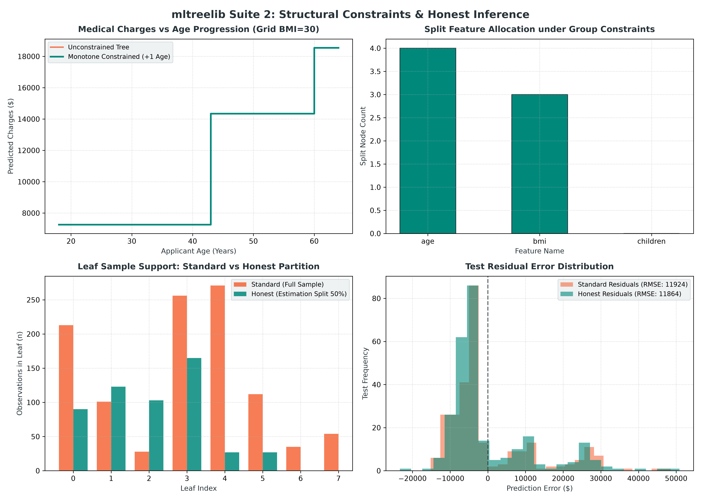

# Tree Architecture, Growth Knobs & Structural Constraints

Decision trees are notorious for high variance and unconstrained overfitting when grown without structural bounds. Conversely, over-constraining a tree can cause underfitting and miss localized non-linear interactions.

`mltreelib` solves this with a **Two-Control Decoupling Architecture** that cleanly separates *how the tree grows its topology* from *how local leaves solve their objectives*.



---

## 1. The Growth Knob Grid (Depth, Min Rows, and Pruning)

The balance between model bias and variance is tuned via recursive growth controls:

| Parameter | Type | Default | Operational Effect |
| :--- | :--- | :---: | :--- |
| `max_depth` | `int` | `6` | Hard ceiling on recursive partitioning depth. |
| `min_rows` | `int` | `15` | Minimum rows on each side of a split. |
| `min_gain` | `float` | `1e-9` | Minimum reduction in split deviance required to accept a partition. |
| `prune` | `str` | `"cp"` | Post-pruning: `"cp"` (cost-complexity), `"bic"`, `"mdl"` or `"none"`. |
| `cp_alpha` | `float` | `5.0` | Absolute per-leaf penalty in target units (squared-error units for a Gaussian leaf). Depends on the target's scale. |
| `cp` | `float` | `None` | Scale-free penalty as a fraction of the root cost, as in rpart. When set it overrides `cp_alpha`. |

The defaults above come from the live constructor. Pruning is bottom-up with one penalty: a split survives only when its error reduction exceeds the per-leaf penalty. There is no cross-validated choice of the penalty.



<!-- run -->
```python
from mltreelib import ModelTree
from mltreelib.data import Dataset

ds = Dataset.load(
    "concrete_compressive_strength", target="ConcreteCompressiveStrength"
)

for cp in (None, 0.001, 0.01, 0.05):
    tree = ModelTree(leaf="mean", max_depth=6, min_rows=15, prune="cp", cp=cp)
    tree.fit(ds)
    print(f"cp={cp}: {tree.n_leaves()} leaves")
```

<!-- output -->
```text
cp=None: 36 leaves
cp=0.001: 30 leaves
cp=0.01: 13 leaves
cp=0.05: 5 leaves
```

**Next:** section 2 adds monotone and interaction constraints, which are set alongside the depth and `min_rows` bounds from section 1; its example sets `max_depth=3` and `min_rows=30`.

---

## 2. Monotone & Interaction Constraints

In regulated domains such as insurance rating and credit underwriting, legal and physical rules dictate that increasing risk indicators (e.g. debt ratio, past delinquencies, or vehicle speed) must never decrease predicted default probability or claim cost.

`mltreelib` enforces strict monotonicity along split paths:
- `+1`: Monotonically non-decreasing ($\frac{\partial \hat{y}}{\partial x_j} \ge 0$).
- `-1`: Monotonically non-increasing ($\frac{\partial \hat{y}}{\partial x_j} \le 0$).
- `0`: Unconstrained split behavior.



<!-- run -->
```python
import numpy as np
from mltreelib import ModelTree, Metrics

# 1. Generate credit applicant data with natural risk relationships
rng = np.random.default_rng(2026)
n_applicants = 1200

# Predictors: Revolving Utilization (%), Borrower Age (Years), Monthly Income ($k)
utilization = rng.uniform(0.05, 1.20, n_applicants)
age = rng.uniform(21.0, 75.0, n_applicants)
income = rng.uniform(2.0, 20.0, n_applicants)

# Default risk increases with utilization, decreases with age and income
risk_score = 0.45 * utilization - 0.005 * age - 0.02 * income + rng.normal(0, 0.05, n_applicants)

X = np.column_stack([utilization, age, income])
feature_names = ["revolving_utilization", "borrower_age", "monthly_income"]

# 2. Enforce domain monotonicity: +1 (increasing), -1 (decreasing)
# Utilization must increase risk (+1), Age must decrease risk (-1), Income must decrease risk (-1)
monotone_spec = [1, -1, -1]

tree = ModelTree(
    leaf="linear",
    max_depth=3,
    min_rows=30,
    monotone=monotone_spec,     # Enforces sign constraints along every split path
    honesty=True,               # Disjoint sample splitting for structure vs leaf estimation
    honesty_fraction=0.5,
    seed=2026,
)
tree.fit(X, risk_score.tolist(), col_names=feature_names)

print("Monotone & Honest Tree Fit Successfully.")
print(f"Total Leaves: {len(tree.leaves())}")
for s in tree.splits():
    print(f"  Split: Feature '{s['col']}' <= {s['threshold']:.3f}")
```

<!-- output -->
```text
Monotone & Honest Tree Fit Successfully.
Total Leaves: 2
  Split: Feature 'revolving_utilization' <= 0.577
```

!!! tip "Related guides"
    - [Structural Constraints & Honesty](constraints-and-honesty.md) for mathematical proofs of monotone projection.
    - [Core Tree Architecture](core-tree-architecture.md) for allocator-free growth benchmarks.
