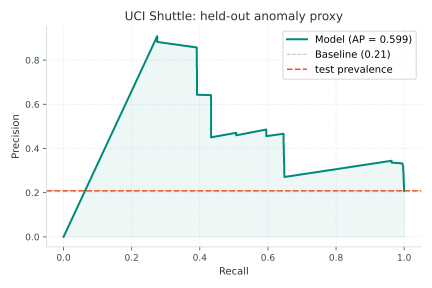

!!! info "Consolidated Flagship Guide"
    This topic is now part of the comprehensive flagship guide: [**Unsupervised Density Trees: Clustering & Anomaly Detection**](unsupervised-clustering-and-anomalies.md).

# Compare anomaly review budgets

The [Shuttle anomaly pathway](../guides/anomaly.md) makes a 5% review queue. This example asks how the apparent precision and recall change if the team can inspect 1%, 5%, or 10% of a batch. It uses the same fitted score for all three policies.

Use the Shuttle files and fit block in the pathway. The extended script reproduces the same score and budget curve directly.

```bash
uv run python examples/anomaly_shuttle_evaluation.py
```

## Score a batch once

After the pathway's `scores` and `y_test` assignments, use this block to compare budgets. Define and freeze the operating budget on development data when making a performance claim.

```python
from itertools import accumulate
from pathlib import Path
from mltreelib import AnomalyTree

# 1. Load Shuttle benchmark data
base = Path("datasets/external/shuttle")
def load_shuttle(path):
    with path.open() as f:
        rows = [[float(v) for v in line.split()] for line in f if line.strip()]
    return [r[:-1] for r in rows], [int(r[-1]) for r in rows]

train_x, train_y = load_shuttle(base / "shuttle.trn")
test_x, y_test = load_shuttle(base / "shuttle.tst")

# Fit on normal operating records (class 1)
reference = [row for row, label in zip(train_x, train_y) if label == 1][:5000]
model = AnomalyTree(kind="eif", max_depth=10, extension_level=1, seed=42)
model.fit(reference, col_names=[f"sensor_{i+1}" for i in range(9)])

# Score test records
scores = model.score_samples(test_x)

# 2. Compare operational review budgets (1%, 5%, 10%)
truth = [int(label != 1) for label in y_test]
order = sorted(range(len(scores)), key=lambda i: (-scores[i], i))
hits = list(accumulate(truth[i] for i in order))
for fraction in (.01, .05, .10):
    budget = max(1, round(fraction * len(scores)))
    found = hits[budget - 1]
    print(f"Records: {budget:4d} ({int(fraction*100)}%) | Precision: {found / budget:.3f} | Recall: {found / sum(truth):.3f}")
```

The budget fixes how many rows enter the queue. The score ranks the records, then source order breaks ties. Keep the same budget and tie rule when comparing a new scorer with a baseline.



| Test records reviewed | Precision | Recall |
|---:|---:|---:|
| 145 (1%) | 0.614 | 0.030 |
| 725 (5%) | 0.894 | 0.214 |
| 1,450 (10%) | 0.815 | 0.391 |

Precision rose from 1% to 5% for this ranking. Precision at a budget need not decrease smoothly as you add cases. Check score ties and the composition of the queue before expecting that pattern again.

## Check the label before using the curve

Test precision here uses non-class-1 operating states as a labeled proxy. In an actual review queue, collect reviewer outcomes and a random sample outside the queue. The random sample gives evidence about what the queue missed. Compare the ranking with an existing rule or a random-review baseline at the same budget.

The unified `AnomalyTree` interface exposes both scoring and thresholded predictions. Use `score_samples()` for a fixed workload. If using `predict()`, monitor the actual queue size because a training cutoff does not enforce a fixed budget in a new batch.
