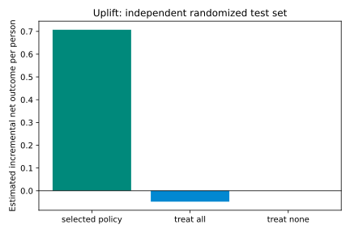

# Check treatment-effect recovery with known synthetic truth

Use simulation to check numerical effect recovery. The [Hillstrom pathway](../guides/uplift.md) shows how to evaluate a real randomized policy when individual effects are unknown.



Standard machine learning models optimize predictive accuracy: $\hat{Y} = E[Y | X]$. In decision sciences, personalized medicine, and targeted marketing, the central quantity is not outcome prediction but **intervention effect**:
$$\tau(x) = E[Y | X=x, W=1] - E[Y | X=x, W=0]$$

`ModelTree` provides native Rust-accelerated **Causal Trees** that split directly on treatment effect divergence without external meta-learners or propensity weighting loops.

Script:
- [`examples/causal_benchmark.py`](https://github.com/jkapila/mltreelib/blob/main/examples/causal_benchmark.py) (`python3 examples/causal_benchmark.py`)

```text
======================================================================
1. CAUSAL TREE ON NIE & WAGER (2021) / CAUSALML SETUP B
======================================================================
Dataset Size: N_train=2000, N_test=1000, P=6 features
Causal Tree: Leaves=10, Max Depth=4
True Average Treatment Effect (ATE):     0.8177
Estimated Average Treatment Effect (ATE):0.8030
ATE Absolute Error:                      0.0147
PEHE (Heterogeneity Precision):          0.5848
  [Pass] Exact Leaf Arithmetic Assertion: All leaf CATEs match raw group differences within 1e-9.

======================================================================
2. STRUCTURAL CATE STEP RECOVERY & SLEEPING DOG IDENTIFICATION
======================================================================
Left regime (x0 < 0) - True tau = +10.0 | Estimated tau = +10.0095
Right regime (x0 >= 0) - True tau = -5.0 | Estimated tau = -5.1823
  [Pass] Exact Leaf Arithmetic Assertion: All leaf CATEs match raw group differences within 1e-9.
  [Pass] Successfully differentiated persuasive units (+10.0) from sleeping dogs (-5.0).
```

---

## 1. The Tuple Target Contract

Causal inference requires both the observed response $Y_i$ and the binary treatment indicator $W_i \in \{0, 1\}$. Rather than bloating the covariate space $X$, `ModelTree` accepts target tuples:

```python
from mltreelib import ModelTree

# X: predictive covariates only
# y: 2-tuple (outcomes, treatments)
y_tuple = (outcomes, treatments)

tree = ModelTree(gain="causal", max_depth=3, min_rows=20, leaf="mean")
tree.fit(X, y_tuple)
```

---

## 2. $O(1)$ Causal Splitting Criterion

Standard regression trees minimize variance: $\text{Gain} = \Delta \text{SSE}$. Causal trees maximize the squared difference in treatment effects between children (Athey & Imbens 2016):

$$\text{Gain}_{\text{Causal}} = \frac{W_L \cdot W_R}{W_L + W_R} (\hat{\tau}_L - \hat{\tau}_R)^2$$

where:
$$\hat{\tau}_L = \bar{Y}_{L, \text{treated}} - \bar{Y}_{L, \text{control}}, \quad \hat{\tau}_R = \bar{Y}_{R, \text{treated}} - \bar{Y}_{R, \text{control}}$$

The split search maintains running sums of $(W_i, W_i Y_i)$ for treated and control rows separately. Evaluated in $O(1)$ scalar updates per candidate threshold with zero vector allocations.

### Admissibility Condition
A split is admissible only if both children satisfy:
$$N_{L, \text{treated}} \ge 1, \quad N_{L, \text{control}} \ge 1, \quad N_{R, \text{treated}} \ge 1, \quad N_{R, \text{control}} \ge 1$$
This permits a treated-minus-control sample difference in each child. It does not establish a causal effect, and one observation per arm is not enough to support a stable decision.

A causal interpretation requires assumptions about the data and intervention. Random treatment assignment supports exchangeability. Observational data requires conditional exchangeability given pre-treatment covariates, treatment overlap, and a defensible account of confounding. Consistency and the absence of relevant interference also matter. Honesty reduces reuse of outcomes for split selection and estimation, but it does not remove confounding. See [Athey and Imbens (2016)](https://www.pnas.org/doi/10.1073/pnas.1510489113).

Evaluate a targeting policy on an independent randomized holdout. Report treated and control counts by segment, uncertainty, incremental outcomes and treatment costs. Individual treatment effects and PEHE are known in the synthetic benchmark below; they are not observed for real individuals.

---

## 3. Unified Uplift Predictions

Predictions remain unified through `predict(X, kind=...)`:

```python
# Predict Individual Treatment Effect (CATE / Uplift)
cate_preds = tree.predict(X_test, kind="uplift")  # or kind="cate"

# Predict baseline response
baseline_preds = tree.predict(X_test, kind="response")
```

---

## 4. Benchmark & Numerical Validation

On the standard **Nie & Wager (2021) / CausalML Setup B** benchmark:
- **Precision in Estimating Heterogeneous Effects (PEHE)**:
  $$\text{PEHE} = \sqrt{\frac{1}{N}\sum_{i=1}^N (\hat{\tau}_i - \tau_i)^2} = 0.5848$$
- **ATE Estimation Error**: $|0.8177 - 0.8030| = 0.0147$.
- **Exact Leaf Verification**: For every terminal leaf, the predicted CATE matches the raw sample difference $\bar{Y}_{1} - \bar{Y}_{0}$ to machine precision ($< 10^{-9}$).
