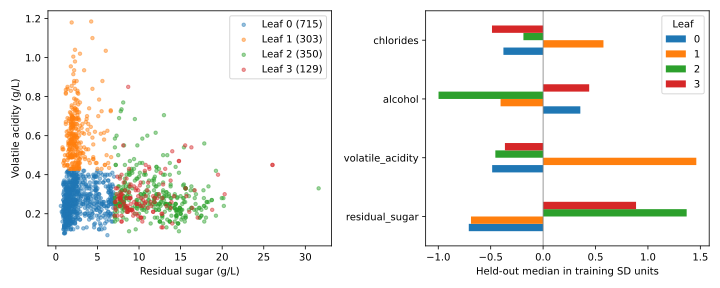

# Check whether a clustering tree is stable after refitting

Start with the [wine chemistry pathway](../guides/clustering.md) to fit and inspect a segment tree. This example changes the question. If you collect another training sample, do you group the same review wines together?

Download [OpenML Wine Quality 46964](https://www.openml.org/d/46964) to `datasets/wine_quality.parquet`. Run the code from the repository root after `uv sync`.

## Compare two tree depths on a fixed review set

Keep the review rows constant. Use identical feature scaling for both fits so the comparison isolates the change in training rows. Use the same procedure at both depths.

```python
import numpy as np
import pandas as pd
from mltreelib import ClusterTree

df = pd.read_parquet("datasets/wine_quality.parquet").sample(frac=1, random_state=2026)
features = ["residual_sugar", "volatile_acidity", "alcohol", "chlorides"]
train, refit, review = df.iloc[:2500], df.iloc[2500:5000], df.iloc[5000:]
center, scale = train[features].mean(), train[features].std()

def design(part):
    return ((part[features] - center) / scale).to_numpy().tolist()

for depth in (1, 2):
    assignments = []
    for part in (train, refit):
        tree = ClusterTree(kind="pct", max_depth=depth, min_rows=150)
        tree.fit(design(part), col_names=features)
        assignments.append(tree.predict(design(review)))

    counts = pd.crosstab(np.asarray(assignments[0]), np.asarray(assignments[1]))

    def pairs(n):
        return (n * (n - 1) // 2).sum()

    shared = pairs(counts.to_numpy().ravel())
    either = pairs(counts.sum(axis=0)) + pairs(counts.sum(axis=1)) - shared
    print(depth, shared / either if either else float("nan"), counts.to_dict())
```

A score of 1 means the fits keep the same pairs together. An arbitrary segment ID change does not affect it. If one tree assigns everything to one large group, a stability score alone cannot tell you whether that group is useful. Report size, profiles and stability together. For a full pipeline stability check, refit the scaling in each training partition.



## How to use this comparison

Change the depth or the feature list on development data. Check that each leaf has enough rows for its profile and that analysts can interpret the condition. Use a new held-out batch before claiming the final choice is stable. The [clustering guide](../guides/clustering.md) describes the unified engine choices and their input contracts.
