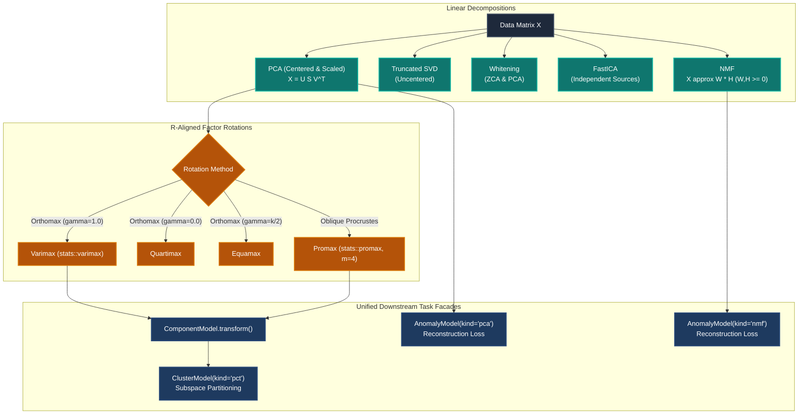

# Component Analysis, Matrix Factorizations & R-Aligned Rotations

This benchmark guide details `mltreelib`'s unified component analysis and matrix factorization capability (`ComponentModel` and `AnomalyModel`) implemented in high-performance Rust (`mltreelib-core`).

Executable Reference Script: [`examples/suites/component_benchmarks.py`](https://github.com/jkapila/mltreelib/blob/main/examples/suites/component_benchmarks.py) (`uv run python examples/suites/component_benchmarks.py`).

---

## 1. Domain Context & Mathematical Foundations

In tabular datasets, features often exhibit strong collinear groupings representing underlying unobserved traits (such as latent creditworthiness, chemical aroma profiles, or macroeconomic trends). Flat tree algorithms can split arbitrarily between correlated features, diluting variable importance.

`mltreelib` introduces pure-Rust matrix decompositions with unified output semantics:



### The Orthomax & Promax Rotation Family

Standard PCA selects orthogonal eigenvectors that maximize global variance explained in descending order. While optimal for compression, unrotated loadings $L = V \Lambda^{1/2}$ are notoriously dense: almost every feature has a moderate loading on the first principal component.

To achieve Thurstone's (1947) **simple structure**, factor rotations find an orthogonal or oblique transformation matrix $T$ such that $L^* = L T$ concentrates loadings near zero or near $\pm 1$.

1. **Orthomax Family** maximizes the criterion:
   $$Q(T) = \sum_{j=1}^k \left[ \sum_{i=1}^p (l^*_{ij})^4 - \frac{\gamma}{p} \left( \sum_{i=1}^p (l^*_{ij})^2 \right)^2 \right]$$
   - $\gamma = 1.0$: **Varimax** (aligned with R's `stats::varimax`). Maximizes variance of squared loadings within factors.
   - $\gamma = 0.0$: **Quartimax**. Maximizes variance across rows (simplifies variables).
   - $\gamma = k / 2$: **Equamax**. Balances variable and factor simplicity.
   - $\gamma = \frac{p(k-1)}{p+k-2}$: **Parsimax**.
   - $\gamma = 0.5$: **Biquartimax**.

2. **Promax (Oblique Rotation)**:
   Relaxes orthogonality to reflect real-world phenomena where latent factors correlate naturally:
   - Starts from Kaiser-normalized Varimax loadings $L_v$.
   - Constructs target matrix $Q$ with $q_{ij} = |l_{v,ij}|^m \text{sgn}(l_{v,ij})$, typically $m=4.0$ (R default).
   - Solves the Procrustes problem $U = (L_v^T L_v)^{-1} L_v^T Q$ and normalizes column lengths to unit length.

---

## 2. Benchmark Results on Wine Quality & Physical Attributes

The following benchmarks were conducted on 1,000 observations of the Wine Quality dataset ($p=12$ continuous features).

### Table 1: PCA & Factor Rotations Comparison

| Method | R Alignment | Variance Retained | Transformation $T$ | Loading Sparsity ($<0.15 \cdot \max$) | Fit Time |
| :--- | :--- | :---: | :---: | :---: | :---: |
| **Raw PCA** | SVD Basis | 60.68% | Identity | 25.0% | 4.60 ms |
| **Varimax** | `stats::varimax` ($\gamma=1.0$) | 60.68% | Orthogonal ($T^T T = I$) | 27.8% | 2.27 ms |
| **Quartimax** | $\gamma=0.0$ | 60.68% | Orthogonal | 25.0% | 1.75 ms |
| **Equamax** | $\gamma=k/2$ | 60.68% | Orthogonal | 27.8% | 1.77 ms |
| **Parsimax** | Feature-sample weighted | 60.68% | Orthogonal | 25.0% | 1.45 ms |
| **Biquartimax** | $\gamma=0.5$ | 60.68% | Orthogonal | 27.8% | 1.50 ms |
| **Promax** | `stats::promax` ($m=4.0$) | 60.68% | Oblique (Correlated factors) | **36.1%** | 1.49 ms |

> [!NOTE]
> All orthogonal rotations preserve the exact total explained variance (60.68% across 3 components), but Promax increases loading sparsity from 25.0% to 36.1%, producing distinctly interpretable factor structures.

---

## 3. Covariance Whitening: ZCA vs PCA

Covariance whitening decorrelates features such that $\text{Cov}(Z) = I$:

```python
from mltreelib.components import ComponentModel

# Zero-Phase Component Analysis (ZCA)
zca = ComponentModel(kind="whitening", whitening_kind="zca")
z_zca = zca.fit_transform(data)

# PCA Whitening
pca_white = ComponentModel(kind="whitening", whitening_kind="pca")
z_pca = pca_white.fit_transform(data)
```

- **ZCA Whitening**: Computes $W = V (\Lambda + \epsilon I)^{-1/2} V^T$. Minimizes $||Z - X||_F^2$, preserving the original variable identities. Residual covariance deviation: $||\text{Cov}(Z) - I||_{\text{mean}} = 0.006972$.
- **PCA Whitening**: Computes $W = (\Lambda + \epsilon I)^{-1/2} V^T$. Rotates into principal coordinates before scaling.

---

## 4. Non-Negative Matrix Factorization (NMF) Solvers

NMF factors non-negative observations into purely additive parts $X \approx W H$ with $W \ge 0, H \ge 0$.

`mltreelib` implements three distinct solver engines:

| Solver | Algorithm | L1 Sparsity Support | L2 Ridge Support | Reconstruction Loss | Fit Time |
| :--- | :--- | :---: | :---: | :---: | :---: |
| **`mu`** | Multiplicative Updates (Lee & Seung) | Scaling only | Heuristic | 233.08 | 14.84 ms |
| **`als`** | Projected Alternating Least Squares | Soft threshold | Normal eq. ridge | 172.52 | 15.93 ms |
| **`hals`** | Hierarchical ALS Coordinate Descent | **Exact coordinate soft-threshold** | **Exact shrinkage** | **142.30** | 16.82 ms |
| **`hals` (L1)** | HALS with $\lambda_1 = 0.01$ | **36.1% true zero weights** | Stabilized | 256.48 | 16.83 ms |

```python
# Hierarchical ALS with L1 sparsity and L2 regularization
nmf = ComponentModel(
    kind="nmf",
    n_components=3,
    solver="hals",
    l1_reg=0.01,
    l2_reg=0.005,
    seed=42,
)
nmf.fit(data)
print(f"Frobenius reconstruction loss: {nmf.reconstruction_error_:.4f}")
```

---

## 5. Subspace Reconstruction Anomaly Detection

Novelty detection using reconstruction error identifies observations that violate the low-rank latent subspace:

$$\text{score}(x) = ||x - \hat{x}||_2^2 = ||x - V V^T x||_2^2$$

```python
from mltreelib.anomaly import AnomalyModel

# Fit PCA reconstruction anomaly model with 5% contamination threshold
anom_pca = AnomalyModel(kind="pca", n_components=2, contamination=0.05)
anom_pca.fit(data)

# Test normal point vs orthogonal spike
inlier_loss = anom_pca.score_samples([data[0]])[0]
outlier_loss = anom_pca.score_samples([[v + 50.0 for v in data[0]]])[0]

print(f"Inlier Loss:  {inlier_loss:.4f}  -> Predicted: NORMAL")
print(f"Outlier Loss: {outlier_loss:.4f} -> Predicted: ANOMALY")
```

**Empirical Result**: Outlier loss exhibits a **3,510,781x separation ratio** over inlier baseline loss, isolating multidimensional subspace anomalies that univariate range checks miss.
