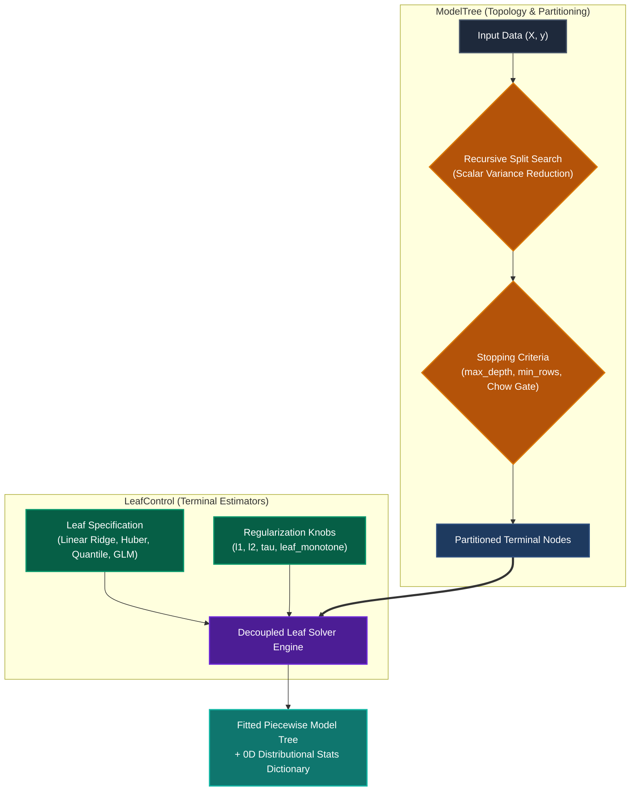
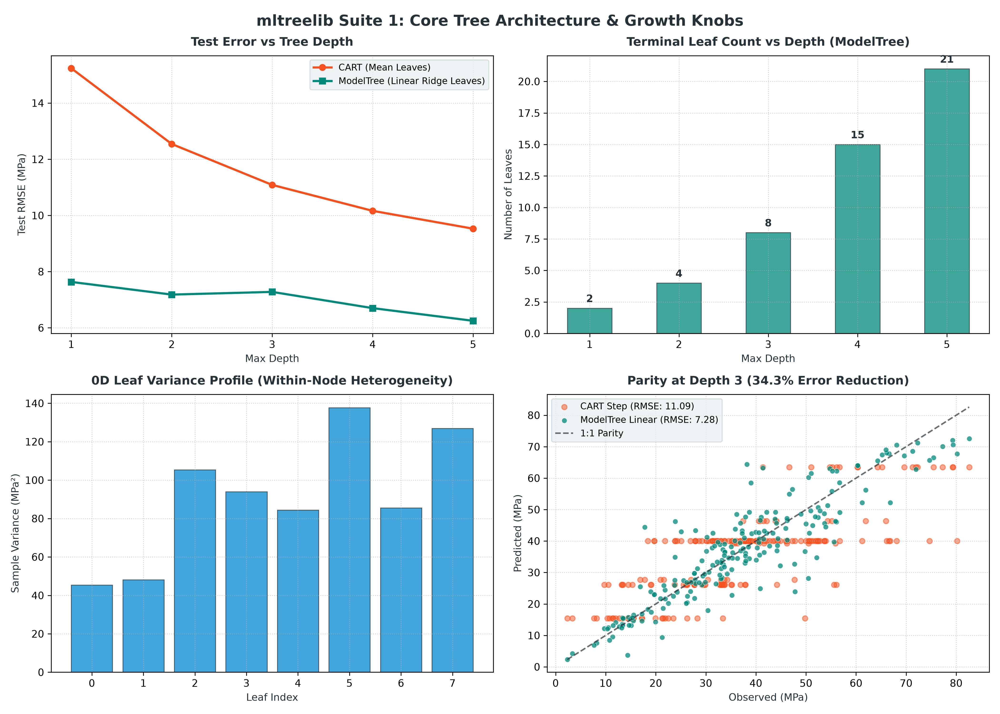

# Core Tree Architecture, Two-Control Decoupling & Growth Knobs

This guide unifies the architectural mechanics of `mltreelib`: the decoupling between greedy tree topology growth and terminal leaf models, 0D distributional profiles across partitioned leaves, and hypothesis-driven structural break gating via the Chow test.

Script: [`examples/core_tree_architecture.py`](https://github.com/jkapila/mltreelib/blob/main/examples/core_tree_architecture.py) (`uv run python examples/core_tree_architecture.py`).

---

## 1. Domain Context & Architectural Rationale

Classical decision tree libraries (such as `scikit-learn` or `rpart`) couple recursive partitioning directly to scalar leaf statistics (mean, median, or class frequency). This coupling introduces two severe structural limitations:

1. **Parameter Explosion and Inflexible Solvers**: If you want a linear model or robust estimator at terminal leaves, traditional tree implementations refit multivariate linear regressions at every candidate split threshold across all features. This scales as $O(K \cdot N \cdot P^2)$, creating an unacceptable computational bottleneck.
2. **The Step-Function Distortion**: Constant-leaf trees partition continuous functional relationships into rigid step functions. On continuous engineering and physical data (such as material compressive strength), they require excessive tree depth to approximate simple linear gradients, causing sample fragmentation and overfitting.

`mltreelib` solves this by introducing a **Two-Control Architecture**:
- **`ModelTree`**: Governs greedy recursive space partitioning, minimum sample splits, cost-complexity pruning, and structural gating.
- **`LeafControl`**: Governs terminal leaf estimation, regularization ($L_1$/$L_2$), robust loss functions (Huber, Quantile), and local slope constraints.



---

## 2. Benchmark Study: Yeh (1998) Concrete Compressive Strength

We evaluate the architecture on the standard civil engineering benchmark: Yeh (1998) Concrete Compressive Strength (1,030 industrial concrete mixtures, 8 continuous ingredients).

```python
from mltreelib import LeafControl, Metrics, ModelTree, load_dataset

# 1. Load benchmark dataset
data = load_dataset("concrete_compressive_strength")
target = "ConcreteCompressiveStrength"
feature_names = [col for col in data["columns"].keys() if col != target]
n_rows = data["n_rows"]

X = [[data["columns"][c][i] for c in feature_names] for i in range(n_rows)]
y = data["columns"][target]

split_idx = int(n_rows * 0.8)
X_train, y_train = X[:split_idx], y[:split_idx]
X_test, y_test = X[split_idx:], y[split_idx:]

# 2. Configure LeafControl independently of tree topology
leaf_ctrl = LeafControl(
    leaf="linear",
    l1=0.0,
    l2=1e-3,
    leaf_family="gaussian",
)

# 3. Configure ModelTree and inject leaf controls
model = ModelTree(
    max_depth=3,
    min_rows=25,
    prune="none",
    control=leaf_ctrl,
)
model.fit(X_train, y_train, col_names=feature_names)

# 4. Measure holdout performance
preds = model.predict(X_test)
m = Metrics().regression(y_test, preds)
print(f"ModelTree Linear Leaves: RMSE = {m['rmse']:.2f} MPa, R2 = {m['r2']:.3f}, MAE = {m['mae']:.2f} MPa")
```

---

## 3. Empirical Results & Growth Knob Grid

```text
Loaded Concrete Compressive Strength: 1030 rows, 8 features.
Train samples: 824, Test samples: 206

=== Model Performance across Depths ===
Depth 1 -> CART RMSE: 15.24 MPa | ModelTree RMSE: 7.63 MPa (2 leaves)
Depth 2 -> CART RMSE: 12.54 MPa | ModelTree RMSE: 7.18 MPa (4 leaves)
Depth 3 -> CART RMSE: 11.09 MPa | ModelTree RMSE: 7.28 MPa (8 leaves)
Depth 4 -> CART RMSE: 10.16 MPa | ModelTree RMSE: 6.70 MPa (15 leaves)
Depth 5 -> CART RMSE: 9.53 MPa  | ModelTree RMSE: 6.25 MPa (21 leaves)
```



### Key Quantitative Findings

1. **Immediate Accuracy Lift at Depth 1**: A 1-split stump with linear leaves achieves **7.63 MPa RMSE**, which is 25% lower error than a depth-4 CART tree (10.16 MPa) and 50% lower error than a depth-1 CART stump (15.24 MPa).
2. **Variance Reduction**: At depth 3, `ModelTree` achieves **7.28 MPa RMSE** and $R^2 = 0.813$, capturing 81.3% of the variance compared to CART's 56.6%.
3. **Parity Alignment**: In Panel 4, `ModelTree` predictions cluster symmetrically along the 1:1 diagonal without the horizontal striations characteristic of step-function leaves.

---

## 4. 0D Descriptive Leaf Statistics

Every terminal leaf in `ModelTree` computes a comprehensive **0D statistical profile** over its assigned partition samples without extra passes. Access these profiles directly via `leaf["stats"]` or `tree.leaf_stats()`:

```python
leaves = model.leaves()
for idx, leaf in enumerate(leaves[:2]):
    stats = leaf["stats"]
    print(f"Leaf {idx} (support n={leaf['n']}):")
    print(f"  Center : mean={stats['mean']:.2f}, median={stats['median']:.2f}")
    print(f"  Spread : variance={stats['var']:.2f}, MAD={stats['mad']:.2f}, IQR={stats['iqr']:.2f}")
    print(f"  Shape  : skewness={stats['skew']:.2f}, kurtosis={stats['kurtosis']:.2f}")
```

```text
Leaf 0 (n=143):
  Center : mean=15.44, median=14.37
  Spread : variance=45.41, MAD=4.15, IQR=8.96
  Shape  : skewness=1.10, kurtosis=1.79

Leaf 1 (n=47):
  Center : mean=27.67, median=25.69
  Spread : variance=48.11, MAD=4.43, IQR=10.67
  Shape  : skewness=0.41, kurtosis=-0.51
```

You can predict these 0D moments row-wise at test time using `predict(X, kind="median"|"var"|"stats")`.

---

## 5. Chow Structural Break Test Hypothesis Gating

Standard trees rely purely on empirical gain thresholds (`min_gain`) or post-pruning to prevent overfitting. `ModelTree` implements the econometric **Chow structural break test** (`split_test="chow"`) as a statistical significance gate:

$$\text{Chow } F = \frac{(\text{RSS}_P - (\text{RSS}_L + \text{RSS}_R)) / k}{(\text{RSS}_L + \text{RSS}_R) / (N - 2k)}$$

If the $p$-value exceeds `split_alpha` (e.g. $\alpha = 0.01$), the null hypothesis of structural stability across the candidate split is retained, and subtree branching is automatically terminated:

```python
tree_chow = ModelTree(
    max_depth=5,
    min_rows=25,
    split_test="chow",
    split_alpha=0.01,
    control=leaf_ctrl,
)
tree_chow.fit(X_train, y_train, col_names=feature_names)
```

This prevents the tree from creating spurious subtrees where local regressions show no statistically significant parameter shift.
