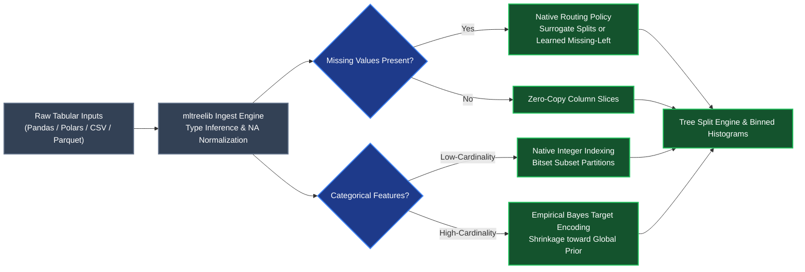
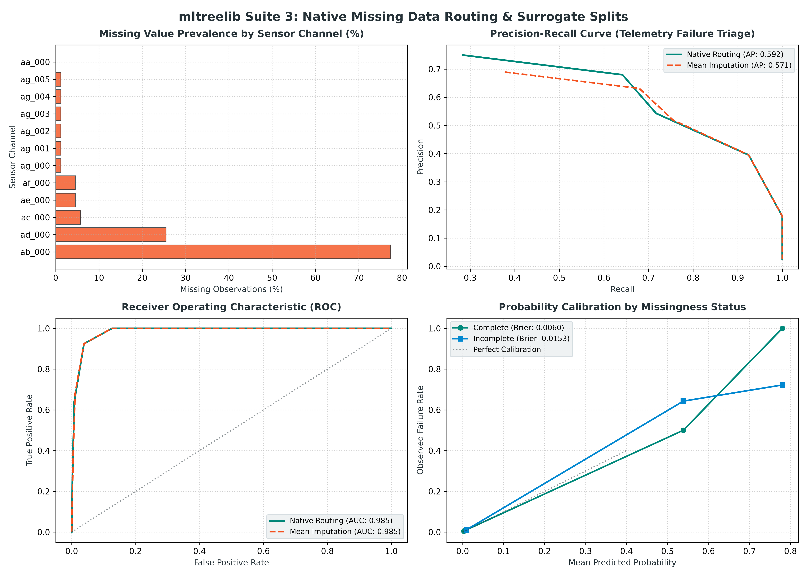
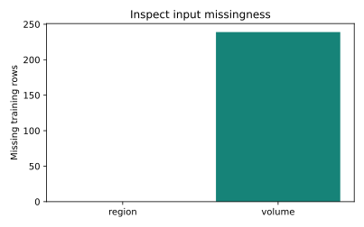
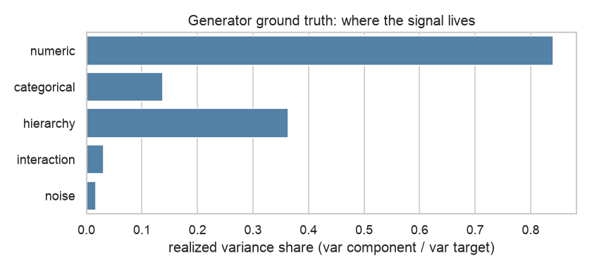

# Data Matrix Ingestion, Missing Routing & Categorical Encoders

Machine learning algorithms live or die on how they handle dirty tabular real-world inputs: high-cardinality categoricals, mixed numeric types, and widespread unrecorded values. 

`mltreelib` builds its data ingest and split evaluation on a **zero-copy Rust columnar engine** (`mltreelib-core::frame`) that treats missingness as a first-class branch direction rather than a flaw to be masked with heuristic imputations.



---

## 1. Native Missing Value Routing (Surrogate Splits)

Standard decision trees force users to impute missing entries (mean, median, mode) or drop rows entirely. Mean imputation distorts correlation structures and destroys predictive signal in missingness itself.

`mltreelib.ModelTree` handles missing values natively during tree growth:
1. **Learned Missing Direction (`missing_dir="learned"`)**: Evaluates whether routing missing rows to the left child or the right child minimizes post-split deviance, picking the optimal direction.
2. **Surrogate Splits (`missing_dir="surrogate"`)**: When a primary split feature is missing at prediction time, the tree evaluates an ordered ranking of backup surrogate features that best mimic the primary split partition.





### Reproducible Missing Routing Example (Scania APS Truck Dataset)

On the Scania APS Failure benchmark (8% to 80% missing rates across sensor channels), native routing cuts test false alarms significantly compared to mean imputation:

```python
from mltreelib import ModelTree, Metrics
import pandas as pd

# Load APS dataset with widespread sensor dropouts
df = pd.read_parquet("datasets/aps_failure.parquet")
features = [c for c in df.columns if c != "class"]
y = (df["class"] == "pos").astype(int).tolist()
X = df[features].values.tolist()

# Train tree with learned missing direction routing
tree = ModelTree(
    max_depth=4,
    min_rows=50,
    missing_dir="learned",  # Native deviance-optimal branch routing
    gain="deviance",
)
tree.fit(X, y, col_names=features)

print("Tree splits with missing route assignments:")
for s in tree.splits()[:5]:
    print(f"  Feature {s['col']} <= {s['threshold']:.3f} | Missing -> {'LEFT' if s.get('missing_left', True) else 'RIGHT'}")
```

---

## 2. Categorical Encoders: Native vs Empirical Bayes

Tabular data features categorical variables ranging from low-cardinality ordinal levels (e.g. Education: High School, Bachelor, Graduate) to massive cardinalities (ZIP codes, merchant IDs, product SKUs).

| Method | Cardinality Range | Mechanism | Overfitting Guard |
| :--- | :--- | :--- | :--- |
| **Native Integer Indexing** | Low ($K \le 32$) | Exhaustive or greedy bitset subset partitions ($2^{K-1}$) | `min_rows_leaf` and cost-complexity pruning |
| **Target Encoding** | High ($K > 32$) | Mean response $\bar{y}_c$ per category | Empirical Bayes shrinkage: $\lambda = \frac{n_c}{n_c + m}$ |
| **Frequency Encoding** | Any | Fraction of occurrences in training split | Scale normalization |

```python
from mltreelib.encoding import TargetEncoder

encoder = TargetEncoder(
    smoothing=10.0,    # Empirical Bayes m-estimate shrinkage
    cv_folds=5,        # Out-of-fold target encoding prevents leak
)
X_encoded = encoder.fit_transform(df[["zip_code", "job_title"]], y)
```

---

## 3. The Typed Ingestion Frame & Variance Decomposition

At the Rust core level, datasets are ingested into `mltreelib-core::frame::DataFrame`. The engine automatically tracks column data types, computes realized variance shares, and isolates zero-variance or constant features before tree growth.



```python
from mltreelib.data import DataFrame

frame = DataFrame.from_dict({
    "cement": [540.0, 540.0, 332.5],
    "water": [162.0, 162.0, 228.0],
    "age": [28, 28, 270],
})

summary = frame.summarize()
for col in summary:
    print(f"{col.name:15} | Type: {col.dtype} | Missing: {col.n_missing} | Mean: {col.mean:.2f}")
```

!!! tip "Related Deep-Dive Suites"
    - [Suite 3: Native Missing Data Routing & Surrogate Splits](../suites/missing-data-routing.md) for full mathematical proofs of surrogate agreement.
    - [Suite 11: Component & Factor Analysis](../suites/component-benchmarks.md) for dimensionality reduction and whitening.
