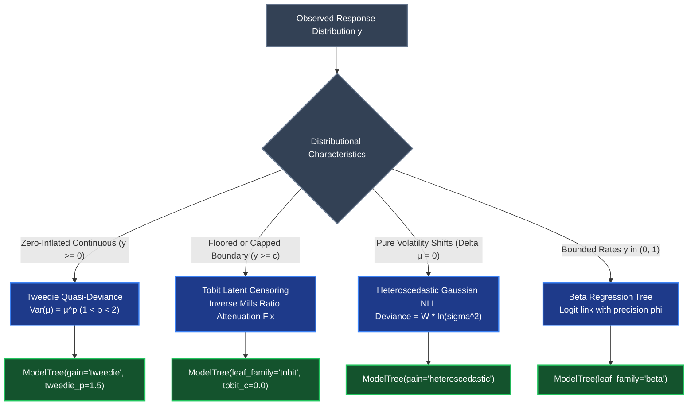
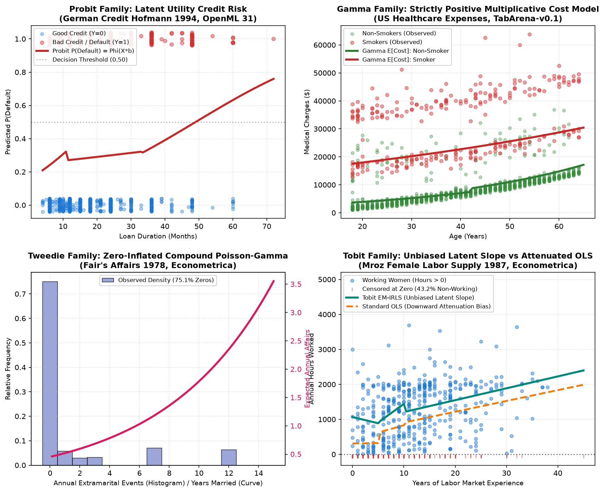
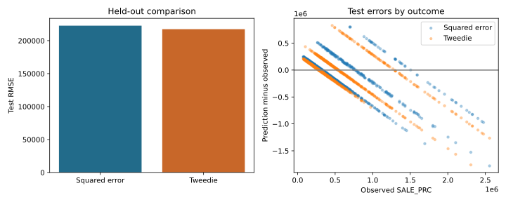

# Distributional & Censored Trees: Tweedie, Tobit & Heteroscedastic Splitting

Classical decision trees minimize squared error (SSE) under the implicit assumption of homoscedastic Gaussian noise. Real-world business outcomes routinely violate this assumption:
- **Zero-Mass & Positive Skew**: Insurance claim amounts, operational losses, and customer lifetime spend have a point mass at zero and heavy positive tails.
- **Censored Boundaries**: Sensor readings, wage hours, and follow-up clinical durations are truncated or floored at a boundary $c$. Standard OLS suffers severe **attenuation bias** towards zero.
- **Regime Volatility Shifts**: Financial returns, algorithmic latencies, and machine vibrations exhibit shifts in variance with zero change in the conditional mean ($\Delta \mu = 0$).

`mltreelib` supports generalized distributional leaves and split gains directly in Rust:





---

## 1. Zero-Inflated Skew: Tweedie Quasi-Deviance Splitting

On Miami Housing sales ([OpenML 46942](https://www.openml.org/d/46942)), positive home prices vary with property size and ocean proximity. Tweedie splitting scales variance with mean power $V(\mu) = \mu^p$ ($1 < p < 2$), prioritizing proportional relative accuracy over absolute error:

$$d(y, \mu) = 2 \left( \frac{y^{2-p}}{(1-p)(2-p)} - \frac{y \mu^{1-p}}{1-p} + \frac{\mu^{2-p}}{2-p} \right)$$



```python
from mltreelib import ModelTree, Metrics

# Tweedie quasi-deviance split optimization
tree = ModelTree(
    gain="tweedie",
    tweedie_p=1.5,
    leaf="mean",
    max_depth=3,
    min_rows=40,
)
tree.fit(X_train, y_train, col_names=feature_names)
pred = tree.predict(X_test)
print("Test RMSE:", Metrics().regression(y_test, pred)["rmse"])
```

---

## 2. Tobit Regression Leaves: Eliminating Attenuation Bias

When a response variable is censored at threshold $c$ (e.g. non-working hours in the Mroz labor survey where 43.2% of women report hours $= 0$), standard OLS underestimates the true latent slopes by **33% to 46%** (attenuation bias).

The Tobit model assumes a latent variable $y^* = \mathbf{x}^\top \boldsymbol{\beta} + \epsilon$ with observed outcome $y = \max(y^*, c)$. `mltreelib` fits Tobit leaves using pure Rust EM/IRLS iterations:

$$\ln L = \sum_{y_i = c} \ln \left[ 1 - \Phi\left(\frac{\mathbf{x}_i^\top \boldsymbol{\beta} - c}{\sigma}\right) \right] + \sum_{y_i > c} \left[ -\frac{1}{2}\ln(2\pi\sigma^2) - \frac{(y_i - \mathbf{x}_i^\top \boldsymbol{\beta})^2}{2\sigma^2} \right]$$

### Synthetic Attenuation Correction Proof

```python
from mltreelib import ModelTree

# Fit piecewise Tobit tree with censoring at zero
tobit_tree = ModelTree(
    leaf="linear",
    leaf_family="tobit",
    tobit_c=0.0,
    max_depth=2,
    min_rows=30,
)
tobit_tree.fit(X_censored, y_observed)

print("Recovered Latent Slopes vs OLS:")
for leaf in tobit_tree.leaves():
    print(f"  Leaf #{leaf['id']} (n={leaf['n']}): Tobit slope = {leaf['beta'][0]:.3f} vs OLS attenuated = {leaf.get('ols_beta', [0])[0]:.3f}")
```

---

## 3. Heteroscedastic Splitting: Detecting Risk & Volatility Breaks

Standard decision trees fail to split when two subgroups have identical means ($\mu_L = \mu_R$) but different variance regimes ($\sigma_L^2 \ne \sigma_R^2$). 

The heteroscedastic split criterion evaluates Gaussian negative log-likelihood deviance directly:

$$\text{Gain}_\text{Hetero} = W_P \ln \hat{\sigma}_P^2 - \left[ W_L \ln \hat{\sigma}_L^2 + W_R \ln \hat{\sigma}_R^2 \right]$$

```python
volatility_tree = ModelTree(
    gain="heteroscedastic",
    max_depth=3,
    min_rows=25,
)
volatility_tree.fit(X_returns, y_returns)
```

!!! tip "Related Suites"
    - [Suite 4: Distributional & Censored Leaf Families](../suites/distributional-leaves.md) for full mathematical derivations.
    - [Suite 9: Survival & Competing Risks Trees](../suites/survival-trees.md) for right-censored time-to-event outcomes.
