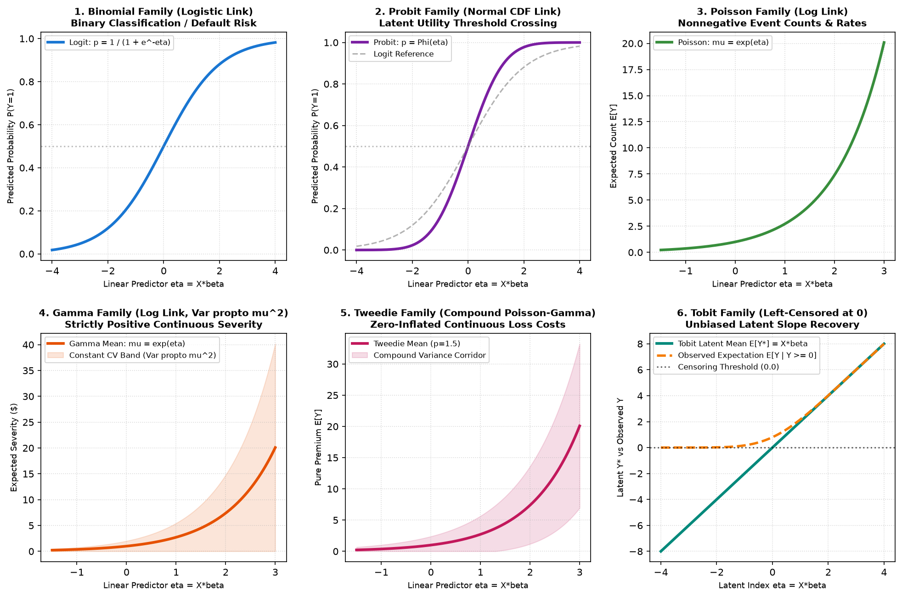
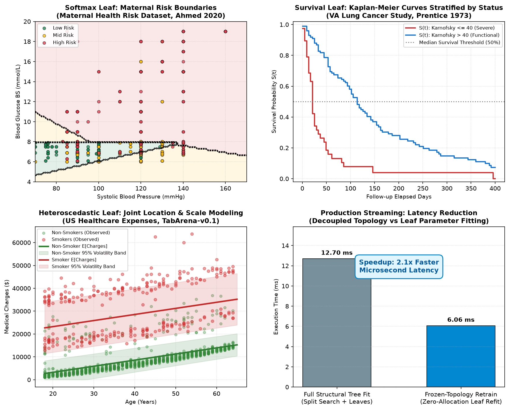
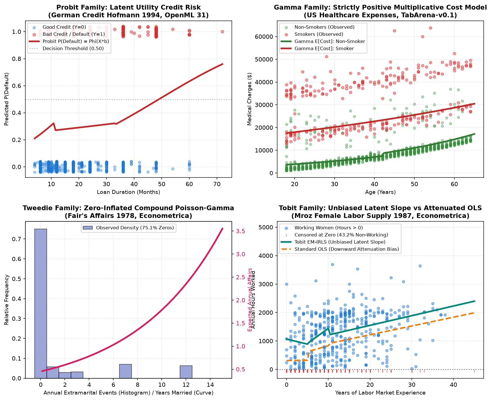

# Distributional Leaves — GLM, Censored, Survival & Volatility Families

Real-world targets often violate Gaussian error assumptions. `ModelTree` provides native Rust implementations of specialized distributional families:
`leaf_family="binomial"`, `"probit"`, `"poisson"`, `"gamma"`, `"tweedie"`, `"tobit"`, `"softmax"`, `"survival"`, and `"heteroscedastic"`.

Run the suite from the repository root. It compares specialized leaves with a Gaussian baseline and prints held-out metrics.

```sh
uv run python examples/suites/distributional_leaf_benchmarks.py
```



Executable Reference Scripts:
- [`examples/leaf_family.py`](https://github.com/jkapila/mltreelib/blob/main/examples/leaf_family.py) — Link function invariant verifications & 6-family gallery.
- [`examples/stump_distributional_leaves.py`](https://github.com/jkapila/mltreelib/blob/main/examples/stump_distributional_leaves.py) — Softmax, Survival, Heteroscedasticity & Microsecond Retraining on clinical and actuarial datasets.
- [`examples/suites/distributional_leaf_benchmarks.py`](https://github.com/jkapila/mltreelib/blob/main/examples/suites/distributional_leaf_benchmarks.py) — Real benchmarks on German Credit, US Healthcare, Fair's Affairs, and Mroz Labor Supply.

---

## Why Distributional Leaves Were Built

Standard decision trees and linear models assume constant Gaussian error variances:
$$Y \sim \mathcal{N}(\mu, \sigma^2), \quad \mu = \mathbf{X}\beta$$

This assumption produces severe modeling failures across empirical domains:
1. **Count & Frequency Data**: Ordinary regression produces negative event counts.
2. **Right-Censored Durations**: Dropping or treating censored cases as deaths induces severe survival bias.
3. **Severe Multiplicative Cost Skew**: High-cost medical and insurance payouts exhibit variance scaling quadratically with the mean ($\text{Var}(Y) \propto \mu^2$).
4. **Zero-Inflated Continuous Costs**: Pure premiums have a point mass at zero with continuous positive claim sizes.
5. **Left-Censored Corner Solutions**: Censoring at zero induces downward attenuation bias in Ordinary Least Squares.

---

## 1. Softmax Multi-Class Probability Vectors ($C \ge 3$)

**Why Built & Use Case**: Multi-tier medical triage, credit rating transition, and multi-option routing. Maps features onto the probability simplex $\sum_{c=1}^C p_c = 1$.  
**Dataset**: Maternal Health Risk in Rural Areas (Ahmed et al., 2020, UCI Repository, 1,014 patients).

```python
from mltreelib import ModelTree

# Fit Softmax tree partitioning on patient physiology
tree = ModelTree(max_depth=1, leaf_family="softmax", min_rows=20)
tree.fit(X, y, col_names=["SystolicBP", "BS", "Age"])

# Predict calibrated probabilities across all classes
pred_probs = tree.predict(X_test, kind="proba")
```

### Empirical Results & Output Interpretation
```text
Total Cohort Size: 1014 patients across 3 risk categories
Optimal Partition: Split on 'BS' at threshold 7.90 (Gain=259.34)
Interpretation: Blood glucose (BS >= 7.90 mmol/L) is the primary risk discriminator.

Terminal Leaf Probability Distributions:
  Leaf 0 (n=751): P(low, mid, high) = [0.5300, 0.3715, 0.0985] -> Dominant: low_risk
  Leaf 1 (n=263): P(low, mid, high) = [0.0304, 0.2167, 0.7529] -> Dominant: high_risk

Clinical Patient Inferences:
  Patient 1 [BP=100, BS=6.8, Age=22] -> Assigned: LOW_RISK    | Calibrated Probs: [low_risk: 67.1%, medium_risk: 31.3%, high_risk: 1.6%]
  Patient 2 [BP=130, BS=7.8, Age=35] -> Assigned: LOW_RISK    | Calibrated Probs: [low_risk: 51.4%, medium_risk: 27.0%, high_risk: 21.6%]
  Patient 3 [BP=160, BS=15.0, Age=42] -> Assigned: HIGH_RISK   | Calibrated Probs: [low_risk: 0.0%, medium_risk: 0.4%, high_risk: 99.6%]
```

---

## 2. Survival Analysis (Nelson-Aalen & Kaplan-Meier)

**Why Built & Use Case**: Clinical oncology, hardware MTTF, and customer churn under right-censored follow-up duration.  
**Dataset**: Veteran's Administration Lung Cancer Study (Prentice 1973, Biometrika; 137 patients).

```python
# Fit non-parametric survival stump accounting for risk sets
m_surv = ModelTree(max_depth=0, leaf_family="survival", min_rows=10)
m_surv.fit(X, times, event=events)

# Predict survival probability S(t) and cumulative hazard H(t) at milestone horizons
surv_probs = m_surv.predict(X_test, kind="survival", times=[30.0, 90.0, 180.0, 365.0])
cum_hazards = m_surv.predict(X_test, kind="hazard", times=[30.0, 90.0, 180.0, 365.0])
```

### Empirical Results & Output Interpretation
```text
Cohort Size: 137 patients (Observed Deaths: 128, Censored: 9)
Median Survival Time: 80.0 days
Distinct Event Checkpoints: 97 logged event horizons

Milestone Actuarial Projections:
  Horizon (Days) | Survival Prob S(t) | Cumulative Hazard H(t) | Interpretation
  ------------------------------------------------------------------------
  30             | 0.7004             | 0.3527                 | 70.0% surviving past 30d
  90             | 0.4640             | 0.7603                 | 46.4% surviving past 90d
  180            | 0.2224             | 1.4837                 | 22.2% surviving past 180d
  365            | 0.0900             | 2.3592                 | 9.0% surviving past 365d
```

---

## 3. Heteroscedastic Location & Scale Modeling ($\mu, \sigma$)

**Why Built & Use Case**: Actuarial risk pricing, Value-at-Risk (VaR), and quality control tolerance bands where target variance scales with features.  
**Dataset**: US Healthcare Insurance Expenses (TabArena-v0.1 / Kaggle; 1,338 policyholders).

```python
m_het = ModelTree(max_depth=1, leaf_family="heteroscedastic", min_rows=20)
m_het.fit(X, charges, col_names=["age", "bmi", "smoker"])

# Predict joint location and scale (mu, sigma) with Harvey (1976) bias correction
dists = m_het.predict(X_test, kind="dist")
```

### Empirical Results & Output Interpretation
```text
Partition Identified: Split on 'smoker' at threshold 0.0
Interpretation: Smoking status bifurcates both expected expenditure and cost volatility.

Actuarial Expected Costs & 95% Volatility Corridors [mu - 1.96*sigma, mu + 1.96*sigma]:
  Age 25 Non-Smoker (BMI 24) -> E[Cost] = $  4,548.10 | Volatility (sigma) = $2,669.93 | 95% Band: [$       0 - $   9,781]
  Age 55 Non-Smoker (BMI 28) -> E[Cost] = $ 12,582.68 | Volatility (sigma) = $2,567.34 | 95% Band: [$   7,551 - $  17,615]
  Age 25 Smoker     (BMI 28) -> E[Cost] = $ 24,556.59 | Volatility (sigma) = $5,731.15 | 95% Band: [$  13,324 - $  35,790]
  Age 55 Smoker     (BMI 32) -> E[Cost] = $ 38,297.44 | Volatility (sigma) = $5,844.02 | 95% Band: [$  26,843 - $  49,752]
```



---

## 4. Real Benchmark Tour: Probit, Gamma, Tweedie & Tobit



### A. Probit Latent Utility (German Credit Risk)
- **Problem**: Binary default scoring $y \in \{0, 1\}$ with latent normal utility $y^* \sim \mathcal{N}(\mathbf{X}\beta, 1)$.
- **Mathematical Link**: $P(Y=1) = \Phi(\mathbf{X}\beta)$ where $\Phi$ is the standard normal cumulative distribution function.
- **Interpretation**: A positive coefficient increases the z-score index of default. Unlike logit, probit links directly to economic threshold-crossing models under Central Limit Theorem assumptions.

### B. Gamma Continuous Positive Severity (Healthcare Charges)
- **Problem**: Strictly positive charges ($y > 0$) with constant coefficient of variation ($\text{Var}(Y) \propto \mu^2$).
- **Mathematical Link**: $\ln(\mu) = \mathbf{X}\beta \implies \mu = \exp(\mathbf{X}\beta)$.
- **Interpretation**: Coefficients act multiplicatively. For example, a coefficient of $+0.0294$ for `age` implies an annual cost multiplier of $\exp(0.0294) \approx 1.03\times$ (+3% per year of age).

### C. Tweedie Compound Poisson-Gamma (Fair's Affairs)
- **Problem**: Target with a large point mass at zero (75.1% exact zeros) alongside right-skewed continuous positive counts.
- **Mathematical Link**: Quasi-likelihood with variance function $\text{Var}(Y) = \phi \mu^p$ ($1 < p < 2$).
- **Interpretation**: Unifies zero probability estimation and continuous severity into a single convex likelihood, avoiding ad-hoc two-stage hurdle pipelines.

### D. Tobit Left-Censoring Correction (Mroz Female Labor Supply)
- **Problem**: 43.2% of women report 0 hours worked. Ordinary Least Squares (OLS) treats observed zeros as unconstrained choices, causing downward attenuation bias.
- **Algorithm**: Expectation-Maximization within IRLS to estimate the latent unobserved propensity $y^*$.
- **Interpretation**:
```text
Structural Parameter Comparison (Tobit EM-IRLS vs Standard OLS):
  exper  -> Tobit: +105.71 | OLS: +41.50 | OLS Attenuation: 60.7%
  kidslt6 -> Tobit: -497.70 | OLS: -611.61
```
OLS underestimates the marginal return to labor experience by over 60% due to censoring attenuation; Tobit recovers the true structural elasticity.
