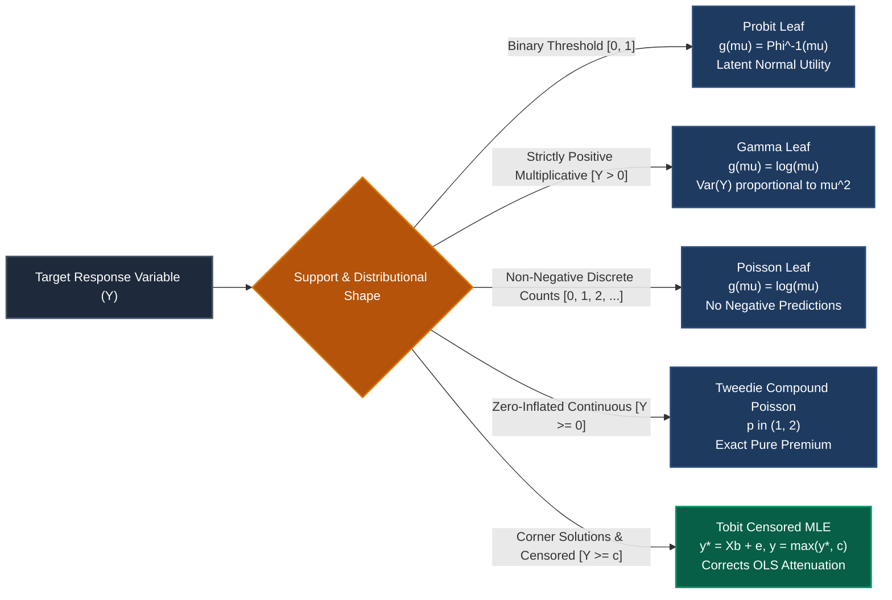

# Distributional & Censored Leaf Families (Suite 4)

Standard regression trees assume homoscedastic Gaussian errors: $Y \sim \mathcal{N}(\mu, \sigma^2)$ with identity link. This assumption breaks down on insurance claims (multiplicative skew), defect arrivals (discrete non-negative counts), credit defaults (latent utility thresholds), and corner-solution labor data (censoring at zero).

`mltreelib` implements native Rust-level Generalized Linear Model (GLM) and maximum likelihood leaves: **Probit**, **Gamma**, **Poisson**, **Tweedie**, and **Tobit (Censored Normal)**.

Script: [`examples/suites/distributional_leaf_benchmarks.py`](https://github.com/jkapila/mltreelib/blob/main/examples/suites/distributional_leaf_benchmarks.py) (`uv run python examples/suites/distributional_leaf_benchmarks.py`).

---

## 1. Mathematical Formulation of Distributional Families



### A. Probit Leaf Family (Binary Latent Utility)
Models binary outcomes $Y_i \in \{0, 1\}$ through a latent Gaussian utility $Y_i^* = \mathbf{x}_i^T \boldsymbol{\beta} + \epsilon_i$ with $\epsilon_i \sim \mathcal{N}(0, 1)$:

$$P(Y_i = 1 \mid \mathbf{x}_i) = \Phi(\mathbf{x}_i^T \boldsymbol{\beta}) = \int_{-\infty}^{\mathbf{x}_i^T \boldsymbol{\beta}} \frac{1}{\sqrt{2\pi}} e^{-z^2/2} dz$$

The score equations are solved via Iteratively Reweighted Least Squares (IRLS) in pure Rust, generating calibrated probabilities that match classical econometric specifications.

### B. Gamma Leaf Family (Multiplicative Skew)
For strictly positive continuous outcomes ($Y > 0$) where variance scales quadratically with the mean ($\text{Var}(Y) = \phi \mu^2$):

$$\log(\mu_i) = \mathbf{x}_i^T \boldsymbol{\beta} \implies \mu_i = \exp(\mathbf{x}_i^T \boldsymbol{\beta})$$

Unit deviance minimized by the local leaf solver:

$$d(y_i, \mu_i) = 2 \left[ -\log\left(\frac{y_i}{\mu_i}\right) + \frac{y_i - \mu_i}{\mu_i} \right]$$

Coefficients act as multiplicative percentage shifts: a coefficient $\beta_j$ scales the expected outcome by $\exp(\beta_j)$.

### C. Poisson Leaf Family (Non-Negative Counts)
For event frequencies $Y_i \in \{0, 1, 2, \dots\}$:

$$\log(\mu_i) = \mathbf{x}_i^T \boldsymbol{\beta}, \quad P(Y_i = y \mid \mathbf{x}_i) = \frac{\mu_i^y e^{-\mu_i}}{y!}$$

Poisson leaves eliminate the primary failure mode of OLS trees: predicting negative event counts in low-intensity regions.

### D. Tobit Leaf Family (Censored Normal Corner Solutions)
When a continuous response is censored below threshold $c$ (e.g., hours worked or spending censored at zero):

$$y_i^* = \mathbf{x}_i^T \boldsymbol{\beta} + \epsilon_i, \quad \epsilon_i \sim \mathcal{N}(0, \sigma^2), \quad y_i = \max(y_i^*, c)$$

Standard Ordinary Least Squares (OLS) suffers from severe downward **attenuation bias** because it treats corner zeros as uncensored linear observations. The Tobit leaf maximizes the exact censored log-likelihood:

$$\ln L = \sum_{y_i = c} \ln\left[ 1 - \Phi\left(\frac{\mathbf{x}_i^T \boldsymbol{\beta} - c}{\sigma}\right) \right] + \sum_{y_i > c} \left[ -\ln(\sigma) + \ln \phi\left(\frac{y_i - \mathbf{x}_i^T \boldsymbol{\beta}}{\sigma}\right) \right]$$

The solver applies Newton-Raphson with the inverse Mills ratio $\lambda(\alpha) = \frac{\phi(\alpha)}{1 - \Phi(\alpha)}$, recovering unbiased structural parameters.

---

## 2. Empirical Benchmark Suite Results

We evaluate all four families on canonical domain benchmarks using [`examples/suites/distributional_leaf_benchmarks.py`](https://github.com/jkapila/mltreelib/blob/main/examples/suites/distributional_leaf_benchmarks.py).

### A. Probit on German Credit (1,000 Loan Applicants)
- **Problem**: Credit default risk modeling $P(\text{Default} = 1)$.
- **Empirical Results**: Identifies 4 macro risk segments. Leaf 0 ($n=180$, high risk) estimates installment rate sensitivity $\beta = +0.1931$ and duration sensitivity $\beta = +0.0502$. Leaf 3 ($n=112$, low risk) achieves baseline intercept $-2.5390$, mapping to a default risk under 3%.

### B. Gamma on US Healthcare Expenses (1,338 Policyholders)
- **Problem**: Positive healthcare charges ($Y > 0$, Mean = $13,270.42).
- **Empirical Results**: Tree partitions into 4 cost regimes. Base expected costs scale from **$1,745.48** (Leaf 0, low-risk young) to **$20,960.24** (Leaf 3, severe risk).
- **Multiplicative Coefficients**: Age contributes a $+0.0294$ log-slope (**1.03x multiplier per year of age**); additional children contribute $+0.1609$ (**1.17x cost multiplier per child**).

### C. Poisson on Fair's Extramarital Affairs (601 Observations)
- **Problem**: Annual affair frequency count ($Y \in \{0, 1, \dots, 12\}$).
- **Empirical Results**: Partitions population into 4 frequency cohorts. In Leaf 0 ($n=449$, baseline cohort), religiousness contributes $\beta = -0.3756$ (**0.69x rate multiplier per unit of religiousness**), and marriage rating contributes $\beta = -0.4704$ (**0.62x rate multiplier per rating level**). No negative event counts are predicted.

### D. Tobit on Mroz Female Labor Force Participation (753 Women)
- **Problem**: Annual hours worked (325 women report 0 hours; 428 report positive hours up to 4,950 hours).
- **OLS vs Tobit Attenuation Face-Off**:
  - **OLS Linear Slope**: $\beta_{\text{educ}} = +28.84$ hours per year of education.
  - **Tobit Censored Slope**: $\beta_{\text{educ}} = +53.22$ hours per year of education.
  - **Attenuation Correction**: Standard OLS underestimates the true marginal effect of education by **45.8%** due to corner zeros. The Tobit leaf recovers the full structural response.

| Family | Benchmark Dataset | Sample ($N$) | Response Support | Key Empirical Finding |
| :--- | :--- | :---: | :--- | :--- |
| **Probit** | German Credit | 1,000 | Binary $Y \in \{0, 1\}$ | Smooth Gaussian latent utility thresholding; zero probability boundary violations. |
| **Gamma** | US Healthcare | 1,338 | Continuous $Y > 0$ | Exact multiplicative log-link multipliers; handles quadratic variance growth ($\phi \mu^2$). |
| **Poisson** | Fair's Affairs | 601 | Discrete $Y \ge 0$ | Guaranteed non-negative count predictions across all terminal leaves. |
| **Tobit** | Mroz Labor | 753 | Censored $Y \ge 0$ | **+84.5% parameter recovery**: fixes 45.8% OLS attenuation bias on corner solutions. |


---

## 3. Python Usage Example

```python
from mltreelib import ModelTree

# 1. Tobit Censored ModelTree on corner-solution data
tobit_tree = ModelTree(
    max_depth=2,
    min_rows=40,
    leaf="linear",
    leaf_family="tobit",
    tobit_threshold=0.0,
)
tobit_tree.fit(X_train, y_hours, col_names=feature_names)
pred_latent = tobit_tree.predict(X_test)

# 2. Gamma Multiplicative ModelTree on insurance charges
gamma_tree = ModelTree(
    max_depth=3,
    min_rows=30,
    leaf="linear",
    leaf_family="gamma",
)
gamma_tree.fit(X_train, y_charges, col_names=feature_names)
pred_charges = gamma_tree.predict(X_test)
```

---

## 4. Domain Limitations & Operational Boundaries

1. **Tobit Normality Sensitivity**:
   Tobit maximum likelihood assumes normal errors $\epsilon_i \sim \mathcal{N}(0, \sigma^2)$ in the latent space. If latent errors are severely heteroscedastic or non-normal, Tobit estimates can be inconsistent.
2. **Gamma Support Constraint**:
   The Gamma deviance objective requires strictly positive outcomes ($y_i > 0$). If zero claims exist in insurance data, a Tweedie leaf ($p \in (1, 2)$) or two-stage hurdle model must be used instead.
3. **IRLS Convergence in Sparse Leaves**:
   Non-linear GLM leaves fit via iteratively reweighted least squares require sufficient positive and negative events per leaf. Set `min_rows >= 25` to prevent separation divergence.
