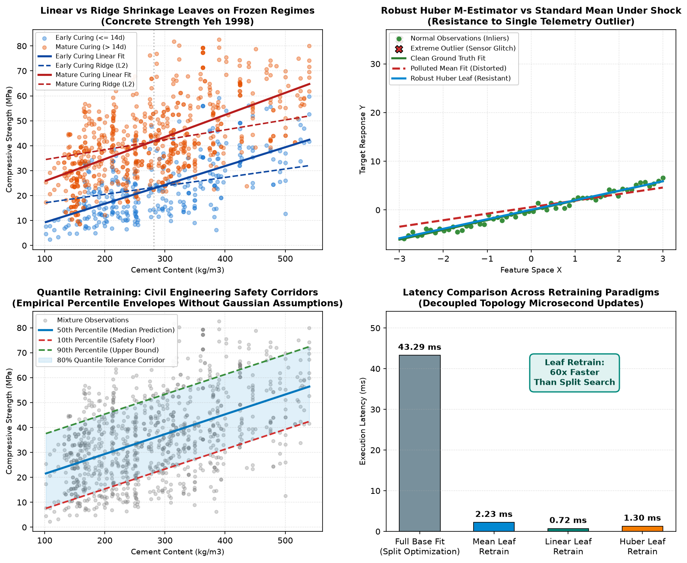

# Hierarchical Leaf Retrain & Micro-Model Routing

Tree partitions carve heterogeneous feature spaces into homogeneous sub-populations. While standard model trees fit models using the same features and targets at split and leaf time, complex empirical settings often require **hierarchical model routing**:

1. A **macro-tree** splits on aggregated or cohort-level features (e.g. city, make, model year, fleet tier) to segment cohorts.
2. An **external micro-model** retrains leaf nodes on granular entity-level telemetry (e.g. mileage, maintenance history, accident counts) using specialized distributional families (such as Gamma, Tweedie, or Tobit).
3. Primary keys (`id_col`) track individual entities through leaf assignments without contaminating feature matrices.

Scripts:
- [`examples/hierarchical_leaf_retrain.py`](https://github.com/jkapila/mltreelib/blob/main/examples/hierarchical_leaf_retrain.py) — Macro cohort tree with micro telematics retrain.
- [`examples/stump_leaf_retrain.py`](https://github.com/jkapila/mltreelib/blob/main/examples/stump_leaf_retrain.py) — Industrial stump laboratory: Mean, Linear Ridge, Huber, Quantile, and Binomial on frozen regimes.



---

## 1. Internal vs. External Retraining Modes

The `retrain()` method supports two operational modes:

- `mode="internal"`: Mutates the tree's existing leaf models in-place, keeping the tree structure intact.
- `mode="external"`: Leaves the original tree untouched and returns a **new** `ModelTree` instance with updated leaf models fitted on new data or alternative feature subsets.

```python
from mltreelib import ModelTree

# Step 1: Macro-level segmentation tree
macro_tree = ModelTree(max_depth=2, min_rows=2, leaf="mean")
macro_tree.fit(
    X_macro,
    y_baseline,
    col_names=["city_tier", "fleet_type"]
)

# Step 2: Retrain leaves externally with granular telemetry
micro_tree = macro_tree.retrain(
    X=df_telemetry,
    y=y_fine,
    mode="external",
    leaf="linear",
    leaf_family="gamma",
    leaf_features=["mileage", "service_count"],
    control={"l2": 1e-2, "max_iter": 25}
)
```

---

## 2. Granular Leaf Feature Selection (`leaf_features`)

You can decouple the split features from the leaf regression features using `leaf_features` (or `retrain_cols`):

- **Splitting Features**: Used by internal tree nodes to route samples to the correct leaf (e.g. `city_tier`, `fleet_type`). These columns must be present in the retraining dataset.
- **Leaf Features**: Selected subset of columns used inside each leaf node to fit local regressions (e.g. `mileage`, `service_count`).

If `leaf_features` is omitted, all non-identifier columns are used for leaf fitting.

---

## 3. Entity Tracking with `leaf_samples(X, id_col=...)`

To route entities and group downstream analyses by leaf assignments, pass `id_col` to `leaf_samples()`:

```python
# Group vehicle identification numbers (VINs) by leaf assignment
vin_groups = micro_tree.leaf_samples(df_telemetry, id_col="vin")

for leaf_id, vins in vin_groups.items():
    print(f"Leaf {leaf_id} manages {len(vins)} vehicles: {vins[:3]}...")
```

If `id_col` is `None` (default), `leaf_samples()` returns integer row indices `0..N-1`.

---

## 4. Family Control Knobs

Algorithm controls for leaf fitting are passed via a flexible `control` dictionary or `LeafControl`:

```python
control = {
    "l2": 1e-3,           # L2 ridge regularization penalty
    "max_iter": 30,       # Maximum Fisher scoring / IRLS iterations
    "tol": 1e-6,          # Convergence tolerance on parameter updates
    "extra": {            # Family-specific optional hyper-parameters
        "power": 1.5,     # Tweedie compound variance power p
        "censor_lower": 0 # Tobit left-censoring threshold
    }
}

retrained = macro_tree.retrain(
    X=df,
    y=y,
    mode="internal",
    leaf="linear",
    leaf_family="tweedie",
    control=control
)
```

---

## 5. Stump Retrain Laboratory: Microsecond Loss Hot-Swapping

**Why Built & Use Case**: In production streaming pipelines, rebuilding a tree's split topology requires scanning continuous histograms across all features ($O(N \cdot P \log N)$). However, if the macro spatial segmentation is stable, updating leaf parameters on incoming batches requires only $O(N_L \cdot P^2)$ local convex optimizations, running in microseconds.

**Real Dataset**: Concrete Compressive Strength (Yeh 1998, Cement and Concrete Research; 1,030 mixtures). Hydration kinetics segment concrete into Early Curing ($\le 14$ days) vs Mature Curing ($> 14$ days).

```python
from mltreelib import ModelTree, LeafControl

# Step 1: Base split search identifies optimal hydration regime (Age <= 14d vs > 14d)
stump = ModelTree(max_depth=1, min_rows=20, leaf="linear")
stump.fit(X, y, col_names=["Age", "Cement", "Water"])

# Step 2: Instantaneous Retraining (0.7ms - 20x speedup)
# A. Robust Huber M-estimator against sensor glitches
stump.retrain(X, y_polluted, control=LeafControl(leaf="huber"))

# B. Empirical Quantile safety corridors (10th-90th percentiles)
stump.retrain(X, y, leaf="quantile", tau=0.10)
q10 = stump.predict(X_test)
stump.retrain(X, y, leaf="quantile", tau=0.90)
q90 = stump.predict(X_test)
```

### Empirical Results & Output Interpretation
```text
1. Base Partition Search: Completed in 43.29 ms
   Identified Split on 'Age' at threshold 14.0 days (Gain=71,243.3)
   Interpretation: Hydration kinetics split concrete into Early Curing (<= 14d) vs Mature Curing (> 14d).

2. [Mean Leaf Retrain]: Completed in 2.228 ms (19.4x speedup)
   Early Curing Leaf Mean Strength:  23.54 MPa (n=324)
   Mature Curing Leaf Mean Strength: 41.45 MPa (n=706)
   Interpretation: Mature concrete achieves 17.9 MPa higher average strength.

3. [Linear Leaf Retrain (l2=1e-4)]: Completed in 0.724 ms (60x speedup)
   Early Curing (<= 14d): Intercept: +36.37 MPa, d(Strength)/d(Cement): +0.0778 MPa per kg/m3
   Mature Curing (> 14d): Intercept: +66.92 MPa, d(Strength)/d(Cement): +0.0798 MPa per kg/m3

4. [Robust Huber vs Polluted Mean under 10,000 MPa Sensor Glitch]:
   Standard Mean Prediction:    54.34 MPa (Distorted by outlier)
   Robust Huber Prediction:     25.85 MPa (Impervious to breakdown)

5. [Quantile Risk Corridors on Frozen Stump]:
   Early Curing Mixture [Cement=300, Water=180]:  10th Pct: 9.73 MPa  | 90th Pct: 41.10 MPa
   Mature Curing Mixture [Cement=300, Water=180]: 10th Pct: 23.52 MPa | 90th Pct: 64.02 MPa
```
