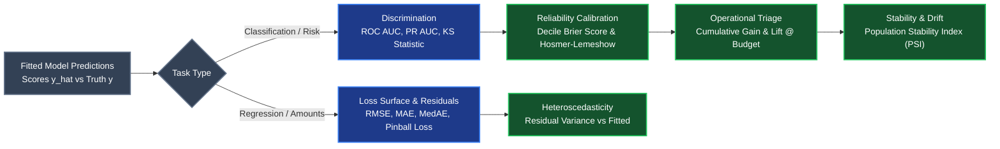
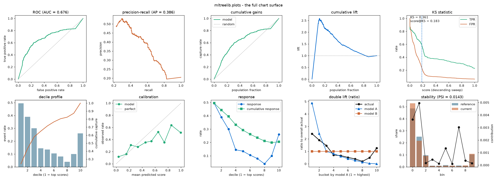
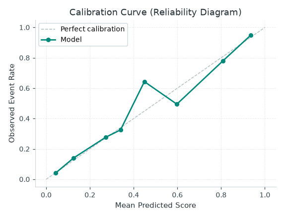
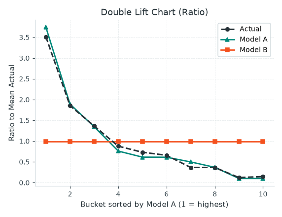
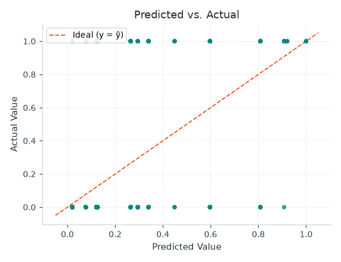

# Metrics, Diagnostics & Probability Calibration

A model score without diagnostic verification is an operational liability. A high AUC can disguise severe probability miscalibration, and an acceptable test RMSE can hide heteroscedastic residual explosions or catastrophic drift.

`mltreelib.Metrics` and `mltreelib.plots` provide an evaluation and visualization engine implemented with pure numeric precision, independent of heavy visualization dependencies (matplotlib is an optional extra: `pip install mltreelib[plotting]`).



---

## 1. Multi-Panel Diagnostic Surface

Every chart in `mltreelib.plots` operates on native Matplotlib `Axes`, allowing multi-metric dashboards in a single figure:

```bash
uv run python examples/metrics_showcase.py
```



---

## 2. Classification Diagnostics & Probability Calibration

In credit triage, fraud detection, and medical diagnosis, ranking alone is insufficient. Underwriters make decisions based on expected dollar loss, which demands calibrated probabilities $P(y=1 \mid \mathbf{x})$.

| Diagnostic Chart | Core Question Answered | Failure Mode Diagnosed |
| :--- | :--- | :--- |
| **`plot_roc`** / **`plot_pr`** | Can the model rank positive instances ahead of negatives? | High ROC with low PR indicates severe false-positive flooding under class imbalance. |
| **`plot_calibration`** | Does a predicted score of 0.20 correspond to exactly 20% empirical event rate? | S-shaped curve indicates over-confidence; inverted curve indicates mis-specified link function. |
| **`plot_ks`** | What is the maximum separation distance between default and non-default distributions? | Identifies the optimal cutoff threshold $\tau^*$ maximizing operational divergence. |
| **`plot_double_lift`** | When comparing Model A vs Model B, which model captures more true events across deciles? | Reveals regions where a challenger model outperforms a production champion. |
| **`plot_psi`** | Did the score distribution shift between training (baseline) and inference (current)? | PSI $> 0.25$ signals severe population drift requiring immediate model retraining. |

### Visual Examples

| Reliability Calibration Curve | Double-Lift Model Comparison |
| :---: | :---: |
|  |  |

---

## 3. Regression & Residual Diagnostics

For continuous pricing, demand forecasting, and risk models:

| Diagnostic Chart | Core Question Answered | Failure Mode Diagnosed |
| :--- | :--- | :--- |
| **`plot_residuals`** | Are residual errors mean-zero and homoscedastic across all response levels? | Funnel-shaped residual spread signals heteroscedasticity, calling for `gain="heteroscedastic"` or Tweedie. |
| **`plot_importance`** | Which features drove the split deviance reduction across the tree? | Over-reliance on single surrogate features or leakage columns. |
| **`plot_breakdown`** | Why did this individual loan applicant receive this exact predicted rate? | DALE-style waterfall attribution decomposed by tree split paths. |



---

## 4. Code Example: Computing the Full Metrics Suite

```python
import numpy as np
from mltreelib import Metrics, plots
import matplotlib.pyplot as plt

# 1. Generate realistic credit default probabilities and observed labels
rng = np.random.default_rng(2026)
n_cases = 1000

# True baseline event probability
true_risk = rng.beta(a=0.8, b=4.0, size=n_cases)
y_true = rng.binomial(1, true_risk).tolist()

# Predicted risk probabilities from champion model and noisy challenger
y_prob_champ = np.clip(true_risk + rng.normal(0, 0.08, n_cases), 0.001, 0.999).tolist()
y_prob_chal = np.clip(true_risk + rng.normal(0, 0.15, n_cases), 0.001, 0.999).tolist()

# 2. Compute Discrimination and Calibration Metrics
metrics = Metrics()

roc = metrics.roc_curve(y_true, y_prob_champ)
pr = metrics.pr_curve(y_true, y_prob_champ)
brier = metrics.brier_score(y_true, y_prob_champ)
ks_res = metrics.ks_statistic(y_true, y_prob_champ)

print("Champion Model Performance:")
print(f"  ROC-AUC: {roc['auc']:.4f}")
print(f"  Average Precision (PR-AUC): {pr['average_precision']:.4f}")
print(f"  Brier Reliability Score: {brier:.4f}")
print(f"  Kolmogorov-Smirnov (KS): {ks_res['ks']:.4f} (Score @ KS cutoff = {ks_res['score_at_ks']:.3f})")

# 3. Population Stability Index (PSI) Drift Check against subsequent test cohort
y_prob_subsequent = np.clip(true_risk * 1.15 + rng.normal(0, 0.08, n_cases), 0.001, 0.999).tolist()
psi_res = metrics.stability_index(y_prob_champ, y_prob_subsequent, 10)
psi_val = psi_res["psi"]
print(f"  Population Stability Index (PSI): {psi_val:.4f} ({'Stable' if psi_val < 0.10 else 'Shift Detected'})")

# 4. Render Calibration and Double Lift Curves Side-by-Side
fig, (ax1, ax2) = plt.subplots(1, 2, figsize=(12, 5))
plots.plot_calibration(y_true, y_prob_champ, ax=ax1)
plots.plot_double_lift(y_true, y_prob_chal, y_prob_champ, ax=ax2)
plt.tight_layout()
plt.show()
```

!!! tip "Related Guides"
    - [Why Credit Scoring Needs Glass-Box Trees](../blog/why-credit-scoring-needs-glass-box-trees.md) for asymmetric cost optimization using KS cutoffs.
    - [Model Inspection & Quinlan Rules](model-inspection-and-rules.md) for white-box split path audits.
