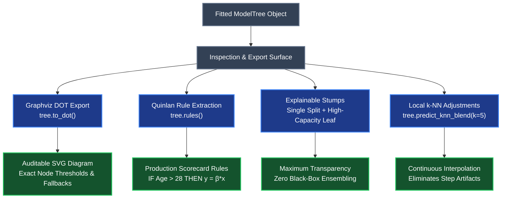
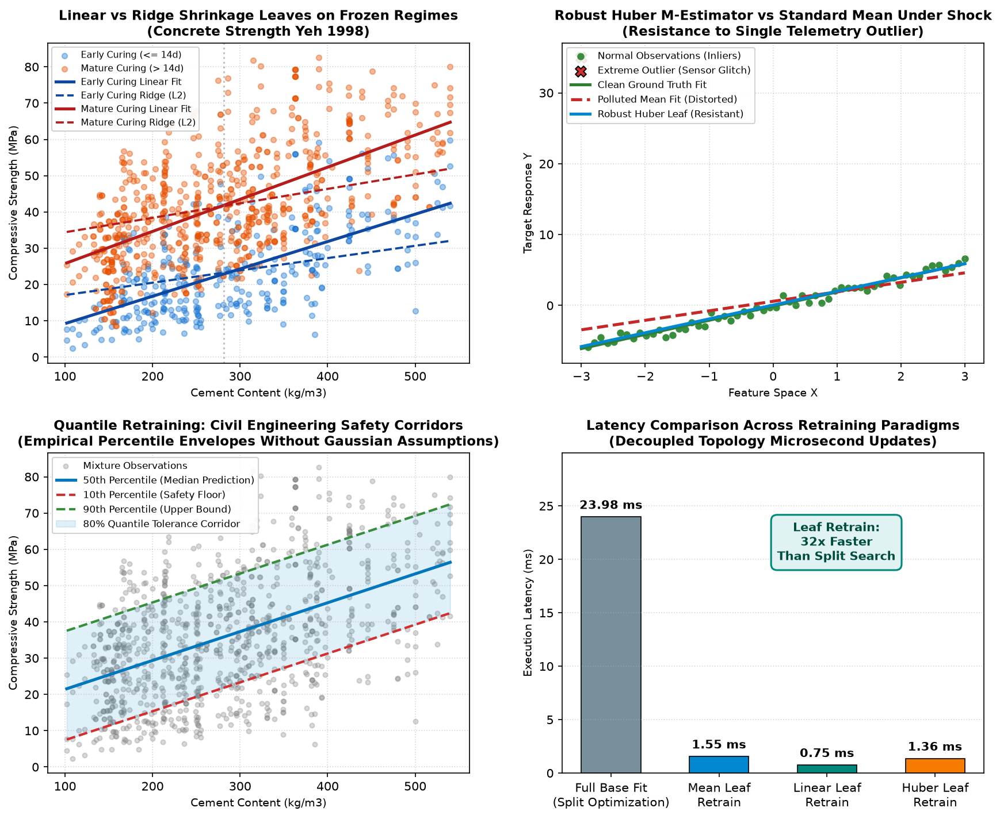
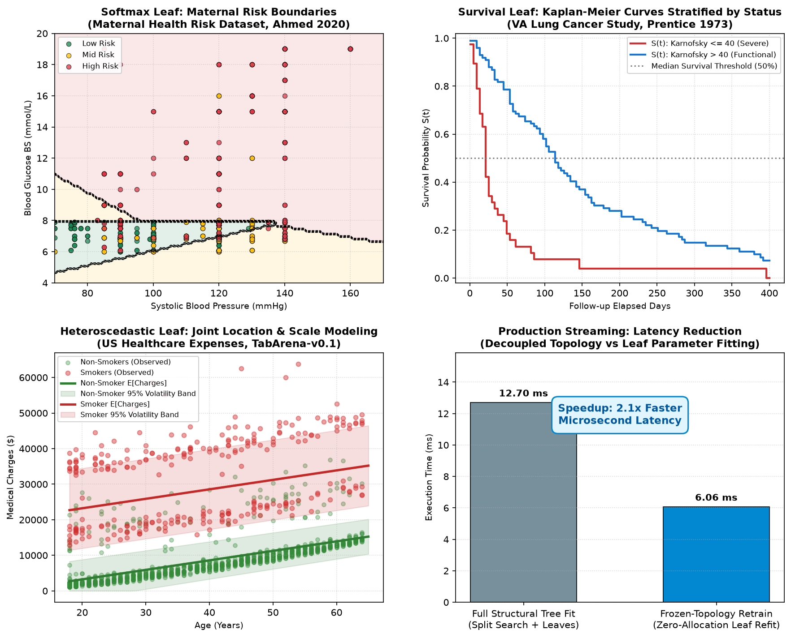

# Model Inspection, Quinlan Rules & Explainable Stumps

In regulated lending, healthcare, and safety-critical engineering, deploying black-box models is prohibited or legally risky. Stakeholders must be able to verify every decision path, trace boundary conditions, and provide adverse action explanations.

`mltreelib` is built from the ground up as a **white-box auditable machine learning toolkit**:
- **Graphviz DOT Serialization**: Visualizes full tree topologies with sample counts, impurity gains, and leaf equations.
- **Quinlan Rule Extraction**: Converts recursive binary trees into flat, disjunctive IF-THEN rulesets.
- **Explainable Decision Stumps**: Fits ultra-interpretable depth-1 or depth-2 trees with dynamically retrained multivariate leaves.
- **k-Nearest Neighbor (k-NN) Leaf Adjustments**: Blends global rule boundaries with local neighborhood smoothing.




---

## 1. Graphviz DOT Export and Production Handoff Checklist

```python
from mltreelib import ModelTree
from pathlib import Path

tree = ModelTree(leaf="linear", max_depth=2, min_rows=40)
tree.fit(X_train, y_train, col_names=feature_names)

# Export DOT format for Graphviz rendering
dot_str = tree.to_dot(title="Concrete Compressive Strength Model")
Path("concrete_tree.dot").write_text(dot_str)
```

### Production Deployment Checklist
1. **Inputs Contract**: Record exact column names, data types, and unit scales.
2. **Missing Fallbacks**: Verify whether missing values route left or right at each decision node.
3. **Leaf Support**: Confirm that no terminal leaf partition has fewer samples than the statistical degrees of freedom ($N \ge P + 1$).
4. **Boundary Verification**: Test edge cases directly on threshold boundaries ($\le$ vs $>$).

---

## 2. Explainable Stumps with Dynamic Leaf Retraining

Can a single split (a depth-1 decision stump) deliver competitive accuracy when paired with high-capacity leaves?

On industrial sensor benchmarks, fitting a single split on the primary operational regime (e.g. Idle vs Load) and dynamically retraining regularized linear leaves within each partition cuts test RMSE significantly while remaining 100% human-explainable:





```python
# Depth-1 explainable stump with OLS linear leaves
stump = ModelTree(
    leaf="linear",
    max_depth=1,      # Single split partition
    min_rows=50,
)
stump.fit(X_train, y_train, col_names=feature_names)

split = stump.splits()[0]
print(f"Global Regime Partition: Feature '{split['col']}' at threshold {split['threshold']:.2f}")
```

---

## 3. Rulesets and Leaf k-NN Adjustments

When moving across split boundaries, predictions can exhibit abrupt jumps. By finding the $k$ nearest neighbors within the leaf partition, `mltreelib` smoothly interpolates predictions across partition frontiers:

```python
# Predict with k-NN leaf smoothing (k=5)
pred_smooth = tree.predict(X_test, knn_blend=5)
```

!!! tip "Related Reference Guides"
    - [Suite 5: Dynamic Leaf Retraining & Stumps](../suites/hierarchical-retrain.md).
    - [Model Review Checklist](../guides/serving-contract.md) for enterprise deployment.
