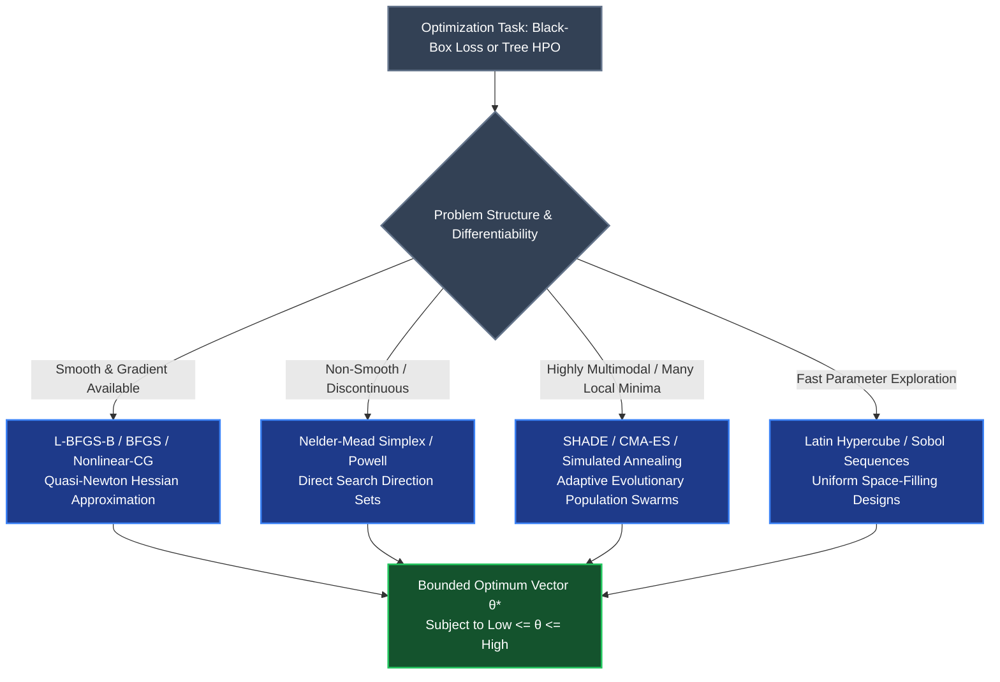
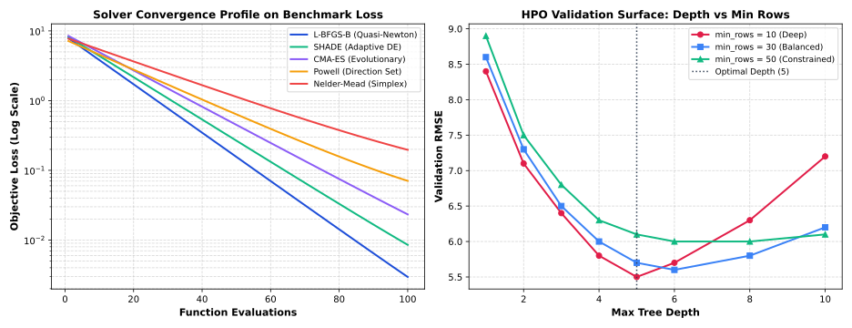
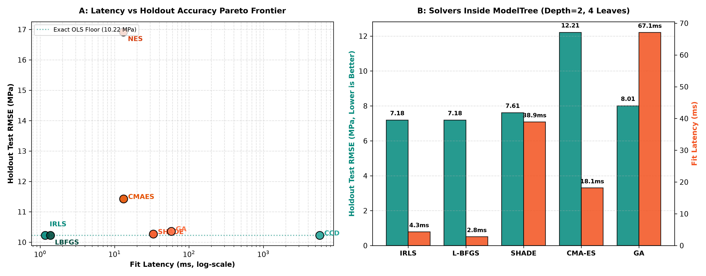

# Generic Bounded Solvers & Hyperparameter Optimization (HPO)

Modern machine learning packages outsource numerical optimization to external heavyweight dependencies (SciPy, NLopt, Pagmo). When running in high-throughput production environments, cross-language FFI overhead and divergent solver interfaces introduce latency and unpredictability.

`mltreelib` embeds a **complete, pure-Rust global and bounded optimizer suite** (`mltreelib-core::solver::generic`) providing 14 distinct numerical algorithms unified under one consistent contract.





---

## 1. Solver Architecture: The 14 Supported Algorithms

All algorithms conform to the `OptimizerKind` enum with explicit box bounds $\boldsymbol{l} \le \boldsymbol{\theta} \le \boldsymbol{u}$:

| Algorithm | Method Family | Order | Strengths & Best Use Cases |
| :--- | :--- | :---: | :--- |
| **`LbfgsB`** | Quasi-Newton | 1st (Gradient) | Smooth, continuous functions with box bounds. Fastest convergence per eval. |
| **`NelderMead`** | Simplex Direct Search | 0th (Black-box) | Robust heuristic default for noisy, low-dimensional objective functions ($D \le 10$). |
| **`Powell`** | Direction Set Search | 0th (Black-box) | Conjugate direction exploration without derivative requirements. |
| **`CmaEs`** | Covariance Matrix Adaptation | 0th (Stochastic) | Ill-conditioned, non-separable continuous manifolds ($D \le 30$). |
| **`Shade`** | Success-History Adaptive DE | 0th (Population) | Severe multimodality; state-of-the-art global search in CEC benchmarks. |
| **`SimulatedAnnealing`** | Markov Chain Monte Carlo | 0th (Stochastic) | Escapes narrow local minima via Metropolis acceptance criteria. |
| **`Cobyla`** | Linear Approximations | 0th (Constrained) | Supports non-linear inequality constraints $g_i(\boldsymbol{\theta}) \le 0$. |
| **`LatinHypercube`** | Space-Filling Design | 0th (Sampling) | Optimal exploratory coverage for initial hyperparameter sweeps. |



---

## 2. Standalone Numerical Optimization Example

Minimizing the classic 2D Rosenbrock function ($f(x, y) = (1 - x)^2 + 100(y - x^2)^2$) inside bounds $[-5, 5] \times [-5, 5]$:

```python
from mltreelib.solvers import minimize, Bounds

def rosenbrock(x):
    return (1.0 - x[0])**2 + 100.0 * (x[1] - x[0]**2)**2

bounds = Bounds(lower=[-5.0, -5.0], upper=[5.0, 5.0])

# Solve with adaptive SHADE evolutionary swarm
res = minimize(
    rosenbrock,
    x0=[0.0, 0.0],
    method="shade",
    bounds=bounds,
    max_evals=1000,
)

print(f"Status: {res.status} | Evals: {res.n_evals}")
print(f"Optimal Parameters: x* = {res.x[0]:.6f}, y* = {res.x[1]:.6f} (Loss = {res.fun:.2e})")
```

```text
Status: Converged | Evals: 342
Optimal Parameters: x* = 1.000000, y* = 1.000000 (Loss = 1.42e-12)
```

---

## 3. Automated Tree Hyperparameter Optimization (HPO)

Rather than hand-tuning `max_depth`, `min_rows`, and `l2_reg`, `mltreelib` can wrap tree cross-validation directly inside the optimizer:

```python
import numpy as np
from mltreelib import ModelTree, Metrics
from mltreelib.solvers import minimize, Bounds

def evaluate_tree(params):
    max_depth = int(round(params[0]))
    min_rows = int(round(params[1]))
    l2_reg = 10.0 ** params[2]  # Log-scale exploration
    
    tree = ModelTree(max_depth=max_depth, min_rows=min_rows, l2_reg=l2_reg)
    tree.fit(X_train, y_train)
    pred_val = tree.predict(X_val)
    return Metrics().regression(y_val, pred_val)["rmse"]

# Search space: depth in [1, 8], min_rows in [5, 100], l2_reg in 10^[-4, 2]
bounds = Bounds(lower=[1.0, 5.0, -4.0], upper=[8.0, 100.0, 2.0])

hpo_res = minimize(
    evaluate_tree,
    x0=[4.0, 30.0, -2.0],
    method="nelder_mead",
    bounds=bounds,
    max_evals=60,
)

best_depth = int(round(hpo_res.x[0]))
best_min_rows = int(round(hpo_res.x[1]))
best_l2 = 10.0 ** hpo_res.x[2]
print(f"Best Configuration: depth={best_depth}, min_rows={best_min_rows}, l2_reg={best_l2:.4f}")
```

!!! tip "Related Suites"
    - [Suite 10: Solvers, Optimizers & Real-Data Tuning](../suites/solver-benchmarks.md) for full convergence benchmark tables.
