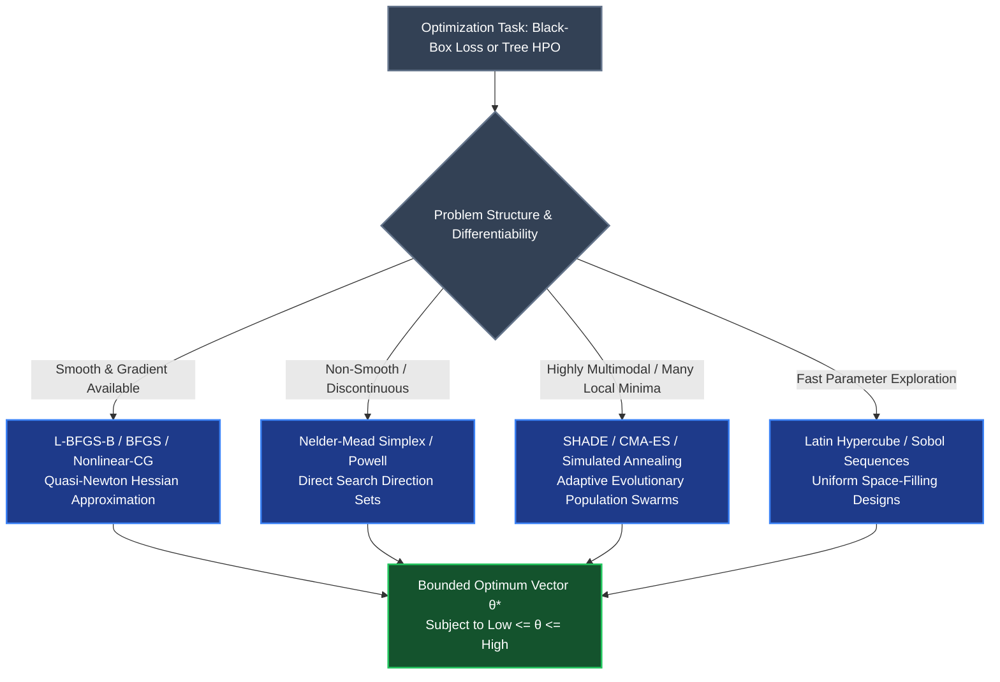

# Generic Bounded Solvers & Hyperparameter Optimization (HPO)

Modern machine learning packages outsource numerical optimization to external heavyweight dependencies (SciPy, NLopt, Pagmo). When running in high-throughput production environments, cross-language FFI overhead and divergent solver interfaces introduce latency and unpredictability.

`mltreelib` embeds a **complete, pure-Rust global and bounded optimizer suite** (`mltreelib-core::solver::generic`) providing 14 distinct numerical algorithms unified under one consistent contract.




---

## 1. Solver Architecture: The 14 Supported Algorithms

All algorithms conform to the `OptimizerKind` enum with explicit box bounds $\boldsymbol{l} \le \boldsymbol{\theta} \le \boldsymbol{u}$:

| Algorithm | Method Family | Order | Strengths & Best Use Cases |
| :--- | :--- | :---: | :--- |
| **`LbfgsB`** | Quasi-Newton | 1st (Gradient) | Smooth, continuous functions with box bounds. Fastest convergence per eval. |
| **`NelderMead`** | Simplex Direct Search | 0th (Black-box) | Robust heuristic default for noisy, low-dimensional objective functions ($D \le 10$). |
| **`Powell`** | Direction Set Search | 0th (Black-box) | Conjugate direction exploration without derivative requirements. |
| **`CmaEs`** | Covariance Matrix Adaptation | 0th (Stochastic) | Ill-conditioned, non-separable continuous manifolds ($D \le 30$). |
| **`Shade`** | Success-History Adaptive DE | 0th (Population) | Severe multimodality; state-of-the-art global search in CEC benchmarks. |
| **`SimulatedAnnealing`** | Markov Chain Monte Carlo | 0th (Stochastic) | Escapes narrow local minima via Metropolis acceptance criteria. |
| **`Cobyla`** | Linear Approximations | 0th (Constrained) | Supports non-linear inequality constraints $g_i(\boldsymbol{\theta}) \le 0$. |
| **`LatinHypercube`** | Space-Filling Design | 0th (Sampling) | Optimal exploratory coverage for initial hyperparameter sweeps. |


---

## 2. Standalone Numerical Optimization: One-Shot & Ask-Tell Interface

### Method A: One-Shot Minimization (`optimize`)

Minimizing the classic 2D Rosenbrock function ($f(x, y) = (1 - x)^2 + 100(y - x^2)^2$) inside bounds $[-5, 5] \times [-5, 5]$:

```python
from mltreelib.solvers import optimize

# Objective function to minimize
def rosenbrock(x):
    return (1.0 - x[0])**2 + 100.0 * (x[1] - x[0]**2)**2

bounds = [(-5.0, 5.0), (-5.0, 5.0)]

# Solve using Nelder-Mead simplex search
res = optimize(
    rosenbrock,
    bounds=bounds,
    start=[0.0, 0.0],
    method="nelder_mead",
    max_evaluations=1000,
)

print(f"Status: {res.status} | Total Evaluations: {res.evaluations}")
print(f"Optimal Parameters: x* = {res.best_x[0]:.4f}, y* = {res.best_x[1]:.4f} (Loss = {res.best_value:.2e})")
```

```text
Status: converged | Total Evaluations: 206
Optimal Parameters: x* = 1.0000, y* = 1.0000 (Loss = 2.65e-18)
```

---

### Method B: Asynchronous Population Search (`AskTell`)

For expensive simulation models, distributed workers, or hardware-in-the-loop tuning, `mltreelib` provides the decoupled **Ask-Tell** paradigm:

```python
from mltreelib.solvers import AskTell

# Initialize evolutionary CMA-ES optimizer with box bounds
optimizer = AskTell(
    "cma_es",
    bounds=[(-5.0, 5.0), (-5.0, 5.0)],
    max_evaluations=120,
    seed=2026,
)

# Active optimization loop
while not optimizer.should_stop:
    # 1. Ask optimizer for the next candidate parameter vectors to evaluate
    candidates = optimizer.ask()

    # 2. Evaluate objective loss across candidates (can run in parallel across CPU/GPU)
    fitness_scores = [rosenbrock(pt) for pt in candidates]

    # 3. Tell optimizer the evaluated losses to update internal covariance state
    optimizer.tell(fitness_scores)

print(f"AskTell Optimization Complete:")
print(f"  Evaluations: {optimizer.evaluations}")
print(f"  Best Solution: x* = {optimizer.best_x[0]:.4f}, y* = {optimizer.best_x[1]:.4f}")
print(f"  Minimum Objective Loss: {optimizer.best_value:.4e}")
```

---

## 3. Automated Tree Hyperparameter Optimization (HPO)

Rather than manually guessing `max_depth` and `min_rows`, `mltreelib` wraps tree cross-validation directly inside the numerical optimizer:

```python
import numpy as np
from mltreelib import ModelTree, Metrics
from mltreelib.solvers import optimize

# 1. Generate synthetic non-linear response surface
rng = np.random.default_rng(2026)
n_train, n_val = 1000, 300

X_train = rng.uniform(-3.0, 3.0, size=(n_train, 4))
y_train = X_train[:, 0] * 1.5 + np.sin(X_train[:, 1] * 2.0) + rng.normal(0, 0.2, n_train)

X_val = rng.uniform(-3.0, 3.0, size=(n_val, 4))
y_val = X_val[:, 0] * 1.5 + np.sin(X_val[:, 1] * 2.0) + rng.normal(0, 0.2, n_val)

metrics = Metrics()

# 2. Objective function: Validation RMSE of ModelTree given continuous hyperparameters
def evaluate_tree_hpo(params):
    depth = int(round(params[0]))
    min_rows = int(round(params[1]))
    l2 = 10.0 ** params[2]  # Log-scale exploration for regularization

    tree = ModelTree(
        leaf="linear",
        max_depth=depth,
        min_rows=min_rows,
        l2=l2,
    )
    tree.fit(X_train, y_train.tolist())
    pred_val = tree.predict(X_val)
    return metrics.regression(y_val.tolist(), pred_val)["rmse"]

# Search bounds: depth in [1, 6], min_rows in [10, 60], log10(l2) in [-4, 1]
bounds = [(1.0, 6.0), (10.0, 60.0), (-4.0, 1.0)]

# 3. Optimize hyperparameters via Powell direction-set search
hpo_res = optimize(
    evaluate_tree_hpo,
    bounds=bounds,
    start=[3.0, 30.0, -2.0],
    method="powell",
    max_evaluations=40,
)

best_depth = int(round(hpo_res.best_x[0]))
best_min_rows = int(round(hpo_res.best_x[1]))
best_l2 = 10.0 ** hpo_res.best_x[2]

print("HPO Search Results:")
print(f"  Best Validation RMSE: {hpo_res.best_value:.4f}")
print(f"  Optimal Configuration: max_depth={best_depth}, min_rows={best_min_rows}, l2={best_l2:.4e}")
```

!!! tip "Related Suites"
    - [Suite 10: Solvers, Optimizers & Real-Data Tuning](../suites/solver-benchmarks.md) for full convergence benchmark tables.
