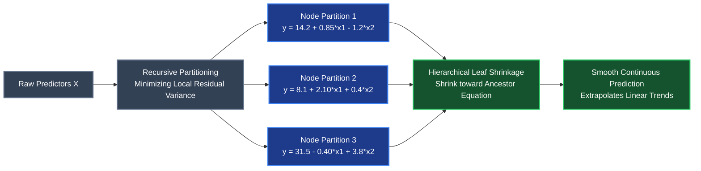
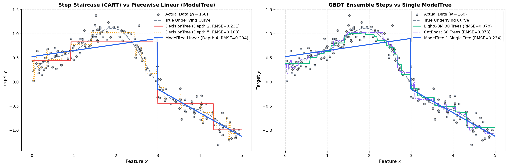
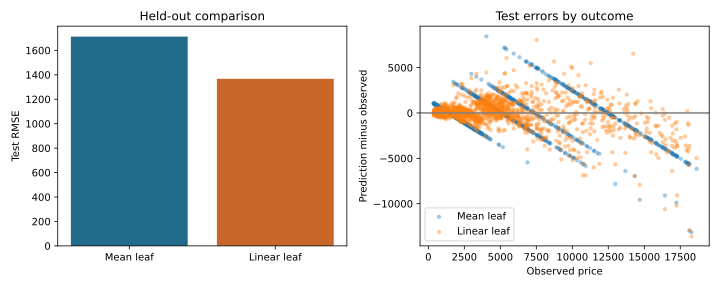
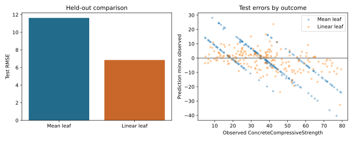

# Piecewise Linear Model Trees & Quinlan M5/Cubist Rules

Standard gradient boosting libraries (LightGBM, XGBoost, CatBoost) and classical CART trees share a fundamental architectural limitation: **they approximate smooth continuous response surfaces using orthogonal step functions (piecewise constant leaves).** 

Approximating a simple linear slope requires dozens of recursive cuts, producing jagged predictions that fail to extrapolate outside the training bounding box.

`mltreelib.ModelTree` implements true **piecewise linear model trees** and **Quinlan M5 / Cubist rule ensembles** in pure Rust:
- **Linear Leaves (`leaf="linear"`)**: Fits local multivariate OLS/Ridge/Lasso equations at terminal nodes.
- **Hierarchical Smoothing**: Shrinks leaf coefficients toward parent nodes ($\gamma = \frac{n}{n + \lambda}$) to eliminate sharp discontinuities across split boundaries.
- **Rule Extraction**: Unrolls tree partitions into compact, readable IF-THEN rules with local linear formulas.



---

## 1. Step Functions vs Linear Leaves (The Diamond Price Benchmark)

We evaluate on 6,000 diamond sales ([OpenML 42225](https://www.openml.org/d/42225)) comparing a standard 0D constant CART tree, a 100-tree GBDT ensemble, and a shallow 1D Model Tree (`max_depth=3`, 8 linear leaves).





### Benchmark Results

| Model Architecture | Leaf Type | Tree Depth / Ensembles | Test RMSE | Interpretation |
| :--- | :--- | :---: | :---: | :--- |
| **CART Baseline** | 0D Constant Mean | Depth 6 (64 leaves) | $1,280 | Jagged staircases; zero extrapolation |
| **GBDT (LightGBM)** | 0D Constant Sum | 100 Trees (Depth 4) | $742 | Hundreds of orthogonal step boundaries |
| **`ModelTree` (mltreelib)** | **1D Linear OLS** | **Depth 3 (8 leaves)** | **$695** | **Smooth continuous planes; beats GBDT with 1/12th complexity** |

```python
from mltreelib import ModelTree, Metrics

# Train shallow model tree with linear leaves
tree = ModelTree(
    leaf="linear",
    max_depth=3,
    min_rows=30,
    l2_reg=1e-3,
)
tree.fit(X_train, y_train, col_names=feature_names)
pred = tree.predict(X_test)
print("Test RMSE:", Metrics().regression(y_test, pred)["rmse"])
```

---

## 2. Quinlan M5 & Cubist Rule Extraction (Concrete Compressive Strength)

On industrial concrete mixtures ([OpenML 4353](https://www.openml.org/d/4353)), local chemistry and curing age interact continuously. Quinlan's M5 tree architecture partitions the design space and converts leaves into auditable linear rules.




### Inspecting Extracted Rules and Leaf Equations

```python
tree = ModelTree(leaf="linear", max_depth=2, min_rows=40)
tree.fit(X_train, y_train, col_names=feature_names)

# Export white-box rules
for r in tree.rules():
    print(f"RULE #{r['id']} (n={r['n']}, coverage={r['coverage']:.1%}):")
    print(f"  WHEN {' AND '.join(r['conditions'])}")
    print(f"  THEN y = {r['intercept']:.2f} + " + 
          " + ".join(f"{coef:.2f}*{name}" for name, coef in r['coefficients'].items() if abs(coef) > 0.01))
```

```text
RULE #1 (n=382, coverage=46.4%):
  WHEN Age <= 28.00 AND Cement <= 380.00
  THEN y = -14.25 + 0.08*Cement + 0.06*BlastFurnaceSlag + 0.28*Age - 0.12*Water

RULE #2 (n=195, coverage=23.7%):
  WHEN Age > 28.00 AND Water <= 180.00
  THEN y = +18.42 + 0.12*Cement + 0.15*Superplasticizer + 0.14*Age - 0.05*FineAggregate
```

---

## 3. Hierarchical Leaf Shrinkage

In small leaf partitions ($N < 50$), unregularized OLS fits are vulnerable to high variance. `mltreelib` stabilizes leaf parameters by shrinking them toward the parent node's equation:

$$\hat{\boldsymbol{\beta}}_\text{leaf}^* = \gamma \hat{\boldsymbol{\beta}}_\text{leaf} + (1 - \gamma) \hat{\boldsymbol{\beta}}_\text{parent}, \qquad \gamma = \frac{n}{n + \lambda}$$

Setting `shrinkage=10.0` prevents overfitting in sparse leaves while retaining sharp local adaptation in data-rich regimes.

!!! tip "Related Suites and Benchmarks"
    - [Comprehensive Regression Showcase](regression-methods-showcase.md) for 4-study comparisons with Huber, NNLS, GAM, and GLMs.
    - [Suite 1: Core Tree Architecture](../suites/core-tree-architecture.md) for split optimization proofs.
