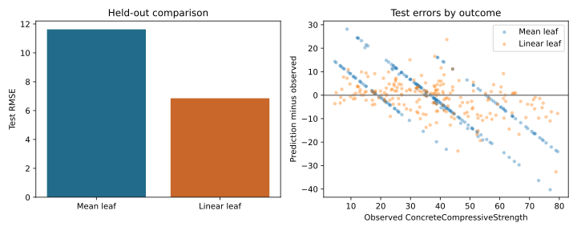

!!! info "Consolidated Flagship Guide"
    This topic is now part of the comprehensive flagship guide: [**Piecewise Linear Model Trees & Quinlan M5/Cubist Rules**](piecewise-linear-and-cubist.md).


# Cubist-style model trees in Python: explain a concrete strength prediction

Concrete strength depends on the recipe and curing age. It is plausible that those relationships differ across mixtures. A model tree divides the measurements into regions and fits a local equation in each region. We can inspect those regions and test whether the local equations improve held-out predictions.

Cubist and M5 motivate this combination of partitions and linear models. C5.0 belongs to a related lineage for classification and rule sets. Here we use `ModelTree` in mltreelib, whose tree fit runs in Rust and is exposed through Python. The exercise compares its mean and linear leaves. It does not reproduce every Cubist or C5.0 rule and committee feature.

## Prepare real concrete measurements

Download [OpenML concrete compressive strength 46917](https://www.openml.org/d/46917) to `datasets/concrete_compressive_strength.parquet`. The [UCI source](https://archive.ics.uci.edu/dataset/165/concrete+compressive+strength) describes the eight inputs and the response in MPa. The dataset includes 1,030 experiments. This tutorial uses 824 for training and 206 for testing. Similar recipes can appear in both parts of this random split. Use grouped recipe or batch splits for claims about new mixes.

Clone the repo, run `uv sync`, and run this code from the root.

```python
from examples.real_tree_studies import load, rows
from mltreelib import Metrics, ModelTree

target = "ConcreteCompressiveStrength"
df = load("concrete_compressive_strength", 46917).sample(frac=1, random_state=2026)
train, test = df.iloc[:824], df.iloc[824:]
features = df.columns.drop(target).tolist()
for leaf in ("mean", "linear"):
    tree = ModelTree(leaf=leaf, max_depth=2, min_rows=40, prune="none")
    tree.fit(rows(train, features), train[target].tolist(), col_names=features)
    prediction = tree.predict(rows(test, features))
    print(leaf, Metrics().regression(test[target].tolist(), prediction)["rmse"])

print("Split", tree.splits()[0])
print("Example leaf", tree.leaves()[0])
print(tree.to_dot())
```

The last tree uses linear leaves. Its DOT export records the fitted split structure. To create a diagram, save the DOT text to a file and run Graphviz. Use the same feature names for fitting, diagrams and the review worksheet.

## What can you read from a leaf?

Test RMSE was 18.34 MPa for the global training mean, 11.63 MPa for mean leaves, and 6.85 MPa for linear leaves. Both trees split first on curing age at 14 days and include a cement split at 350 kg/m³. The linear tree's first leaf had 180 training rows. Its fitted age coefficient was about 1.18 MPa per day with other inputs held fixed inside that leaf.



Start with the root split. Check which training records a branch covers, then read the support `n` and the leaf's coefficient columns. The split and the coefficients answer different questions. The split chooses a local region. The coefficients describe how the fitted prediction changes within it.

A condition on curing age can expose a useful region for an experiment. Treat the coefficient as predictive until a controlled study estimates the effect of changing the process. A large residual for a particular recipe is often a better place to investigate than the largest global importance bar.

## How does a rule become a useful handoff?


Use the diagram to read the structure. [Check boundary routing](../guides/serving-contract.md#check-split-boundaries) before transcribing the displayed conditions.

Record the feature name, input unit, threshold, missing direction, leaf support and final prediction. Use the exported representation to review a few rows on both sides of each boundary. If you extract a separate rule set, compare its predictions with the tree and check how overlapping and unmatched rules behave.

```bash
uv run python examples/real_tree_studies.py concrete
```

!!! tip "Deep-Dive Benchmark Suites"
    - For exact mathematical formulation of the two-control decoupling architecture and Chow structural break gating, see [Suite 1: Core Tree Architecture & Growth Knobs](../suites/core-tree-architecture.md).
    - For fast warm-start leaf retraining and micro-model routing down frozen tree topologies, see [Suite 5: Dynamic Leaf Retraining & Adaptation](../suites/hierarchical-retrain.md).

See [Quinlan's M5 paper](https://www.cs.tufts.edu/~nr/cs257/archive/ross-quinlan/continuous.pdf), [Kuhn's Cubist vignette](https://cran.r-project.org/web/packages/Cubist/vignettes/cubist.html) and the [rules and neighbor adjustment example](../examples/rules-summary-knn.md).
