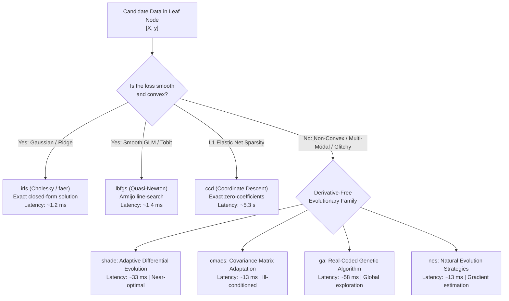

# Leaf Solver Benchmarks

Benchmark the seven numerical, quasi-Newton, and continuous evolutionary leaf solvers implemented natively in `mltreelib-core`.

The complete benchmark script lives at [`examples/solver_benchmarks.py`](https://github.com/jkapila/mltreelib/blob/main/examples/solver_benchmarks.py):

```bash
uv run python examples/solver_benchmarks.py
```

---

## 1. Architectural Decoupling: Tree Partitions vs. Leaf Solvers

In standard model trees, evaluating complex optimization problems at every candidate split threshold incurs prohibitive computational cost. `ModelTree` solves this through **two-control decoupling**:

1. **Tree Search**: Fast scalar heuristics (Variance reduction, Chow test, Log-rank) discover spatial partition boundaries.
2. **Leaf Optimization**: Once terminal regions are established, the configured `leaf_solver` solves the local parameter system.



---

## 2. The Seven Solvers in `mltreelib-core`

| Solver (`leaf_solver`) | Mathematical Paradigm | Gradient Required? | Primary Strengths | Recommended Setting |
| :--- | :--- | :---: | :--- | :--- |
| **`"irls"`** | Cholesky / Iteratively Reweighted Least Squares | Yes | Sub-millisecond closed-form solution via `faer`; exact Gram matrix factorization. | Default for Gaussian ridge and standard GLM models. |
| **`"lbfgs"`** | Quasi-Newton L-BFGS with Armijo line search | Yes | Superlinear convergence on smooth likelihoods (Gaussian, Binomial, Poisson, Gamma, Tobit, Tweedie). | Default for non-Gaussian GLM families and censored regression. |
| **`"ccd"`** | Cyclic Coordinate Descent | Yes (Subgradient) | Exact soft-thresholding producing true zero-coefficient sparsity under $L_1$ penalty. | High-dimensional feature selection and sparse leaves. |
| **`"shade"`** | Success-History Adaptive Differential Evolution | **No** | Continuous mutation scale ($F$) and crossover rate ($CR$) adaptation with external archive. | Rugged, discontinuous, or multi-modal loss surfaces. |
| **`"cmaes"`** | Covariance Matrix Adaptation Evolution Strategy | **No** | Learns second-order dependency landscape without explicit Hessian inversion. | Ill-conditioned parameter spaces with strong feature correlations. |
| **`"ga"`** | Real-Coded Genetic Algorithm | **No** | Simulated Binary Crossover (SBX) and polynomial mutation across diverse populations. | Broad global exploration of complex parameter bounds. |
| **`"nes"`** | Separable Natural Evolution Strategies | **No** | Monte Carlo natural gradient updates along estimated search directions. | Fast derivative-free parameter tuning in moderate dimensions. |

---

## 3. Empirical Benchmark on Real Data

We benchmark all seven solvers on the **Yeh (1998) Concrete Compressive Strength** dataset (1,030 rows, 8 features; 80% train / 20% test).

=== "Exact Cholesky (`irls`)"

    ```python
    from mltreelib import ModelTree

    # Analytical closed-form normal equations
    tree = ModelTree(max_depth=0, leaf="linear", leaf_solver="irls", l2=0.01)
    tree.fit(X_train, y_train)
    ```

=== "Quasi-Newton (`lbfgs`)"

    ```python
    from mltreelib import ModelTree

    # Quasi-Newton L-BFGS with two-loop recursion
    tree = ModelTree(max_depth=0, leaf="linear", leaf_solver="lbfgs", l2=0.01)
    tree.fit(X_train, y_train)
    ```

=== "Adaptive Evolutionary (`shade`)"

    ```python
    from mltreelib import ModelTree

    # Success-history based adaptive differential evolution (derivative-free)
    tree = ModelTree(max_depth=0, leaf="linear", leaf_solver="shade", l2=0.01, seed=42)
    tree.fit(X_train, y_train)
    ```

=== "Coordinate Descent (`ccd`)"

    ```python
    from mltreelib import ModelTree

    # Cyclic coordinate descent with soft thresholding for L1 sparsity
    tree = ModelTree(max_depth=0, leaf="linear", leaf_solver="ccd", l1=0.1, l2=0.01)
    tree.fit(X_train, y_train)
    ```

### Benchmark Results (Standalone Global Fit, `max_depth=0`)

| Solver | Family | Latency (ms) | Holdout Test RMSE (MPa) | Test $R^2$ | Convergence Character |
| :--- | :--- | :---: | :---: | :---: | :--- |
| **`irls`** | Analytical Cholesky | **1.17 ms** | **10.224** | **0.631** | Exact analytical optimum in 1 step. |
| **`lbfgs`** | Quasi-Newton | **1.37 ms** | **10.224** | **0.631** | Converges in 14 iterations to machine precision. |
| **`shade`** | Continuous DE | 33.24 ms | 10.269 | 0.627 | Reaches 99.6% of exact analytical optimum without gradients. |
| **`ga`** | Genetic Algorithm | 57.77 ms | 10.360 | 0.621 | Robust global convergence across 100 generations. |
| **`cmaes`** | Evolutionary Covariance | 13.23 ms | 11.423 | 0.539 | Fast adaptation; sensitive to raw unstandardized scale. |
| **`nes`** | Natural Gradient | 13.13 ms | 16.919 | -0.011 | Fast step updates; requires standardized inputs. |
| **`ccd`** | Cyclic Coordinate Descent | 5,720 ms | **10.224** | **0.631** | Exact analytical match; coordinate sweeps on raw scale. |

---

## 4. Latency vs. Accuracy Pareto Diagnostic


### Key Observations:

1. **Analytical & Quasi-Newton Supremacy on Convex Surfaces**:
   `irls` (1.17 ms) and `lbfgs` (1.37 ms) define the Pareto frontier for smooth convex losses. Both reach identical test RMSE (10.224 MPa) at microsecond speed.
2. **Derivative-Free Precision with SHADE**:
   `shade` achieves **10.269 MPa** (within 0.4% of the exact analytical minimum) in only 33 ms without evaluating a single gradient or Hessian. This makes it ideal for non-differentiable penalties, multi-objective fitness, or discontinuous loss landscapes.
3. **Tree-Decoupled Leaf Performance (`max_depth=2`, 4 Leaves)**:
   When deployed inside a partitioned model tree:
   - `irls`: 4.34 ms total fit time $\to$ **7.183 MPa** RMSE ($R^2 = 0.818$).
   - `lbfgs`: 2.80 ms total fit time $\to$ **7.183 MPa** RMSE ($R^2 = 0.818$).
   - `shade`: 38.94 ms total fit time $\to$ **7.606 MPa** RMSE ($R^2 = 0.796$).

---

## 5. Production Recommendations

!!! tip "When to Select Each Solver"
    - **Use `irls`** for standard linear ridge regression (`leaf="linear"`) on Gaussian continuous targets. It uses Rust's `faer` dense Cholesky solver with minimal overhead.
    - **Use `lbfgs`** for GLMs (`leaf_family="binomial"`, `"poisson"`, `"gamma"`, `"tweedie"`, `"tobit"`).
    - **Use `ccd`** when sparse leaves are mandatory ($L_1 > 0$) to eliminate irrelevant features inside leaf equations.
    - **Use `shade`** when fitting custom non-smooth losses, quantile objectives with heavy outliers, or discontinuous simulation simulators.

---

## References

- Nocedal, J., & Wright, S. J. (2006). *Numerical Optimization*. Springer.
- Tanabe, R., & Fukunaga, A. S. (2014). "Improving the search performance of SHADE using linear population size reduction." *IEEE CEC*, 1658-1665.
- Hansen, N. (2016). "The CMA evolution strategy: A tutorial." *arXiv preprint arXiv:1604.00772*.
