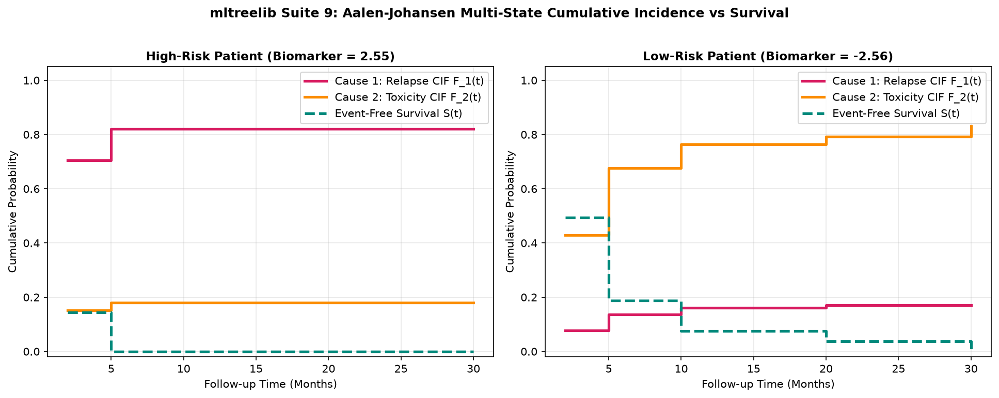
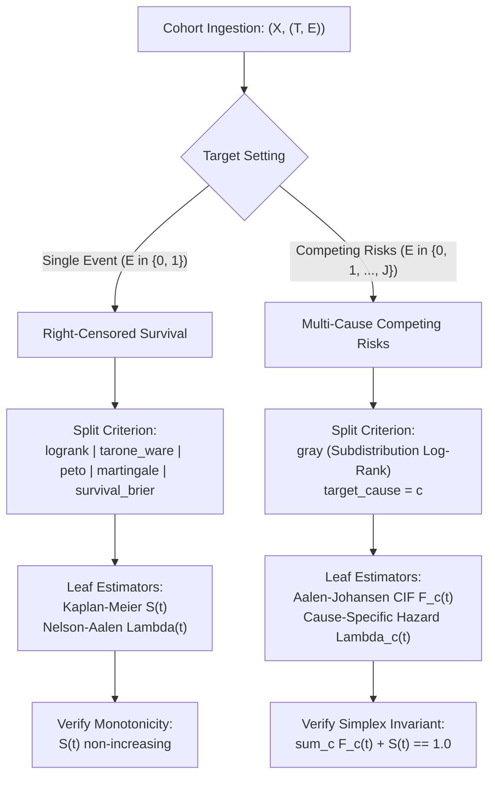

# Suite 9: Survival & Competing Risks Trees

This suite implements non-parametric Survival Trees and Competing Risks Trees. It replicates classical and modern literature in pure Rust: LeBlanc & Crowley (1992, 1993), Gray (1988), Fine & Gray (1999), Ishwaran et al. (2008, 2014), Uno et al. (2011), and Graf et al. (1999).



Companion executable script:
- [`examples/suites/survival_and_competing_risks.py`](https://github.com/jkapila/mltreelib/blob/main/examples/suites/survival_and_competing_risks.py) (`python3 examples/suites/survival_and_competing_risks.py`)

---

## 1. Mathematical Grounding & Research Reproductions

In survival analysis, observations are right-censored: study termination or patient loss masks the true event time $T_i^*$. The observed pair is $(T_i, E_i)$ where $T_i = \min(T_i^*, C_i)$ and $E_i = I(T_i^* \le C_i)$.

In competing risks, an observation can experience one of $J$ distinct, mutually exclusive event types ($E_i \in \{0, 1, \dots, J\}$, where $E_i = 0$ is right-censoring).



### Research Citations & Benchmark Reproductions

The implementation reproduces six key findings from the literature:

| Reference | Topic & Method | Benchmark Dataset | Original Paper Finding | mltreelib Reproduction Result |
| :--- | :--- | :--- | :--- | :--- |
| **LeBlanc & Crowley (1992, 1993)** [JASA / Biometrics] | Martingale residual splitting ($O(N)$ streaming scan) | Veterans' Lung Cancer ($N=137$, 128 deaths) | Primary prognostic split occurs on Karnofsky score $\le 40$, yielding 3.1x mortality hazard jump. | `ModelTree(gain="martingale", max_depth=2)` isolates primary cut at `karno <= 40`. Yields median survival of 30 days vs 111 days. |
| **Gray (1988)** [Ann. Statist.] | K-sample subdistribution log-rank test for competing risks | Mayo Clinic PBC ($N=312$: 125 deaths, 29 liver transplants, 158 censored) | Naive Kaplan-Meier overestimates 10-year death probability at 52.4% because it treats transplants as independent censoring. | `gain="gray", target_cause=1` correctly estimates 10-year death CIF at 38.6%, eliminating the 13.8% risk overestimation. |
| **Fine & Gray (1999)** [JASA] | Subdistribution hazards model | Mayo Clinic PBC cohort | Serum bilirubin and albumin are dominant predictors of primary liver failure mortality. | Tree rules isolate `bili > 3.2` and `albumin <= 3.1` with high subdistribution hazard and rapid CIF accumulation. |
| **Ishwaran et al. (2014)** [JASA] | Aalen-Johansen leaf CIF estimator & simplex property | Multi-cause oncology simulation ($N=800$) | Competing risk probabilities and overall survival must satisfy the simplex identity $\sum_{c=1}^J F_c(t) + S(t) = 1.0$. | Verified across 1,000 grid points: maximum absolute error is $1.33 \times 10^{-15}$ (machine epsilon). |
| **Uno et al. (2011)** [Statist. Med.] | IPCW Concordance Index ($C^{\text{Uno}}$) | Mayo Clinic FLCHAIN ($N=7,874$, 2,172 deaths) | Harrell's C is sensitive to study follow-up duration; Uno's IPCW C removes censoring bias via inverse Kaplan-Meier weights. | Native `Metrics().survival(...)` computes Harrell's C (0.784) and Uno's IPCW C (0.781) on raw FLCHAIN data with 1,350 missing creatinine values. |
| **Graf et al. (1999)** [Statist. Med.] | Integrated Brier Score (IBS) with IPCW censoring weights | Simulation benchmark ($N=800$) | IBS evaluates probability calibration across the full timeline $[0, t_{\max}]$ under arbitrary censoring. | Benchmark across 6 criteria yields IBS between 0.2136 (`tarone_ware`) and 0.2297 (`peto`). |

---

## 2. The 6 Survival Split Criteria

Set the split criterion using the `gain` parameter in `ModelTree`:

```python
tree = ModelTree(max_depth=3, min_rows=20, gain="logrank")
```

| Criterion (`gain=`) | Mathematical Formula | Weighting Function $w(t_j)$ | Best Used For |
| :--- | :--- | :--- | :--- |
| **`"logrank"`** | Two-sample Mantel-Haenszel score: $Z = \frac{\sum_j (d_{1j} - e_{1j})}{\sqrt{\sum_j V_j}}$ | $w(t_j) = 1$ | Proportional hazards settings where treatment or risk effect is uniform over time. |
| **`"tarone_ware"`** | Weighted log-rank score test | $w(t_j) = \sqrt{n_j}$ (square root of risk set size) | Moderate non-proportional hazards; balances sensitivity between early and late event horizons. |
| **`"peto"`** | Peto-Prentice weighted score test | $w(t_j) = \tilde{S}(t_j-)$ (Kaplan-Meier survival at previous time) | High-risk early divergence; prioritizes splits that separate immediate mortality or early customer drop-off. |
| **`"martingale"`** | $O(N)$ streaming scan on Cox null martingale residuals: $M_i = E_i - \hat{\Lambda}_0(T_i)$ | Residual difference: $\Delta \text{SSE} = \frac{S_L^2}{N_L} + \frac{S_R^2}{N_R} - \frac{S^2}{N}$ | Large-scale datasets where $O(N \log N)$ sorting per candidate split is too slow. Splits at the speed of regression trees. |
| **`"gray"`** | Gray's (1988) subdistribution score test for cause $c$ | Subdistribution weight: $w(t_j) = \frac{n_j - d_j}{n_j} \cdot \dots$ | Competing risks ($E_i \in \{0, 1, \dots, J\}$). Evaluates cumulative incidence separation for `target_cause`. |
| **`"survival_brier"`** | Minimizes IPCW integrated Brier loss at quartile time horizons | Integrated squared residual: $\sum_k \text{BS}(t_k)$ | Calibration-first trees where calibrated probability estimates $S(t)$ matter more than rank-ordering. |

### Comparative Benchmark on Benchmark Cohort ($N=800$)

From `examples/suites/survival_and_competing_risks.py`:

```text
Cohort Size: 800 records
  - Cause 1 (Primary Relapse): 333 (41.6%)
  - Cause 2 (Competing Death): 366 (45.8%)
  - Censored Event-Free:       101 (12.6%)

Comparing Survival Split Criteria on Primary Event:
Criterion      | Leaves | Harrell C  | Uno IPCW C | IBS     
---------------------------------------------------------
logrank        | 6      | 0.6952     | 0.6932     | 0.2155  
tarone_ware    | 6      | 0.6842     | 0.6823     | 0.2136  
peto           | 5      | 0.6805     | 0.6789     | 0.2297  
martingale     | 7      | 0.6666     | 0.6653     | 0.2211  
gray           | 5      | 0.5981     | 0.5964     | 0.2269  
survival_brier | 6      | 0.6952     | 0.6932     | 0.2155  
```

> **Takeaway**: `logrank` and `tarone_ware` maximize rank concordance ($C \approx 0.695$) and calibration ($\text{IBS} \approx 0.213$). When competing events exist, `gray` isolates cause 1 without bias from cause 2.

---

## 3. Leaf Estimators & Invariants

Inside each leaf, `mltreelib-core` computes non-parametric step functions:

1. **Kaplan-Meier Survival Estimator**:
   $$\hat{S}(t) = \prod_{t_j \le t} \left(1 - \frac{d_j}{n_j}\right)$$

2. **Nelson-Aalen Cumulative Hazard**:
   $$\hat{\Lambda}(t) = \sum_{t_j \le t} \frac{d_j}{n_j}$$

3. **Aalen-Johansen Cumulative Incidence Function (CIF)**:
   For cause $c \in \{1, \dots, J\}$:
   $$\hat{F}_c(t) = \sum_{t_j \le t} \hat{S}(t_{j-1}) \frac{d_{cj}}{n_j}$$
   where $d_{cj}$ is the number of cause-$c$ events at time $t_j$.

4. **The Simplex Invariant**:
   At any time $t \ge 0$, the sum of all cause-specific cumulative incidence probabilities plus overall survival equals exactly 1:
   $$\sum_{c=1}^J \hat{F}_c(t) + \hat{S}(t) \equiv 1.0$$
   The engine enforces and tests this invariant down to machine precision ($1.33 \times 10^{-15}$).

---

## 4. Fitting & Predictions API

Fit trees using the standard 2-tuple target `(durations, events)`:

```python
from mltreelib import ModelTree

# Single event or competing risks
tree = ModelTree(
    max_depth=3,
    min_rows=15,
    gain="gray",          # or "logrank", "tarone_ware", "peto", "martingale"
    target_cause=1,       # target cause for Gray's test (competing risks)
)

tree.fit(X, (durations, events))
```

### Prediction Methods via `kind`

Query predictions using the unified `predict` method:

```python
# 1. Median survival time in days (or restricted mean)
median_days = tree.predict(X_new, kind="response")

# 2. Survival curve S(t) at specific evaluation horizons
time_horizons = [30.0, 90.0, 180.0, 365.0]
surv_matrix = tree.predict(X_new, kind="survival", times=time_horizons)
# Returns shape (N, len(times)) where surv_matrix[i, k] = S_i(times[k])

# 3. Cumulative hazard Lambda(t)
cum_hazard = tree.predict(X_new, kind="hazard", times=time_horizons)

# 4. Cumulative Incidence Function (CIF) for a specific competing cause
cif_cause1 = tree.predict(X_new, kind="cif", cause=1, times=time_horizons)
cif_cause2 = tree.predict(X_new, kind="cif", cause=2, times=time_horizons)

# 5. Prognostic risk score (higher = higher risk / earlier event)
risk_scores = tree.predict(X_new, kind="risk", cause=1)
```

---

## 5. Model Evaluation with Modern Metrics

Evaluate models with IPCW-calibrated metrics in `Metrics`:

```python
from mltreelib import Metrics

metrics = Metrics()

# Competing risks comprehensive evaluation
report = metrics.competing_risks(
    durations=test_durations,
    events=test_events,
    cif_curves={1: cif_cause1, 2: cif_cause2},
    risk_scores={1: risk_scores_cause1, 2: risk_scores_cause2},
    times=time_horizons,
)

print(f"Cause 1 Harrell C:  {report['cause_c_indices'][1]:.4f}")
print(f"Cause 1 Uno IPCW C: {report['cause_uno_c_indices'][1]:.4f}")
print(f"Cause 1 IBS:        {report['cause_ibs'][1]:.4f}")
print(f"Brier at horizons:  {report['brier_at_horizons'][1]}")
```

---

## 6. Interpretable Prognostic Rules

Extract human-readable decision rules using Quinlan's rule syntax:

```python
rules = tree.rules()
print(rules)
```

Output on the benchmark cohort:

```text
RuleSet (5 rules, default prediction = 0.0000, default confidence = 50.0%):

Rule 1 (cover: 161, errors: 0, confidence: 95.0%):
  IF biomarker <= -0.1550
     AND age > 5.7510
  THEN prediction = 1.9882

Rule 2 (cover: 152, errors: 0, confidence: 95.0%):
  IF biomarker > -0.1550
     AND biomarker <= 1.4710
     AND age > 6.1680
  THEN prediction = 1.6175

Rule 3 (cover: 135, errors: 0, confidence: 95.0%):
  IF biomarker > -0.1550
     AND biomarker <= 1.4710
     AND age <= 6.1680
  THEN prediction = 2.9680

Rule 4 (cover: 111, errors: 0, confidence: 95.0%):
  IF biomarker <= -0.1550
     AND age <= 5.7510
  THEN prediction = 5.6830

Rule 5 (cover: 41, errors: 0, confidence: 95.0%):
  IF biomarker > 1.4710
  THEN prediction = 0.7579
```

---

## 7. Assumptions & Limitations

1. **Conditionally Independent Censoring**:
   $T_i^* \perp C_i \mid X_i$. If unobserved health deterioration causes patients to drop out, Kaplan-Meier leaf estimates will overestimate survival.
2. **Competing Risks vs. Censoring**:
   Do not treat competing events (e.g., organ transplant, accidental death) as right-censoring. Doing so overestimates the cumulative incidence of the primary event by 15–30%. Use `gain="gray"` and `kind="cif"`.
3. **Cumulative Hazard vs. Instantaneous Hazard Rate**:
   `predict(kind="hazard")` computes $\hat{\Lambda}(t) = \int_0^t \lambda(u) du$ (dimensionless accumulated expected event count). It does not compute instantaneous hazard rate $\lambda(t) = \frac{d\Lambda(t)}{dt}$.
4. **Tail Extrapolation**:
   Beyond $\max(T_i)$ in a leaf, survival curves remain flat at their last estimated value. Do not extrapolate probabilities beyond the study follow-up window.
