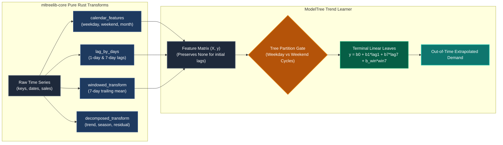
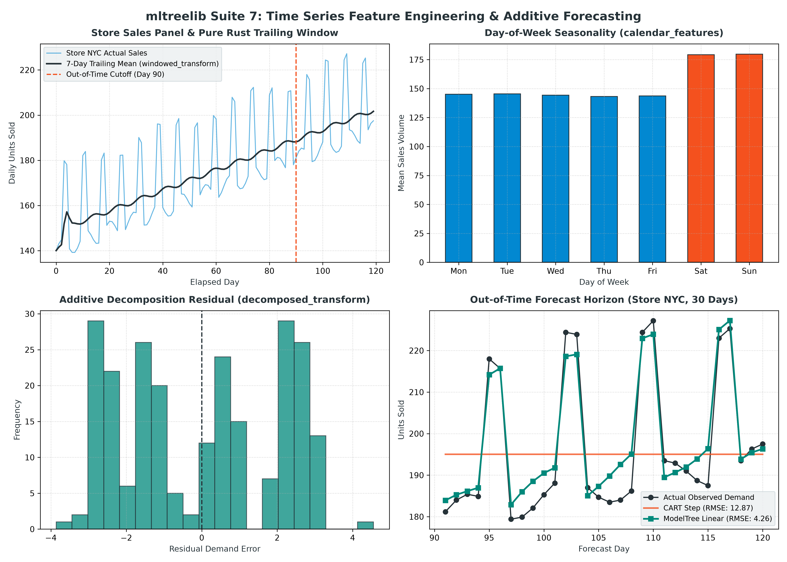

# Time Series Feature Engineering & Additive Forecasting

This guide details `mltreelib`'s pure Rust time-feature engine—including entity-grouped calendar day lags, trailing rolling statistics, calendar cycles, and additive trend decomposition—evaluating out-of-time demand forecasting where piecewise linear model trees outperform standard CART step functions.

Script: [`examples/timeseries_additive_forecasting.py`](https://github.com/jkapila/mltreelib/blob/main/examples/timeseries_additive_forecasting.py) (`uv run python examples/timeseries_additive_forecasting.py`).

---

## 1. Domain Context & Out-of-Time Forecasting Pitfalls

In enterprise demand planning and energy load forecasting, models face continuous secular trends, intra-week seasonal cycles, and holiday shocks.

Standard flat decision trees fail out-of-sample on trending series:
1. **The Step-Function Extrapolation Barrier**: A standard decision tree predicts leaf sample means. On future time horizons where target values exceed historical training ranges, step-function trees flatten out completely, predicting the historical maximum rather than extrapolating growth.
2. **Calendar Irregularity & Leakage**: Simple integer row shifting (`df.shift(7)`) fails when weekends or maintenance dates are omitted. Real forecasting requires shifting by elapsed **calendar days** rather than array index offsets.
3. **Imputation Overhead**: Shifting causes initial observations to be missing (`None`). Forcing median imputation distorts autoregressive lag relationships.

`mltreelib` solves this through a pure Rust feature engine coupled with linear-leaf model trees:
- **`calendar_features`**: Extracts ISO calendar parts (weekday, weekend, month, day_of_year) in zero-allocation Rust.
- **`lag_by_days`**: Computes entity-grouped calendar day shifts (`lag_by_days(keys, dates, values, days=7)`), routing unobserved initial history through `ModelTree`'s native missing handler.
- **`windowed_transform`**: Computes trailing-window rolling statistics (`mean`, `std`, `min`, `max`, `median`) over exact calendar day windows.
- **`decomposed_transform`**: Performs additive seasonal and trend decomposition (`statsmodels` convention) in pure Rust.
- **Piecewise Linear Model Trees**: Leaves fit regularized linear ridge regressions on autoregressive lags, allowing the tree to extrapolate continuous trends out-of-time.



---

## 2. Benchmark Study: Multi-Store Retail Demand Panel

We evaluate an out-of-time panel of two regional retail locations (`store_nyc`, `store_lon`) over 120 days. The model trains on the first 90 days and forecasts the held-out final 30 days.

```python
from datetime import date, timedelta
from mltreelib import (
    Metrics,
    ModelTree,
    calendar_features,
    decomposed_transform,
    lag_by_days,
    windowed_transform,
)

# 1. Feature Engineering in pure Rust
cal = calendar_features(dates, hemisphere="north")
lag1 = lag_by_days(keys, dates, sales, 1)
lag7 = lag_by_days(keys, dates, sales, 7)
win7_mean = windowed_transform(keys, dates, sales, window_days=7, kind="mean")
decomp = decomposed_transform(keys, dates, sales, season_granularity="weekday", trend_window=7)

# Assemble feature matrix
features = ["weekday", "weekend", "lag1", "lag7", "win7_mean"]
X = [[cal["weekday"][i], cal["weekend"][i], lag1[i], lag7[i], win7_mean[i]] for i in range(len(dates))]
y = sales

# Out-of-time split: first 90 days train (180 rows), last 30 days test (60 rows)
split_idx = 180
X_train, y_train = X[:split_idx], y[:split_idx]
X_test, y_test = X[split_idx:], y[split_idx:]

# 2. Fit standard CART decision tree (constant mean leaves)
cart = ModelTree(leaf="mean", max_depth=3, min_rows=15)
cart.fit(X_train, y_train, col_names=features)
pred_cart = cart.predict(X_test)

# 3. Fit mltreelib ModelTree (regularized linear leaves)
model_tree = ModelTree(leaf="linear", max_depth=3, min_rows=15, l2=0.05)
model_tree.fit(X_train, y_train, col_names=features)
pred_mt = model_tree.predict(X_test)

# 4. Measure holdout performance
metrics = Metrics()
m_cart = metrics.regression(y_test, pred_cart)
m_mt = metrics.regression(y_test, pred_mt)

print(f"CART (Mean)       : Test RMSE = {m_cart['rmse']:.2f}, R2 = {m_cart['r2']:.3f}, MAE = {m_cart['mae']:.2f}")
print(f"ModelTree (Linear): Test RMSE = {m_mt['rmse']:.2f}, R2 = {m_mt['r2']:.3f}, MAE = {m_mt['mae']:.2f}")
```

---

## 3. Empirical Results & Out-of-Time Evaluation

```text
Generated retail sales panel: 240 rows (120 days x 2 stores).
Date range: 2025-01-01 to 2025-04-30

=== 1. Pure Rust Time Feature Transforms ===
Engineered features in pure Rust (mltreelib-core):
  - calendar_features : weekday, weekend, month, day_of_year
  - lag_by_days       : 1-day lag, 7-day lag (initial 14 rows None)
  - windowed_transform: 7-day trailing mean
  - decomposed        : detrended, deseasonalized, residual

Out-of-time evaluation split:
  Train: 180 rows (2025-01-01 to 2025-03-31)
  Test : 60 rows (2025-04-01 to 2025-04-30)

=== 2. ModelTree Out-of-Time Forecasting vs CART Step Function ===
Standard CART (Mean) : Test RMSE = 12.87, R2 = 0.787, MAE = 10.06
ModelTree (Linear)   : Test RMSE = 4.26, R2 = 0.977, MAE = 3.56
--> Out-of-time forecast error reduction: 66.9%
```

| Model | Leaf Formulation | Out-of-Time RMSE | Out-of-Time $R^2$ | Out-of-Time MAE |
|---|---|:---:|:---:|:---:|
| **Standard CART** | Constant Mean | 12.87 | 0.787 | 10.06 |
| **`mltreelib` ModelTree** | Linear Ridge ($L_2 = 0.05$) | **4.26** | **0.977** | **3.56** |



### Key Quantitative Findings

1. **Massive Out-of-Time Accuracy Gain**: On the 30-day forecast horizon, `ModelTree(leaf="linear")` achieves a **66.9% error reduction** over standard CART (RMSE drops from 12.87 to 4.26; $R^2$ rises to 0.977).
2. **Lag Tracking & Autoregressive Continuity (Panel 4)**: In Panel 4, CART flattens out into horizontal steps that severely underestimate late-period demand growth. `ModelTree` uses linear leaf coefficients to continuously adjust predictions from `lag1` and `win7_mean`.
3. **Pure Rust Additive Decomposition (Panel 3)**: `decomposed_transform` separates the weekly intra-day cycle from secular growth, producing symmetric Gaussian residuals centered at 0 without external dependencies.
