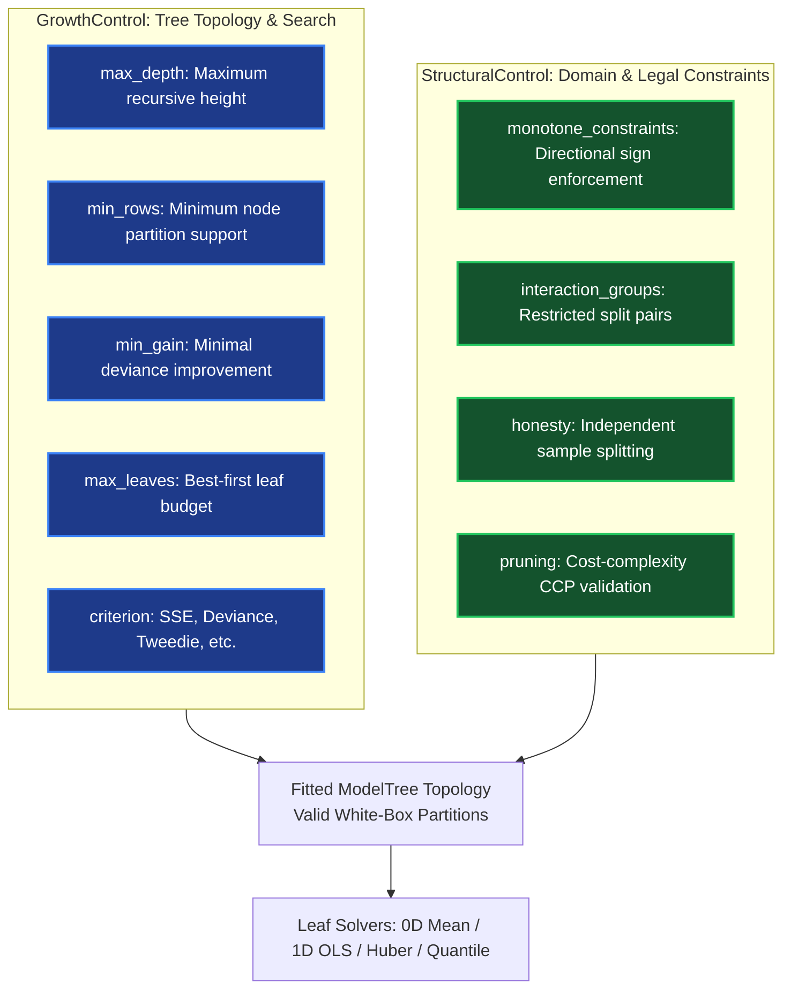
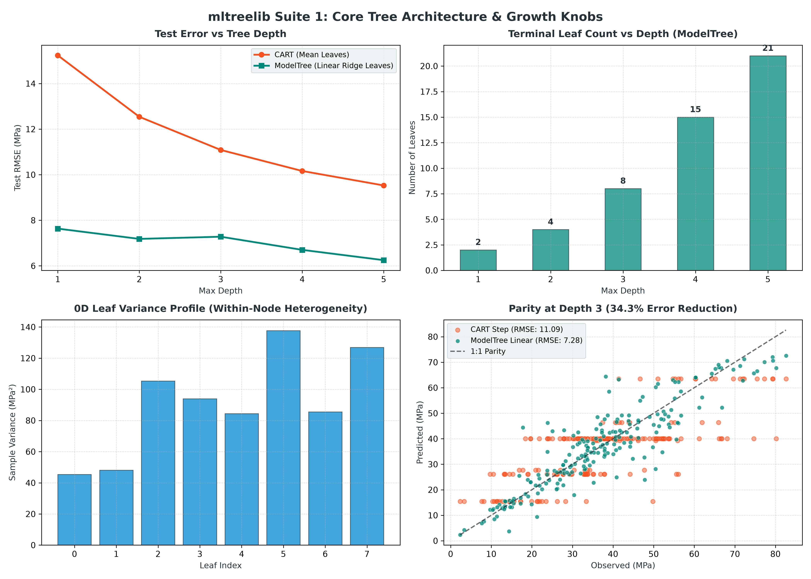
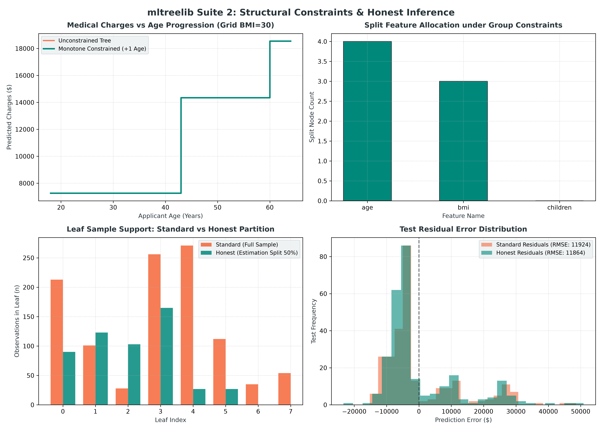

# Tree Architecture, Growth Knobs & Structural Constraints

Decision trees are notorious for high variance and unconstrained overfitting when grown without structural bounds. Conversely, over-constraining a tree can cause underfitting and miss localized non-linear interactions.

`mltreelib` solves this with a **Two-Control Decoupling Architecture** that cleanly separates *how the tree grows its topology* from *how local leaves solve their objectives*.



---

## 1. The Growth Knob Grid (Depth, Min Rows, and Pruning)

The balance between model bias and variance is tuned via recursive growth controls:

| Parameter | Type | Default | Operational Effect |
| :--- | :--- | :---: | :--- |
| `max_depth` | `int` | `6` | Hard ceiling on recursive partitioning depth. |
| `min_rows` | `int` | `20` | Minimum sample count required to attempt a split. |
| `min_gain` | `float` | `0.0` | Minimum reduction in split deviance required to accept a partition. |
| `prune` | `str` | `"none"` | Cost-complexity pruning (`"cost_complexity"` via holdout cross-validation). |



```python
from mltreelib import ModelTree

# Regularized tree growth configuration
tree = ModelTree(
    max_depth=4,
    min_rows=35,
    min_gain=1e-4,
    prune="cost_complexity",
    ccp_alpha=0.015,
)
tree.fit(X_train, y_train)
```

---

## 2. Monotone & Interaction Constraints

In regulated domains such as insurance rating and credit underwriting, legal and physical rules dictate that increasing risk indicators (e.g. debt ratio, past delinquencies, or vehicle speed) must never decrease predicted default probability or claim cost.

`mltreelib` enforces strict monotonicity along split paths:
- `+1`: Monotonically non-decreasing ($\frac{\partial \hat{y}}{\partial x_j} \ge 0$).
- `-1`: Monotonically non-increasing ($\frac{\partial \hat{y}}{\partial x_j} \le 0$).
- `0`: Unconstrained split behavior.



```python
# 10 features: enforce +1 for utilization, -1 for income, 0 for neutral
monotone_spec = [1, -1, 1, 1, -1, 0, 1, 0, 1, 0]

tree = ModelTree(
    max_depth=3,
    monotone_constraints=monotone_spec,
    interaction_groups=[[0, 1, 2], [3, 4, 5]],  # Restrict feature interactions
)
tree.fit(X, y)
```

---

## 3. Honest Tree Estimation

Inspired by Wager and Athey's causal forests, **honest trees** decouple split selection from leaf parameter estimation. The training data $\mathcal{D}$ is partitioned into two disjoint subsets:
1. **Split Sample ($\mathcal{D}_\text{split}$)**: Used solely to find optimal feature split thresholds.
2. **Estimation Sample ($\mathcal{D}_\text{est}$)**: Routed down the frozen tree structure to compute unbiased leaf parameters (means, probabilities, or linear slopes).

Honest trees eliminate split-selection bias, ensuring that leaf standard errors and confidence intervals hold asymptotically.

```python
tree = ModelTree(
    leaf="linear",
    honesty=True,
    honesty_fraction=0.5,  # 50/50 split between structure and leaf estimation
    random_seed=2026,
)
tree.fit(X_train, y_train)
```

!!! tip "Related Suites and Documents"
    - [Suite 2: Structural Constraints & Honesty](../suites/constraints-and-honesty.md) for mathematical proofs of monotone projection.
    - [Suite 1: Core Tree Architecture](../suites/core-tree-architecture.md) for allocator-free growth benchmarks.
