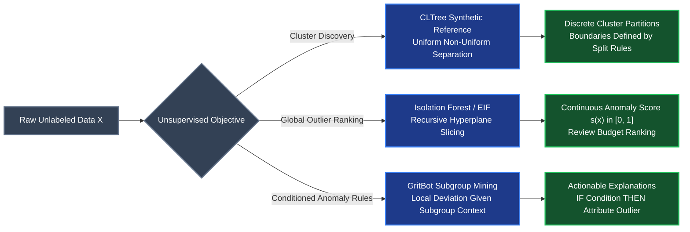
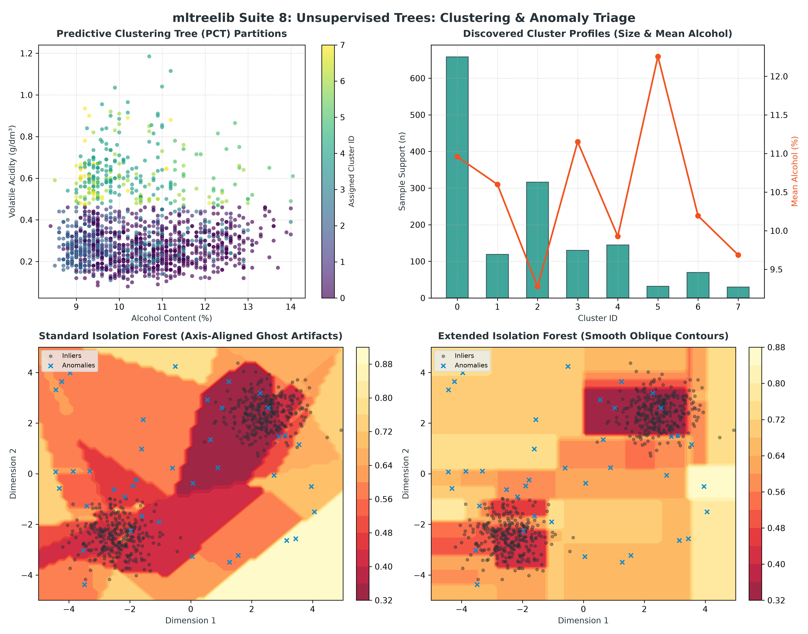
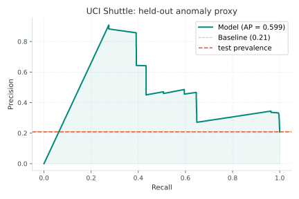
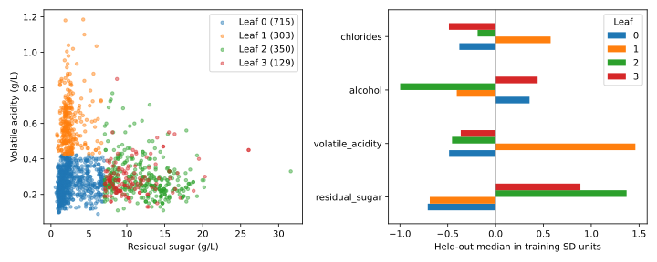

# Unsupervised Density Trees: Clustering & Anomaly Detection

Unsupervised learning in high-dimensional tabular spaces is plagued by the curse of dimensionality: distance-based methods like k-means and raw DBSCAN degrade as noisy, irrelevant features distort Euclidean distances.

`mltreelib` approaches clustering and anomaly detection through **unsupervised density trees** in pure Rust:
1. **CLTree (Clustering Trees)**: Generates synthetic uniform reference points to turn unsupervised density estimation into an optimal supervised classification task.
2. **Extended Isolation Forest (EIF)**: Evaluates random hyperplanes through feature space, isolating anomalies with shorter recursive path lengths than normal instances.
3. **GritBot Discovery**: Identifies localized anomalous outliers conditioned on tight business rules (e.g. "for concrete with Age > 90, sample #42 has anomalously low strength").





---

## 1. Anomaly Review Budgets (NASA Shuttle Benchmark)

In real-world fraud or engineering reviews, operations teams cannot inspect thousands of alerts. What matters is **Precision at Budget** (e.g. reviewing only the top 1% or 5% highest-scoring instances).

On the NASA Shuttle benchmark ([OpenML 40685](https://www.openml.org/d/40685)), `mltreelib.anomaly.ExtendedIsolationForest` concentrates true system failures into the top 1% review queue:



```python
from mltreelib.anomaly import ExtendedIsolationForest
from mltreelib import Metrics

# Train Extended Isolation Forest with oblique hyperplanes
model = ExtendedIsolationForest(
    n_trees=100,
    sample_size=256,
    extension_level=2,  # 2D oblique random hyperplanes
    random_seed=2026,
)
model.fit(X_train)
scores = model.score_samples(X_test)

# Evaluate precision at 5% triage budget
budget = int(0.05 * len(X_test))
ranked_idx = sorted(range(len(scores)), key=lambda i: -scores[i])[:budget]
caught = sum(y_test[i] for i in ranked_idx)
print(f"Top 5% Budget: Caught {caught}/{sum(y_test)} anomalies (Precision = {caught/budget:.2%})")
```

---

## 2. White-Box Clustering: CLTree (Wine Quality Benchmark)

Unlike black-box k-means, `CLTree` partitions data into clusters defined by human-readable orthogonal boundaries, rejecting uniform noise regions:



```python
from mltreelib.cluster import CLTree

cltree = CLTree(
    min_cluster_size=20,
    density_factor=1.2,
)
labels = cltree.fit_predict(X_wine)
print("Discovered Clusters:", set(labels))
```

---

## 3. GritBot: Conditioned Local Outlier Mining

GritBot discovers anomalies that are anomalous **only within their specific operating regime**. An engine temperature of 85°C is normal at peak highway cruise, but anomalous when idling at cold start.

```python
from mltreelib.anomaly import GritBot

grit = GritBot(min_subgroup_size=30, confidence=0.01)
anomalies = grit.fit_predict(X, col_names=feature_names)

for a in anomalies[:3]:
    print(f"Case #{a['case_id']} is ANOMALOUS for '{a['attribute']}':")
    print(f"  Observed: {a['value']:.2f} (Expected subgroup mean: {a['subgroup_mean']:.2f})")
    print(f"  Condition: {' AND '.join(a['conditions'])}")
```

!!! tip "Related Suites"
    - [Suite 8: Unsupervised Trees, Anomaly & Density Partitioning](../suites/unsupervised-trees.md) for full algorithmic formulations.
