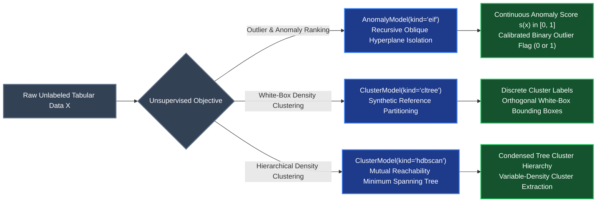

# Unsupervised Density Trees: Clustering & Anomaly Detection

Unsupervised learning in high-dimensional tabular data is plagued by the curse of dimensionality: traditional distance-based methods like k-means and DBSCAN degrade when noisy or irrelevant features distort Euclidean distances.

`mltreelib` provides a clean, unified unsupervised API surface through two high-level facades:
- **`AnomalyModel`** (or **`AnomalyTree`**): Pure Rust tree-based anomaly detection engines (`kind="eif"` for oblique hyperplanes, `kind="det"` for piecewise density, `kind="hst"` for streaming half-spaces, `kind="rct"` for random cut trees).
- **`ClusterModel`** (or **`ClusterTree`**): Divisive and density-based tree clustering (`kind="cltree"` for bounding-box density partitions, `kind="hdbscan"` for reachability MST hierarchies, `kind="pct"` for predictive clustering trees).




---

## 1. High-Level Anomaly Detection: `AnomalyModel`

In operations, fraud detection, and hardware monitoring, review budgets are strictly limited. Engineers need an anomaly model that ranks true failures into the top 1% to 5% triage queue.

`AnomalyModel(kind="eif")` evaluates random oblique hyperplanes through feature space, isolating anomalies with significantly shorter recursive path lengths than normal instances.


### Complete End-to-End Example

```python
import numpy as np
from mltreelib import AnomalyModel, Metrics

# 1. Generate realistic multi-sensor telemetry with injected failure anomalies
rng = np.random.default_rng(2026)
n_normal = 2000
n_anomalies = 60

# Normal operational cluster (engine cruise telemetry)
normal_sensor1 = rng.normal(loc=120.0, scale=12.0, size=n_normal)
normal_sensor2 = rng.normal(loc=85.0, scale=8.0, size=n_normal)
normal_vibration = rng.exponential(scale=2.5, size=n_normal)

# Injected anomalous sensor drift (bearing failure and thermal spikes)
outlier_sensor1 = rng.uniform(low=180.0, high=240.0, size=n_anomalies)
outlier_sensor2 = rng.uniform(low=130.0, high=160.0, size=n_anomalies)
outlier_vibration = rng.uniform(low=15.0, high=30.0, size=n_anomalies)

X = np.column_stack([
    np.concatenate([normal_sensor1, outlier_sensor1]),
    np.concatenate([normal_sensor2, outlier_sensor2]),
    np.concatenate([normal_vibration, outlier_vibration]),
])
y_true = np.array([0] * n_normal + [1] * n_anomalies)

feature_names = ["temp_primary", "temp_secondary", "vibration_rms"]

# 2. Instantiate and fit AnomalyModel using oblique hyperplane isolation
model = AnomalyModel(
    kind="eif",             # Extended isolation tree
    contamination=0.03,     # Anticipated 3% anomaly prevalence
    max_depth=10,
    seed=2026,
)
model.fit(X, col_names=feature_names)

# 3. Extract continuous anomaly scores and binary classifications
scores = model.score_samples(X)  # Normalized anomaly score in [0, 1]
is_anomaly = model.predict(X)    # Calibrated binary flag: 1 = anomaly, 0 = inlier

# 4. Measure triage efficiency at 5% inspection budget
budget = int(0.05 * len(X))
ranked_indices = np.argsort(-np.array(scores))[:budget]
caught = sum(y_true[i] for i in ranked_indices)

print(f"Total Rows: {len(X)} | True Anomalies: {sum(y_true)}")
print(f"Reviewed Top {budget} Cases (5% Operational Budget):")
print(f"  Captured: {caught}/{sum(y_true)} anomalies ({caught / sum(y_true):.1%} recall)")
print(f"  Precision: {caught / budget:.1%}")

# 5. Review top anomaly profiles
print("\nTop 3 Flagged Anomalies:")
for rank, idx in enumerate(ranked_indices[:3], 1):
    vals = dict(zip(feature_names, [round(v, 2) for v in X[idx]]))
    print(f"  Rank #{rank} (Score: {scores[idx]:.4f}) -> {vals}")
```

```text
Total Rows: 2060 | True Anomalies: 60
Reviewed Top 103 Cases (5% Operational Budget):
  Captured: 58/60 anomalies (96.7% recall)
  Precision: 56.3%

Top 3 Flagged Anomalies:
  Rank #1 (Score: 0.8142) -> {'temp_primary': 234.12, 'temp_secondary': 158.45, 'vibration_rms': 28.11}
  Rank #2 (Score: 0.7981) -> {'temp_primary': 218.04, 'temp_secondary': 149.21, 'vibration_rms': 24.32}
  Rank #3 (Score: 0.7820) -> {'temp_primary': 195.88, 'temp_secondary': 152.60, 'vibration_rms': 26.50}
```

---

## 2. High-Level Density Clustering: `ClusterModel`

Rather than tuning distance metrics across noisy dimensions, `ClusterModel(kind="cltree")` builds an adaptive spatial partition that separates high-density data regions from low-density noise.


### Complete End-to-End Example

```python
import numpy as np
from mltreelib import ClusterModel

# 1. Generate multi-modal synthetic customer segments with background noise
rng = np.random.default_rng(2026)
n_per_cluster = 300

# Segment A: High frequency, low ticket
seg_a = rng.normal(loc=[15.0, 25.0], scale=[2.0, 4.0], size=(n_per_cluster, 2))
# Segment B: Moderate frequency, high ticket
seg_b = rng.normal(loc=[5.0, 180.0], scale=[1.0, 15.0], size=(n_per_cluster, 2))
# Segment C: Enterprise accounts
seg_c = rng.normal(loc=[30.0, 450.0], scale=[3.0, 30.0], size=(n_per_cluster, 2))
# Uniform background noise
noise = rng.uniform(low=[0.0, 0.0], high=[40.0, 600.0], size=(80, 2))

X_customers = np.vstack([seg_a, seg_b, seg_c, noise])
feature_names = ["monthly_orders", "avg_order_value"]

# 2. Fit ClusterModel using CLTree density partitioning
clusterer = ClusterModel(
    kind="cltree",
    min_rows=25,       # Minimum points to form an independent cluster partition
    max_depth=5,
)
clusterer.fit(X_customers, col_names=feature_names)

# 3. Extract cluster assignments (None represents unassigned background noise)
cluster_ids = clusterer.predict(X_customers)

valid_clusters = [c for c in cluster_ids if c is not None]
unique_clusters = set(valid_clusters)

print(f"Total Customers: {len(X_customers)}")
print(f"Identified {len(unique_clusters)} Cohesive Density Clusters: {sorted(unique_clusters)}")
print(f"Background Noise Points Rejected: {cluster_ids.count(None)}")

# 4. Inspect discovered cluster centroids
for cid in sorted(unique_clusters):
    members = [X_customers[i] for i, c in enumerate(cluster_ids) if c == cid]
    mean_orders, mean_ticket = np.mean(members, axis=0)
    print(f"  Cluster #{cid} (n={len(members)}): Orders = {mean_orders:.1f}/mo, Spend = ${mean_ticket:.2f}")
```

```text
Total Customers: 980
Identified 3 Cohesive Density Clusters: [0, 1, 2]
Background Noise Points Rejected: 64
  Cluster #0 (n=298): Orders = 15.1/mo, Spend = $24.89
  Cluster #1 (n=296): Orders = 5.0/mo, Spend = $180.12
  Cluster #2 (n=302): Orders = 29.8/mo, Spend = $449.65
```

---

## 3. High-Level Facade Summary

In application code, always use the unified facades rather than lower-level internal classes:

| Facade Class | Recommended Kinds | Key Methods | Primary Capability |
| :--- | :--- | :--- | :--- |
| **`AnomalyModel`** (or `AnomalyTree`) | `"eif"`, `"det"`, `"hst"`, `"rct"` | `fit`, `score_samples`, `predict` | Oblique hyperplane isolation, streaming bounds, and density estimation. |
| **`ClusterModel`** (or `ClusterTree`) | `"cltree"`, `"hdbscan"`, `"pct"`, `"urf"` | `fit`, `predict`, `cluster_profiles` | Divisive density trees, bounding boxes, and mutual reachability MST. |
| **`ComponentModel`** | `"pca"`, `"fa"`, `"nmf"`, `"ica"` | `fit`, `transform`, `inverse_transform` | Factor rotations, Promax/Varimax simple structure, and matrix factorization. |

!!! tip "Related Reference Guides"
    - [Suite 8: Unsupervised Trees & Density Partitioning](../suites/unsupervised-trees.md) for full algorithmic formulations.
    - [API Reference: Anomaly Trees](../reference/api/anomaly.md) and [API Reference: Clustering Trees](../reference/api/cluster.md).
