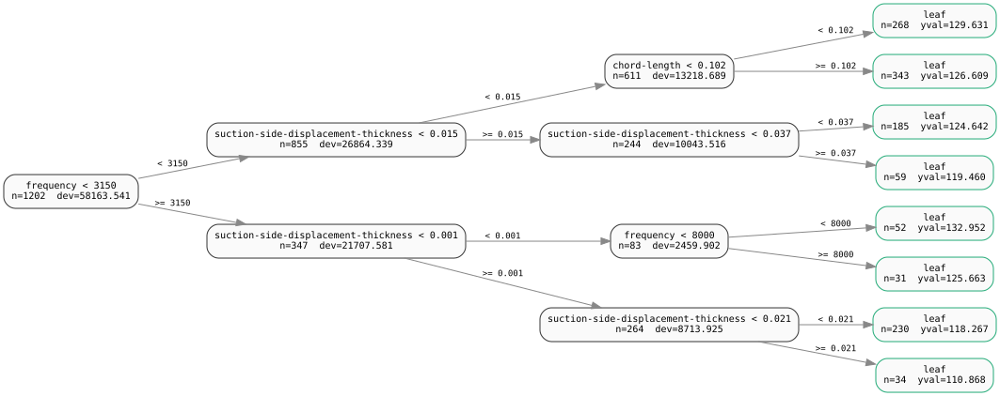
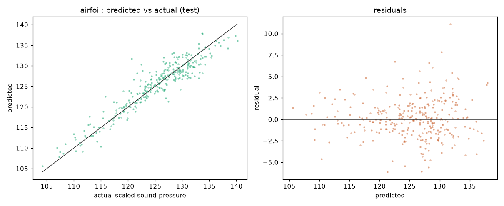
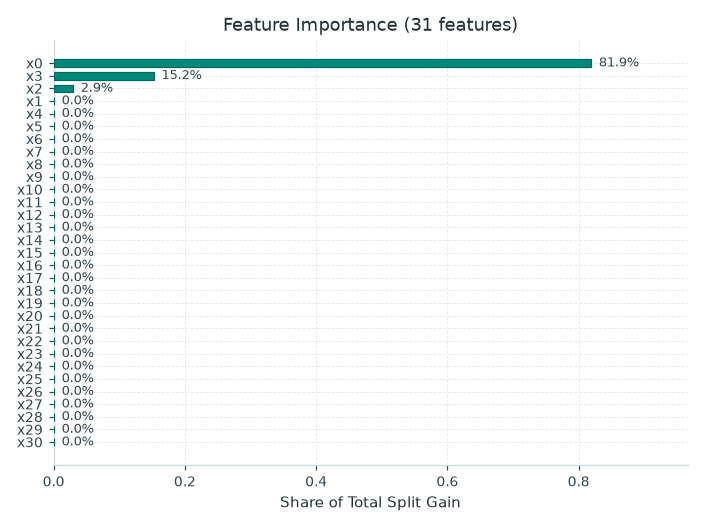
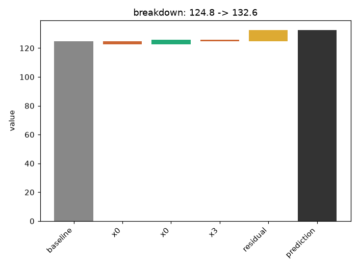
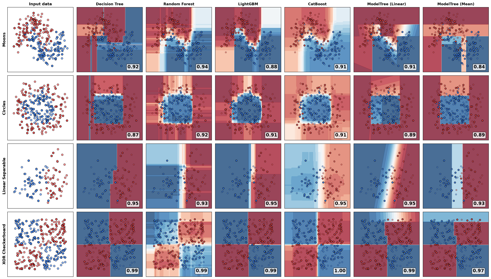
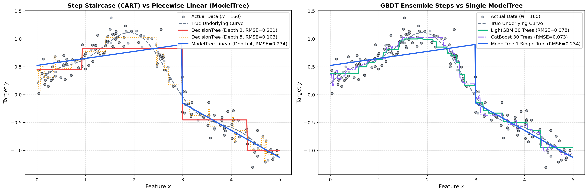
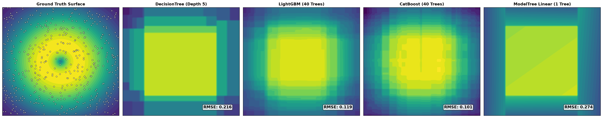

# Visualization — tree diagrams and diagnostic plots

The end-to-end picture: a real fit on
[`airfoil_self_noise`](../benchmarks/datasets.md) (1,503 rows, 5 numeric +
1 categorical), the tree drawn left-to-right, and the diagnostic +
explanation charts. Script:
[`examples/visualization.py`](https://github.com/jkapila/mltreelib/blob/main/examples/visualization.py)
(`uv run --with pandas --with pygraphviz --with matplotlib python examples/visualization.py`).
Every image here is click-to-zoom.

## The tree, depth 3 for readability

`max_depth=3, min_rows=30` — constrained for clarity, not score. Rectangles
test a numeric threshold, diamonds are leaves (fitted value + support):



*left-to-right (`rankdir=LR`): the split path reads as a sentence.*

## Diagnostics



## Explanation

Feature importance (share of total split gain) and the DALE-style breakdown
of one test row — baseline → per-column steps → prediction:




```text
tree diagram: docs/assets/airfoil_tree.svg (8 leaves, depth 3, rendered by graphviz)
diagnostics: docs/assets/airfoil_diagnostics.png
feature importance: docs/assets/airfoil_importance.png
breakdown of one test row: docs/assets/airfoil_breakdown.png
test rmse: 2.3
```

---

## Benchmark Comparisons (scikit-learn style)

Generated via `examples/plot_sklearn_comparisons.py` using `matplotlib`:

### 1. 2D Decision Boundaries — ModelTree vs CART, LightGBM, and CatBoost

Based on the canonical [scikit-learn Classifier Comparison](https://scikit-learn.org/stable/auto_examples/classification/plot_classifier_comparison.html) on Moons, Circles, and Linearly Separable datasets:



Unlike standard orthogonal axis-aligned step boxes from CART and GBDTs, `ModelTree(leaf="linear")` computes multivariate linear logits within each leaf, generating smooth oblique decision surfaces.

### 2. 1D Continuous Curve Approximation — Step Staircase vs Linear ModelTree

Based on the canonical [scikit-learn Tree Regression](https://scikit-learn.org/stable/auto_examples/tree/plot_tree_regression.html) benchmark:



### 3. 2D Continuous Surface Regression — Staircase Terraces vs Piecewise Planar Facets

Comparison on a non-linear 2D ripple function ($z = \frac{\sin(r)}{r + 0.4} \times 2.5$):



Where CART, LightGBM, and CatBoost are constrained to flat orthogonal step terraces, a single `ModelTree(leaf="linear")` fits local 2D planar gradients in each partitioned partition, capturing continuous curved topography with zero staircase artifacts.

---

## The chart layer

All fourteen chart functions (`mltreelib.plots`) are catalogued under
[API reference — Visualization](../reference/plots.md); the full metrics +
charts showcase is [Metrics & plots](metrics-plots.md).

**Examples — next: [Metrics & plots](metrics-plots.md)**
