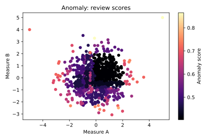
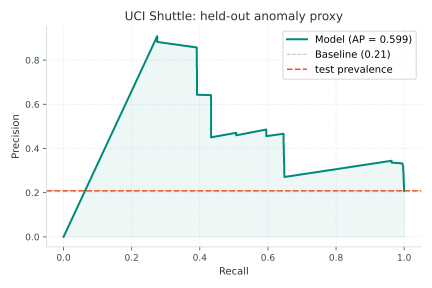

# Anomaly detection: a practical pathway

Rank records that deserve review. An unusual record is not automatically an error, fraud, or causal explanation.

**Path:** Define the decision → Prepare data → Fit a baseline → Evaluate → Inspect → Act and monitor.

## 1. Define the data and split

The model fits 2,000 synthetic reference observations and scores 1,002 later records. Two extreme points are deliberately inserted. Actual labels are unknown in ordinary deployments.

## 2. Fit and inspect a small example

This complete example uses the package and Python standard library. It uses synthetic data and a fixed seed. Run it from a Python environment with `mltreelib` installed.

```python
from random import Random
from mltreelib import AnomalyTree

rng = Random(44)
train = [[rng.gauss(0, 1), rng.gauss(0, 1)] for _ in range(2000)]
review = [[rng.gauss(0, 1), rng.gauss(0, 1)] for _ in range(1000)] + [[5., 5.], [-5., 4.]]
model = AnomalyTree(kind="eif", max_depth=8, extension_level=1, seed=44)
model.fit(train, col_names=["measure_a", "measure_b"])
scores = model.score_samples(review)
top = sorted(range(len(scores)), key=lambda i: scores[i], reverse=True)[:5]
print("anomaly top review indices:", top)
```

## 3. See the result



The figure comes from [`examples/modeling_pathways.py`](https://github.com/jkapila/mltreelib/blob/main/examples/modeling_pathways.py). Rendering the figures requires matplotlib. The example is a teaching illustration, not a benchmark.

## 4. Evaluate before deciding

`score_samples` returns higher anomaly scores for higher review priority in this example. Select the top records using review capacity and a threshold chosen on appropriate validation data. Check precision and recall when reviewed labels become available.

## 5. Interpret and monitor

Inspect the original record and its context. Track alert volume, reviewer outcomes and drift. Different `AnomalyTree` engines can produce different score distributions, so do not compare raw scores across engines without checking their meaning.

## 6. Work from a review budget

The [anomaly workflow](https://github.com/jkapila/mltreelib/blob/main/examples/anomaly_workflow.py) fits 2,000 reference observations and scores a separate batch of 1,100 records. The synthetic batch contains 100 planted anomalies. The example ranks the scores and selects 100 records for review.

```bash
uv run python examples/anomaly_workflow.py
```


With the fixed seed, 75 of the 100 selected records are planted anomalies. Precision at the review budget is 0.75, and recall of the planted anomalies is 0.75. The model's training contamination threshold flags 176 of the 1,100 review records. These numbers describe this synthetic run; they are not estimates of production accuracy.

In real data, the labels are not known for all cases. Record reviewer outcomes and measure precision among reviewed cases. Recall requires reliable labels for cases outside the review queue. Compare against a simple existing review rule and track changes over time.

## 7. Understand the facade

The following checks use `AnomalyTree` on small synthetic inputs. Scores are model-specific and are not probabilities. A higher score is the facade's stated anomaly ranking convention; check its usefulness for the chosen engine and data.

| `kind` | Checked interface | What to inspect |
|---|---|---|
| `eif` | Fit, `score_samples`, `predict`; mixed types in a small example | Rank and review capacity |
| `det` | Fit, scores, labels, and `predict_density`; mixed types in a small example | Density and score scale |
| `hst` | Fit, scores and labels on numeric inputs | Reference window and score behavior |
| `rct` | Fit, scores and labels on numeric inputs | Ranking and chosen review threshold |
| `active` | Fit, scores and labels on numeric inputs | Whether the ranking meets the task's needs |
| `context` | Fit on integer sequences | Scoring is not exposed through the facade in the checked version |

`contamination` selects a training-score cutoff. It is not a measured prevalence or a guarantee that the same proportion will be flagged in new data. Ties at the cutoff can also flag more records than the requested fraction. In a check with 20 identical rows and `contamination=0.1`, all 20 were flagged.

### Product gaps from the checks

- `hst`, `rct` and `active` convert `None` to zero before fitting and scoring. This conflicts with the package's missing-data goal.
- `context` fit succeeded, but `score_samples` raised an instruction to use `surprise_score`, which the facade does not expose. The active facade also exposes no feedback method in the checked version.
- A separate mixed-type check ran through `eif` and `det`, including raw category labels and missing values. That small check does not establish every missing or unseen-category contract.

These are product gaps, not instructions to impute data. Track input missingness, score distributions, alert volume, review outcomes and changes to the population.

## Real-data example

The [bank churn walkthrough](real-data.md) runs this workflow on a 10,000-row TabArena dataset with independent test rows.

## 8. Real labeled proxy: UCI Statlog Shuttle

The [UCI Statlog Shuttle dataset](https://archive.ics.uci.edu/dataset/148/statlog+shuttle) provides an official split of 43,500 training and 14,500 test records. For this anomaly proxy, class 1 is the reference class and classes 2–7 are treated as anomalies. These are operating-state labels, not reviewed anomaly incidents. The dataset documentation says the original time order was randomized.

Download the [UCI archive](https://archive.ics.uci.edu/static/public/148/statlog+shuttle.zip). The following commands require `curl`, `unzip`, and `uncompress`. The files are not committed to Git.

```bash
mkdir -p datasets/external/shuttle
curl -fL 'https://archive.ics.uci.edu/static/public/148/statlog+shuttle.zip' -o /tmp/mltreelib-shuttle.zip
unzip -p /tmp/mltreelib-shuttle.zip shuttle.tst > datasets/external/shuttle/shuttle.tst
unzip -p /tmp/mltreelib-shuttle.zip shuttle.trn.Z | uncompress -c > datasets/external/shuttle/shuttle.trn
```

Then run:

```bash
uv run python examples/anomaly_shuttle_evaluation.py
```

The script samples 5,000 class-1 training rows with seed 42, fits `AnomalyTree(kind="eif")`, and scores the supplied 14,500-row test set. It does not fit on test labels. At a fixed 5% review budget, it flags 725 rows, of which 648 have a non-class-1 label. Precision is 0.8938 and recall is 0.2144. Test prevalence is 0.2084, and average precision is 0.5988.



These results are for one model, reference sample and proxy label definition. They do not demonstrate production anomaly precision or compare against competing models. The provided split is randomized, not a time-ordered deployment test.

## Next steps and references

[Anomaly comparison](../examples/anomaly-comparison.md) · [Anomaly API](../reference/api/anomaly.md)

Continue with [data preparation](data.md), [evaluation and monitoring](evaluation.md), or [model extensions](advanced-modeling.md). The [practical modeling pathways](index.md) show the other tasks. For broader coverage, see the [documentation audit](https://github.com/jkapila/mltreelib/tree/main/references/research).
