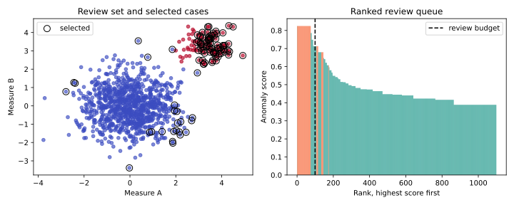

# Anomaly detection in Python: a Shuttle review queue

Use a fixed review budget to surface unusual operating states. The goal is a prioritized list of records an analyst can inspect.

## 1. Get the data and define the evaluation

The [UCI Statlog Shuttle dataset](https://archive.ics.uci.edu/dataset/148/statlog+shuttle) provides an official split of 43,500 training and 14,500 test records. For this anomaly proxy, class 1 is the reference class and classes 2–7 are treated as anomalies. These are operating-state labels, not reviewed anomaly incidents. The dataset documentation says the original time order was randomized.

Download the [UCI archive](https://archive.ics.uci.edu/static/public/148/statlog+shuttle.zip). The following commands require `curl`, `unzip`, and `uncompress`. The files are not committed to Git.

```bash
mkdir -p datasets/external/shuttle
curl -fL 'https://archive.ics.uci.edu/static/public/148/statlog+shuttle.zip' -o /tmp/mltreelib-shuttle.zip
unzip -p /tmp/mltreelib-shuttle.zip shuttle.tst > datasets/external/shuttle/shuttle.tst
unzip -p /tmp/mltreelib-shuttle.zip shuttle.trn.Z | uncompress -c > datasets/external/shuttle/shuttle.trn
```

Run the full study from the repository root.

```bash
uv run python examples/anomaly_shuttle_evaluation.py
```

## 2. Fit the reference and rank new rows

The official class labels identify operational states. Use class 1 to build the reference. Defer the test labels until scoring completes.

```python
from pathlib import Path
from random import Random

from mltreelib import AnomalyTree, Metrics

base = Path("datasets/external/shuttle")

def load(filename):
    with (base / filename).open() as f:
        records = [[float(value) for value in line.split()] for line in f if line.strip()]
    return [row[:-1] for row in records], [int(row[-1]) for row in records]

x_train, y_train = load("shuttle.trn")
x_test, y_test = load("shuttle.tst")
reference = [row for row, label in zip(x_train, y_train) if label == 1]
Random(42).shuffle(reference)
tree = AnomalyTree(kind="eif", max_depth=10, extension_level=1, seed=42)
tree.fit(reference[:5000], col_names=[f"sensor_{i + 1}" for i in range(9)])
scores = tree.score_samples(x_test)

budget = round(.05 * len(scores))
order = sorted(range(len(scores)), key=lambda i: (-scores[i], i))
truth = [int(label != 1) for label in y_test]
hits = sum(truth[i] for i in order[:budget])
print("precision / recall at budget", hits / budget, hits / sum(truth))
print("average precision", Metrics().pr_curve(truth, scores)["average_precision"])
```

The tie break preserves source order. Choose a tie policy that matches your queue rules. A score cutoff derived from the training sample can produce a different number of alerts after deployment. Use the rank budget when the review team has a fixed capacity.

## 3. Interpret the held-out results

The script samples 5,000 class-1 training rows with seed 42, fits `AnomalyTree(kind="eif")`, and scores the supplied 14,500-row test set. It does not fit on test labels. At a fixed 5% review budget, it flags 725 rows, of which 648 have a non-class-1 label. Precision is 0.8938 and recall is 0.2144. Test prevalence is 0.2084, and average precision is 0.5988.


These results are for one model, reference sample and proxy label definition. They do not demonstrate production anomaly precision or compare against competing models. The provided split is randomized, not a time-ordered deployment test.

## 4. Controlled check with synthetic truth

The [anomaly workflow](https://github.com/jkapila/mltreelib/blob/main/examples/anomaly_workflow.py) fits 2,000 reference observations and scores a separate batch of 1,100 records. The synthetic batch contains 100 planted anomalies. The example ranks the scores and selects 100 records for review.

```bash
uv run python examples/anomaly_workflow.py
```



With the fixed seed, 75 of the 100 selected records are planted anomalies. Precision at the review budget is 0.75, and recall of the planted anomalies is 0.75. The model's training contamination threshold flags 176 of the 1,100 review records. These numbers describe this synthetic run; they are not estimates of production accuracy.

In real data, the labels are not known for all cases. Record reviewer outcomes and measure precision among reviewed cases. Recall requires reliable labels for cases outside the review queue. Compare against a simple existing review rule and track changes over time.

## 5. Understand the facade

The following checks use `AnomalyTree` on small synthetic inputs. Scores are model-specific and are not probabilities. A higher score is the facade's stated anomaly ranking convention; check its usefulness for the chosen engine and data.

| `kind` | Checked interface | What to inspect |
|---|---|---|
| `eif` | Fit, `score_samples`, `predict`; mixed types in a small example | Rank and review capacity |
| `det` | Fit, scores, labels, and `predict_density`; mixed types in a small example | Density and score scale |
| `hst` | Fit, scores and labels on numeric inputs | Reference window and score behavior |
| `rct` | Fit, scores and labels on numeric inputs | Ranking and chosen review threshold |
| `active` | Fit, scores and labels on numeric inputs | Whether the ranking meets the task's needs |
| `context` | Fit on integer sequences | Scoring is not exposed through the facade in the checked version |

`contamination` selects a training-score cutoff. It is not a measured prevalence or a guarantee that the same proportion will be flagged in new data. Ties at the cutoff can also flag more records than the requested fraction. In a check with 20 identical rows and `contamination=0.1`, all 20 were flagged.

### Product gaps from the checks

- `hst`, `rct` and `active` convert `None` to zero before fitting and scoring. This conflicts with the package's missing-data goal.
- `context` fit succeeded, but `score_samples` raised an instruction to use `surprise_score`, which the facade does not expose. The active facade also exposes no feedback method in the checked version.
- A separate mixed-type check ran through `eif` and `det`, including raw category labels and missing values. That small check does not establish every missing or unseen-category contract.

These are product gaps, not instructions to impute data. Track input missingness, score distributions, alert volume, review outcomes and changes to the population.

## Next steps and references

[Anomaly comparison](../examples/anomaly-comparison.md) · [Anomaly API](../reference/api/anomaly.md)
