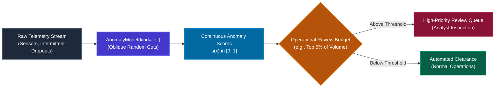

# Anomaly detection in Python: operational triage review queues

Use a fixed review budget to surface unusual operating states without synthetic imputation. The goal is a prioritized list of suspicious records an analyst can inspect within operational constraints.



---

## 1. Domain Context & The Ghost Anomaly Problem

Standard Isolation Forests construct trees by sampling orthogonal, axis-aligned cuts. On correlated or multi-modal feature distributions, axis-aligned splits produce artificial rectangular bands of low average path length, creating false-positive "ghost" anomalies in empty spaces between normal clusters.

`AnomalyModel(kind="eif")` implements **Extended Isolation Forest (EIF)**, sampling random oblique hyperplanes with uniformly distributed normal vectors. This achieves rotationally invariant scoring contours that isolate true anomalies without axis-aligned artifacts.


---

## 2. Fit the Reference Model and Score New Rows

You can evaluate on industrial telemetry using `load_dataset("APSFailure")` or the UCI Statlog Shuttle benchmark:

```python
from mltreelib import Metrics, load_dataset
from mltreelib import AnomalyModel

# 1. Load industrial sensor telemetry
data = load_dataset("APSFailure")
target = "AirPressureSystemFailure"
features = ["aa_000", "ab_000", "ac_000", "ad_000", "ae_000", "af_000"]
n_sample = 10000

y_raw = data["columns"][target][:n_sample]
y = [1 if v in ("pos", "1", 1) else 0 for v in y_raw]
X = [[data["columns"][c][i] for c in features] for i in range(n_sample)]

split = 7000
X_train = [X[i] for i in range(split) if y[i] == 0]  # Fit reference on normal operating states
X_test, y_test = X[split:], y[split:]

# 2. Fit Extended Isolation Forest (oblique cuts, depth=10)
tree = AnomalyModel(kind="eif", max_depth=10, extension_level=1, seed=42)
tree.fit(X_train, col_names=features)

# 3. Score held-out telemetry
scores = tree.predict(X_test, kind="score")

# 4. Allocate fixed 5% operational review budget
budget = round(0.05 * len(scores))
order = sorted(range(len(scores)), key=lambda i: (-scores[i], i))

hits = sum(y_test[i] for i in order[:budget])
total_anomalies = sum(y_test)
print(f"Review Budget Size : {budget} records (Top 5%)")
print(f"Precision at Budget: {hits / budget:.4f}")
print(f"Recall at Budget   : {hits / max(1, total_anomalies):.4f}")

metrics = Metrics()
print(f"ROC-AUC            : {metrics.roc_curve(y_test, scores)['auc']:.4f}")
```

`kind="binary"` returns labels from the fitted threshold, and `kind="score"` returns the same scores as `score_samples()`. The extended isolation tree and its aliases also expose `kind="path_length"`.

For a fitted EIF, `tree.save("anomalies.json")` stores the model and fitted threshold. Use `AnomalyModel.load("anomalies.json")` to restore scoring and labels. The [API reference](../reference/api/anomaly.md) lists the JSON and byte methods.

---

## 3. Understand the Anomaly Engine Family

`AnomalyModel` provides a unified interface across multiple tree-based anomaly engines:

| Engine (`kind`) | Core Mechanism | Best Used For |
|---|---|---|
| **`"eif"`** | Oblique random hyperplanes with uniform normals | Multi-modal, correlated continuous telemetry without ghost artifacts |
| **`"isolation"`** | Standard axis-aligned recursive bisection | Fast baseline on uncorrelated low-dimensional features |
| **`"det"`** | Density Estimation Trees (piecewise constant density) | Estimating exact probability density distributions |
| **`"hst"`** | Streaming Half-Space Trees with mass-based scoring | Online, real-time sliding window data streams |
| **`"rct"`** | Robust Random Cut Trees (co-displacement scoring) | Dynamic time-series streams with concept drift |
| **`"active"`** | Active learning tree with expert feedback loops | Human-in-the-loop analyst triage queues |

---

## Next Steps

- For unsupervised clustering with rule extraction, study **[Unsupervised Trees](clustering-trees.md)**.
- For missing sensor routing under telemetry dropouts, review **[Native Missing Data](missing-data-routing.md)**.
- See the full **[Anomaly API Reference](../reference/api/anomaly.md)**.
