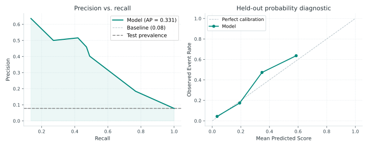

# Binary classification in Python: predict financial distress

Use the Give Me Some Credit dataset to estimate financial distress within two years. The tutorial fits a decision tree classifier, then uses validation data to decide which scores enter a review queue.

## 1. Get the data and define the decision

Download [OpenML 46929](https://www.openml.org/d/46929) to `datasets/GiveMeSomeCredit.parquet`. The target is `FinancialDistressNextTwoYears`. The published table has 150,000 labeled rows. This example uses a shuffled 12,000-row subset. Keep the last 2,000 sampled rows for the final report.

Use observed values as supplied. In the sample, monthly income and number of dependents can be missing. Pass them through to the tree. The input schema is numeric and needs no encoder.

## 2. Fit and choose a threshold

```python
import pandas as pd
from mltreelib import Metrics, ModelTree

df = pd.read_parquet("datasets/GiveMeSomeCredit.parquet")
df = df.sample(frac=1, random_state=2026).iloc[:12000]
target = "FinancialDistressNextTwoYears"
features = df.columns.drop(target).tolist()

def input_data(frame):
    x = [[None if pd.isna(v) else v for v in row]
         for row in frame[features].itertuples(index=False, name=None)]
    return x, (frame[target] == "Yes").astype(int).tolist()

x_train, y_train = input_data(df.iloc[:8000])
x_val, y_val = input_data(df.iloc[8000:10000])
x_test, y_test = input_data(df.iloc[10000:])

tree = ModelTree(leaf="mean", leaf_family="binomial", gain="deviance",
                 max_depth=3, min_rows=100, prune="none")
tree.fit(x_train, y_train, col_names=features, dtypes=["numeric"] * len(features))

val_scores = tree.predict_proba(x_val)
def cost(threshold):
    return sum(5 if y and p < threshold else 1 if not y and p >= threshold else 0
               for y, p in zip(y_val, val_scores))

threshold = min([.02, .05, .10, .20, .40, 1.01], key=cost)
scores = tree.predict_proba(x_test)
alerts = [int(score >= threshold) for score in scores]
print(Metrics().classification(y_test, alerts)["confusion"])
```

The costs are illustrative. A missed event costs five units and a false alert costs one. A threshold above 1 represents no alerts. The [full script](https://github.com/jkapila/mltreelib/blob/main/examples/real_tree_studies.py) also compares probability error with the training event rate.

```bash
uv run python examples/real_tree_studies.py credit
```



## 3. Read the result

The validation threshold was **0.20**. It flagged 159 of 2,000 test rows. Of the 155 observed distress events, 73 were flagged and 82 were missed. The remaining 86 alerts were false positives.

| Test metric | Tree | Reference |
|---|---:|---:|
| Average precision | 0.3310 | 0.0775 event prevalence |
| Brier score | 0.0577 | 0.0717 constant training rate |

The root uses revolving utilization. A later split uses the count of payments 60 to 89 days past due. The training sample contains 1,616 missing income values and 222 missing dependent counts.

Average precision measures how well the scores rank the positive cases. Compare it with test prevalence as a reference. Brier score measures squared probability error. Compare it with the constant training-rate model. The probability plot is a diagnostic. Review bin counts and treat sparsely populated bins with care.

## 4. Review the model before acting

Use `tree.splits()` to see the original feature names and `tree.leaves()` to check support. Evaluate calibration, decision cost and review volume on realistic future records. This random historical split demonstrates a workflow. An underwriting decision needs time-based validation, group analysis, documented data provenance and governance.

Read the [credit article](../blog/why-credit-scoring-needs-glass-box-trees.md) for a deeper walkthrough of explanation and threshold choice. Use the [evaluation guide](evaluation.md) for the differences between probability, ranking and decision metrics.
