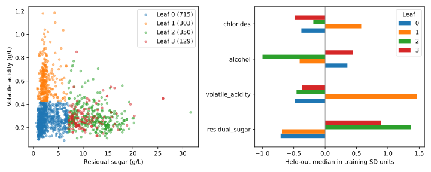
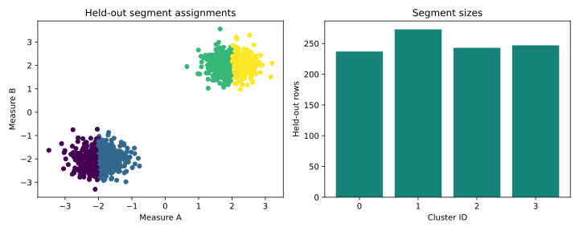

# Clustering in Python: profile wines by chemistry

Use a predictive clustering tree to group wines by measurements a lab can inspect. The output is a leaf ID, a rule and a profile. A lab could investigate an unexpected shift in the size of a segment across production batches.

## 1. Get the data and choose the features

Save [OpenML Wine Quality 46964](https://www.openml.org/d/46964) to `datasets/wine_quality.parquet`. The 6,497 records come from the [UCI Wine Quality collection](https://archive.ics.uci.edu/dataset/186/wine+quality). Use four numeric measurements. Keep `median_wine_quality` and `wine_color` out of fitting. Those columns can help interpret groups later.

PCT splits to reduce the variation of numeric features inside its leaves. The measurements have different units, so give them comparable scales using training means and standard deviations. Keep the original units for the report. Scaling is an explicit choice for this similarity objective.

## 2. Fit, assign and profile

Run this from the repository root. The second split supports a refit check. Assign the review records with both models before comparing them.

```python
import pandas as pd
from mltreelib.cluster import ClusterTree

df = pd.read_parquet("datasets/wine_quality.parquet").sample(frac=1, random_state=2026)
features = ["residual_sugar", "volatile_acidity", "alcohol", "chlorides"]
train, review = df.iloc[:2500], df.iloc[5000:].copy()
center = train[features].mean()
scale = train[features].std()

def design(frame):
    return ((frame[features] - center) / scale).to_numpy().tolist()

tree = ClusterTree(kind="pct", max_depth=2, min_rows=150)
tree.fit(design(train), col_names=features)
review["segment"] = tree.predict(design(review), kind="cluster")
print(review.groupby("segment")[features].median().round(3))
print(review["segment"].value_counts().sort_index())
print(tree.rules())
```

`labels_` stores the training assignments and `n_clusters_` gives the number of assigned clusters. The [full script](https://github.com/jkapila/mltreelib/blob/main/examples/guides/real_tree_studies.py) refits on the other 2,500 wines and draws the figure.

```bash
uv run python examples/guides/real_tree_studies.py wine
```



## 3. Read the profiles and check stability

| Leaf | Review rows | Median residual sugar (g/L) | Median volatile acidity (g/L) | Median alcohol (%) |
|---|---:|---:|---:|---:|
| 0 | 715 | 2.1 | 0.260 | 10.9 |
| 1 | 303 | 2.2 | 0.580 | 10.0 |
| 2 | 350 | 12.0 | 0.265 | 9.3 |
| 3 | 129 | 9.7 | 0.280 | 11.0 |

The two lower-sugar groups differ on acidity. The higher-sugar groups differ on alcohol. Pairwise Jaccard agreement on the 1,497 review wines was **0.841** after refitting at depth two on the second training sample. This is one check with a shared training scale.

A scatter plot only shows two of the four input features. Use the profile panel to see how the segments differ across the full feature list. It displays each segment's median in units of the training standard deviation. For a rule review, convert a standardized threshold back to lab units using `threshold * scale + center`.

Report pairwise Jaccard agreement after refitting. It counts pairs assigned together in both fits as a fraction of pairs assigned together in either fit. It avoids matching arbitrary leaf IDs and excludes the usually large number of pairs separated by both fits. This tests the stability of one partition with fixed scaling. Before using the groups operationally, repeat with independent batches and compare against a simpler lab rule.

## 4. Choose an engine through `ClusterTree`

The following observations are from a small numeric, two-group synthetic check. They establish the interface paths exercised, not comparative model quality.

| `kind` | Training and prediction output checked | `rules()` in that check |
|---|---|---|
| `pct` | Training labels and new-row labels | Conditions, prototypes and support |
| `cltree` | Labels can include `None` for unassigned rows | Bounding boxes and support |
| `hdbscan` | Training and new-row labels | Empty list |
| `urf` | Training and new-row labels | Empty list |

The sample check returned 8 PCT leaves, 3 CLTree groups plus unassigned points, 2 HDBSCAN groups, and a highly imbalanced URF assignment. These results depend on the data and settings. They do not rank the engines. Check whether a segment is stable and useful before assigning an action to it.

For URF, `tree.predict(x, kind="distances")` returns one row per query and one column per training row in fit order. Each distance is the square root of one minus the fraction of trees in which the two rows share a leaf.

For a fitted PCT, `tree.save("clusters.json")` stores the model, training assignments, and rules. Use `ClusterTree.load("clusters.json")` to restore the fitted tree. The [API reference](../reference/api/cluster.md) lists the JSON and byte methods.

### Missing values and categories: product gaps

The wrapper currently converts `None` to `0.0` for `cltree`, `hdbscan` and `urf` during fitting and prediction. This is implicit imputation and conflicts with the package's missing-data goal. Track it as a product gap. Do not assume those engines distinguish missing from a real zero. They also reject raw strings in the checked inputs.

PCT accepted raw categorical labels and missing numeric entries in a separate check. Its returned rules displayed category codes rather than the original labels. In that check, an unseen category and a missing category went to different leaves. Category-label rendering and unseen-category routing need further investigation before those rules become a business handoff.

For density and proximity methods, check scaling, distance choice and the meaning of an unassigned or noise label. For all kinds, test the actual new-row behavior and input schema that your workflow uses.

## 5. Run the controlled stability example

The [synthetic clustering workflow](https://github.com/jkapila/mltreelib/blob/main/examples/guides/clustering_workflow.py) lets you change the overlap between known generating groups. It uses 1,000 independent review rows and illustrates how a tree can split a single generating group into several leaves.



See [Blockeel et al. on predictive clustering](https://arxiv.org/abs/cs/0011030) and the [engine comparison](unsupervised-clustering-and-anomalies.md).
