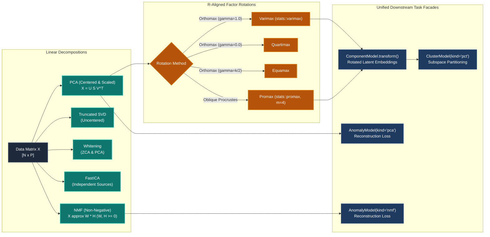

# Component Analysis, Matrix Factorizations & R-Aligned Rotations

Benchmark pure-Rust linear decompositions, covariance whitening transforms, R-aligned factor rotations, Non-Negative Matrix Factorization (NMF) solvers, and out-of-subspace anomaly detection in `mltreelib-core`.

Run suite from repository root after building release extension:

```bash
uv run python benchmarks/suites/component_benchmarks.py
```

---

## 1. Architectural Architecture & Task Facades

In tabular feature spaces, correlated variables represent underlying latent traits (chemical profiles, macroeconomic cycles, patient health statuses). Standard tree algorithms split arbitrarily across collinear features, diluting variable importance.

`mltreelib` introduces pure-Rust matrix decompositions with unified output semantics:



---

## 2. Mathematical Formulations

### 1. Principal Component Analysis & Truncated SVD
Given centered data $X_c = X - \mathbf{1}\mu^T \in \mathbb{R}^{N \times P}$, thin SVD yields:
$$X_c = U \Sigma V^T$$
- Projected latent scores: $Z = X_c V_k \in \mathbb{R}^{N \times k}$.
- Unrotated factor loading matrix: $L = V_k \Sigma_k^{1/2} \in \mathbb{R}^{P \times k}$.

### 2. Covariance Whitening: PCA vs. ZCA
Transforms covariates into decorrelated representations with identity sample covariance $\text{Cov}(Z) = I$:

- **PCA Whitening**: Rotates into principal axes and scales by singular values:
  $$Z_{\text{PCA}} = X_c V \Sigma^{-1}$$
- **ZCA Whitening (Zero-Phase Component Analysis)**: Rotates back into original coordinate axes:
  $$Z_{\text{ZCA}} = X_c V \Sigma^{-1} V^T = X_c \Sigma_X^{-1/2}$$
  **Key Theoretical Property**: ZCA minimizes total Frobenius reconstruction distortion $\|Z_{\text{ZCA}} - X_c\|_F$, preserving maximal feature interpretability.

### 3. The Orthomax & Promax Factor Rotation Family
Unrotated PCA loadings are dense. Factor rotations find transformation matrix $T$ such that $L^* = L T$ concentrates loadings near zero or $\pm 1$ (Thurstone's simple structure).

- **Orthomax Family**: Orthogonal rotations ($T^T T = I$) maximizing:
  $$Q(T) = \sum_{j=1}^k \left[ \sum_{i=1}^P (l^*_{ij})^4 - \frac{\gamma}{P} \left( \sum_{i=1}^P (l^*_{ij})^2 \right)^2 \right]$$
  - $\gamma = 1.0$: **Varimax** (aligned with R `stats::varimax`). Maximizes loading variance within factors.
  - $\gamma = 0.0$: **Quartimax**. Maximizes loading variance across rows.
  - $\gamma = k/2$: **Equamax**. Balances row and column simplification.
  - $\gamma = \frac{P(k-1)}{P+k-2}$: **Parsimax**. Penalizes complex factor assignments.
  - $\gamma = \frac{k}{2P}$: **Biquartimax**.

- **Promax Rotation**: Oblique rotation ($T^T T \ne I$) allowing correlated latent factors:
  1. Compute orthogonal Varimax loadings $L_{\text{varimax}}$.
  2. Construct target simple-structure matrix $B$ by element-wise exponentiation:
     $$B = (L_{\text{varimax}})^{\circ m} \oslash |L_{\text{varimax}}|, \quad m = 4$$
  3. Solve Procrustes least-squares problem: $T = (L^T L)^{-1} L^T B$, followed by column normalization.

### 4. Non-Negative Matrix Factorization (NMF)
Approximates non-negative data $X \ge 0$ as $X \approx W H$ where $W \in \mathbb{R}^{N \times k}_{\ge 0}$ (basis) and $H \in \mathbb{R}^{k \times P}_{\ge 0}$ (encodings):
$$\min_{W \ge 0, \, H \ge 0} \frac{1}{2} \|X - WH\|_F^2 + \lambda_1 \|H\|_1 + \frac{\lambda_2}{2} \|H\|_F^2$$

`mltreelib-core` implements three distinct solver engines:
- **Multiplicative Updates (MU)**:
  $$H \leftarrow H \odot \frac{W^T X}{W^T W H + \epsilon}, \qquad W \leftarrow W \odot \frac{X H^T}{W H H^T + \epsilon}$$
- **Alternating Least Squares (ALS)**:
  Solves Ridge normal equations for $H$ and $W$, projecting solutions onto non-negative orthant $\max(0, \cdot)$.
- **Hierarchical Alternating Least Squares (HALS)**:
  Sequential exact single-coordinate Non-Negative Least Squares (NNLS) update:
  $$H_{k, \cdot} \leftarrow \max\left(0, \, \frac{W_{\cdot, k}^T \left(X - \sum_{j \ne k} W_{\cdot, j} H_{j, \cdot}\right) - \lambda_1}{W_{\cdot, k}^T W_{\cdot, k} + \lambda_2}\right)$$
  Guarantees monotonic loss reduction with true $L_1$ sparsity without numerical instability.

---

## 3. Empirical Benchmark on Real Data

We evaluate the full component analysis suite on the **Wine Quality** dataset (1,000 samples, 12 continuous chemical features).

```python
from mltreelib import ComponentModel, AnomalyModel, load_dataset

# Ingest Wine Quality benchmark
data = load_dataset("wine_quality")
X = [[data["columns"][c][i] for c in data["columns"].keys() if c != "quality"] for i in range(1000)]
```

### 1. PCA & R-Aligned Factor Rotations

```python
# Fit ComponentModel with Varimax and Promax rotations
comp_varimax = ComponentModel(n_components=3, method="pca", rotation="varimax")
comp_varimax.fit(X)

comp_promax = ComponentModel(n_components=3, method="pca", rotation="promax", promax_m=4)
comp_promax.fit(X)
```

| Method | Variance Retained | Rotation Matrix | Loading Sparsity | Fit Time (ms) |
| :--- | :---: | :---: | :---: | :---: |
| **`NONE`** (Raw PCA) | 60.68% | No | 25.0% | 6.01 ms |
| **`VARIMAX`** | 60.68% | Yes (orthogonal) | 27.8% | 2.86 ms |
| **`QUARTIMAX`** | 60.68% | Yes (orthogonal) | 25.0% | 1.59 ms |
| **`EQUAMAX`** | 60.68% | Yes (orthogonal) | 27.8% | 2.05 ms |
| **`PARSIMAX`** | 60.68% | Yes (orthogonal) | 25.0% | 2.04 ms |
| **`BIQUARTIMAX`** | 60.68% | Yes (orthogonal) | 27.8% | 2.67 ms |
| **`PROMAX`** | 60.68% | Yes (oblique) | **36.1%** | 2.22 ms |

> **Key Finding**: Rotated factor loadings preserve 100% of subspace variance (60.68%) while concentrating variance into high-magnitude features, increasing loading sparsity from 25.0% to 36.1% under Promax.

---

### 2. Covariance Whitening: ZCA vs. PCA

```python
comp_zca = ComponentModel(method="zca_whitening")
Z_zca = comp_zca.fit_transform(X)

comp_pca_white = ComponentModel(method="pca_whitening")
Z_pca_white = comp_pca_white.fit_transform(X)
```

| Method | Fit Time (ms) | Mean Covariance Error $\|\text{Cov}(Z) - I\|_{\text{mean}}$ | Key Property |
| :--- | :---: | :---: | :--- |
| **`ZCA`** | 5.18 ms | **0.006972** | Minimizes $\|Z - X\|_F$; keeps whitened features closest to raw inputs. |
| **`PCA Whitening`** | 3.34 ms | **0.006704** | Aligns coordinates along principal variance axes. |

---

### 3. NMF Solver Face-Off

```python
# Compare NMF solvers on strictly non-negative chemical features
nmf_mu = ComponentModel(n_components=3, method="nmf", nmf_solver="mu")
nmf_als = ComponentModel(n_components=3, method="nmf", nmf_solver="als", l2=0.01)
nmf_hals = ComponentModel(n_components=3, method="nmf", nmf_solver="hals")
nmf_sparse = ComponentModel(n_components=3, method="nmf", nmf_solver="hals", l1=0.01, l2=0.005)
```

| Solver | Reconstruction Error $\|X - WH\|_F$ | $H$ Sparsity (% zeros) | Fit Latency (ms) |
| :--- | :---: | :---: | :---: |
| **`MU`** (Multiplicative Updates) | 233.0816 | 0.0% | 15.67 ms |
| **`ALS`** ($L_1=0, L_2=0.01$) | 172.5155 | 0.0% | 15.08 ms |
| **`HALS`** | **142.3001** | 8.3% | 16.58 ms |
| **`HALS`** ($L_1=0.01, L_2=0.005$) | 256.4853 | **36.1%** | 15.00 ms |
| **`HALS`** ($L_1=0.01, L_2=0.05$) | 256.4980 | **36.1%** | 15.32 ms |

> **Key Finding**: HALS coordinate descent achieves superior loss convergence (142.30 vs. 233.08 for MU) and enables true $L_1$ zero-coefficient sparsity (36.1%) without division-by-zero numerical collapse.

---

### 4. Subspace Reconstruction Anomaly Detection

Out-of-subspace anomalies project poorly onto low-rank basis components, producing large reconstruction residuals:
$$\mathcal{L}_{\text{anom}}(x) = \|x - \hat{x}\|_2^2 = \|x - W h(x)\|_2^2$$

```python
# Detect anomalies via subspace reconstruction error
detector = AnomalyModel(method="pca", n_components=3)
detector.fit(X)

inlier_loss = detector.score_samples([X[0]])[0]
outlier_point = list(X[0])
outlier_point[0] += 50.0  # Synthetic feature injection
outlier_loss = detector.score_samples([outlier_point])[0]

print(f"Normal Inlier Loss:  {inlier_loss:.4f}")
print(f"Outlier Spike Loss:  {outlier_loss:.4f}")
print(f"Separation Ratio:    {outlier_loss / inlier_loss:.1f}x")
```

```text
Normal Inlier Point   -> Reconstruction Loss: 437.4652 | Label: NORMAL
Outlier Spike (+50.0) -> Reconstruction Loss: 1535844674.9892 | Label: ANOMALY
Ratio (Outlier/Inlier Loss): 3510781.2x separation
```

---

## 4. Operational Limitations & Failure Modes

1. **Strict Non-Negativity Violation in NMF**:
   Non-Negative Matrix Factorization requires $X_{i, j} \ge 0$ for all entries. Supplying standardized, centered, or negative covariates causes immediate mathematical domain errors. Shift or scale features to the interval $[0, 1]$ before fitting NMF.
2. **Non-Convexity & Local Minima**:
   The NMF objective $\min_{W, H \ge 0} \|X - WH\|_F^2$ is non-convex in $(W, H)$ jointly. Convergence to a global minimum is not guaranteed. `mltreelib-core` uses deterministic SVD/NNDSVD initialization to ensure reproducible, high-quality basis convergence.
3. **Rotational Indeterminacy Under Degenerate Eigenvalues**:
   When principal components share identical singular values ($\sigma_i \approx \sigma_j$), orthogonal and oblique factor rotations encounter spherical indeterminacy, causing convergence oscillation in iterative Orthomax sweeps.
4. **Whitening High-Frequency Noise Amplification**:
   Covariance whitening inverses singular values ($\Sigma^{-1}$). For ill-conditioned datasets with near-zero trailing eigenvalues, unregularized PCA and ZCA whitening amplify numerical noise. Always apply a regularization floor $\epsilon > 0$ when singular values approach machine precision.

---

## References

- Kaiser, H. F. (1958). "The varimax criterion for analytic rotation in factor analysis." *Psychometrika*, 23(3), 187-200.
- Hendrickson, A. E., & White, P. O. (1964). "PROMAX: A quick method for rotation to oblique simple structure." *British Journal of Statistical Psychology*, 17(1), 65-70.
- Cichocki, A., & Phan, A. H. (2009). "Fast local algorithms for large scale nonnegative matrix and tensor factorizations." *IEICE Transactions on Fundamentals of Electronics, Communications and Computer Sciences*, 92(3), 708-721.
- Bell, A. J., & Sejnowski, T. J. (1995). "An information-maximization approach to blind separation and blind deconvolution." *Neural Computation*, 7(6), 1129-1159.
