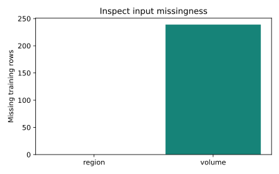

# Prepare data for modeling

**Path:** Define the prediction time → Split rows → Inspect types and missingness → Fit transformations on training data → Apply the same schema to new data.

| Decision | Check |
|---|---|
| Split | Keep future observations, customers or groups out of training when they define the deployment setting. |
| Numeric | Check units, impossible values, missingness and whether scaling is appropriate for the chosen model. |
| Categorical | Preserve the distinction between labels and ordered numeric measurements. Fit any mapping on training data. |
| Target | Exclude the outcome and features that become available only after the prediction time. |
| New data | Preserve column order, names, types and the fitted mapping. Test unknown levels and missing values. |

## Example: native categories and missing predictors


`ModelTree` accepts categorical labels and missing predictors without a separate encoder or imputation step. Declare the feature types and preserve the same column order at prediction time.

<!-- run -->
```python
from mltreelib import ModelTree

x = [["north", 1.0], ["north", None], ["south", 1.0], ["south", None]] * 10
y = [1.0, 2.0, 9.0, 10.0] * 10
model = ModelTree(max_depth=2, min_rows=4, leaf="mean")
model.fit(x, y, dtypes=["categorical", "numeric"],
          col_names=["region", "amount"])
print(model.predict([["north", None], ["south", None]]))
print(model.splits())
```

<!-- output -->
```text
[1.5, 9.5]
[{'col': 'region', 'threshold': 0.0, 'missing_left': True, 'gain': 640.0}]
```

Use a separate encoder only when another downstream workflow needs it. If you use one, fit it on training data only.

## Inspect before fitting

The [data and metrics example](https://github.com/jkapila/mltreelib/blob/main/examples/guides/data_metrics_pathway.py) creates a synthetic mixed dataset and splits it into training, validation and test rows. It counts missing values on the training rows before fitting. It passes the original categorical labels and missing numeric entries directly to both models.



For the fixed seed, 239 of 2,000 training rows have a missing `volume`. The chart shows where to investigate collection and data quality. It does not imply that those values need imputation. Also check missingness by source, group and time when those fields are available.

```bash
uv run python examples/guides/data_metrics_pathway.py
```

The example requires matplotlib to render the charts. Graphviz is optional for rendering the tree. The package plotting extra installs the chart dependencies; Graphviz also requires its system executable.

## Choose the preparation

Use native categorical inputs for `ModelTree`. Use an encoder when the downstream estimator requires it. Target-based encoders need leakage-safe training representations and an independently fitted evaluation pipeline. Missing-value behavior varies by operation. Test missing predictors, targets and unknown categories for the exact estimator before deployment.

- [Missing routing](data-matrix-and-routing.md) explains `ModelTree` routing.
- [Categorical encoders](data-matrix-and-routing.md) explains training leakage.
- [Data processing](data-matrix-and-routing.md) shows typed ingestion, summaries and time features.
- [Time series forecasting](timeseries-forecasting.md) shows prior-day features and a time split.
- [Data API](../reference/data.md) catalogs builders, encoders and transforms.

## What remains

The existing references do not yet give a checked missing and unseen-value matrix for every model and encoder. They also need a single end-to-end example that carries a fitted schema through deployment. In a checked two-category example, an unseen category routed differently from a missing value. This conflicts with the stated unseen-as-missing contract and is recorded as a product gap for investigation. A checked `IndexMapper` maps an unseen label to missing. In a separate check, `OneHotEncoder` mapped missing and unseen labels to all-zero vectors, `CountEncoder` mapped them to missing and zero respectively, and `TargetEncoder` mapped them to missing and the fitted prior.
