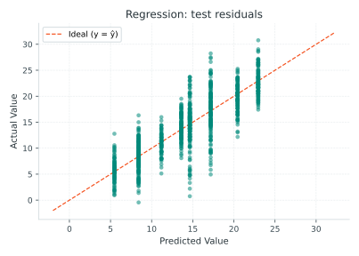
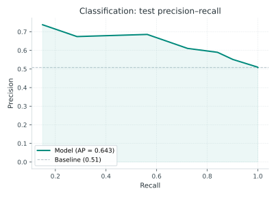
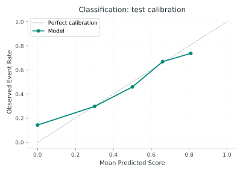
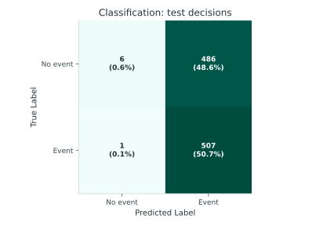
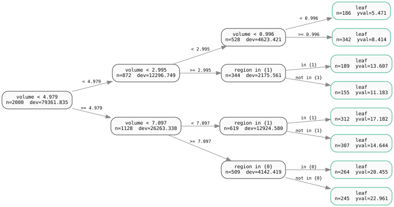
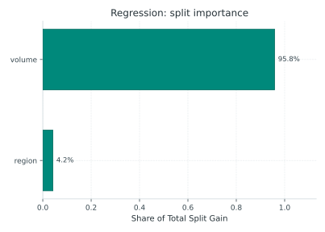

# Evaluate and monitor a model

**Path:** Choose a baseline → Choose the split → Select metrics and costs → Tune on validation data → Report once on test data → Monitor outcomes and drift.

| Task | Start with | Also check |
|---|---|---|
| Regression | MAE and RMSE against a mean or operational baseline | Residuals, large errors, segments, time periods |
| Classification | Confusion matrix and precision/recall at a chosen threshold | Probability calibration, PR curve, costs, subgroup outcomes |
| Clustering | Segment sizes, profiles and stability | Out-of-sample assignment, usefulness and sensitivity to scaling |
| Anomaly | Reviewed precision at a fixed review budget | Score drift, alert volume, missed cases when labels are available |
| Survival | Censoring-aware discrimination and calibration | Risk sets and reliability at the chosen horizon |
| Uplift | Randomized held-out policy value | Arm counts, uncertainty, cost and overlap |

## A complete held-out example

The [data and metrics example](https://github.com/jkapila/mltreelib/blob/main/examples/guides/data_metrics_pathway.py) uses the same raw mixed inputs for regression and classification. It generates 4,000 synthetic rows with a fixed seed: 2,000 for training, 1,000 for validation and 1,000 for test. It uses raw category labels and missing numeric values without encoding or imputation.

```bash
uv run python examples/guides/data_metrics_pathway.py
```

### Regression: compare with a baseline

The script compares test MAE with a constant equal to the **training** outcome mean. Its numbers describe its own generated sample, so run it to see them. Use residual plots to look for error patterns rather than relying only on an average.



### Classification: ranking, calibration and decisions

The script chooses among four thresholds on validation data, using an illustrative cost that assigns three units to a missed event and one unit to a false alert. Run it for its selected threshold and test confusion matrix. The block below checks calibration on seeded synthetic data.



A precision–recall curve shows the tradeoff as the score threshold changes. Compare it with the positive event rate and the capacity of the review team. It does not establish calibration.



Calibration compares predicted probabilities with observed event frequencies in bins. Small bins make the plot unstable. The 1,000 test rows come from a synthetic distribution; the plot alone does not establish calibration in production.

Use `IsotonicCalibrator` to fit a monotone mapping for binary event probabilities.
Fit the mapping on validation or out-of-fold probabilities. Compare Brier scores on independent test rows. On this seeded sample the calibrated test Brier score is 0.1933, against 0.1946 for the raw probabilities: a small difference on 1,000 rows.

<!-- run -->
```python
import numpy as np
from mltreelib import Metrics, ModelTree
from mltreelib.calibration import IsotonicCalibrator

rng = np.random.default_rng(7)
X = rng.normal(size=(4000, 4))
p_true = 1 / (1 + np.exp(-(1.5 * X[:, 0] - X[:, 1])))
y = (rng.uniform(size=4000) < p_true).astype(int).tolist()
X = X.tolist()
X_train, y_train = X[:2000], y[:2000]
X_val, y_val = X[2000:3000], y[2000:3000]
X_test, y_test = X[3000:], y[3000:]

model = ModelTree(leaf="mean", leaf_family="binomial", gain="deviance",
                  max_depth=3, min_rows=50, prune="none")
model.fit(X_train, y_train, dtypes=["numeric"] * 4)

calibrator = IsotonicCalibrator.fit(y_val, model.predict_proba(X_val))
raw = model.predict_proba(X_test)
calibrated = calibrator.predict(raw)
metrics = Metrics()
print(metrics.brier_score(y_test, raw), metrics.brier_score(y_test, calibrated))
```

<!-- output -->
```text
0.19456565411850799 0.1932642638524234
```



The confusion matrix describes decisions at one chosen threshold. Change the cost assumptions or capacity and repeat threshold selection on validation data. Keep the test set independent of that selection.

### Inspect the tree



The tree is rendered from `ModelTree.to_dot()`. Node conditions describe the fitted partitions. Check feature names, missing routing and leaf support before using them in a report. Categorical conditions can display internal codes, so check their meaning before sharing a rule. A prediction path does not establish the effect of an intervention.



Split importance summarizes gain used by the fitted tree. It is not a causal effect and does not measure every source of predictive value. The [visualization guide](visualization.md) shows how to select and render each view.

## What remains

The current metrics guide catalogs many report functions, but it does not provide a complete task-by-task evaluation workflow. Survival, uplift, clustering and anomaly examples still need validated task-specific evaluation and uncertainty examples. Check the API before assuming that a recommended metric is implemented by this package.

[Metrics and plots](metrics-plots.md) · [Metrics reference](../reference/metrics.md) · [Model pathways](index.md)
