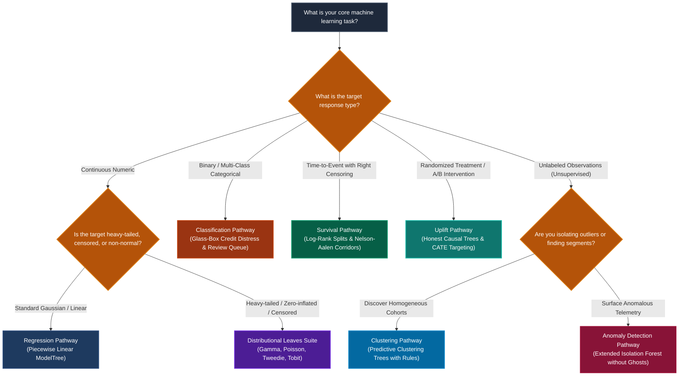

# Practical modeling pathways

Start with a decision. Each pathway uses a real cited dataset, shows the complete fitting code, reads empirical metrics against baseline benchmarks, and provides transparent decision inspection.

| Decision | Path | Dataset | What to check |
|---|---|---|---|
| Estimate a price | [Regression](regression.md) | OpenML diamonds | Test errors and residuals |
| Predict financial distress | [Classification](classification.md) | Give Me Some Credit | Ranking, probability and threshold cost |
| Group wine by chemistry | [Clustering](clustering.md) | UCI Wine Quality via OpenML | Leaf profiles and refit stability |
| Prioritize unusual readings | [Anomaly detection](anomaly.md) | Scania APS Failure / Shuttle | Precision at a fixed review budget |
| Estimate survival over time | [Survival](survival.md) | FLCHAIN | Censoring-aware error by horizon |
| Decide who gets an email | [Uplift](uplift.md) | Hillstrom experiment | Policy value against treat-all and treat-none |

## How to use the documentation

1. **Run one pathway.** Get its dataset and follow the analysis from split through evaluation.
2. **Change one part.** The [example library](../examples/index.md) covers missing routing, alternative leaves, calibration diagnostics, retraining and other focused variations.
3. **Review the decision.** Use the [evaluation guide](evaluation.md), [visualization catalog](visualization.md) and [serving contract](serving-contract.md).

The [dataset setup page](real-data.md) lists the downloads. Synthetic checks sit after the practical workflows. They make known effects and missing-data behavior easier to test.
